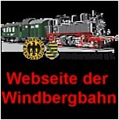
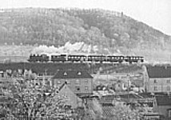
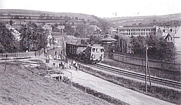
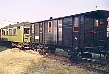
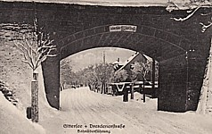
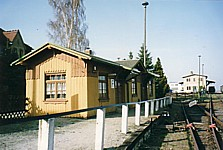
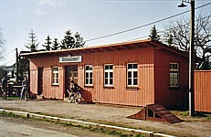

* * *

* * *

Die Windbergbahn entstand als “Hänichener Kohlenzweigbahn” im
Zusammenhang mit der Entstehung der Steinkohlegruben im Revier Burgk - Gittersee - Hänichen. Um den Abtransport der geförderten Kohle zu erleichtern,
planten die Besitzer der Schächte den Bau einer Zweigstrecke zur 1855 im Plauenschen Grund eröffneten [Albertbahn](../../../sud/plauen/plauenscher_grund/albertbahn/). Diese war auf private Initiative einiger
Grubenbesitzer angelegt worden und sollte über Nebenstrecken die Schächte in Gittersee/Hänichen und Zauckerode/Niederhermsdorf an das Staatsbahnnetz
anschließen. Obwohl das schwierige Gelände einen Eisenbahnbau fast unmöglich zu machen schien, gelang es dem Ingenieur Guido Brescius 1854 einen Entwurf
vorzustellen, der eine Streckenführung ohne größere kostspielige Kunstbauten erlaubte und den Betrieb mit normalen
Dampflokomotiven ermöglichte. Bereits im Juli 1855 begannen die Bauarbeiten, so dass die Strecke am 21. 10. 1856
übergeben werden konnte. Anschlussbahnen führten von der Hauptstrecke zum Moritz- und Meiselschacht in Gittersee, zum Windbergschacht und weiteren Schachtanlagen des Reviers.

Obwohl die Bahn hauptsächlich dem Kohletransport diente, wurden ab 1857 auch
Züge mit Aussichtswaggons eingesetzt, die sich an den Wochenenden zu einer Touristenattraktion entwickelten. Da es an speziellen Personenwagen mangelte, wurden einfach Bänke in die zuvor
gereinigten Kohlenwaggons gestellt und diese mit Girlanden und Birkenreisern geschmückt. Gelegentlich fuhr sogar eine Blaskapelle im Zug mit. Erst drei Jahre nach Übernahme der Windbergbahn durch den
sächsischen Staat am 1. Juli 1868 endeten diese Fahrten. Obwohl der Steinkohlebergbau um 1900 zurückging und schließlich völlig eingestellt
wurde, behielt die Bahn ihre Bedeutung für den Güterverkehr. 1907/08 wurde die Strecke deshalb für den regulären
Personen- und Güterverkehr umgebaut und bis nach Possendorf verlängert. In diesem Zusammenhang entstand auch der noch heute gebräuchliche Name Windbergbahn. Bis nach dem Zweiten Weltkrieg blieb sie wichtige
Verkehrsverbindung zwischen den Orten Possendorf, Hänichen, Gittersee und Birkigt und dem Dresdner Hauptbahnhof. Die historischen Fotos zeigen einen typischen Windbergbahn-Personenzug vor dem namengebenden
Windberg und einen Güterzug in der Nähe der Coschützer Straße in Freital-Birkigt.

Materialmangel und die Bindung von Baukapazitäten für den geplanten Ausbau des Berliner Außenringes führten zur
Einstellung des Bahnbetriebes zwischen Possendorf und Kleinnaundorf am 20. April 1951. Die verbliebene Reststrecke wurde noch bis zum 10. November 1957 von Personenzügen befahren
. Den Abschnitt zwischen Gittersee und Kleinnaundorf baute man daraufhin ebenfalls ab. Bis 1993 verkehrten noch regelmäßig Güterzüge von Birkigt bis zum
Bahnhof Obergittersee, wo ein Anschluss auf das Gelände des Wismut-Schachtes bestand.

Wegen ihrer historischen Bedeutung wurde die Windbergbahn mit ihren Anlagen und Bauten bereits 1980 unter Denkmalschutz gestellt. Für die Erhaltung der Bahn
engagiert sich ein Verein, der künftig auch wieder Museumsfahrten, u. a. mit dem letzten erhaltenen Windbergbahn-Aussichtswagen _(Foto)_, durchführen will. Leider
musste die Strecke am 1. November 1998 wegen baulicher Schäden gesperrt werden. Die von der Deutschen Bahn 2002 vorgesehene Stilllegung wurde jedoch
vom Eisenbahnbundesamt abgelehnt. Nach mehrjährigen Verhandlungen konnte am 22. Dezember 2008 zwischen der DB Netz AG und dem Windbergbahn e.V. ein Pachtvertrag abgeschlossen werden, der die Zukunft der Bahn sichert. Im
Herbst 2010 erhielt der Verein zudem die Konzession zum Betrieb der Strecke für 50 Jahre. Seitdem laufen Arbeiten, um die Strecke schrittweise wieder befahrbar zu machen.

Ihren Ausgangspunkt nimmt die Windbergbahn in Freital-Birkigt, wo sie von
der Hauptstrecke Dresden - Chemnitz abzweigt. Das Dienstgebäude mit Wasserstation und Wartesaal entstand 1912. In zahlreichen Kehren führt die Strecke am Birkigter Hang hinauf bis nach Obergittersee und überwindet
dabei auf ca. 5,4 km Streckenlänge einen Höhenunterschied von 120 Metern. Brücken überqueren die Coschützer Straße, die Karlsruher Straße sowie den
Kesselgrund. Das Foto (rechts) zeigt die 1965 abgetragene und durch eine Stahlträgerbrücke ersetzte Bahnbrücke über die [Karlsruher Straße](../../../sud/gittersee/strassen_gittersee/karlsruher_strasse/).

Der Endpunkt der Windbergbahn befindet sich heute in Obergittersee. Das historische Empfangsgebäude an der Hermann-Michel-Straße wurde von den Mitgliedern des Traditionsvereins Windbergbahn mittlerweile wieder in den
Ursprungszustand von 1916 zurückversetzt. Die Station besaß neben Wartehalle, Gepäck- und Dienstraum seit 1920
auch einen massiven Güterschuppen mit Ladestraße. Unmittelbar hinter diesem Bahnhof endet heute die Bahn. Ihr
weiterer Verlauf ist jedoch durch den zum größten Teil erhaltenen Bahndamm und verschiedene Bahngebäude noch gut erkennbar. Einige davon wurden in den letzten Jahren historisch getreu wiederhergestellt.

**_Fotos:_** _Der Endpunkt der Windbergbahn in Obergittersee (links)_

_und der ehem. Haltepunkt Kleinnaundorf (rechts)_

* * *

 \[ [Home](../../../index.html)\] \[ [Nord](../../../nord/)\] \[ [Nordwest](../../../nordwest/)\] \[ [Neustadt](../../../neustadt/)\] \[ [Nordost](../../../nordost/)\] \[ [West](../../../west/)\] \[ [Zentrum](../../../zentrum/)\] \[ [Südwest](../../../sudwest/)\] \[ [Süd](../../../sud/)\] \[ [Südost](../../../sudost/)\] \[ [Ost](../../../ost/)\] \[ [Register](../../../Register/register.html)\] \[ [Kontakt](../../../Kontakt/kontakt.html)\] \[ [Impressum](../../../impressum/)\]
