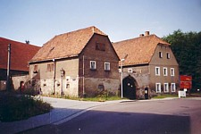
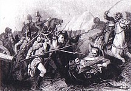
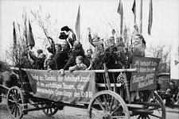
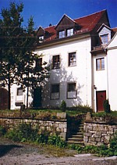

* * *

**Gemeindesiegel von Kaitz**

* * *

* * *

**Schulen in Kaitz**

* * *

**Vereine in Kaitz**

Der Bauernweiler Kaitz wurde am 31. März 1206 gemeinsam mit Dresden und anderen Ortschaften erstmals als Kiz (altsorbisch: Haus, Hütte) genannt und erstreckt sich zu beiden Seiten des [Kaitzbachtales](../../sud/kaitz/kaitzbachtal/). Andere Deutungen leiten den Namen vom slawischen Kyi (= Keule, Knüppel) oder dem Namen des Stammesältesten ab. Gegründet von sorbischen Siedlern gab es hier bereits frühzeitig einen Herrenhof, dessen Besitzer vom Markgrafen zu Meißen belehnt worden war. Außerdem besaßen Dresdner Bürger, 1408 u. a. die bedeutende Ratsherrenfamilie Busmann Anteile am Dorf. 1445 lebten in Kaitz fünf Bauern mit ihren Familien. 1473 ist ein Steinbruch bei Kaitz erwähnt, in dem im 18. Jahrhundert u.a. Baumaterial für den Bau des Altstädter Rathauses gewonnen wurde. Wichtigster Erwerbszweig war jedoch die Landwirtschaft. Außerdem befanden sich an den Hängen des Kaitzbachtales Weinberge, an die noch ein altes [Winzerhaus](../../sud/kaitz/strassen_kaitz/) von 1686 erinnert. Noch bis ins 16. Jahrhundert war der Ort dem Meißner Hochstift abgabenpflichtig. Kirchlich gehörte Kaitz zur Frauenkirche, ab 1674 zur Kirche von Leubnitz.

1646 erwarb der Hauptsalzkassenverwalter Martin Lehmann ein größeres Kaitzer Bauerngut und erweiterte dadurch seinen Besitz in Kaitz, der bereits aus einer von insgesamt vier Wassermühlen bestand. 1667 überließ ihm Kurfürst Johann Georg II. auch die Rechte über vier Amtsuntertanen, womit fast der gesamte Ort in eine Hand kam. Das Herrschaftsgut Kaitz erhielt 1672 den Status eines [Erb- und Allodialgutes](../../Sud/Kaitz/Strassen_Kaitz/Altkaitz/altkaitz.html) und war bis 1920 als Amtslehngut selbstständiger Gutsbezirk mit einer Gesamtfläche von 111 Hektar. Lediglich zwei Hektar Land blieben in bäuerlichem Besitz. Zur Bewirtschaftung der ausgedehnten Flächen wurden Tagelöhner herangezogen, für die um 1670 Wohnhäuser an der [Possendorfer Straße](../../Sud/Kaitz/Strassen_Kaitz/Possendorfer Straße/possendorfer_strasse.html) entstanden. Ein besonderes Privileg besaßen die Kaitzer Bäcker, die ab 1670 in Dresden Brot- und Mehlhandel betreiben durften. 1760 erwarb der Dresdner Bürgermeister Karl Gustav Strauch das Lehngut, dessen bürgerliche Besitzer mehrfach wechselten.

Schwer getroffen wurde Kaitz während der [Schlacht bei Dresden](../../sud/racknitz/schlacht_bei_dresden/) 1813\. Damals besetzte Napoleons 45. Division am 23. August eine Verteidigungsstellung nahe des Dorfes, wurde jedoch wenig später von der "Böhmischen Armee" der Verbündeten vertrieben. Drei Tage später begann mit einem Angriff auf Dresden die eigentliche Schlacht, die mit dem letzten Sieg Napoleons auf deutschem Boden endete. Obwohl Kaitz nicht unmittelbar im Kampfgebiet lag, kam es zu erheblichen Schäden im Ort. Zudem wurden auf der noch heute so benannten "Tränenwiese" hunderte Verwunde notdürftig versorgt. Am 28. August 1813 besetzte der französische Marschall Marmout erneut die südlichen Höhen des Elbtals, bevor im Zusammenhang mit der Belagerung Dresden ab 11. Oktober Kaitz wieder in russische Hände geriet, zuvor jedoch von den abziehenden Franzosen niedergebrannt wurde. An die Ereignisse erinnert heute mehrere Denkmale in Kaitz.

Die Folgejahre waren zunächst vom Wiederaufbau geprägt, wobei die Häuser in Altkaitz ihr heutiges Aussehen erhielten. Ende des 19. Jahrhunderts wurden am Rande des alten Dorfkerns an der Boderitzer und der Possendorfer Straße einige Mietshäuser errichtet. Nach dem Ersten Weltkrieg entstanden Ein- und Zweifamilienhäuser an Stelle der ehemaligen Weinbergsterrassen. 1905 kam die zwischen Boderitzer Straße und Kaitzbach gelegene Kleingartensparte “Frühauf Kaitz 1905” hinzu. Ort und Amtslehngut wurden erst 1920 zu einer Landgemeinde vereinigt, die am 1. April 1921 nach Dresden eingemeindet wurde. Das Gut bestand noch bis 1945 und fiel dann unter die Bestimmungen der Bodenreform. Insgesamt erhielten 11 Neubauern Land zugeteilt. Am 6. Dezember 1952 schlossen sich 15 Kaitzer Bauern zur LPG “Fortschritt” zusammen _( **Foto:** Maiumzug der LPG Kaitz in den 1950er Jahren / SLUB - Deutsche Fotothek / Erich Höhne)._ 1960 entstand als zweite Genossenschaft die LPG "Kaitzgrund". Beide vereinigten sich 1968. 1975 kam die LPG Coschütz dazu. Noch im gleichen Jahr erfolgte die Bildung der LPG "Fortschritt Bannewitz" mit Sitz in Kaitz. Nach 1990 wurde die Landwirtschaft zugunsten einiger kleinerer Gewerbebetriebe zurückgedrängt. Die verbliebenen Flächen werden seit 1991 von der Dresdner Vorgebirgs Agrar AG bewirtschaftet.

Im Zuge der Eingemeindung entwickelte sich Kaitz zum Dresdner Wohnvorort, behielt jedoch trotz einiger Neubauten bis heute sein dörfliches Flair. In den Zwanziger Jahren siedelten sich verschiedene Handwerksbetriebe an. Zu den bedeutendsten gehörte das spätere Autoreparaturwerk, dessen Areal ab Mitte der 1950er der bekannte Wohnwagenbauer Nagetusch nutzte. Ab 1927 verkehrten erstmals Linienbusse nach Kaitz, nachdem zuvor ein Ersuchen der Gemeinde um Verlängerung der Straßenbahnstrecke nach Räcknitz bis Kaitz erfolglos geblieben war. Seit 2004 gibt es südlich des Ortskerns die Anschlusstelle Dresden-Südvorstadt an die Autobahn A 17 Dresden-Prag.

Schulen in Kaitz:

Ursprünglich mussten die Kinder des Ortes die Kirchschule in Leubnitz besuchen. Wegen der großen Entfernung wurde jedoch bereits 1736 von einem Kaitzer Häusler eine illegale “Winkelschule” in Kaitz eingerichtet, die 1840 offiziell als Nebenschule von Leubnitz anerkannt wurde. Die Schulstube befand sich zunächst im 1. Obergeschoss des Wohnhauses Altkaitz Nr. 5 _(Foto links)_, ab 1824 im neu errichteten Schul- und Armenhaus des Ortes (Altkaitz 11).

1844 errichtete die Gemeinde ein eigenes Schulhaus am Franzweg 2. Das Grundstück dafür hatte 1839 der Kaitzer Gutsbesitzer Johann Gottlieb Franz zur Verfügung gestellt. Dieses Gebäude, 1868 um ein zweites Stockwerk erhöht, wird heute als Schulhort genutzt. Wegen der wachsenden Kinderzahl machte sich schon bald erneut eine Erweiterung erforderlich. 1888 baute die Gemeinde deshalb unmittelbar neben dem bereits bestehenden das jetzige Schulgebäude. 1906 musste auch dieses um eine zusätzliche Etage erhöht werden. Neben den Klassenräumen gab es hier ab 1895 bis 1939 auch einen Betsaal mit Altar, Orgel und Taufbecken, da Kaitz keine eigene Kirche besaß.

Mit der Eingemeindung des Ortes wurde die Kaitzer Schule 1921 als 71. Volksschule in das Dresdner Schulnetz eingegliedert. Nach den Luftangriffen auf Dresden fanden hier ca. 1000 Ausgebombte eine provisorische Unterkunft. Das zuvor als Wohngebäude dienende alte Schulhaus wurde 1952 zum Kindergarten und Schulhort ausgebaut. Später verzog der Kindergarten in einen Neubau gegenüber dem Kaitzer Gasthof, wo er bis zur Schließung 1996 untergebracht war. In der DDR-Zeit wurde die 71. Volks- zur zehnklassigen polytechnischen Oberschule und trug den Namen 71. POS “Wilhelm Dieckmann”. Heute nutzt die 71. Grundschule “Am Kaitzbach” dieses Gebäude _(Foto rechts)_. 2011/12 entstand neben der Schule eine moderne Sporthalle. Am Rande des Schulgartens erinnern zwei Bruchsteine mit den Aufschriften 1813 und 1913 an die Schlacht bei Dresden. Ursprünglich befanden sich diese vor der früheren Polizeiwache Boderitzer Straße 92. Jüngeren Datums ist die 1977 im Freigelände aufgestellte Frauenplastik "Jugend und Sport".

Video: Kinderfest des Kindergartens Kaitz 1968 (Amateurfilm von Hans Mitschke)

Postwesen in Kaitz:

Die postalische Versorgung von Kaitz oblag bis Ende des 19. Jahrhunderts dem Hofpostamt Dresden. Erst 1890 wurde im Ort selbst eine Posthilfsstelle, vier Jahre später eine Postagentur eingerichtet. Diese befand sich im Eckhaus Possendorfer Straße / Altkaitz und gehörte zu einer Materialwarenhandlung. 1907 verzog sie zur Possendorfer Straße 39, 1913 in das Eckhaus Boderitzer Straße 91 (ab 1931 Dresden A 41). Nachdem 1955 auch diese Agentur ihre Pforten schloss, erhielt Kaitz nach einem kurzen Intermezzo auf der Boderitzer Straße 99 1959 eine richtige Zweigstelle im früheren Ladenlokal Possendorfer Straße 28. Von 1964 bis 1978 kehrte das Postamt 62 noch einmal zur Boderitzer Straße 91 zurück. Zuletzt war die Kaitzer Post bis zum 30. September 1991 in einem Laden auf der Boderitzer Straße 78 untergebracht.

Feuerwehr Kaitz:

Die Geschichte der Kaitzer Feuerwehr begann im Jahr 1894, als die Königliche Amtshauptmannschaft Dresden am 20. Februar die Genehmigung zum Bau eines Spritzenhauses erteilte. Das kleine bis heute existierende Häuschen befindet sich am Dorfplatz Altkaitz gegenüber dem Kriegerdenkmal und bot Platz für eine Handdruckspritze, kleinere Löschgeräte und ein Waschhaus zum Säubern der Ausrüstung. Die Feuerwehr war zunächst als Pflichtfeuerwehr organisiert, der alle männlichen Einwohner zwischen 20 und 40 Jahren angehörten. Die Spritze musste per Muskelkraft zum Brandort gezogen werden und benötigte vier Mann für die Bedienung.

Nach der Eingemeindung von Kaitz wurde die Feuerwehr aufgelöst und ihre Aufgaben von der Dresdner Berufsfeuerwehr übernommen. Erst 1962 bildetet sich in Kaitz eine Freiwillige Feuerwehr. Diese bezog wenig später das Grundstück einer früheren Dachdeckerwerkstatt und besaß zunächst nur einen Tragspritzenanhänger, bevor 1966 ein Löschfahrzeug erworben werden konnte. 1972 brannte das Feuerwehrgerätehaus ab und musste komplett erneuert werden. Eingesetzt wurden die Kameraden meist bei Bränden in der Umgebung des Ortes, bei Hochwasser und zudem als Sicherheitswache im Operettentheater in Leuben. Heute gehört sie als Stadtteilfeuerwehr Kaitz zum Dresdner Rettungsnetz und erhielt 2006 ein modernes Gerätehaus und neue Technik.

**Buchtipp: Christine Fischer "Elisa und der Schatten Napoleons", Taschenbuch (348 Seiten) (ISBN 978-3741208010)**

Frühjahr 1813. Seit acht Jahren leidet Dresden unter der französischen Besatzung. Einquartierung, Hunger und Krankheit drängen die Bürger an den Rand des Erträglichen. Auch die junge Elisa Tilla, die Pirnaer Apothekertochter, die 1806 hoffnungsvoll in die Residenzstadt kommt. Von einem traumatischen Kindheitserlebnis verfolgt, von ihrer Jugendliebe verlassen, sucht sie mutig ihren Platz im Leben und trotzt allen Schicksalsschlägen. Doch im August 1813 geschieht das Unfassbare: Die Armeen der Verbündeten stehen vor Dresden, bereit, dem Eroberer die Entscheidungsschlacht aufzuzwingen. Napoleon gewinnt die Schlacht. Danach beginnt für die Menschen in der eingeschlossenen Stadt eine Leidenszeit von apokalyptischem Ausmaß.

Elisa hilft, wo sie kann. Bis zur Selbstzerstörung setzt sie sich für Kranke und Verletzte ein. Lindert so den Schmerz über den vermeintlichen Tod ihres Ehemanns Alois. Als Napoleon in der Schlacht bei Leipzig geschlagen wird, atmen die Völker auf. In Wien ringen die Siegermächte um eine Neuordnung Europas. Für seine Treue zu Napoleon wird das Königreich Sachsen empfindlich bestraft.
Elisa beginnt am Tod ihres Mannes zu zweifeln, als ihr der Zufall plötzlich einen Hinweis in die Hände spielt. Noch einmal nimmt sie all ihre Kraft zusammen und beschließt Alois zu suchen.

Interessierte können das Buch u.a. für 13,99 € bei Amazon erwerben.

 \[ [Home](../../index.html)\] \[ [Nord](../../nord/)\] \[ [Nordwest](../../nordwest/)\] \[ [Neustadt](../../neustadt/)\] \[ [Nordost](../../nordost/)\] \[ [West](../../west/)\] \[ [Zentrum](../../zentrum/)\] \[ [Südwest](../../sudwest/)\] \[ [Süd](../../sud/)\]
 \[ [Südost](../../sudost/)\] \[ [Ost](../../ost/)\] \[ [Register](../../Register/register.html)\] \[ [Kontakt](../../Kontakt/kontakt.html)\] \[ [Impressum](../../impressum/)\]
