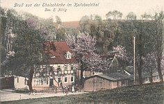
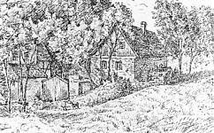
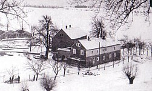
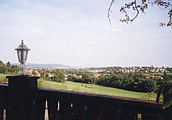
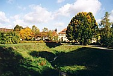
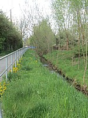

* * *

Der Kaitzbach hat eine Gesamtlänge von ca. 12 km und durchquert in seinem Verlauf die südlichen Dresdner Stadtteile Gittersee, Kaitz, Mockritz und Strehlen. Seine Quelle befindet sich in der Nähe des Sportplatzes von Kleinnaundorf, wo er zunächst Grundbach genannt wird. Bis 1995 versorgte er hier das örtliche Freibad mit Wasser, welches jedoch mittlerweile geschlossen und renaturiert wurde. Erst bei Eintritt ins Dresdner Stadtgebiet wird er offiziell als Kaitzbach bezeichnet. In diesem Bereich gab es vor dem Zweiten Weltkrieg die Gaststätte "Talschänke" mit Veranda und einem kleinen Teich _(Foto)_. Das noch erhaltene Gebäude dient heute als Wohnhaus. Unweit davon stehen mehrere Brunnenhäuschen, die früher Grundwasser für die [Felsenkellerbrauerei](../../../sud/plauen/plauenscher_grund/felsenkellerbrauerei/) und die [Bienertmühle](../../../sud/plauen/bienertmuhle/) förderten. Heute sind diese Brunnen nur noch selten in Betrieb.

Im oberen Kaitzgrund zwischen Gittersee und Kaitz befanden sich früher mehrere Wassermühlen. Die erste war die aus der früheren Cunnersdorfer Gutsmühle hervorgegangene Ehrlichsmühle, einst auch als “Knochenmühle” bezeichnet _(Zeichnung von 1890)_. Im 19. Jahrhundert war dieser Talabschnitt beliebtes Ausflugsziel, nicht zuletzt da einige Mühlen auch gastronomische Versorgung und selbsthergestellten Wein anboten. Das klare Wasser des Kaitzbaches ermöglichte sogar das Überleben von Flusskrebsen, die mittlerweile jedoch ausgestorben sind.

Unterhalb der Ehrlichmühle erinnerte ein Gedenkstein an den Medicus und Naturforscher Dr. Grollmus. Grollmus galt zu Lebzeit im 19. Jahrhundert als volkstümlicher Kur- und Wunderdoktor und lebte im nahen Nöthnitz, zuletzt in Kaitz. An einem seiner Lieblingsplätze stellten 1854 Freunde eine ca. 80 cm hohe Sandsteinsäule mit einer Metalltafel auf.

_"Zur Ruhe ladet hier dich ein die reine frische Quelle_

_nun soll es Grollmus Ruhe sein, geweiht an dieser Stelle - den 14. Mai 1854"_

Bereits 1904 war das kleine Denkmal beschädigt und verschwand später unter unbekannten Umständen.

Im weiteren Verlauf diente der Kaitzbach dem Antrieb der 1779 an Stelle der abgebrannten Adamsmühle entstandenen Clausmühle (später Waltermühle) sowie der Köhlermühle, die zuvor auch Zschachlitzmühle genannt wurde _(Foto)_. Nach Einstellung des Mahlbetriebs wurden die einstigen Mühlteiche zur Eisgewinnung genutzt, das Grundstück der Köhlermühle war zuletzt Standort einer Gärtnerei. Leider verlor der obere Kaitzgrund nach 1945 viel von seinem landschaftlichen Reiz, da die Wismut Teile der Hänge als Abraumhalde und die Talsohle zum Anlegen zweier Schlammteiche nutzte. Nach Schließung der Uranaufbereitungsanlage nutzte die Stadt Dresden das Areal noch bis 1990 als Hausmülldeponie. Im Bereich dieser Halde wurde der Bach in den 1950er Jahren verlegt und verläuft heute in einem unterirdischen Stollen. In diesem Zusammenhang erfolgte 1955 auch der Abriss der Mühlengebäude. Am einstigen Abzweig zum Mühlengrundstück der Waltersmühle befindet sich einer von insgesamt neun Musensteinen. Die künstlerisch gestalteten Steine wurden von der Bildhauerin Christa Donner geschaffen und sind Teil des Kunstprojektes "Mnemosyne-Wasserkunstweg" entlang des Kaitzbaches.

Bedeutendste Wassermühle am Kaitzbach war jedoch das Kaitzer Mühlengut (Altkaitz 6), welches ab 1670 das Privileg des Brot- und Mehlhandels in Dresden besaß und zum [Amtslehngut Kaitz](../../../sud/kaitz/) gehörte. Diese Mühle in Altkaitz wurde später auch Hofemühle genannt. Das anschließende im Sommer wie im Winter romantische Wiesental _(Fotos)_ läßt heute kaum noch erahnen, dass an seinen Hängen noch 1887 Weinbau betrieben wurde. An der Kreuzung Mittelsteg / Bannewitzer Straße mündet am rechten Ufer die aus Boderitz kommende Zschauke, unweit davon der nur zeitweise Wasser führende Nautelbach. Zum Schutz vor Hochwasser entstand in diesem Bereich 2005 an der sogenannten „Tränenwiese“ ein Hochwasserrückhaltebecken. Alte Weiden säumen das Ufer des Bachs, der hier noch weitgehend naturbelassen seinen Weg nimmt. Das Bild zeigt einen Blick ins Kaitzbachtal von der Terrasse des [Café Weinberg](../../../sud/kaitz/strassen_kaitz/)

Im Anschluss erreicht der Kaitzbach den Dorfkern von Mockritz. Bemerkenswert ist hier eine steinerne Bogenbrücke, an deren Seiten zwei alte Jagdsäulen an frühere fürstliche Jagdvergnügungen erinnern. Unweit davon lag einst die Palitzschmühle. In der Nähe wurde der Kaitzbach seit dem 17. Jahrhundert zum Münzteich angestaut. Mit Hilfe von Schiebern konnte der Wasserstand reguliert werden, um die Wasserkraft bei Bedarf zum Betrieb der kurfürstlichen Münze im Stadtzentrum nutzen zu können. Gleichzeitig wurde dieser Teich als Feuerlöschteich verwendet. Nach Schließung der Münze vorübergehend als Eisteich genutzt, gestaltete man den früheren Münzteich 1925 zum [Mockritzer Bad](../../../sud/mockritz/) um.

Anschließend setzt der Kaitzbach seinen Weg bis in den Dorfkern von Strehlen fort. Südlich der Zschertnitzer Straße nimmt er den Nöthnitzbach auf. Wegen der häufigen Hochwasser wurde der Kaitzbach im Bereich Teplitzer Straße teilweise kanalisiert. Schwere Hochwasser sind u. a. für 1445 und 1876 verbürgt, bei denen das Wasser sogar bis zum Neumarkt gestanden haben soll. Die in den Zwanziger Jahren angelegte und auch als Hugo-Bürkner-Park bezeichnete Grünanlage zwischen Teplitzer und Lockwitzer Straße dient als Rückhaltebecken ebenfalls dem Hochwasserschutz _(Foto)_. Nach dem Bau der umliegenden Wohnhäuser wurde der Kaitzbach in unterirdische Rohre verlegt und ist somit heute erst im Dorfkern von Strehlen wieder sichtbar. Hier befand sich einst eine weitere [Mühle](../../../sudost/strehlen/strassen_strehlen/dohnaer_strasse/), die Mitte des 16. Jahrhunderts entstanden war und 1870 zur Dampfmühle umgebaut wurde. Ein Brand am 9. August 1883 besiegelte das Schicksal dieser Mühle.

Von Strehlen aus führt der Kaitzbach offen entlang des Kaitzbachweges _(Foto)_ zum Gustav-Adolf-Platz und erreicht schon bald den [Großen Garten](../../../zentrum/grosser_garten/), wo er über einen Abzweiggraben den Carolasee und einige kleinere Gewässer speist. Der Hauptlauf des Baches führt weiter am Zoo vorbei bis zur Bürgerwiese, wird an der Zinzendorfstraße von einem unterirdischen Kanal aufgenommen und mündet in der Nähe des Hasenberges in die Elbe. Ursprünglich verlief der Kaitzbach oberirdisch über die Bürgerwiese bis zur Kreuzstraße, von dort über den Altmarkt und die Schloßstraße, wo er am heutigen Schloßplatz in die Elbe mündete. Bereits 1529 wurde das Flussbett im Innenstadtbereich teilweise überbaut und der Bach zur Versorgung des Stadtgrabens genutzt. Letzte Reste des offenen Baches verschwanden im 18. und 19. Jahrhundert mit der zunehmenden Bebauung.

* * *

 \[ [Nord](../../../nord/)\] \[ [Nordwest](../../../nordwest/)\] \[ [Neustadt](../../../neustadt/)\] \[ [Nordost](../../../nordost/)\]
 \[ [West](../../../west/)\] \[ [Zentrum](../../../zentrum/)\] \[ [Südwest](../../../sudwest/)\] \[ [Süd](../../../sud/)\] \[ [Südost](../../../sudost/)\] \[ [Ost](../../../ost/)\] \[ [Register](../../../Register/register.html)\] \[ [Kontakt](../../../Kontakt/kontakt.html)\] \[ [Impressum](../../../impressum/)\]
