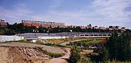
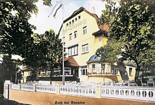
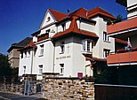

* * *

Die Bannewitzer Straße, eine Seitenstraße der Boderitzer Straße,
geht auf einen alten Fußweg nach Nöthnitz zurück, der 1876 zum Fahrweg ausgebaut wurde. 1904 erhielt sie den Namen Nöthnitzer Straße. Im Zusammenhang mit der Eingemeindung von Kaitz wurde sie 1926 nach dem nahegelegenen Ort Bannewitz in Bannewitzer Straße umbenannt. Der nördlich gelegene Teil der Straße jenseits des Kaitzbaches wird umgangssprachlich auch "Schulberg" genannt, da er zur 1844 eröffneten Kaitzer Schule führt. Im südlichen Teil liegt der sogenannte "Läuseberg", dessen Name an ein russisches Feldlager während der Schlacht bei Dresden und die schlimmen hygienischen Zustände in dieser Zeit erinnert. Hier befand sich ab 1900 auch der heute nicht mehr genutzte Wasserhochbehälter des Ortes, dessen bauliche Überreste noch vorhanden sind. Die Gebäude der Bannewitzer Straße stammen meist aus der ersten Hälfte des 20. Jahrhunderts, einige Baulücken wurden nach 1990 mit Eigenheimen geschlossen.

Ratskeller Kaitz: Das Eckhaus an der Kreuzung zur Boderitzer Straße (Nr. 12- _Foto_) wurde 1892 für den Schankwirt Robert Jüngling erbaut und hieß zunächst "Restaurant Thalschlösschen". Erst 1919 wechselte der Name unter den neuen Besitzern, der Familie Nestler in "Ratskeller Kaitz". In den 1930er Jahren fanden im Garten hinter dem Haus auch Volksfeste mit Vogelschießen und Schlachtfeste statt. 1945 befand sich hier ein Auffanglager für Ausgebombte, zeitweise auch ein Ausweichstandort für die als Lazarett genutzte Schule.

In den 1950er Jahren wandelte sich der "Ratskeller" wieder zu einer typischen Vorstadtkneipe mit Billiardtischen und Treffpunkt für Skat- und Doppelkopfspieler. Auch der 1949 gegründete Volkschor Kaitz nutzte das Lokal als Probenraum. Hinzu kamen Familienfeste, Schulungen und Versammlungen. 1982 übernahm die Familie Mittag das Traditionslokal und führte es bis zur Schließung 1995. Heute werden die ehemaligen Gasträume als Büro genutzt.

Die heutige Boderitzer Straße trug früher in Kaitz den Namen Leichenweg, da sie die Verbindung des Dorfes zur Leubnitzer Kirche und dem dortigen Friedhof war. Im Zusammenhang mit dem Bau einiger Mietshäuser wurde sie 1899 zur Fahrstraße ausgebaut und ab 1904 Leubnitzer Straße genannt. Erstmals in Kaitz wurden für diese Straße fortlaufende Hausnummern vergeben. 1926 erfolgte die Vereinigung mit der Mockritzer Friedrich-August-Straße zur [Boderitzer Straße](../../../sud/mockritz/strassen_mockritz/). Die Flurgrenze verläuft zwischen den Häusern 69 und 71.

Die Wohnhäuser an der Boderitzer Straße stammen aus der Zeit der zweiten Ortserweiterung in den Jahren 1894 und 1901. Meist handelt es sich um typische Würfelhäuser, wie sie in vielen Dresdner Vorstädten in dieser Zeit typisch waren. Bewohner waren meist Arbeiter und Angestellte. Zudem gab es hier mehrere Geschäfte, u.a. für Lebensmittel (Nr. 78, 91 und 95), eine Verkaufsstelle des Konsumvereins "Vorwärts" (Nr. 81), eine Fleischerei (Nr. 82) und eine Drogerie (Nr. 99). Im Haus Nr. 83 betrieb Hans Gehre seine Bäckerei. Der Bäckermeister war begeisterter Radrennfahrer und nahm 1936 sogar an den Olympischen Spielen in Berlin teil. Im Hintergebäude des Grundstücks Boderitzer Straße 79 hatte Adolf Neumann (1868-1942) seine Dekorationsmalerei. Neumann schuf auch einige Ölgemälde und gehörte bis 1918 dem Kaitzer Gemeinderat an. Aus der Tischlerei Kurt Trögers (Nr. 95) ging nach 1945 die PGH Tischlerhandwerk und die Bau- und Möbeltischlerei Bannewitz hervor. Zudem gab es vor 1945 einige Kleinbetriebe, so eine Bettfedernreinigung (Nr. 93) und die Hutfabrik Rüdiger & Anders (Nr. 95).

Auffällig sind die Eckhäuser zur Bannewitzer Straße, in dem sich früher die Gaststätte "Ratskeller Kaitz" _(Foto)_ und das Gemeindeamt befanden, sowie die beiden Doppelhäuser Boderitzer Straße 84/86 und 88/90. Ab 1901 nutzte der Gemeinderat zunächst das Erdgeschoss der Boderitzer Straße 94, bevor 1913 das Haus Boderitzer Straße 92 bezogen wurde. Neben dem Gemeindeamt befanden sich hier bis zur Eingemeindung 1921 auch das Standesamt und das Ortsgericht. Auch die Kaitzer Post hatte von 1913 bis 1955 und 1964 bis 1978 (Nr. 91), 1956 bis 1959 (Nr. 99) und 1979 bis 1991 (Nr. 78) auf der Boderitzer Straße ihr Domizil. Im Haus Boderitzer Straße 85 war zeitweise die Polizeidienststelle mit Arrestzelle im Hinterhaus untergebracht.

Autohaus Friedewald (Nr. 75): Auf diesem Grundstück eröffnete 1924 der Stellmacher Martin Friedewald seine Firma zur Herstellung von Leitern, Schubkarren, Handwagen und ähnlichen Fahrzeugen. Außerdem fertigte der Betrieb Zubehörteile und Karosserien für Kraftfahrzeuge, die zu dieser Zeit noch einen hohen Anteil an Holzteilen besaßen. Mit der Weiterentwicklung der Kfz-Technik kamen ab 1930 zunehmend auch Reparaturen an Blechkarossen hinzu. Da das Kaitzer Grundstück nun nicht mehr den Anforderungen genügte, verlegte Friedewald seine Werkstatt 1938 nach Räcknitz, wo sie als "Autohaus Friedewald" bis heute existiert.

Der parallel zum Kaitzbach verlaufende Franzweg erhielt seinen Namen 1926 nach dem früheren Gemeindevorstand von Kaitz Adolf Max Franz (1860-1916). Zuvor wurde er Schmiedegäßchen genannt. Einer seiner Vorfahren verkaufte hier 1839 ein Grundstück, auf dem 1844 das neue Kaitzer [Schulhaus](../../../sud/kaitz/) errichtet wurde. Die mehrfach erweiterte Schule wird heute von der 71. Grundschule "Am Kaitzbach" genutzt.

Das 1849 umgebaute Wohngebäude Franzweg Nr. 12 _(Foto)_ gehört zu den ältesten Häusern in Kaitz und steht unter Denkmalschutz. Eine Inschrift am Türsturz von 1849 erinnert an den früheren Besitzer J. G. Keller. In diesem Gebäude wurde am 21. Juli 1894 der Pfarrer Paul Richter geboren. Richter gehörte in der NS-Zeit der Bekennenden Kirche an und wurde 1942 in das KZ Dachau deportiert, wo er im August an Hungertyphus starb. An der Einmündung in die Possendorfer Straße hat die [Freiwillige Feuerwehr Kaitz](../../../sud/kaitz/) ihr Domizil. Bis 1990 gab es hier zudem einen Kindergarten. Bemerkenswert sind auch die beiden Sonnenuhren an den Wohnhäusern Franzweg 18 und 20.

Die große Straßenschleife Innsbrucker Straße wurde 1925 angelegt, um den Durchgangsverkehr aus dem Kaitzer Dorfkern herauszunehmen. Für den Ausbau der "Neuen Landstraße" musste ein Damm mit zwei Durchlässen für Kaitz- und Zschaukebach aufgeschüttet werden. Zudem wurde der Straßenrand alleeartig mit Pappeln bepflanzt. 1926 erhielt sie ihren Namen nach der Landeshauptstadt Innsbruck in Tirol (Österreich). Heute ist sie Teil der dichtbefahrenen Bundesstraße B 170 und dient seit ihrem vierspurigen Ausbau bis 2004 als Autobahnzubringer zur Anschlussstelle Dresden-Südvorstadt der Bundesautobahn A 17 (Dresden-Prag). In diesem Zusammenhang wurden mehrere Straßenanschlüsse verändert und eine neue Brücke über das Kaitzbachtal gebaut.

**_Foto:_** _Blick von Altkaitz über die Innsbrucker Straße zur Südhöhe_

Die Straße Kaitzer Weinberg wurde als Fuß- und Wirtschaftsweg nach Kleinpestitz am Nordrand des Kaitzbachtales angelegt. Von 1908 bis 1926 trug sie den Namen Weinbergstraße. 1918 wurde der Weg im Rahmen von Notstandsarbeiten ausgebaut. Nachdem bereits um 1912 das heutige "Pfarrer-Richter-Haus" (Nr. 16) und das Café Weinberg (Nr. 12) enstanden waren, folgten ab ca. 1930 bis zum Zweiten Weltkrieg zahlreiche individuell gestaltete Ein- und Zweifamilienhäuser.

Die hier gelegenen Grundstücke am Hang des Kaitzbachtales nutzten die Kaitzer Einwohner ab ca. 1650 bis 1887 als Weinberge. An diese Vergangenheit erinnert ein 1686 errichtetes Weinberghaus und eine historische Plänermauer im Grundstück Nr. 14. In der Mauer neben dem Eingangstor sieht man eine auf das Jahr 1686 datierte Schrifttafel sowie die Initialen der damaligen Besitzer der Weinberge, die Familien Clauß, Palitzsch und Winkler. Das stark verfallene Gebäude, welches bis zu einem Unwetter 1962 auf dem Dach auch eine Wetterfahne mit Weinbaumotiv besaß, konnte nach 1990 weitgehend originalgetreu wiederaufgebaut werden. Gleichzeitig entstand ein heftig umstrittener moderner Neubau auf diesem Grundstück _(Foto)_.

Café Weinberg (Nr. 12): Das Café Weinberg wurde 1913/14 auf einem früheren Weinberggrundstück am Südhang des Kaitzbachtales erbaut. Zuvor hatte der Dresdner Konditormeister Ernst Theodor Opitz das Areal von der Kaitzer Bauernfamilie Franz erworben. Die originalgetreu erhaltene Innenausstattung stammt aus den Hellerauer Werkstätten und wurde von Richard Riemerschmid entworfen. Von der Veranda und dem angrenzenden Gästegarten bietet sich eine herrliche Aussicht über das Kaitzbachtal bis zur Sächsischen Schweiz. Das auch zu DDR-Zeiten in Privatbesitz befindliche Café wurde 1999 saniert und steht unter Denkmalschutz.

Paul-Richter-Haus (Nr. 16): Da Kaitz nie eine eigene Kirche besaß und kirchlich ab 1674 zur [Leubnitzer Kirche](../../../sudost/leubnitz-neuostra/leubnitzer_kirche/) gehört, mussten die Bewohner weite Wege zum Gottesdienst zurücklegen. Aus diesem Grund gab es seit Anfang des 19. Jahrhunderts regelmäßige Gebetsstunden, die in den Stuben der Bauernhöfe abgehalten wurden. Pläne von 1880, im Ort eine eigene Kapelle einzurichten sowie ein 1905 ins Leben gerufenes Projekt zum Bau eines Pfarrhauses blieben unrealisiert. Allerdings konnte ab 1895 ein Raum der Schule am Franzweg für kirchliche Zwecke genutzt werden. Im Zuge der Erweiterung der Schule 1906 erhielt dieser einen Altar, Kanzel und Taufbecken sowie ein Harmonium. Auf Anordnung der nationalsozialistischen Behörden endetet diese Doppelnutzung 1939. Fortan fanden die Gottesdienste bis 1948 in der [Gaststätte Sängereiche](../../../Sud/Kaitz/Strassen_Kaitz/Possendorfer Straße/possendorfer_strasse.html) auf der Possendorfer Straße 33 statt. Ein Jahr später bezog man einen Raum im hinteren Teil des gleichen Grundstücks, der bis 1990 neuer Gemeindesaal der Christen des Stadtteils war. Hier läutete auch eine 1672 gegossene Bronzeglocke der Dresdner Glockengießerei Andreas Herold, Leihgabe der Kreischaer Kirchgemeinde.

Nach Kündigung es Pachtvertrages bezog man 1990 ein neues Domizil in der früheren Poliklinik Kaitzer Weinberg 16. Die offizielle Einweihung des Gemeindezentrums erfolgte am 24. Juni 1990. Das seit 1997 als Paul-Richter-Haus bezeichnete Gebäude erhielt seinen Namen nach dem früheren Wilsdruffer Pfarrer Paul Richter (\* 1894 in Kaitz, + 1942 im KZ Dachau), der als Mitglied der bekennenden Kirche von den Nazis verfolgt wurde. Sein Grab befindet sich auf dem Leubnitzer Friedhof. Organisatorisch gehört Kaitz gemeinsam mit Mockritz und Kleinpestitz zum Seelsorgebezirk der Kirchgemeinde Leubnitz-Neuostra.

Ursprünglich war das Gebäude 1915 als eines der ersten Häuser an der Weinbergstraße als "Arzthaus" errichtet worden. Hier betrieb der Bezirks-Impfarzt und Bezirks-Fürsorgearzt Dr. med Karl Siegler seine Praxis. Nach seinem Tod übernahmen mehrere Nachfolger die Praxis, die ab 1955 Außenstelle der Poliklinik Strehlen war. 1983 endete die medizinische Nutzung der Räume.

Die Straße Kaitzgrund geht auf einen alten Verbindungsweg zurück, der den Kaitzer Ortskern mit den außerhalb im [Kaitzbachtal](../../../sud/kaitz/kaitzbachtal/) gelegenen Mühlen und den heute zu Bannewitz gehörenden Orten Boderitz und Cunnersdorf verband. 1879 wurde er Kaitzer Weg genannt, um 1900 Cunnersdorf-Kaitzer Straße bzw. Cunnersdorfer Weg. 1926 erhielt er den offiziellen Namen Kaitzgrund. Neben den Mühlen wurde hier bis Ende des 19. Jahrhunderts auch Weinbau betrieben.

Nach dem Zweiten Weltkrieg wurden Teile des einst romatischen Tales durch Uranschlamm der Wismut verfüllt, wodurch auch der Kaitzbach verlegt werden musste. In diesem Zusammenhang verfielen die beiden Mühlen dem Abbruch. Im Zuge des Autobahnbaus wurde die Straße unterbrochen und führt heute nur noch, von Cunnersdorf kommend, als Wirtschaftsweg bis zur Autobahn und danach parallel bis zur Autobahnbrücke über den Zschaukegraben.

Die Meraner Straße wurde nach dem Ersten Weltkrieg oberhalb der früheren Kaitzer Weinberge angelegt und nach der Stadt Meran in Südtirol benannt. Noch bis nach 1990 prägten neben Einfamilienhäusern Felder und eine Schweinemastanlage das Straßenbild, bevor auch hier neue Wohnhäuser errichtet wurden. An der Ecke Meraner / Possendorfer Straße befindet sich eine um 1830 aufgestellte historische Wegsäule. Die ca. 1,60 Meter hohe Säule weist auf frühere Verbindungswege nach Plauen, Kleinpestitz, Kaitz und Coschütz hin und wurde 2009 saniert.

Als Mittelsteg wird seit 1904 der Fußweg durch das [Kaitzbachtal](../../../sud/kaitz/kaitzbachtal/) bezeichnet, der den Ort mit dem benachbarten Mockritz verbindet. Seinen Beginn nimmt er an der Possendorfer Straße, führt dann an einem 2005 angelegten Rückhaltebecken und Kleingärten vorbei nach Altmockritz. Von dort setzt er sich bis zum [Mockritzer Bad](../../../sud/mockritz/) fort und endet an der ehemaligen Ausflugsgeststätte "Grundschlösschen".

Kleingartenverein "Frühauf Kaitz 1905 e.V.": Die Kleingartensparte wurde 1905 auf einem vom damaligen Besitzer des Lehngutes Paul Brendel zur Verfügung gestellten Stück Land am Mittelsteg, gelegen zwischen Possendorfer, Bannewitzer und Boderitzer Straße, angelegt. 1921 konnte nach der Verlegung des bis dahin offen fließenden Baches Zschauke in Rohre die Fläche bis zum Dammweg erweitert werden und besaß nun ca. 130 Parzellen. Nutzer waren meist Familien aus den südlichen Dresdner Vororten. Eine zweite Erweiterung erfolgte nach 1970, 1985 entstand unmittelbar angrenzend der Kleingartenverein "Kaitzbach e.V.".

In der Nachkriegszeit wurde Mitte der 1950er Jahre das Vereinsheim mit einer 1958 eröffneten Gaststätte (Mittelsteg 15) errichtet. Das Material stammte aus Dresdner Ruinen und der aufgelassenen Gärtnerei Lubensky in der ehemaligen Mittelmühle im Kaitzgrund. Zunächst Gartenheim genannt, wechselte der Name des Lokals später in "Kaitzer Stübel" bzw. "Kaitzer Glucke", danach in "Zum Fasan". Seit Ostern 2005 und nach gründlicher Renovierung wird die kleine Gaststätte unter dem Namen "KaitzGarten" betrieben. In den Räumen gründete sich am 23. Juli 1973 der Fußballverein "WSG Kaitz".

Die 1954 eingeführte Straßenbezeichnung Zschaukegraben bezieht sich auf den neben dem Weg entlangführenden Bach Zschauke, auch Boderitzer Wasser genannt. Die Straße ist Teil eines alten Kommunikationsweges, der von Boderitz über Kaitz nach Mockritz führte. Der oberhalb der Autobahn gelegene Abschnitt wird bis heute Rosenweg genannt. Die Zschauke selbst entspringt in der Nähe von Boderitz, unterquert die Autobahn und mündet an der Boderitzer Straße in ein Rohrsystem, welches sie zum Kaitzbach führt. Vor dem Zweiten Weltkrieg lag hier der Schießstand des 1903 gegründeten Königlich-Sächsischen Militärvereins Kaitz.

* * *

 \[ [Home](../../../index.html)\] \[ [Nord](../../../nord/)\] \[ [Nordwest](../../../nordwest/)\] \[ [Neustadt](../../../neustadt/)\] \[ [Nordost](../../../nordost/)\] \[ [West](../../../west/)\] \[ [Zentrum](../../../zentrum/)\] \[ [Südwest](../../../sudwest/)\] \[ [Süd](../../../sud/)\] \[ [Südost](../../../sudost/)\] \[ [Ost](../../../ost/)\] \[ [Register](../../../Register/register.html)\] \[ [Kontakt](../../../Kontakt/kontakt.html)\] \[ [Impressum](../../../impressum/)\]
