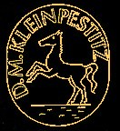
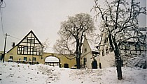
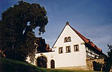
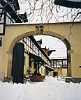

* * *

**Gemeindesiegel von Kleinpestitz**

* * *

Der Dorfkern von Kleinpestitz liegt oberhalb des Kaitzbachtales nur 400 Meter
von Altmockritz entfernt und gehört zu den kleinsten im Dresdner Stadtgebiet. Erstmals erwähnt wurde der Weiler Pestewicz im Jahr 1370. Der Name ist von
einem slawischen Ortsgründer Pest abgeleitet (= “Leute des Pest”). 1495 existierten bereits drei Bauerngüter, die später lediglich um einige Häusleranwesen
erweitert wurden. 1620 war der Bauer Palitzsch Besitzer des gesamten Dorfes mit ca. 20 Einwohnern. Zinspflichtig war Kleinpestitz dem Meißner Hochstift, kirchlich
unterstand das Dorf bis 1889 der Frauenkirche. Da Kleinpestitz nie eine eigene Schule besaß, mussten die Kinder die Schule von Kaitz und ab 1893 die von Mockritz besuchen.

Im Ortskern sind bis heute einige historische Gebäude erhalten geblieben.
Bemerkenswert sind die in den letzten Jahren denkmalgerecht sanierten Gehöfte Altpestitz Nr. 1 (1777 erbaut, Bildsiegel mit springendem Pferd über der Hofeinfahrt),
Nr. 3 (1620 erbaut) und Nr. 5 (Palitzsch-Gut von 1775, Schlußstein mit Pflugschar und gekreuzten Messern). In diesem Gut wurde während der Schlacht bei Dresden
der schwer verwundete General Jean Victor Moreau medizinisch versorgt. An die Ereignisse von 1813 erinnert die frühere Dorfgaststätte [“Moreauschänke”](../../sud/kleinpestitz/moreauschanke/), die leider
seit vielen Jahren geschlossen ist und inzwischen nur noch als Wohnhaus dient. Seit dem 1. April 1921 gehört Kleinpestitz zu Dresden.

Nach dem Ersten Weltkrieg entstand eine Eigenheimsiedlung nordöstlich des Dorfplatzes. Bei den
Bauarbeiten wurden 1926 an der Eigenheimstraße die Überreste einer eisenzeitlichen Siedlung entdeckt. Die Straßennamen Bernerstraße, Isfriedstraße, Römchenstraße, Tirmannstraße und
Zieglerstraße erinnern an frühere Dresdner Ratsherrengeschlechter. Weitere Wohngebäude entstanden nach 1990 zwischen Altpestitz und der Südhöhe an Stelle der früheren
Schweinemastanlage. Kurzzeitig wurden deren Gebäude noch als Möbelmarkt genutzt, 1994 jedoch abgebrochen.

Schulen in Kleinpestitz:

Da Kleinpestitz aufgrund seiner geringen Einwohnerzahl nie eine eigene Schule besaß, besuchten die Kinder des Ortes
die Dorfschule von Kaitz. 1893 entstand an der Flurgrenze zu Mockritz und Zschertnitz ein gemeinsames Schulhaus für
die drei Dörfer, welches noch heute von der 70. Grundschule genutzt wird. Eine weitere Schule wurde um 1980 im Zusammenhang mit dem Neubaugebiet Räcknitzhöhe errichtet. Diese trug zu DDR-Zeiten den Namen 125. POS
“Heinrich Heine”, schloss jedoch bereits kurz nach der Wende ihre Pforten und wurde 2005 abgerissen. Erhalten blieb die heute von verschiedenen Vereinen genutzte Schulturnhalle.

Förderschule: Das Gebäude am Burkersdorfer Weg 20 wurde in den 1980er Jahren als kombinierte Kindertagesstätte
für Krippen- und Kindergartenkinder errichtet. 2008 erfolgte ein Umbau des Hauses, welches seit 2009 von der
Förderschule der evangelischen Behindertenhilfe genutzt wird soll. Zuvor hatte diese Einrichtung ihr Domizil am Hennersdorfer Weg 1.

[_Weiterführende Literatur und Quellen_](../../impressum/quellenverzeichnis/)
