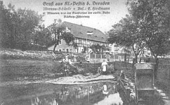
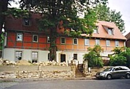

* * *

Die Gaststätte “Moreauschänke” (Eigenheimstraße 1) geht auf den früheren
Dorfgasthof von Kleinpestitz zurück. Ihren Namen erhielt die historische Schankwirtschaft in Erinnerung an die Schlacht bei Dresden 1813. Am 27. August 1813 zerschmetterte eine Kanonenkugel dem aus französischen
Diensten zu Rußland übergelaufenen General Jean Victor Moreau auf den Feldern bei Räcknitz beide Beine. Der schwer verwundete General wurde daraufhin ins Gut Altpestitz Nr. 5 gebracht, wo er medizinisch versorgt wurde.
Den späteren Transport nach Nöthnitz und von dort ins böhmische Laun (Louny) überlebte Moreau nur kurz und verstarb am 2. September 1813. Seine amputierten Beine ruhen unter dem [Moreaudenkmal](../../../sud/racknitz/schlacht_bei_dresden/) an der Räcknitzhöhe.

Ursprünglich war das Gebäude der Moreauschänke Teil des Dreiseithofes
Kleinpestitz Nr. 4. Erst im Zusammenhang mit dem Bau neuer Wohnhäuser am Eigenheimberg ersuchte der Besitzer des Hauses Emil Hieckmann 1911 um eine
Schankkonzession, vor allem um die bei den zahlreichen Neubauten beschäftigten Arbeiter versorgen zu können. Da die Amtshauptmannschaft Dresden jedoch
keinen Bedarf für eine Gastwirtschaft sah, lehnte sie den Antrag zunächst ab. Erst nach weiteren Ersuchen genehmigte man schließlich am 11. Oktober 1912 den
Verkauf von Selterswasser, Limonade, Kaffee, Kakao und Milch. Ein Jahr später wurde diese Konzession um den Bier- und Branntweinausschank erweitert. In
Erinnerung an die historischen Ereignisse während der Befreiungskriege benannte Hieckmann Mitte 1915 seinen Gasthof
in Moreauschänke an. Die Gaststube wurde mit Erinnerungsstücken an die Schlacht und zahlreichen Bildern ausgestattet.
Bis in die 1980er Jahre war sie beliebter Studententreffpunkt, die hier die zu DDR-Zeiten unerwünschten burschenschaftlichen Traditionen pflegten und den Gasthof stadtbekannt machten. Aus Altersgründen wurde die
Moreauschänke Ende 1988 geschlossen. 2002 begann die Sanierung des historischen Gebäudes, welches heute
Wohnzwecken dient. Am Türsturz erinnern noch die Initialen J G L (= Johann Gottlieb Lippitsch) an die früheren Besitzer des Gehöfts.

* * *

 \[ [Home](../../../index.html)\] \[ [Nord](../../../nord/)\] \[ [Nordwest](../../../nordwest/)\] \[ [Neustadt](../../../neustadt/)\] \[ [Nordost](../../../nordost/)\] \[ [West](../../../west/)\] \[ [Zentrum](../../../zentrum/)\] \[ [Südwest](../../../sudwest/)\] \[ [Süd](../../../sud/)\] \[ [Südost](../../../sudost/)\] \[ [Ost](../../../ost/)\] \[ [Register](../../../Register/register.html)\] \[ [Kontakt](../../../Kontakt/kontakt.html)\] \[ [Impressum](../../../impressum/)\]
