* * *

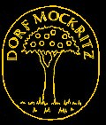

**Gemeindesiegel von Mockritz**

**Schulen in Mockritz:**

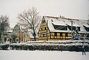Die Fluren des Stadtteiles Mockritz waren bereits im 7. Jahrhundert besiedelt, wie
zahlreiche archäologische Funde der Lausitzer Kultur und der La-Tené-Zeit an verschiedenen Stellen beweisen. So wurden an der Julius-Scholtz-Straße, am Bozener
Weg und im Kaitzbachtal Reste von Gebäuden gefunden. Der dem Burgward Pesterwitz unterstehende Ort war in frühdeutscher Zeit Standort eines Herrengutes und wurde
1350 erstmals als Mokerus urkundlich erwähnt. Der Name ist vom sorbischen mokry abgeleitet, was übersetzt nass, feucht bedeutet und auf die sumpfigen Bodenverhältnisse hinweist.

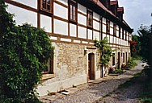Kern des platzartigen Dorfes ist der noch heute gut erhaltene Dorfplatz [Altmockritz](../../sud/mockritz/strassen_mockritz/), um den sich die Gehöfte des Ortes gruppieren _(Fotos)_. Obwohl heute nicht mehr
landwirtschaftlich genutzt, konnten viele Gebäude ihr historisches Bild bewahren und stehen unter Denkmalschutz. Die südlich verlaufende Boderitzer Straße teilte die Dorfflur in zwei Hälften,
deren nördliche im Besitz der Dresdner Bürgerfamilie Busmann, die südliche ab 1481 im Besitz des Meißner Domstifts waren. Dieses richtete in
Mockritz eine Garbensammelstelle für den Zehnten ein, bei der die Bauern der Orte Coschütz, Döhlen, Dölzschen, Kaitz, Löbtau, Mockritz, Räcknitz, Strehlen und
Zschertnitz bis 1839 ihre Abgaben zugunsten der Kirche abliefern mussten. Zur Lagerung wurden in Mockritz vier
Zehntscheunen errichtet. Der nördliche Dorfteil kam 1398 an die Kreuzkirche und unterstand später dem Religionsamt
Dresden. Im Jahr 1767 wurden in Mockritz erstmals Kartoffeln angebaut, erste Erwähnung des Kartoffelanbaus im Dresdner Raum.

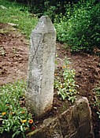1349 ist eine Mühle im Ort erwähnt, die sich am [Kaitzbach](../../sud/kaitz/kaitzbachtal/) auf dem Gelände des heutigen
Freibades befand und den Gebrüdern Karas gehörte. 1669 erhielt sie die Genehmigung, Brot und Mehl auf dem Dresdner Wochenmarkt zu verkaufen und existierte bis 1875. Unweit dieser
Wassermühle ließ Kurfürst Johann Georg I. 1621 den Münzteich anstauen, der zur Regulierung der Wasserkraft für die Dresdner Münzprägestätte diente. Für die Kurfürsten war Mockritz
jedoch auch als Teil des “Rothäuser Jagdreviers” von Bedeutung. Neben einigen kleineren Brücken über den Kaitzbach erinnert noch die Jagdsäule auf dem Gelände des Mockritzer
Bades an diese Zeit. Die Säule wurde 1751 unmittelbar neben einer dieser Brücken errichtet und sollte die Erkennung der Übergangsstellen während der Hofjagden erleichtern. Später
wurde sie als jagdgeschichtliches Denkmal an ihren heutigen Standort versetzt _(Foto)_.

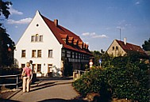
Im 19. Jahrhundert wandelte sich auch in Mockritz die Bevölkerungsstruktur. Obwohl sich hier keine Industriebetriebe ansiedelten, wurden um 1890 die ersten Mietshäuser
außerhalb des Dorfkerns erbaut. Diese wurden hauptsächlich von Arbeitern der zahlreichen Ziegeleien auf Gostritzer, Mockritzer und Zschertnitzer Flur bewohnt. Neue Wohngebäude entstanden an der [Südhöhe](../../sud/zschertnitz/strassen_zschertnitz/), der Münzmeisterstraße und der Boderitzer Straße. Nach dem Ersten Weltkrieg folgte die Kleinhaussiedlung an der Welschhufer
und Rippiener Straße. Weitere Straßen zwischen Mockritz und Strehlen erhielten ihre Namen nach bekannten Kunstmalern. Seit dem 1. April 1921 gehört der Ort als
Stadtteil zu Dresden. Einen deutlichen Bevölkerungszuwachs brachten die Jahre nach 1945, da Mockritz von Kriegszerstörungen weitgehend verschont geblieben war. Nach 1990 entstanden weitere Eigenheime an der Boderitzer
Straße und am Münzteichweg..

Schulen in Mockritz:

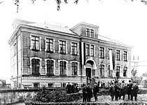
Die Kinder des Ortes besuchten ursprünglich die Leubnitzer Schule, da Mockritz seit 1674 kirchlich zu diesem Ort gehörte. 1844 wechselten sie ins benachbarte
Kaitz. Erst 1892 entstand auf Inittiative des Räcknitzer Gemeindevorstandes Franz an der Südhöhe ein gemeinsames Schulhaus für den Schulverband Mockritz -
Kleinpestitz - Räcknitz und Zschertnitz. Nach Abwägung verschiedener Standorte hatte man bewusst ein Platz abseits der Ortskerne gewählt, um allen Kindern
möglichst gleich lange Schulwege zu sichern. Projektiert wurde der Bau vom Räcknitzer Baumeister Sommerschuh. Die Kosten in Höhe von 60.000 Mark
wurden mit Hilfe eines Darlehens der Landständischen Bank finanziert. Bereits wenige Monate nach Baubeginn im August 1892 konnte die neue Schule am 6. April 1893 feierlich eingeweiht werden.
Um Einbußen beim Schulgeld auszugleichen, wurden an Kaitz und Strehlen Abfindungszahlungen in Höhe von 2.500 M bzw. 500 M  vereinbart.

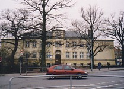Wachende Einwohnerzahlen führten bereits zehn Jahre nach Eröffnung zu Platznot an der Mockritzer Schule. 1905 gab es für insgesamt 229 Kinder nur drei
Klassenräume, je Zimmer also 76 Kinder. Zwei Jahre später besuchten bereits 233 Kinder die Schule. Um dieses Problem zu lösen, beschloß der Schulvorstand 1908
den Umbau der bisherigen Lehrerwohnung zu zusätzlichen Klassenzimmern. Außerdem konnte nun im Keller eine Kochlehrküche eingerichtet werden.

Nach Eingliederung in den Dresdner Schulbezirk wurde die Mockritzer Schule ab 1921 als 70. Volksschule bezeichnet. 1922/23 erfolgte der Anbau zweier
Seitenflügel, womit die Schule ihr heutiges Aussehen erhielt. Während des Zweiten Weltkrieges diente das Gebäude ab
Januar 1944 als Flak-Kaserne und militärische Kommandozentrale, nach 1945 als 70. Polytechnische Oberschule.
Heute wird es von der 70. Grundschule genutzt. 2013 entstand ein Ergänzungsbau mit Schulturnhalle, Speisesaal und Horträumen.

Gaswerk Mockritz:

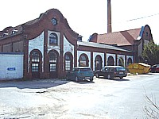1907 entstand südlich des Mockritzer Dorfkerns an der heutigen Babisnauer Straße
(Nr. 30) ein Gaswerk, das vom Gemeindeverband Bannewitz und Umgebung betrieben wurde und Mockritz sowie elf weitere Orte mit Leuchtgas versorgte. Mit
zunehmendem Bedarf errichtete man 1912 einen zweiten Gasbehälter. Das Werk bestand bis zur Eingemeindung des Ortes und wurde 1922 stillgelegt. Die Versorgung
des Ortes übernahm nun die Stadt Dresden, nachdem Mockritz Anschluss an das städtische Leitungsnetz erhalten hatten. Die Gebäude des früheren Gaswerkes
wurden im Anschluss bis 2012 von verschiedenen Gewerbebetrieben genutzt. 1932 hatte hier die Polstermöbelfabrik Max Striegnitz ihren Sitz. Künftig ist ein Umbau zu Wohnzwecken geplant.

Freibad Mockritz:

Das Mockritzer Bad geht auf den früheren Münzteich zurück, der 1621 von Kurfürst Johann Georg I. zur Verstärkung
der Wasserkraft für die Dresdner Münze angelegt wurde. Mit Hilfe von Schiebereglern an den drei Abflüssen konnte der
Wasserstand des Kaitzbaches reguliert werden, so dass bei Bedarf die entsprechende Wasserkraft zur Verfügung stand.
Die eigentliche Münze befand sich in der Nähe des Residenzschlosses, wo einst auch der Kaitzbach in die Elbe mündete.
Ab 1646 nutzte die Stadt den Teich zugleich als Fischteich sowie als Mühlteich einer nahegelegenen Wassermühle.

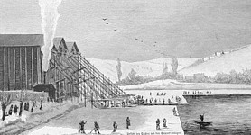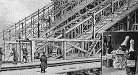

**_Bilder:_** _Die Dresdner Eiswerke am Münzteich Mockritz (um 1890)_

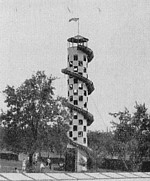Nach Verlegung der alten Münze nach Freiberg wurde auch der Münzteich überflüssig und 1882 an den englischen Unternehmer Thornton Sheil verkauft. Hier gewannen die Dresdner
Eiswerke in den Wintermonaten Eis, welches in drei speziell isolierten Scheunen gelagert und in den Sommermonaten als Kühleis verkauft wurde. Mit Erfindung des Kühlschranks konnte
auf diese Form der Kühleisgewinnung zunehmend verzichtet werden, so dass der Teich  1925 zum Freibad umgestaltet wurde. Besitzer war Moritz Hegewald, der mit finanzieller
Unterstützung der Stadt das Gelände umzäunte und mit den notwendigen Einrichtungen ausstattete. U.a. gab es 1200 Umkleidekabinen, einen 18 Meter hohen Rutschbahnturm
sowie eine schwimmende Tanzdiele für sommerliche Veranstaltungen.

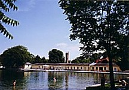
1960 erwarb die Stadt Dresden das Bad von Hegewalds Erben und gliederte es in den Städtischen Bäderbetrieb ein. 1973 entstand unmittelbar am Badgelände ein internationaler Campingplatz.
Das mehrfach modernisierte Mockritzer Bad wird heute von den Quellen des Tiefen Börners gespeist, während der Kaitzbach renaturiert am Badesee vorbeifließt. Umfangreiche Sanierungs- und
Modernisierungsarbeiten erfolgten Mitte der 1990er Jahre. Im Zuge der Maßnahmen verkleinerte sich die Wasserfläche auf ca. 10.000 m², die einst inmitten des Teichs liegende Insel wurde zur Liegewiese. Als Abschluss der
Arbeiten kam 2011 noch eine Kaltwasser-Kneipp-Anlage hinzu.

Kleingartenverein Mockritz:

Die Kleingartenanlage am Nöthnitzbach wurde 1920 durch die Carl-Ernst-von-Eulitz-Stiftung angelegt. Die Gärten
wurden bevorzugt an ärmere Bevölkerungsschichten verpachtet, um ihnen so eine bessere Versorgung mit Lebensmitteln
zu ermöglichen. 1927 entstand ein Vereinshaus, welches 1953 erweitert wurde. Nach Enteignung der Stiftung 1952 übernahm der Kleingärtnerverband die Gartenanlage, die heute 114 Gärten umfasst.

[_Weiterführende Literatur und Quellen_](../../impressum/quellenverzeichnis/)

 \[ [Home](../../index.html)\] \[ [Nord](../../nord/)\] \[ [Nordwest](../../nordwest/)\] \[ [Neustadt](../../neustadt/)\] \[ [Nordost](../../nordost/)\] \[ [West](../../west/)\] \[ [Zentrum](../../zentrum/)\] \[ [Südwest](../../sudwest/)\] \[ [Süd](../../sud/)\]
 \[ [Südost](../../sudost/)\] \[ [Ost](../../ost/)\] \[ [Register](../../Register/register.html)\] \[ [Kontakt](../../Kontakt/kontakt.html)\] \[ [Impressum](../../impressum/)\]
