* * *

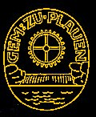

**Gemeindesiegel von Plauen**

* * *

**Bildungseinrichtungen**

**in Plauen:**

[Bibliothek plauen altplauen 1 01189 dresden tel. 0351/4121482](http://www.bibo-dresden.de)

## [Homepage der 55. Oberschule](http://www.55-mittelschule-dresden.de)

* * *

**Plauener Vereine:**

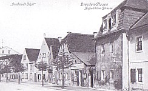Plauen wurde, gemeinsam mit Dresden, erstmals in einer Urkunde vom 31. März 1206 als Plawen erwähnt. Der Ortsname ist vom slawischen “plawat” abgeleitet, was übersetzt “schwimmen, flößen” bedeutet. Vermutlich weist diese Namensgebung auf die einstige Flößerei auf der Weißeritz hin. Das ursprüngliche Sackgassendorf bestand im 15. Jahrhundert aus den beiden Gemeindeteilen am heutigen [F.-C.-Weiskopf-Platz](../../sud/plauen/strassen_plauen/) und an der Wassergasse [(Hofmühlenstraße)](../../sud/plauen/strassen_plauen/hofmuhlenstrasse/) _(Foto)_ und unterstand ab 1315 dem Maternihospital. Mit über 30 Bauernhöfen gehörte der Ort zu den größeren Dörfern der Dresdner Umgebung und besaß bereits um 1300 eine [Kirche](../../sud/plauen/auferstehungskirche/). 1329 kam Plauen an den Rat zu Dresden. 1608 entstand an der Klingenberger Straße ein Freigut, welches sich zeitweise im Besitz des Dresdner Bürgermeisters Lehmann befand. Neben der Landwirtschaft war auch der im 16. Jahrhundert eingeführte Obstanbau von Bedeutung. Zum Schutz der Gehöfte war Plauen zeitweise von einer Mauer umgeben, die aus dem einheimischen Plänerstein (= Plauener Stein) errichtet worden war.

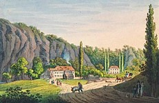Zur Plauener Flur gehören auch Teile des [Plauenschen Grundes](../../sud/plauen/plauenscher_grund/), der bereits im Mittelalter Standort mehrerer Wassermühlen war. Außerdem blieb das Tal über
Jahrhunderte kurfürstliches Jagdrevier und war später Anziehungspunkt für die Künstler der Romantik. Zu den Höhepunkten in der Geschichte dieses Grundes
zählt das prunkvolle Saturnfest im Jahr 1719 aus Anlass der Hochzeit des Kurprinzen. Ab 1542 führte vom Weißeritzufer eine vom Festungsbaumeister Caspar Voigt von Wierandt projektierte hölzerne Röhrfahrt (Hochplauensche
Wasserleitung) bis ins Dresdner Stadtzentrum. Noch älter ist die schon 1366 erstmals genannte Plauener Mühle, die im 16. Jahrhundert von Kurfürst August zur [Hofmühle](../../sud/plauen/bienertmuhle/) ernannt wurde. Bis um 1840 waren die Bauern von über 30 Dörfern verpflichtet, ihr Korn in Plauen mahlen zu
lassen.

Neben den häufigen Hochwasserfluten richteten auch kriegerische Ereignisse immer wieder Zerstörungen im Ort an. So
wurde die Plauener Kirche 1429 durch die Hussiten zerstört. Auch im Dreißigjährigen Krieg, während des Nordischen
Krieges 1706 und im Siebenjährigen Krieg 1759 wurde der Ort durch Einquartierungen und Plünderungen schwer in Mitleidenschaft gezogen. Nach der Bombardierung Dresdens im Jahr 1760 fanden zahlreiche Bürger der Stadt
vorübergehend  in Plauen Zuflucht. Im August 1813 fielen erneut einige Gehöfte den Ereignissen während der Schlacht bei
Dresden zum Opfer, nachdem zuvor französische und österreichische Soldaten im Dorf einquartiert waren.

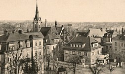In der zweiten Hälfte des 19. Jahrhunderts entwickelte sich Plauen vom
Bauerndorf zum wohlhabenden Dresdner Wohnvorort. Auf dem Gelände des früheren [Reisewitz´schen Gartens](../../sudwest/lobtau/strassen_lobtau/tharandter_strasse/reisewitz_scher_garten/) am Weißeritzufer entstanden
Gewerbebetriebe, die zur Ausbildung einer “Industriegasse” zwischen Plauen und Löbtau führte. Zu den bekannten Unternehmen gehörten die [Schokoladenfabrik Petzold & Aulhorn](../../sud/plauen/strassen_plauen/petzold___aulhorn/), die [Blechwarenfabrik Anton Reiche](../../sud/plauen/strassen_plauen/blechwarenfabrik_reiche/) und die [Brauerei Plauenscher Lagerkeller](../../sud/plauen/strassen_plauen/chemnitzer_strasse/falkenbrauerei/). Wichtigster Förderer der kommunalen
Entwicklung war jedoch der Mühlenbesitzer Gottlieb Traugott Bienert, der 1852 die frühere Hofmühle gepachtet hatte. Unter seiner Regie wuchs die Firma
zu einem modernen Großunternehmen mit über 200 Mitarbeitern. Bienert trat jedoch auch als Mäzen in Erscheinung und
finanzierte für seinen Heimatort 1874 die erste Gas-Straßenbeleuchtung, den Bau einer Kinderbewahranstalt (1883) und des Rathauses (1894). Bereits 1855 hatte der Ort Anschluss an die [Albertbahn](../../sud/plauen/plauenscher_grund/albertbahn/) erhalten, die 1868 in den Besitz des Staates
überging. Am 12. März 1873 verkehrte zum ersten Mal eine Pferdestraßenbahn (1900 elektrifiziert) über die Chemnitzer
Straße bis zum Dorfplatz. Weitere Linien folgten 1898 auf der Tharandter Straße und 1909 über die Nöthnitzer Straße bis zum Plauener Rathaus.

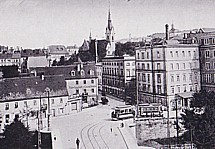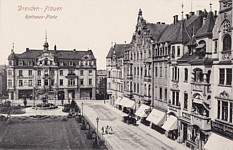

**_Fotos:_** _Altplauen mit Bienertmühle und Kirche (links) und Rathausplatz (rechts) um 1910_

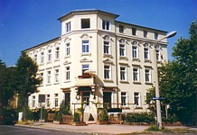Die verbesserten Verkehrsverbindungen und die zahlreichen gewerblichen Unternehmungen führten gegen Ende des 19. Jahrhunderts zu einer verstärkten
Nachfrage nach Bauland im Süden der Stadt Dresden. In Plauen übernahm die 1872 gegründete Baugesellschaft “Dresdner Westend” die Planung und Erschließung der
Freiflächen um den Ort. Zunächst begannen die Arbeiten zu beiden Seiten der [Chemnitzer Straße](../../sud/plauen/strassen_plauen/chemnitzer_strasse/) und wurden nach Verabschiedung eines Bebauungsplanes bis zum
Plauenschen Ring fortgesetzt _(Foto)_. Auf Betreiben der Gemeinde entstanden hier vorrangig Villen in offener Bauweise. Lediglich um den früheren Dorfplatz, jetzt
Chemnitzer Platz genannt, setzte sich großstädtische Bebauung durch. Diesem Boom fielen auch die meisten noch vorhandenen Bauernhöfe zum Opfer. Bis zur Eingemeindung des Ortes am 1. Januar 1903 war dieser Prozess weitgehend abgeschlossen. Zu diesem Zeitpunkt zählte Plauen ca. 12.000 Einwohner.

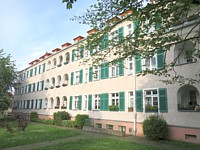
Auch nach dem Anschluss der wohlhabenden Gemeinde an Dresden blieb die Vorstadt Plauen sowohl wichtiger Gewerbestandort als auch beliebter Wohnvorort. Dazu trugen
die bereits im Eingemeindungsvertrag festgelegten Sonderkonditionen für Plauen bei, die u.a. das Fortbestehen der günstigeren Gemeindetarife für fünf Jahre und die Einrichtung
von Außenstellen der Stadtverwaltung im Plauener Rathaus vorsahen. Bis zum Ausbruch des Zweiten Weltkrieges entstanden 15 neue Straßen auf Plauenscher Flur, die vorrangig
mit Wohnhäusern bebaut wurden. Als Bauherren traten die Eisenbahner- Baugenossenschaft (Wohnanlage Münchner Straße) und der Bauverein Gartenheim (Hohenplauen - _Foto_
) in Erscheinung. 1923 wurde der frühere Eisenbahn-Haltepunkt vom Felsenkeller an die Unterführung in [Altplauen](../../sud/plauen/strassen_plauen/altplauen/) verlegt. Seit 1998 dient das Gebäude als Jugendzentrum und
Stadtteiltreff. Der Hochlegung der Gleise fielen neben dem alten Bahnwärterhaus auch einige Gebäude Altplauens und an der Zwickauer Straße zum Opfer. Mit der Entstehung der Siedlung rund um den [Fichtepark](../../sud/plauen/fichtepark/) nach 1930 war die Bebauung weitgehend vollendet.

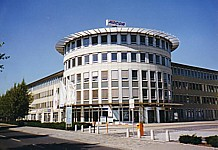Die Luftangriffe auf Dresden führten auch im Stadtteil Plauen zu schweren Schäden, vor allem im nördlichen Teil. Zu den zerstörten Gebäuden gehörten u. a. die bekannte
Schokoladenfabrik Petzold & Aulhorn, die Industriebetriebe an der Zwickauer und Tharandter Straße sowie einige Gebäude am Chemnitzer Platz. Auch der “Plauensche Gasthof” und die [Falkenbrauerei](../../sud/plauen/strassen_plauen/chemnitzer_strasse/falkenbrauerei/) wurden Opfer der Bomben. In der
Nachkriegszeit gelang es nur teilweise, die entstandenen Baulücken zu schließen. Erst nach 1990 wurden einige moderne Wohn- und Bürokomplexe errichtet, so dass
Plauen heute seine Rolle als Stadtteilzenttrum mit Ortsamt und Geschäften wieder ausfüllen kann. An der Bamberger Straße entstand ein modernes Hotel. Größtes
Bauprojekt war der auf dem Gelände der früheren Falkenbrauerei angelegte Bürokomplex “Falkenbrunnen” mit Einkaufszentrum _(Foto)_
. Zu den überregional bekannten Plauener Unternehmen gehören heute die Dr. Quendt Backwaren GmbH und die Feinkostfirma Dr. Doerr.

Schwere Schäden richtete die Hochwasserkatastrophe vom 12./13. August 2002 vor allem im unteren Teil Plauens und im
Plauenschen Grund an. Mehrere Weißeritzbrücken und Wohnhäuser wurden zerstört bzw. schwer beschädigt. Durch starke
Regenfälle im Erzgebirge war der Fluss innerhalb weniger Stunden zur reißenden Flut angeschwollen, vor der sich die Anwohner nur mit Mühe in Sicherheit bringen konnten.

Rathaus:

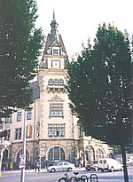

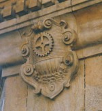Das Rathaus Plauen entstand zwischen 1893/94 am Rande des früheren Dorfplatzes. Zuvor fanden die Beratungen des Gemeinderates in den Räumen des ehemaligen Freigutes an der Klingenberger Straße statt. Bereits 1884 hatte der Mühlenbesitzer Gottlieb Traugott Bienert der Gemeinde das Grundstück für den Rathausbau kostenlos zur Verfügung gestellt. Die öffentliche Ausschreibung gewann das renommierte Dresdner Architektenbüro Lossow & Viehweger. Die Bauausführung oblag den Plauener Baumeistern Fichtner. Am 23. April 1893 erfolgte die Grundsteinlegung. Bereits am 18. Oktober 1894 konnte der im Stil der Neorenaissance gestaltete Bau mit seinem 51 Meter hohen Turm feierlich eingeweiht werden. Die Figur des heiligen Georg an der Fassade stammt von Robert Henze. Am Eingang und am Eckerker ist noch das frühere Gemeindewappen zu sehen _(Bild rechts)_. Eine weitere Darstellung dieses Wappens mit Darstellung eines Mühlrades und eines Wehrs findet sich an der 1993 restaurierten Wetterfahne des Turms. Im Turm wurden zwei Schlaglocken aufgehängt, welche um 1467 entstanden und wohl aus der alten Plauener Dorfkirche stammen.

Im neuen Rathaus fanden neben Sitzungs- und Verwaltungsräumen des Gemeinderates auch die Ortskrankenkasse, die Polizeiwache, das Standesamt und die Plauener Volksbibliothek ihr Domizil. Bis 1936 existierte auch eine Gaststätte “Ratskeller”. Nach der Eingemeindung Plauens übernahm die Stadt Dresden das Rathaus als Außenstelle. In die Räumen des früheren Ratskellers zog 1938 eine Filiale der Dresdner Stadtsparkasse ein. Nach 1945 befanden sich hier u.a. Einrichtungen der Volksbildung und ein Turn- und Gmynastikraum im ehemaligen Ratssaal. Eine umfassende Sanierung erfolgte zwischen 1993 und 1998. Heute hat hier das Ortsamt Plauen seinen Sitz.

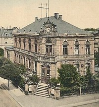Postamt:

Das erste eigene Postgebäude erhielt Plauen im Jahr 1873, als an der Ecke Klingenberger / Bienertstraße (Nr. 17) ein repräsentatives Haus mit Sandstein- und Klinkerfassade errichtet wurde _(Foto)_. Nach der Eingemeindung des Ortes befand sich hier der Sitz des Dresdner Postamtes A 27 (ab 1964 Postamt 8027).

1996 wurde das Postamt geschlossen und in den Bürokomplex Falkenbrunnen an der Chemnitzer Straße verlegt. Seit Schließung dieser Postagentur 2015 befindet sich eine Verkaufs- und Annahmestelle im Presseshop Chemnitzer Straße.

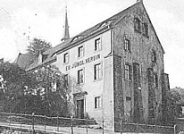Bildungseinrichtungen in Plauen:

Dorfschule: Die erste Dorfschule ist für Plauen bereits 1578 erwähnt. 1785 war diese so stark verfallen, das sich eine umfassende Erneuerung erforderlich machte. Mit wachsender Schülerzahl wurde diese Schule, die sich in der Nähe der Kirche befand, 1857 erweitert. Erst nach einem kompletten Neubau schloss die alte Dorfschule 1876 ihre Pforten. Das Gebäude wurde nun noch für einige Jahre als Vereinslokal des “Evangelischen Jünglingsvereins” genutzt und 1903 abgetragen.

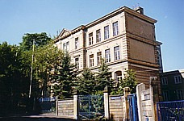39\. Volksschule: Nachdem die bisherige Schule nicht mehr den Anforderungen der stark gewachsenen Gemeinde genügte, wurde 1875 oberhalb des alten Friedhofs mit einem Schulneubau begonnen. Die Entwürfe für das Gebäude stammen von der ortsansässigen Firma Fichtner. Bereits 1876 konnte diese Schule eingeweiht werden. 1893 wurde sie noch um eine 1945 zerstörte Turnhalle erweitert. Ein Ergänzungsbau mit Aula entstand 1895 _(Foto rechts)_. Nach seiner Fertigstellung diente er als Knabenschule, während das ältere Gebäude als Mädchenhaus genutzt wurde.

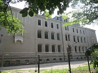Nach der Eingemeindung Plauens erhielt die Schule 1903 den Namen 39. Bezirksschule (ab 1919 39. Volksschule). Zu DDR-Zeiten trug sie den Namen des antifaschistischen Malers Fritz Schulze und erhielt 1980 eine neue Turnhalle. Heute wird das Gebäude an der Schleiermacherstraße 8 von der 39. Grundschule genutzt. Der ältere Gebäudeteil, nach einem Umbau 1960 Außenstelle des Plauener Gymnasiums, wurde 2016 abgetragen _(Foto links)_. An seiner Stelle errichtete man einen modernen Erweiterungsbau für die Grundschule.

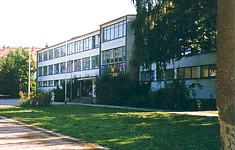49\. Grundschule: Das Schulhaus vom Typ "Dresden Atrium" an der Bernhardstraße 80 entstand zwischen 1966 und 1968 und war die vierte Neubauschule dieses zu DDR-Zeiten weit verbreiteten Typs in Dresden. Die Einweihung erfolgte am 4. März 1968 als 49. Polytechnische Oberschule. Am 12. April 1970 wurde sie nach dem sowjetischen Kosmonauten Juri Gagarin benannt. Gagarin hatte als erster Mensch der Welt 1961 das Weltall bereist. In Anlehnung an die Namensgebung gestaltete man das Gebäude ab 1977 mit einigen Kunstwerken aus. Für das Foyer schuf der Künstler Dieter Bock von Lennep 1977 ein ca. 5 x 2,60 Meter großes Wandbild "Mensch-Technik-Zukunft". Zwei Jahre später wurde am 26. November in einem der beiden Innenhöfe seine Plastik "Rakete" übergeben. Während diese beiden Kunstwerke bis heute erhalten sind, verschwand sein drittes Werk, eine Collage zum Thema Gagarin, nach 1990 bei Renovierungsarbeiten.

Im Sommer 1992 wurde aus der bisherigen zehnklassigen POS eine Grundschule. Im September 2007 erhielt sie den Namen des früheren sächsischen Staatsministers Bernhard August von Lindenau, der auch Namenspatron der Bernhardstraße ist. 2013 wurden das Schulgebäude und die Turnhalle unter Denkmalschutz gestellt. 2016 begann die Sanierung der Gebäude, die jedoch dabei weitgehend im Ursprungszustand erhalten bleiben sollen.

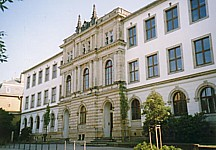55\. Volksschule: Das Gebäude der späteren 55. Volksschule wurde 1884 an der Räcknitzer Straße (Nöthnitzer Straße 6) errichtet. Das als Höhere Volksschule dienende Schulhaus erhielt 1900 ein weiteres Stockwerk, um der zunehmenden Schülerzahl im Ort Rechnung zu tragen. Zwischen 1903 und 1919 trug diese Schule den Namen XV. Bürgerschule, danach 55. Volksschule. Zu DDR-Zeiten nach einem Dresdner Arbeitersportler als 55. POS “Heinz Steyer” bezeichnet, wird das Haus heute von der 55. Oberschule genutzt _(Foto)_. 2010 wurde dieser der Name “Gottlieb Traugott Bienert” verliehen. Der Plauener Industrielle hatte sich einst große Verdienste für das Bildungswesen seines Heimatortes erworben.

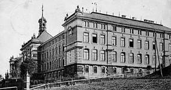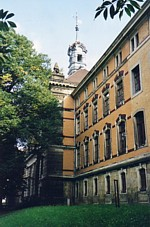Lehrerseminar: Das Königliche Lehrerseminar Plauen wurde zwischen 1894 und 1896 erbaut und am 18. April 1896 als erstes Lehrerseminar Sachsens in einer Dorfgemeinde feierlich eröffnet. Für diese Bildungseinrichtung entstand an der Kantstraße 2 ein repräsentativer Bau nach Plänen des Baurates Waldow. Finanziert wurde der Schulbetrieb teilweise durch Stiftungen Plauener Einwohner und Vereine. 1922 wurde das Lehrerbildungsseminar als Deutsche Oberschule in ein Gymnasium für
Jungen umgewandelt. Zu DDR-Zeiten EOS “Friedrich Engels” genannt, hat heute hier das Gymnasium Dresden-Plauen seinen Sitz. 1961 erhielt die Schule eine kleine, bis heute bestehende Schulsternwarte, die zugleich von der 39. POS genutzt wurde.

In der Aula der Schule befand sich bis 1952 eine Orgel, die dann aus bautechnischen Gründen entfernt werden musste. Im
Jahr 2000 konnte durch die Schenkung eines Privatmannes ein neues Instrument der Firma Jehmlich aufgestellt werden. Die
Aula diente in der Nachkriegszeit einige Jahre auch als Kino (Filmtheater Kantstraße). Zuvor hatte man diese Räume als
Lager für Wertsachen genutzt, welche nach dem Luftangriff aus zerstörten Häusern geborgen bzw. bei Bombenopfern
gefunden worden waren. Dieses Lager bestand bis zum Mai 1945, wurde dann jedoch von der Roten Armee geplündert und wenig später aufgelöst.

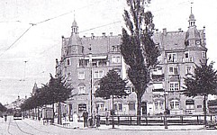Volksbibliothek: Die erste öffentliche Bibliothek in Plauen wurde 1877 auf
Anregung des Ortsvereins im Schulhaus an der Kirche eingerichtet und existierte bis zu ihrer Auflösung 1931. Die von der Gemeinde finanzierte Volksbücherei
war zunächst im Konferenzsaal der Schule untergebracht, zog jedoch 1902 in das neuerbaute Plauener Rathaus um. Mit der Eingemeindung des Ortes kamen die
ca. 3.600 Bände in die Obhut des “Gemeinnützigen Vereins Dresden-Plauen”.

Eine weitere Bibliothek wurde am 19. Februar 1906 als “Freie öffentliche
Bibliothek” auf Initiative Ida Bienerts eröffnet. Erster Leiter war bis 1913 Walter Hofmann (1879-1952), der als Begründer der Idee der Volksbibliotheken gilt. Hofmann arbeitete zuvor als Graveur, lernte
später die ebenfalls sehr kunst- und kulturinteressierte Industriellengattin kennen, die ihn mit dem Aufbau der privat
finanzierten Leihbibliothek beauftragte. 1921 wurde die Bücherei durch die Stadt Dresden übernommen und ist heute Teil
der Dresdner Stadtbibliothek. Ursprünglich befand sie sich auf der  Kielmannseggstraße (heute Agnes-Smedley-Straße 11 - _Foto_
). Später war sie viele Jahre auf der Altfrankener Straße 6 in Löbtau untergebracht und ist heute in Altplauen Nr. 1 zu finden.

Hochplauensche Röhrfahrt:

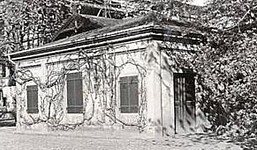Erste Röhrfahrten, d. h. in der Regel aus Holz gefertigte Wasserleitungen,
entstanden bereits zu Ausgang des Mittelalters und dienten der Wasserversorgung der Stadt. Zu den bedeutendsten gehörte die 1541/42 von Festungsbaumeister Caspar Voigt von Wierandt projektierte “Hochplauensche
Röhrfahrt”, die in der Nähe der Walkmühle von der Weißeritz abzweigte und bis zum Schloss führte. Für die Rohre wurden aufgebohrte Kiefernstämme verwendet. Um 1720 folgte eine Zweigleitung in den Zwingerhof zur
Versorgung der dort installierten Wasserspiele des Nymphenbades. Erstmals kamen hier Rohre aus Eisenguß zum Einsatz, die sich wegen ihrer besseren
Haltbarkeit bald überall durchsetzten. Zur Füllung des im Kuhturm des Wilsdruffer Tores befindlichen Wasserbehälters
entwickelte der Hofmechanicus Andreas Gärtner eine Wasserkunst, welche das Röhrwasser 29 Ellen hoch in das Reservoir pumpte.

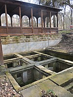Zum Schutz der Einleitung befand sich in Plauen an der Wassergasse (heute Fußweg hinter der Bienertmühle)
das sogenannte Wasserhaus, welches zugleich dem Röhrmeister als Arbeitsstelle diente _(Foto oben rechts)_. Dieser war für die ständige Kontrolle der Wasserqualität sowie die
technische Instandhaltung der Anlage verantwortlich. Dort wurde das Wasser des Mühlgrabens abgezweigt, in Siebschächte geleitet und im Anschluss über drei Ablaufschächte in ein
Rohrsystem verteilt. Mehrfach wurde dieses Gebäude erneuert, wobei sogar die bekannten Ratsbaumeister Johann G. Fehre und George Bähr beteiligt gewesen sein sollen. Die letzte
Rekonstruktion des Plauener Wasserhauses erfolgte 1862. Wenig später entstand unmittelbar dahinter der Gartenpavillon der Bienertschen Villa als Sichtschutz. Noch bis zum Ersten
Weltkrieg war die Hochplauensche Röhrfahrt in Betrieb, musste dann jedoch modernen Wasserleitungen weichen. Das historische Gebäude fiel um 1980 dem Abriss zum Opfer. Eine
Freilegung der Fundamentreste mit den Wasserkammern erfolgte in den letzten Jahren _(Foto links)_. Seit 2013 informiert im sanierten Bienert-Pavillon über die Geschichte der Wasserversorgung.

Gaswerk Plauen:

Die erste Plauener Gasanstalt ließ der Mühlenbesitzer Gottlieb Traugott Bienert 1874 zur Versorgung seines Unternehmens erbauen.
Bald wurden auch einige Wohnhäuser und Straßenlaternen angeschlossen, wodurch Plauen zu einem der ersten Dörfer mit Gasstraßenbeleuchtung wurde. Das kleine Werk genügte jedoch schon bald nicht mehr den Anforderungen der
wachsenden Gemeinde, so dass Bienert 1878 auf Löbtauer Flur an der heutigen Ecke Tharandter/ Fritz-Schulze-Straße ein
weiteres Gaswerk anlegte. Beide Werke gingen 1903 in den Besitz der Stadt der Stadt Dresden über. Während die
Plauener Gasanstalt bereits im März 1903 stillgelegt wurde, produzierte das Löbtauer Werk noch bis 1920. Die Gebäude
und Gasbehälter wurden schließlich 1923/24 beseitigt. Auf dem Areal steht heute die Tankstelle am Eingang zum Plauenschen Grund.

## [Plauener Straßen](../../sud/plauen/strassen_plauen/)

[_Weiterführende Literatur und Quellen_](../../impressum/quellenverzeichnis/)

 \[ [Home](../../index.html)\] \[ [Nord](../../nord/)\] \[ [Nordwest](../../nordwest/)\] \[ [Neustadt](../../neustadt/)\] \[ [Nordost](../../nordost/)\] \[ [West](../../west/)\] \[ [Zentrum](../../zentrum/)\] \[ [Südwest](../../sudwest/)\] \[ [Süd](../../sud/)\]
 \[ [Südost](../../sudost/)\] \[ [Ost](../../ost/)\] \[ [Register](../../Register/register.html)\] \[ [Kontakt](../../Kontakt/kontakt.html)\] \[ [Impressum](../../impressum/)\]
