* * *

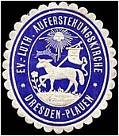

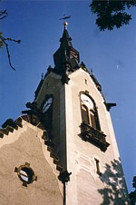

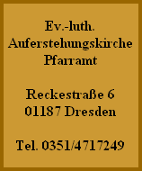

* * *

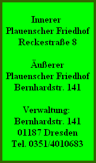

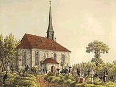Die erste Plauener Kirche entstand wahrscheinlich bereits Mitte des 13 Jahrhunderts, da schon 1296 erstmals ein Pfarrer zu “Plawen” genannt wurde. Sie unterstand ursprünglich dem Kloster Altzella, später dem Nonnenkloster Seußlitz und wurde 1429 während der Hussitenkriege zerstört. 1466 erfolgte ein Neubau mit einem neuen Turm. Am 14. März 1467 wurde dieser Bau durch den Meißner Bischof dem Heiligen Michael geweiht. Erweiterungen des Gotteshauses sind für 1617 und 1700 verbürgt. Die erste Orgel der Kirche wird im Jahr 1491 genannt und soll der Überlieferung nach aus der alten Kreuzkirche gestammt haben.

1735 erhielt die Kirche einen vom Besitzer der Hofmühle gestifteten Barockaltar, der von J. G. Feige geschaffen wurde. Von Feige stammt auch das Grabmal des Mühlenbesitzers Gäbler. Die Ausstattung der Kirche wechselte in der Folgezeit mehrfach. So kam Ende des 18. Jahrhunderts die Orgel der alten Frauenkirche nach Plauen, wo sie noch einige Jahre im Einsatz war. 1878 begann eine umfassende Renovierung der Plauener Kirche. Neben einem Anbau für die Sakristei erhielt das Gebäude eine von Bienert gestiftete neue Orgel. Auch die nach einer Erneuerung des Turmes 1893 aufgehängten Glocken wurden von der Mühlenbesitzerfamilie finanziert.

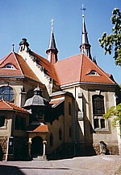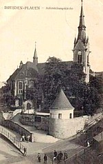Trotz aller Bemühungen erforderte die zunehmend schlechtere Bausubstanz zur Jahrhundertwende einen grundlegende Sanierung des Gebäudes. Zwischen 1900 und 1902 wurde die Kirche deutlich vergrößert und umgebaut und erhielt dabei ihr heutiges Aussehen mit dem auf 49 Meter erhöhten Turm. Die Pläne lieferte das renommierte Architektenbüro Lossow & Viehweger, welches sich für den damals verbreiteten Baustil der deutschen Renaissance entschied. Die Ausführung oblag dem Plauener Baumeister Fichtner. Beim Umbau erweiterte man das Kirchenschiffs und baute ein zusätzliches Querschiffs an, so dass das Gotteshaus nun Platz für 1300 Menschen bot. Am 9. März 1902 wurde die neue Kirche feierlich geweiht und ein Jahr später offiziell in Auferstehungskirche umbenannt. Im Umfeld schuf Stadtbaurat Hans Erlwein 1907 eine neue Treppenanlage mit einem kastellartigen Eckturm _(Foto links)_. Für diese Arbeiten mussten die alte Plauener Schule und die Dorfschmiede abgetragen werden, womit der Abbruch des Oberdorfes abgeschlossen war.

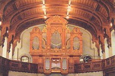Die Plauener Auferstehungskirche wurde 1945 nur leicht beschädigt, verlor jedoch die künstlerisch wertvollen Glasfenster von Bruno Urban. Am 1. Juli 1945 fand im Gotteshaus das erste Nachkriegskonzert des Kreuzchores statt, der die Kirche auch später für gelegentliche Auftritte nutzte. Als Ersatz für die verlorenen Glocken wurde das Geläut der zerstörten Zionskirche eingebaut. Den Innenraum gestaltete man 1953 im Stil der damaligen Zeit um, wobei die Kirche viel von ihrer ursprünglichen Atmosphäre verlor. 1985 baute die Firma Eule eine moderne Orgel in den vorhandenen Orgelprospekt ein _(Foto)_. Nach 1990 begannen umfangreiche Sanierungsarbeiten, die auch eine teilweise Wiederherstellung des historischen Innenraumes vorsehen. 2003 konnten fünf neue Glasfenster eingebaut werden. Die vom Glaskünstler Wolfgang Korn gestalteten Fenster orientieren sich in ihrer Thematik an den historischen Vorbildern, wurden jedoch modern gestaltet. Bemerkenswert ist auch der noch aus der alten Dorfkirche stammenden Taufstein sowie das Altarbild “Segnender Christus” von Alfred Diethe (1859).

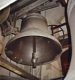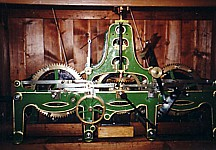

**_Fotos:_** _Glocke und Uhrwerk der Plauener Kirche_

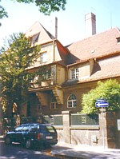
Gemeindehaus: Das Gemeindehaus der Plauener Auferstehungskirche an der Reckestraße 6 entstand 1912 und löste einen Vorgängerbau von 1878 ab. Dieser genügte nicht mehr
den Anforderungen der auf über 10.000 Mitglieder gewachsenen Kirchgemeinde. Für den Neubau beauftragte man den Architekten Max Wrba, der sich für ein zweigeschossiges
Gebäude in Jugendstilformen entschied. Wrba hatte sich zuvor gegen 29 Mitbewerber in einem entsprechenden Wettbewerb durchgesetzt. Der plastische Schmuck an der Fassade stammt von Oskar Döll.

Die offizielle Einweihung des Neubaus erfolgte am 9. Oktober 1912. Neben der Verwaltung erhielten auch verschiedene kirchliche Vereine Räume im Haus. Für diese gab es im Erdgeschoss einen großen und einen kleinen Saal.
Außerdem wurde das Gebäude bis 1995 als Kindergarten genutzt. Da das Gemeindehaus den Zweiten Weltkrieg ohne Schäden überstand, fanden
hier 1945 die ersten Proben des Kreuzchores statt. Von 1948 bis 1972 tagte zudem die sächsische Landessynode im Haus.

Kindergarten:
Die Geschichte des evangelischen Kindergartens Plauen begann 1932, als die Tochter des Pfarrers mit regelmäßigen “Kinderstunden” eine ehrenamtliche Betreuung aufbaute. Die zunehmende Nachfrage führte 1934 zur
Einrichtung eines regulären Kindergartens im Gemeindehaus an der Reckestraße. Dieser bestand bis 1941, wo die Kirche zur Übergabe der Einrichtung an die NS-Volkswohlfahrt gezwungen wurde. Mit dieser Anordnung sollte der
christliche Einfluss zugunsten einer nationalsozialistischen Erziehung zurückgedrängt werden. Bereits 1945 gab es jedoch eine Neugründung, die auch die DDR-Zeit überstand. Bautechnische Gründe führten nach der Wende zur
Schließung und zum Umzug in einen Neubau auf der Krausestraße 5, der am 4. August 1995 eingeweiht wurde.

* * *

Innerer Plauenscher Friedhof:

Der Innere Plauensche Friedhof entstand als Kirchhof der alten Plauener Kirche und wurde bereits 1647 erstmals
erweitert. Hier fanden bis zum Bau des Äußeren Plauenschen Friedhofes alle verstorbenen Einwohner des Dorfes ihre letzte Ruhestätte. Die nur 0,33 Hektar große Anlage wurde 1901-1907 im Zusammenhang mit dem Kirchenneubau
umgestaltet, wobei die Pläne für den Vorplatz des Gotteshauses mit der großen Freitreppe von Hans Erlwein stammen. Bedeutendstes Grabdenkmal ist die Familiengruft der Bienerts mit Plastiken von Robert Henze. Außerdem
fanden bekannte Plauener Industrielle wie der Direktor der [Felsenkellerbrauerei](../../../sud/plauen/plauenscher_grund/felsenkellerbrauerei/) Albert Franz Evereth (1848-1901),
die Baumeister Imanuel Ferdinand (1836-1906) und Konrad Albert Fichtner (1870-1941) und der Großindustrielle John Daniel Souchay hier ihre letzte Ruhestätte. Letzterer war viele Jahre Besitzer von [Schloss Eckberg](../../../nordost/loschwitz/albrechtsschlosser/). Zwei Kriegsgräberstätten mit Holzkreuz und einem Sandsteinrelief sind Arbeiten des Bildhauers Friedrich Press.

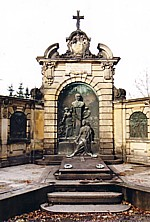Die in einer Friedhofsecke gelegene Grabanlage Bienerts gehört zu den wichtigsten
Schöpfungen der Friedhofsarchitektur im Stadtgebiet _(Foto)_. 1894 wurde hier der bekannte Mühlenbesitzer und Stifter Gottlieb Traugott Bienert (1813-1894) beigesetzt.
Das Porträt des Plauener Ehrenbürgers sowie die Bronzefiguren und - reliefs am Grabmal stammen von Robert Henze. Neben ihm ruhen seine Frau Amalie Wilhelmine, geborene
Heger (1800-1877) und sein Sohn Theodor (1857-1935). Bienerts zweiter Sohn Erwin (1859- 1930) fand im Nachbargrab seine letzte Ruhestätte. Beide setzten das Werk ihres
Vaters fort und waren Stifter des Müllerbrunnens und des Bienertparkes am Hohen Stein. Erwins Ehefrau, die Kunstsammlerin Ida Bienert, initiierte 1904 die Gründung der ersten
Volksbibliothek und versammelte in den Zwanziger Jahren einen Freundeskreis junger Künstler um sich. Zu dieser Runde gehörten u. a. Fritz Löffler, Oskar Kokoschka, Paul
Klee, Otto Dix und Walter Gropius. Letzterer konnte von ihr auch für die Gestaltung der Grabstätte gewonnen werden. Auch der Sohn Erwin und Ida Bienerts, der
Mühlenfabrikant Friedrich Bienert, wurde 1969 in dieser Gruft beigesetzt. Friedrich Bienert war ab 1924 mit der bekannten Tanzpädagogin Gret Palucca verheiratet.

Unweit des Bienert-Grabes liegt die Familiengrabstätte der Familie Wolf. Hier ruht u.a. der Geologe und Biologe Theodor Wolf (1841-1924), der Ende des 19. Jahrhunderts in Südamerika lebte und die erste Landkarte von
Ecuador schuf. Als Naturforscher befasste er sich mit Geologie, Flora und Fauna des Landes und ist Namensgeber
eines Vulkans und einer Krakenart. Wolf lebte nach seiner Rückkehr nach Europa 1891 in Plauen. Die Grabstätte wurde 2013 saniert.

**_Grabstätte_**

**_Todesjahr_**

Familiengrabstätte Bienert (Mühlenbesitzerfamilie)

Familiengrabstätte Schleider (Bildhauer)

Amalie Wilhelmine Heger, Stifterin (Heger-Bienert-Stiftung)

1877

Albert Franz Emil Everth, Direktor der Felsenkellerbrauerei

1901

Hermann Otto Zieger, Kunstmaler

1905

Imanuel Ferdinand Fichtner, Baumeister

1906

Hermann Blauert, Baumeister

1923

Theodor Wolf, Naturforscher und Geograph

1924

Rudolf Focke, Bürgermeister von Geithain

1933

Konrad Albert Otto Fichtner, Baumeister

1941

Johannes Blauert, Architekt und Baumeister

1944

Theodor Görschen, königlich-sächsischer Musikdirektor

1946

Alfred Richter, Prof. Dr.-Ing.

1971

Otto Hliste, Baumeister

1973

Paul Otto Seibt, Baumeister (Familiengrabstätte Seibt - Lienemann)

1977

Fritz Moritz Kleinert, Kammermusiker

1978

* * *

Äußerer Plauenscher Friedhof:

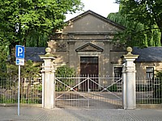Zur Entlastung des bisherigen Friedhofs entstand 1882 an der südlichen Flurgrenze
zu Coschütz ein neuer Begräbnisplatz, der heute als Äußerer Plauenscher Friedhof bezeichnet wird. Dafür erwarb die Gemeinde ein 2,8 Hektar großes Grundstück
und ließ eine Totenhalle und eine Friedhofskapelle errichten. 1897 erfolgte unmittelbar angrenzend die Anlage des Coschützer Friedhofs.

Zu den bekannten Persönlichkeiten, die auf dem Äußeren Plauenschen Friedhof  ihre letzte Ruhe fanden, gehört der frühere Plauener Gemeindevorstand Karl
Gustav Großmann (1843-1900), dessen Grabstein ein Porträtmedaillon von Robert Henze ziert. In seiner Nachbarschaft befindet sich die von August Schreitmüller im Jugendstil geschaffene
Grabstätte der Familie Pleißner (1905). Auch der 1988 verstorbene Dresdner Kunsthistoriker Fritz Löffler (“Das alte Dresden”) wurde auf diesem Friedhof beigesetzt, ebenso zahlreiche früheren TH-Professoren.

**_Grabstätte_**

**_Todesjahr_**

Karl Großmann, Gemeindevorstand von Plauen

1900

Friedrich Bernhard Pfennigwerth, Unternehmer (Lederfabrik) und Handelsgerichtsrat

1927

Richard Julius Müller, Architekt und Rektor der Technischen Hochschule

1930

Hans Lohmann, Oberlehrer Am Annen- und König-Johann-Gymnasium

1930

William Fichtner, Baumeister (Gebrüder Fichtner)

1937

Wilhelm Geißler, Bauingenieur, Professor an der Technischen Hochschule

1937

Johannes Görges, Professor für Elektrotechnik

1946

Gerhard Tempel, Baumeister

1947

Enno Heidebroek,Professor für Maschinenkunde

1955

Georg Oehme, Maler und Professor

1955

Hans Fischer, Architekt

1962

Adolf Loeltgen, Kammersänger

1968

Willy Kehrer, Komponist

1976

Kurt Fichtner, Architekt

1979

Stefan Fronius, Professor für Konstruktionstechnik

1984

Fritz Löffler, Kunsthistoriker und Denkmalpfleger

1988

Bernhard Klemm, Architekt

1995

Hans-Joachim Papke, Architekt

1995

Fritz Schultheiß, Professor für Elektrotechnik

1998

Helmut Rucker, Kammervirtuos

1999

Fritz Wiegmann, Professor für Elektrotechnik

2003

* * *

 \[ [Home](../../../index.html)\] \[ [Nord](../../../nord/)\] \[ [Nordwest](../../../nordwest/)\] \[ [Neustadt](../../../neustadt/)\] \[ [Nordost](../../../nordost/)\] \[ [West](../../../west/)\] \[ [Zentrum](../../../zentrum/)\] \[ [Südwest](../../../sudwest/)\] \[ [Süd](../../../sud/)\] \[ [Südost](../../../sudost/)\] \[ [Ost](../../../ost/)\] \[ [Register](../../../Register/register.html)\] \[ [Kontakt](../../../Kontakt/kontakt.html)\] \[ [Impressum](../../../impressum/)\]
