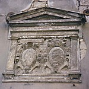
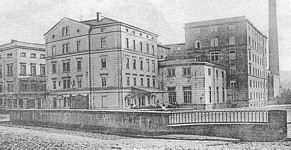
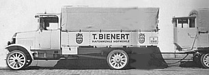
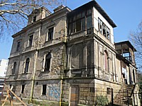
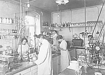
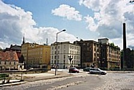
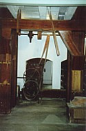
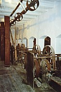

* * *

* * *

* * *

* * *

* * *

* * *

Die Geschichte der Bienertmühle reicht bis ins Jahr 1366 zurück, in dem erstmals eine Wassermühle auf Plauener Flur erwähnt wurde. Diese besaß vier Mahlgänge und eine Brettschneide und wurde später erweitert. 1568 erwarb Kurfürst August eine 1541 von den Dresdner Tuchmachern erbaute Walkmühle und ließ sie bis 1571 durch einen größeren Neubau ersetzen. Die nun als Hofmühle bezeichnete Mühle mit 16 Mahlgängen besaß bis ins 19. Jahrhundert die Mahlgerechtigkeit für Dresden und 66 Dörfer, was zur Folge hatte, dass die Bauern der betroffenen Orte ihr Getreide ausschließlich in Plauen mahlen lassen durften. Erst im Zuge der staatlichen Reformen nach 1830 wurde dieser Mahlzwang aufgehoben. Die Mühle war wegen ihrer Bedeutung und der hier gelagerten Getreidevorräte zu Kriegszeiten immer wieder Ziel feindlicher Soldaten. 1643 nutzte sie der kaiserliche General Piccolomini als Hauptquartier. Letztmals wurde sie 1813 beschädigt. Bereits 1730 hatte der Hofmüller als Nebenerwerb eine kleine Schankwirtschaft eingerichet.

An die alte Hofmühle erinnert noch das kurfürstliche Wappen im Hof mit dem Wappenstein des ersten Hofmühlenmeisters Zacharias Zimmermann von 1570 _(Foto)_. Der Reliefstein, welcher zu den ältesten Einzeldenkmalen Dresdens gehört, zeigt links die Kurschwerter mit der sächsischen Raute, rechts drei Löwen unter einer Krone. Diese entstammen dem dänischen Reichswappen und verweisen auf Kurfürstin Anna, die als Förderin der Landwirtschaft maßgeblich an der wirtschaftlichen Entwicklung Sachsen beteiligt war. Zwischen den Wappen sind zwei verschlungene Monogramme mit dem Buchstaben A zu sehen, die an Kurfürst August und Kurfürstin Anna als Schirmherren der Mühle erinnern.

Nach Aufhebung des Mahlzwanges 1841 verlor die technisch verschlissene Mühle schnell an Bedeutung. So konnte der aus Eschdorf stammende Müller Gottlieb Traugott Bienert am 1. Mai 1852 die Hofmühle Plauen zu günstigen Konditionen pachten. Sofort begann Bienert mit der Modernisierung der Mühle, die 1853 um eine Bäckerei erweitert wurde. 1858 wurde die erste Dampfmaschine installiert, die bei Wassermangel die Turbinen an der Weißeritz ersetzen konnte. Umfangreiche Erweiterungen erfolgten zwischen 1867 und 1889. Dabei entstand u. a. ein neuer Großspeicher mit Gleisanschluss an die Eisenbahnlinie. Als Transportmittel wurden jedoch auch Lkw sowie spezielle Güterstraßenbahnwagen eingesetzt. Einer dieser Güterbeiwagen ist noch heute im [Straßenbahnmuseum](../../../nordwest/trachenberge/strassenbahnmuseum/) in Trachenberge zu sehen.

**_Foto:_** _Transportkraftwagen der Bienertschen Mühlenwerke aus den 1920er Jahren_

Außerdem ließ sich Bienert 1863 eine Villa als Wohnhaus erbauen, die mit einem kleinen Landschaftspark umgeben wurde. Dieser war im Stil der damaligen Zeit mit Wasserläufen und Grotten sowie einer Pergola gestaltet, auf deren Dach ein Tennisplatz lag. Der Park wurde vom bekannten Gartenarchitekten Max Bertram entworfen. Villa und Park sind heute leider nur noch in schlechtem Zustand erhalten _(Foto)_, sollen jedoch schrittweise wiederhergestellt werden. 2013 konnte bereits der hölzerne Gartenpavillon restauriert werden, in dem einige Schautafeln über die Geschichte des Grundstücks informieren. 2015 begann der Wiederaufbau der Villa als Wohnhaus. An die Mühlenbesitzerfamilie erinnert auch das gut erhaltene Familiengrab auf dem [Inneren Plauenschen Friedhof](../../../sud/plauen/auferstehungskirche/).

Genau 20 Jahre nach Unterzeichnung des ersten Pachtvertrages konnte Bienert die Hofmühle vom sächsischen Staat käuflich erwerben. Weiteren Investitionen stand nun nichts mehr im Wege. Die Neuheiten, darunter der Bau einer Gasanstalt 1874, einer eigenen Telegraphenstation und einer neuen Wasserleitung kamen nicht nur dem Betrieb, sondern auch der Gemeinde zugute. Um 1900 beschäftigten die Bienertschen Werke in Plauen, zu denen neben der Bienertmühle auch eine Brotfabrik gehörte, über 220 Beschäftigte. 1913 konnte mit der [Hafenmühle](../../../zentrum/friedrichstadt/alberthafen/) in Dresden-Friedrichstadt ein weiterer Betriebsteil eröffnet werden. Zeitgleich errichteten die Bienerts in Plauen eine moderne Großbäckerei, für deren Bau ein Teil der alten Mühlengebäude sowie die Wohnhäuser Altplauen Nr. 11-15 abgerissen werden musste. Das markante Gebäude mit Uhrturm entstand zwischen 1913 und 1918 am Aufgang zur Schleiermacherstraße in Stahlbetonbauweise und erhielt mehrere Backofenräume, Brotsäle sowie Lager und Remisen für den Fuhrpark des Betriebes. Architekt des Gebäudes war Carl Schümichen, die Bauausführung oblag der Plauener Firma Gebrüder Fichtner und dem Betonbauunternehmen Dyckerhoff & Widmann.

Neben der Getreideverarbeitung gehörte bis zum Ersten Weltkrieg auch eine Ölmühle zum Unternehmen. Diese hatte ihren ursprünglichen Standort unmittelbar am Weißeritzufer und musste 1880 der Erweiterung der Hofmühle weichen. Nach Fertigstellung des Neubaus wurde sie in diesen integriert und zur Herstellung von Raps- und Leinöl genutzt. Größere Erweiterungen erfolgten nach dem Ersten Weltkrieg mit dem Bau des neuen Bahnspeichers mit Ladegleisen (1929) und eines weiteren Großspeichers 1938/39.

1972 wurden die Bienertwerke in Volkseigentum überführt und nun als VEB Dresdner Mühlenwerke bezeichnet. Den Mahlbetrieb in Plauen stellte man wenig später ein, so dass die Mühle nun nur noch als Backwarenfabrik diente. Bis 1995 war das Unternehmen in Betrieb, zuletzt als Teil der Brotfirma Wendeln. Die stark sanierungsbedürftigen Gebäude _(Foto)_ sollten danach einer
neuen Nutzung zugeführt werden. Im Gespräch waren u.a. eine Seniorenwohnanlage bzw. die Einrichtung eines Kulturzentrums oder einer Jugendherberge.

2006 eröffnete in einem Teil des Mühlenkomplexes das Museum Hofmühle mit einer Schau zur Geschichte der Bienertmühle und des Ortes Plauen sowie einem kleinen Mühlenladen mit Café. Außerdem ist hier eine Ausstellung historischer Schokoladenformen der Plauener [Firma Anton Reiche](../../../sud/plauen/strassen_plauen/blechwarenfabrik_reiche/) sowie zum Leben der Tanzpädagogin Gret Palucca, Ehefrau Fritz Bienerts, zu sehen. In weiteren Räumen finden regelmäßig Wechselausstellungen und Veranstaltungen statt. Die übrigen Gebäude werden von verschiedenen Firmen genutzt. Anfang 2010 erfolgte der Abriss des 1938/39 erbauten früheren Getreidespeichers zugunsten eines geplanten, jedoch nie realisierten Sportkletterzentrums des Alpenvereins. Weitere Teile der früheren Bienertmühle werden seit 2014 zu Loftwohnungen ausgebaut.

**_Fotos:_** _Reste der historischen Technik im Mühlenmuseum der Bienertmühle_
