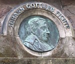
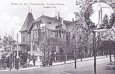
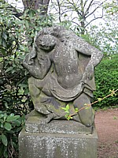
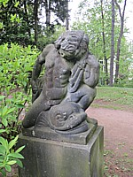
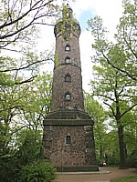
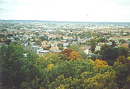
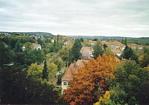

* * *

* * *

* * *

**Porträtmedaillon am Eingang des Fichteturms**

**Öffnungszeiten:**

**Fichteturm:**

**Do. - So. 10-18 Uhr**

**Fichteturm** [**www.bismarcktuerme.de**](http://www.bismarcktuerme.de)

Der heutige Fichtepark wurde 1890/91 als Westendpark angelegt und am 26.
September 1891 aus Anlass des 100. Geburtstages von Theodor Körner feierlich eingeweiht. Der ca. 2,4 Hektar große Park war ursprünglich als Mittelpunkt eines neuen Wohngebietes gedacht, dessen geplantes
Straßensystem heute noch in der Halbkreisstraße zu sehen ist. 1889 wurde für dessen Planung ein öffentlicher Wettbewerb ausgeschrieben, an dem 27 Bewerber teilnahmen. Den ersten Preis für die Gestaltung der Parkanlage
erhielt der aus Berlin-Treptow stammenden preußische Hofgartendirektor Carl Hampel. Das Grundstück stiftete die Familie Bienert sowie die in Plauen tätige
Baugesellschaft “Dresdner Westend”. Zur gastronomischen Versorgung der Besucher des Parkes wurde an der Bernhardstraße / Großmannstraße 1895 die Gaststätte “Parkschänke” mit Gästegarten und einer Kegelbahn eröffnet _(Foto)_. 1945 fiel das Gebäude den Bomben zum Opfer. An seiner Stelle befindet sich heute ein Kinderspielplatz.
Bepflanzung und Wegeführung der Anlage wurden von Hampel geschickt dem ansteigenden Gelände angepasst, so dass
sich ein kulissenartiges Bild mit verschiedenen Sichtachsen bot. Die bogenförmigen Wege, ein kleiner Bach und eine
1902/03 geschaffene Teichanlage betonten den Charakter der Anlage als Landschaftspark. 1906 folgten noch ein Spielplatz und eine Rodelbahn.

Auch nach Schließung der Parkschänke, die 1918 zum Wohnhaus umgewandelt und dabei wesentlich verändert wurde, blieb der Park beliebter Treffpunkt der Plauener Bevölkerung.
In den Zwanziger Jahren wurde er architektonisch neu gestaltet. In diesem Zusammenhang entstand nach einem Entwurf des Bauamtmannes Carl Hirschmann ein Rondell mit acht
Figurengruppen von Kindern mit Tieren, die die menschlichen Temperamente darstellen sollen. Heute sind nur noch die Gruppe “Kind mit Schildkröte” (von Paul Polte) und “Kind
mit Delphin” (von Franz Weschke) erhalten geblieben _(Bilder rechts)_. Die Finanzierung der Plastiken, mit deren Gestaltung zugleich aus dem Krieg heimgekehrte Dresdner Bildhauer
unterstützt werden sollten, übernahm die Bienertstiftung. Angeordnet waren die Plastiken rund um eine abgesenkte Wiesenfläche, welche über vier kleine Freitreppen zu erreichen
war. Im Mittelpunkt des Ovals stand eine Vase aus der Werkstatt des Bildhauers Rudolf Gerbert. 1929 folgte die Anpflanzung von einigen Azaleen- und Rhododendronsträuchern.

**Oskar Aurich: _Kindergruppe_ (Wehmut)**

**Arthur Berger: _Kindergruppe Putte und Bär_**
**(Gleichmut)**

**Paul Berger: _große Figur_ (Sanguiniker)**

**Paul Lindau: _große Figur_ (Melancholie)**

**Franz Weschke: _Kind mit Delphin_ (Frohsinn)**

**Georg Türke: _große weibliche Figur_ (Phlegma)**

**Arthur Selbmann: _weibliche Figur mit Truthahn_ (Choleriker)**

**Paul Polte: _Kind mit Riesenschildkröte_ (Trübsinn)**

**ehemalige Figurengruppen im Fichtepark**

1936 kam es zu wesentlichen Eingriffen in die Gestaltung des Parks. Sowohl das Oval mit Freitreppen und Vase als
auch sechs der acht Figurengruppen wurden zugunsten einer geplanten, aber nie realisierten Freilichtbühne entfernt.
Diese gelten seit 1945 als verschollen, lediglich Gerberts Vase ist noch erhalten und befindet sich heute im Lapidarium
der Stadt. Außerdem ließ man am Fichteturm einen Rundplatz anlegen, welcher als Ort für Veranstaltungen vorgesehen
war. In diesem Zusammenhang mussten auch einige Wege verlegt werden. 1937 erhielt der Park aus Anlass des 175. Geburtstages von Johann Gottlieb Fichte den Namen Fichtepark.

Nach 1945 gingen weitere Teile der historische Struktur des Fichteparks verloren. So beseitigte man 1952 die erhaltenen Reste des Rondells, wenig später wurden am Parkrand zwei Garagen errichtet. Zwischen 1957 und 1965
erfolgte eine teilweise Neugestaltung der gesamten Anlage. Mit dem Abriss des Toilettenhäuschens am südlichen Rand
verschwand 1980 ein weiteres Zeugnis der Geschichte. Erst nach 1990 wurde mit einer umfangreichen Rekonstruktion begonnen, wodurch das ursprüngliche Erscheinungsbild des Parks weitgehend wiederhergestellt werden konnte.

Fichteturm:

Auf Betreiben deutsch-nationaler Kreise um den Plauener Eisenbahnsekretär Müller wurde 1896 aus Anlass des 25. Jahrestages der Gründung des Deutschen Reiches der
Bismarckturm erbaut. Ein Jahr zuvor hatten Plauener Bürger den Bau eines Aussichtsturms zu Ehren des Reichskanzlers beschlossen und an Bismarcks 80. Geburtstag, dem 1. April 1895,
4.325,50 Mark gespendet. Das Gebäude entstand nach Grundsteinlegung am 1. April 1896 in nur fünf Monaten Bauzeit und wurde von der Plauener Baufirma Fichtner aus heimischen
Gesteinsarten wie Sandstein und Syenodiorit errichtet. Die Finanzierung des Turmbaus übernahmen verschiedene private Stifter. Am 2. September 1896 konnte der Turm eingeweiht werden.

Das Gebäude ist 25 Meter hoch und bietet von seiner Aussichtsplattform einen weiten Blick über Dresden bis in die Sächsische Schweiz. Ursprünglich befand sich über dem Eingang ein Bronzerelief des
Reichskanzlers, welches jedoch Anfang der 1950er Jahre aus ideologischen Gründen entfernt wurde. 1954 benannte
man den früheren Bismarckturm in Fichteturm um. 1962 erhielt er aus Anlass des 200. Geburtstages Johann Gottlieb
Fichtes ein Porträtmedaillon des Philosophen. Eine umfassende Sanierung des Aussichtsturmes erfolgte zwischen 1992 und 1998.

**_Fotos:_** _Rundblick vom Fichteturm über die Südhöhe und in Richtung Coschütz_

* * *

 \[ [Nord](../../../nord/)\] \[ [Nordwest](../../../nordwest/)\] \[ [Neustadt](../../../neustadt/)\] \[ [Nordost](../../../nordost/)\]
 \[ [West](../../../west/)\] \[ [Zentrum](../../../zentrum/)\] \[ [Südwest](../../../sudwest/)\] \[ [Süd](../../../sud/)\] \[ [Südost](../../../sudost/)\] \[ [Ost](../../../ost/)\] \[ [Register](../../../Register/register.html)\] \[ [Kontakt](../../../Kontakt/kontakt.html)\] \[ [Impressum](../../../impressum/)\]
