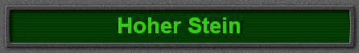
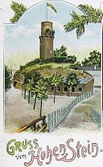
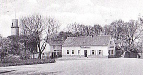
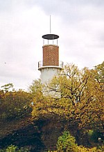
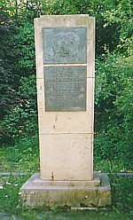

* * *

* * *

* * *

**Öffnungszeiten**

**Aussichtsturm**

**Mo. geschlossen**

**Di.-Fr. 10-16 Uhr**

**Sa. + So. 12-17 Uhr**

Der Hohe Stein, ein geologisches Naturdenkmal hoch über dem
Plauenschen Grund (190 m über NN), ist letzter Rest einer Brandungsklippe im Meer der Kreidezeit. An der aus Syenodiorit bestehenden Klippe sind noch Fossilien von kreidezeitlichen
Meeresbewohnern zu sehen. In urgeschichtlicher Zeit lag hier vermutlich eine Siedlung der Billendorfer Kultur (800 - 550 v. Chr.), da in der Nähe entsprechende Funde gemacht wurden. Im Mittelalter
diente der markante Felsen als Kalvarienberg mit mehreren Gebetsstationen für Prozessionen. Später stand hier zeitweise ein
Galgen. Wegen seiner strategischen Lage war der Hohe Stein auch militärischer Beobachtungsposten zu Kriegszeiten.
1759/60 wurde hier eine Schanze angelegt. In den Befreiungskriegen 1813 nutzten die Verbündeten unter Fürst Schwarzenberg das Areal als Hauptquartier. Auch im Preußisch-Österreichischen Krieg 1866 diente der Hohe Stein
als Wach- und Alarmposten und war Standort eines Geschützes. Teile der Felsen fielen Anfang des 19. Jahrhunderts einem Steinbruch zum Opfer.

Um 1815 begannen erstmals gezielte wissenschaftliche Forschungen am Hohen Stein.
Naturforscher wie Heinrich Ludwig Reichenbach, Hans Bruno Geinitz und Ernst Fürchtegott Zschau befassten sich mit den geologischen Gegebenheiten und wiesen einige
seltene Pflanzenarten wie Steinnelke und Bernsteinkraut nach. 1862 erwarb der Deubener Schmiedemeister Friedrich August Frohberg das Grundstück und ließ hier ein
Ausflugsrestaurant errichten. Außerdem entstand zwei Jahre später ein noch heute erhaltener Aussichtsturm _(Foto)_. Das umliegende Gelände wurde ab 1882 von der
Felsenkellerbrauerei parkartig erschlossen, wobei auch die Aussichtsbastion am Felshang zum Weißeritztal entstand. Das Areal westlich des Hohen Steins erwarb 1906 Erwin
Bienert, Sohn des Mühlenbesitzers, und ließ es zum Landschaftspark umgestaltet. Zu Ehren der Mühlenbesitzerfamilie trägt die Anlage heute den Namen Bienertpark. Hier befindet
sich ein um 1900 als Löschwasserbecken für die [Bienertmühle](../../../sud/plauen/bienertmuhle/) angelegter Teich sowie eine 1961 eingeweihte kleine Sternwarte.

Die Gaststätte am Hohen Stein blieb bis in die 1960er Jahre beliebter Treffpunkt der
Dresdner Bevölkerung, nicht zuletzt wegen der schönen Aussicht nach Dölzschen und in den Plauenschen Grund. Im Haus wohnte bis zu seiner Verhaftung durch die Nazis der politisch
aktive Maler Fritz Schulze mit seiner Frau Eva Schulze-Knabe. 1942 wurde er als Leiter einer Widerstandsgruppe zum Tode verurteilt und in Berlin-Plötzensee hingerichtet. An Fritz
Schulze und seine Kampfgefährten erinnert seit 1954 ein 1987 komplett erneuerter Gedenkstein _(Foto)_. Ab 1950 gehörten vor allem die im Coschützer Wismut-Schacht beschäftigten Bergleute zu den Stammgästen.

Nach Schließung der Gaststätte verfiel das historische Gebäude und wurde 1986 abgerissen. 1995 entstand an seiner Stelle der Neubau eines Seniorenheims für betreutes
Wohnen, in dem sich seit einigen Jahren auch wieder ein Café befindet. 2003 folgte die Sanierung des Aussichtsturmes und des angrenzenden Parks. In diesem Zusammenhang
erhielt der Turm sein ursprüngliches Äußeres mit durchbrochenem Klinkermauerwerk im oberen Bereich zurück. Auch die Wanderwege am Rand des Plauenschen Grundes sowie eine 1896 geschaffene
Aussichtsplattform wurden erneuert.

Video: Blick vom Hohen Stein auf den Plauenschen Grund

* * *

 \[ [Nord](../../../nord/)\] \[ [Nordwest](../../../nordwest/)\] \[ [Neustadt](../../../neustadt/)\] \[ [Nordost](../../../nordost/)\]
 \[ [West](../../../west/)\] \[ [Zentrum](../../../zentrum/)\] \[ [Südwest](../../../sudwest/)\] \[ [Süd](../../../sud/)\] \[ [Südost](../../../sudost/)\] \[ [Ost](../../../ost/)\] \[ [Register](../../../Register/register.html)\] \[ [Kontakt](../../../Kontakt/kontakt.html)\] \[ [Impressum](../../../impressum/)\]
