* * *

* * *

* * *

Ursprünglich wurde der gesamte Talabschnitt der Weißeritz zwischen Plauen und Tharandt als Plauenscher Grund bezeichnet. Im engeren Sinne gehören die im Tal gelegenen Fluren der Gemeinden Plauen, Dölzschen, Gittersee und Coschütz bis zur Freitaler Stadtgrenze dazu. Der Grund war schon im Mittelalter Standort mehrerer Mühlen, blieb jedoch ansonsten unbesiedelt. Wirtschaftliche Bedeutung hatte die bis 1875 betriebene Holzflößerei auf der Weißeritz sowie der Anbau von Obst und Wein an den Hängen. Reste ehemaliger Weinbergsterrassen sind stellenweise noch erhalten. Bereits 1366 wurde in Plauen erstmals eine Wassermühle erwähnt. Im 15. Jahrhundert folgte die Walkmühle der Dresdner Tuchmacher, die 1568 Kurfürst August erwarb. Dieser ließ das Gebäude abbrechen und im darauffolgenden Jahr durch eine Mahlmühle ersetzen. Als [Hofmühle](../../../sud/plauen/bienertmuhle/) oblagen zeitweise 66 Orte der Dresdner Umgebung dem Mahlzwang dieser Mühle, welcher erst um 1840 endete. Nach Übernahme der früheren Hofmühle durch Traugott Bienert im Jahr 1852 wurde das Unternehmen als Bienertmühle bekannt.

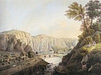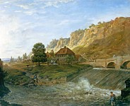

**_Bilder:_** _Der Plauensche Grund um 1810 - Gemälde von Carl August Richter (links) und Anton Graff (rechts)_

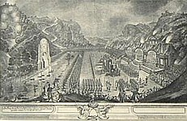Im 17. und 18. Jahrhundert war der romantische Grund kurfürstliches Jagdrevier
und Schauplatz prunkvoller Feste. So soll Kurfürst August der Starke 1698 zu Ehren des Zaren Peter I. eine Parade erzgebirgischer Bergleute aufmarschieren
lassen haben, was jüngere Forschungen jedoch widerlegen. Am 26. September 1719 fand im Plauenschen Grund das Saturnusfestes anlässlich der Vermählung
des Kurprinzen Friedrich August mit Maria Josepha von Österreich statt _(historischer Stich)_. Dabei wechselten Parforcejagden, Komödienaufführungen,
Bälle und Illuminationen ab. Das Fest bildete den krönenden Abschluss der insgesamt sieben “Planetenfeste” und gehört zu den bedeutendsten Barockfesten
der sächsischen Geschichte. Höhepunkt war der Aufmarsch von 1600 Bergleuten, welche im nächtlichen Fackelschein dem jungen Paar ihre Glückwünsche darbrachten.

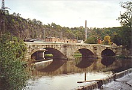Für den Revierförster entstand 1722 das [Hegereiterhaus](../../../sud/plauen/plauenscher_grund/hegereiterhaus/) in der Nähe der alten Weißeritzbrücke, welches später als “Forsthaus” beliebte Ausflugsgaststätte war und erst 1964 abgerissen wurde. Die 1779 errichtete neue Bogenbrücke über den Fluss wird seit Verlegung der durch den Grund führenden [Tharandter Straße](../../../sudwest/lobtau/strassen_lobtau/tharandter_strasse/) auf das linke Ufer 1921 nicht mehr genutzt, ist jedoch als Baudenkmal noch erhalten. 2006 erfolgte ihre Sanierung im Rahmen der Anlage eines Wanderweges durch den Grund _(Foto)_. Dabei wurden auch die Fragmente der alten Straße in die Gestaltung einbezogen und mehrere Infotafeln zu Geschichte, Geologie und Natur des Plauenschen Grundes aufgestellt.

Erst 1745 wurde der durch das Tal führende Pfad durch Freiberger Bergleute zu einem durchgehenden Fahrweg ausgebaut. Zuvor hatte es bereits 1712 und 1724 Ersuchen der im oberen Weißeritztal gelegenen Gemeinden über einen Ausbau gegeben, welche jedoch wegen der hohen Kosten, der zu geringen Verkehrsbedeutung und der befürchteten Störung des Wildes im kurfürstlichen Jagdrevier abgelehnt worden waren. Nach längeren Verhandlungen genehmigte der Kurfürst am 9. September 1745 den Straßenbau. Nutzungsbeschränkungen galten jedoch in der Jagdsaison. Außerdem mussten die begünstigten Orte selbst für den Unterhalt der neuen Straße aufkommen.

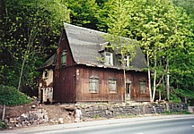Die verbesserten Verkehrsverbindungen und die reizvolle Landschaft machten das Weißeritztal bei Plauen nun zu einem beliebten Anziehungspunkt für Dresdner Bürger, unter ihnen viele Künstler. Allein zwischen 1770 und 1830 entstanden über 1000 künstlerische Darstellungen des Plauenschen Grundes, darunter Werke so berühmter Maler wie Caspar David Friedrich, Anton Graff und Adrian Zingg. Als “Dichter des Plauenschen Grundes” gilt der Literat Wilhelm Müller, der in seinem Werk “Frühlingskranz aus dem Plauenschen Grunde” der Schönheit des Tales ein Denkmal setzte. 1780 erschien der Roman "Herrmann und Ulrike" von Johann Carl Wezel, in dem der Grund ebenfalls eine Rolle spielte. Die im Plauenschen Grund durch den Steinbruchbetrieb entdeckten geologischen Aufschlüsse mit Fossilien waren Gegenstand von Forschungen Wilhelm von Humboldts und des Geologen Hans Bruno Geinitz. Wichtigstes Bodendenkmal ist die hoch über dem Weißeritztal gelegene [Heidenschanze](../../../sud/coschutz/heidenschanze/) auf Coschützer Flur.

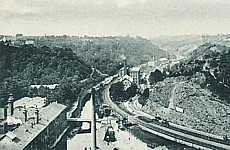Im 19.
Jahrhundert geriet der Plauensche Grund stärker ins Blickfeld einer wirtschaftlichen Nutzung. Existierten bislang nur einige Wassermühlen, entstanden nun erste gewerbliche Unternehmen. So wurde die 1728 erbaute
Dölzschener Neumühle deutlich vergrößert, der benachbarte Eisenhammer entwickelte sich ab 1827 zum [Eisenhammerwerk Dölzschen](../../../sud/plauen/plauenscher_grund/eisenhammerwerk/). Aus einem früheren
Kupferhammer ging 1830 die Garnisonsmühle der sächsischen Armee hervor. Die in Burgk und Zauckerode entdeckten Steinkohlevorkommen erforderten jedoch auch eine Verbesserung der Transportwege. Neben dem Ausbau der
Talstraße zur Chaussee zwischen 1807 und 1809 wurde 1855 die [Albertbahn](../../../sud/plauen/plauenscher_grund/albertbahn/)
mit einem später abgetragenen Tunnel eröffnet. Entlang der Strecke entstanden gegen Ende des 19. Jahrhunderts Wohnhäuser und gewerbliche Bauten. Zu den älteren Gebäuden im Plauenschen Grund zählten die mittlerweile
verschwundenen Villen von Josef Grassi und Friedrich August von Cosel [(Coselvilla)](../../../sud/coschutz/strassen_coschutz/). 1857 wurde in ihrer Nähe die [Felsenkellerbrauerei](../../../sud/plauen/plauenscher_grund/felsenkellerbrauerei/) eröffnet _( **Foto:** Blick vom Hohen Stein)_.

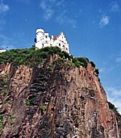Durch diese Entwicklung verlor der Plauensche Grund viel von seinem ursprünglichen Reiz.
Dazu trugen auch zahlreiche Steinbrüche bei, die den hier vorkommenden Plänerstein (“Plauenscher Stein”) abbauten. Bedeutendster war der Ratssteinbruch, der sich ab 1872 im
Besitz der Stadt Dresden befand. 1902 wurde die Straßenbahnlinie nach Deuben und Hainsberg eröffnet, welche 1974 durch eine Buslinie ersetzt wurde. Als Wahrzeichen des
Plauenschen Grundes gelten heute der in den Zwanziger Jahren entstandene Siloturm der früheren Garnisonsmühle und die hoch über dem Grund gelegene [Begerburg](../../../sudwest/dolzschen/begerburg/) in Dölzschen
_(Foto)_. Jüngere Bauvorhaben waren die Anlage eines 121 Meter langen Straßentunnels in der Nähe der Felsenkellerbrauerei (1992) und der Bau der Autobahnbrücke im Jahr 2001/02.
1998 entstand am früheren Mühlgraben der Hofmühle Dresdens erstes privates Wasserkraftwerk mit einer Maximalleistung von 800 kW.

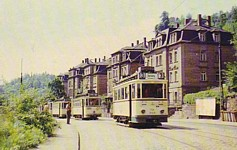

**_Foto:_** _Straßenbahnparade im Plauenschen Grund kurz vor der Einstellung am 26. Mai 1974_

Verheerende Auswirkungen hatte das schwere Weißeritzhochwasser vom 12/13. August 2002, welches auch den Plauenschen Grund verwüstete. Dabei wurden Teile der Straße sowie die Eisenbahntrasse weggerissen und unpassierbar
gemacht. Auch die im Plauenschen Grund stehenden Gebäude sowie das Wasserkraftwerk wurden in Mitleidenschaft
gezogen. Während die Straße bereits einige Wochen später wieder hergestellt werden konnte, dauerte die komplette Sanierung der Bahnstrecke nach Chemnitz bis Ende 2003.

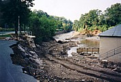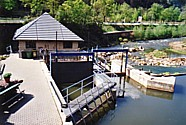

**_Foto links:_** _Die Folgen des Hochwassers von August 2000 sind am_

_Wasserkraftwerk noch deutlich zu erkennen (September 2002)_

_**Foto rechts:**_
_das wiederaufgebaute Wasserkraftwerk im Sommer 2008_

Schwebebahn-Projekt:

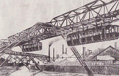Zu den Kuriositäten der Verkehrsgeschichte gehörte der um 1900 erwogene
Bau einer Schwebebahn zwischen Rabenau und Dresden. Die Bahn sollte nach dem Wuppertaler Vorbild auf Stelzen über der Weißeritz verlaufen und die heutigen Freitaler Stadtteile Deuben, Döhlen und Potschappel mit Dresden
verbinden. In Dresden konstituierte sich dafür eine Aktien-Gesellschaft “Elektra”, die mit den Vorplanungen für die Strecke begann. Als Ausgangspunkt
war die Egermühle in Deuben vorgesehen, von der die Bahn bis zur Endstation unterhalb des Hohen Steins schweben sollte. Als Option waren Verlängerungen
über Eckersdorf bis Rabenau und zum Postplatz geplant. Von dort könnte, so die Vorstellungen der Projektanten, die Schwebebahn unterirdisch durch das Dresdner Stadtzentrum und dann auf
Stelzen weiter bis Pirna verkehren.

Obwohl das Finanzministerium seine Zustimmung signalisierte und die Planungsarbeiten durch die ausführende
Maschinenbaugesellschaft Nürnberg bis 1899 weitgehend abgeschlossen waren, kam der Bau nie zustande. Grund waren
neben den immensen Kosten Proteste von Naturschützern und Anliegern sowie die 1902 eröffnete Straßenbahnlinie, die der Schwebebahn einen Großteil der Fahrgäste abgezogen hätte.

Einzelne Gebäude:

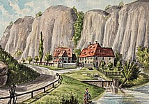Buschmühle: Die Mühle entstand um 1559 als Glasschleife des aus Bautzen stammenden Schleifers Ullrich Wegener und war zweitälteste Mühle in Plauen. Neuere Forschungen vermuten an dieser Stelle einen noch älteren Kupferhammer bzw. eine Spiegelschleife. Später wurde sie als Mahlmühle mit drei Mahlgängen genutzt, stand jedoch immer im Schatten der nahegelegenen Hofmühle. Der Legende nach soll hier der sagenhafte sorbische Müllergeselle Pumphut beschäftigt gewesen sein. Gemäß kurfürstlichem Dekret vom 18. März 1613 unterlagen zwölf Orte, u. a. Altfranken, Boderitz, Coschütz, Naußlitz, Dölzschen, Gittersee, Wölfnitz und Zschertnitz dem Mahlzwang der Buschmühle.

1772 erhielten die Besitzer der Buschmühle das Recht zum Bierausschank. Dadurch entwickelte sie sich zum Ausflugsziel. Die romantisch gelegene Mühle, zeitweise auch Schweizer- oder Grundmühle genannt, war in der Romantik beliebtes Motiv für Maler und Zeichner. 1838 pachtete der Unternehmer E. Kittler die Buschmühle, der sich wenig später auch an der Gründung der Felsenkellerbrauerei beteiligte. 1870 wurde die Buschmühle für 15.000 Taler an die Felsenkeller AG verkauft und ein Jahr später zugunsten einer Erweiterung der Brauerei abgerissen. Erhalten blieb bis heute das Buschmühlenwehr auf dem Gelände der Felsenkellerbrauerei.

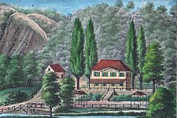Villa Grassi: Das Gebäude wurde ursprünglich als Huthaus eines 1767 aufgeschlossenen Kupferbergwerks erbaut. Da die Erkundungen jedoch keinen Erfolg brachten, ließen die aus Dresden stammenden Gebrüder Lehmann, Besitzer des Hauses, dieses fünf Jahre später aufstocken und zu einem Landhaus mit Freitreppe und Terrassen zur Weißeritz umbauen. 1790 erwarb Graf Heinrich von Bünau das Grundstück, verkaufte es jedoch bereits 1800 weiter an den sächsischen Oberlandbaumeister Johann Gottlob Hauptmann (1755-1813). Ab 1799 lebte hier der Maler Josef Grassi (1757-1838), der im August 1800 als Professor an die Dresdner Kunstakademie berufen wurde und ein beträchtliches Vermögen besaß. Grassi ließ in der Umgebung seiner Villa einen kleinen Aussichtspavillon und ein Badehäuschen errichten und das Gelände parkartig umgestalten. Da man bei den Arbeiten eine Quelle entdeckt hatte, ließ Grassi das Mineralwasser durch Dr. David August Ficinus analysieren und machte das Areal zum beliebten Erholungsort.

Nach der Beseitigung der von französischen Soldaten im August 1813 verursachten Kriegsschäden kam die Villa Grassi 1816 in den Besitz des Grafen Friedrich von Kalckreuth. Zeitweise wohnte der mit ihm befreundete Liederdichter Wilhelm Müller (1794-1827) in diesem Haus, der hier u. a. die Verse zu seinem "Frühlingskranz aus dem Plauenschen Grunde" schrieb. Müller ist auch Schöpfer des 1818 erstmals veröffentlichten Volksliedes "Das Wandern ist des Müllers Lust...". Nach 1830 diente das Gebäude als Kaffeehaus, wurde Ende 1856 verkauft und unmittelbar darauf zugunsten von Gebäuden der Felsenkellerbrauerei abgerissen. Der frühere Standort lag ungefähr dort, wo sich später die Gaststätte der Felsenkellerbrauerei (nach 1945 Klubhaus der Eisenbahner) befand.

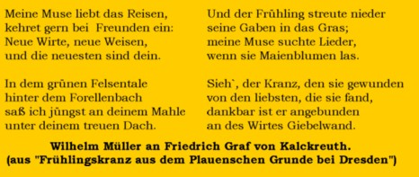

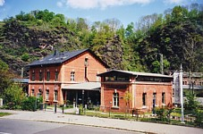Bahnhof Plauen:
Die Station in der Nähe der Felsenkellerei entstand 1855 als Haltepunkt der am 28. Juni 1855 eröffneten [Albertbahn](../../../sud/plauen/plauenscher_grund/albertbahn/). In unmittelbarer Nähe
befand sich einst ein 57 Meter langer Eisenbahntunnel, der 1894/95 dem Streckenausbau zum Opfer fiel. Der Bahnhof war zugleich erster Unterwegshalt der [Windbergbahn](../../../sud/gittersee/windbergbahn/) nach Gittersee und Possendorf. Wegen der ungünstigen Lage
abseits des Ortes hielten die Züge hier jedoch nur bei Bedarf. 1900 entstand das noch heute erhaltene Bahnhofsgebäude mit Wartesaal sowie Dienst- und Wohnräumen _(Foto)_.

Als 1923 die Gleise der Eisenbahn im Plauener Ortskern auf einen Hochdamm verlegt wurden, schloss der alte Bahnhof
seine Pforten und wurde nach Altplauen verlegt. Das frühere Bahnhofsgebäude im Plauenschen Grund diente nun als Wohnhaus und ist bis heute erhalten. Seit 2003 hat hier eine Kunstglaserei ihr Domizil.

Straßentunnel: Der offiziell Tunnel Plauenscher Grund, während der Bauzeit auch “Ingrid-Tunnel” (nach der Ehefrau des
sächsischen Ministerpräsidenten Kurt Biedenkopf) genannte Straßentunnel in der Nähe der Felsenkellerbrauerei entstand
1991/92 als erster Straßentunnel Sachsens. Baubeginn war am 25. Juni 1991, der Durchstich erfolgte am 31. Juli 1991. Das Bauwerk ist 121 Meter lang und wurde am 26. Februar 1992 dem Verkehr übergeben.

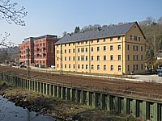Königsmühle: An ihrer Stelle soll 1719 beim Saturnfest anlässlich der Hochzeit des Kronprinzen der Tempel des Saturnus gestanden haben. Im Rahmen der Inszenierung brachten erzgebirgische Bergleute hier dem Gott und dem Brautpaar die Schätze der Berge in Form von Gold, Silber und Mineralien, während sein Begleiter Cupido als Münzmeister fungierte und Gold- und Silbermünzen als Erinnerung an dieses Fest prägte. Einige davon befinden sich noch heute im Münzkabinett. Nach Ende des Festes brach man den hölzernen Bau wieder ab.

1739 entstand auf Initiative des sächsischen Kurfürsten und Königs von Polen Friedrich August III auf dem Grundstück die Königsmühle. Allerdings war dem Unternehmen kein großer Erfolg beschieden, da sie wegen der benachbarten Buschmühle oft unter Wassermangel litt. 1857 und 1872 fielen Teile der Königsmühle Bränden zum Opfer. 1871 war diese Teil der Dampfmühlen-Aktien-Gesellschaft zu Dresden geworden. Die verbliebenen Gebäude wurden 1899 von den Söhnen Traugott Bienerts erworben und zugunsten anderer Industriebauten abgerissen. U.a. befand sich hier zeitweise eine Fabrik zur Herstellung von Kühleis, ein Zweigbetrieb eines Spielzeugherstellers sowie ein Lager der Quedlinburger Saatgutwerke. Das unter Denkmalschutz stehende markante Klinkergebäude an der Tharandter Straße 109 aus dem Jahr 1878 sowie das Nachbargebäude wurden 2011/13 zu Loftwohnungen und Büros umgebaut _(Foto)_.

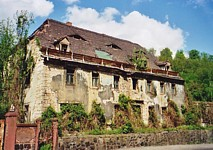Goldene Krone: Das Gasthaus “Goldene Krone” geht auf eine einstige Tränke für die Jagdhunde der sächsischen Kurfürsten zurück, welche bereits im 16. Jahrhundert von Kurfürstin Anna eingerichtet worden sein soll. Später erhielt das Areal die Schankgerechtigkeit und wurde als “Weiße Taube” bzw. "Gasthof zum Plauenschen Grund" bezeichnet. Nach mehrfachen Besitzerwechseln und Umbauten entwickelte sich daraus die Schankwirtschaft “Goldene Krone”, die in ihrer heutigen Form 1828/29 entstand. Das historische Gasthaus blieb bis in die Nachkriegszeit geöffnet und steht seitdem in ruinösem Zustand leer.

Neumühle: Die Mühle entstand 1727/28 in unmittelbarer Nachbarschaft zur Königsmühle als kurfürstliche Mahlmühle auf Dölzschener Flur. Nach einer Erweiterung 1766/68 besaß sie 16 Mahlgänge und gehört damit zu den leistungsstärksten Mühlen im Dresdner Raum. 1839 übernahm die sächsische Weißbäckerinnung den Mahlbetrieb und nutzte die Gebäude nun auch als Bäckerei. 1874 erwarb der Hofbäcker Gottfried Braune das Gelände und richtete hier sowie auf dem Grundstück der benachbarten Garnisonsmühle eine moderne Großbäckerei ein. Erweiterungsbauten entstanden 1903 und nach Ende des Ersten Weltkrieges. Nach 1945 wurde die Mühle vom Konsum-Backwarenbetrieb genutzt. 2016 wurden die Gebäude zur Wohnanlage umgebaut.

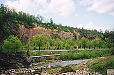Steinbrüche: Anfang des 19. Jahrhunderts entstanden an verschiedenen Stellen des Plauenschen Grundes Steinbrüche. Älteste waren der um 1740 auf Löbtauer Flur eingerichtete erste Dresdner Ratssteinbruch sowie ein um 1800 aufgeschlossener Bruch in der Nähe der Neumühle. Diese dienten zunächst der Gewinnung von Baumaterial für die Anliegergemeinden, später zunehmend der Fertigung von Pflastersteinen und Schotter für den Ausbau der Dresdner Straßen und Bahnlinien. Zu den bedeutendsten gehörten der 1856 vom Dölzschener Gutsbesitzer Otto Beger eröffnete Steinbruch unterhalb der Begerburg sowie der Forsthausbruch, welcher sich ab 1872 im Besitz des Rates der Stadt Dresden befand und deshalb Ratssteinbruch genannt wurde _(Foto)_. Dieser blieb als letzter der einst bis zu 12 Steinbrüche des Grundes noch bis 1961 im Betrieb. Weitere Steinbrüche befanden sich im Besitz der 1898 gegründeten “Vereinigte Steinbrüche im Plauenschen Grund AG” sowie privater Gutsbesitzer der Anliegergemeinden.

Promenadenweg: Der Weg oberhalb der rechten Seite des Weißeritztales beginnt hinter der Felsenkellerbrauerei und führt von dort zur Heidenschanze und weiter über die ehemalige Garnisonsmühle und Günthers Busch nach Potschappel. Er wurde Ende des 19. Jahrhunderts von der Sektion Plauen des Gebirgsvereins für die Sächsische Schweiz angelegt und mit Treppen, Aussichtspunkten und Ruhebänken gestaltet. Am 11. Oktober 1882 erfolgte die Übergabe des ersten Abschnitts mit einem Festakt in der Felsenkellerbrauerei und anschließendem Ball im Coschützer Gasthof. Am 28. September 1887 wurde der zweite Abschnitt von der Heidenschanze bis Potschappel übergeben.

Schweizerbett: Als "Schweizerbett" wird ein Aussichtspunkt oberhalb der Felsenkellerbrauerei in der Nähe des Fußweges am Eiswurmlager bezeichnet. Der Legende nach soll einst ein Schweizer, entweder nach seiner Herkunft oder von Beruf, auf einem Felsvorsprung seinen Rausch ausgeschlafen haben. Das eigentliche Schweizerbett fiel im 19. Jahrhundert dem Steinbruchbetrieb zum Opfer.

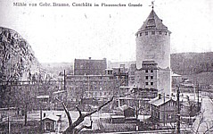Garnisonsmühle: Diese Mühle gehörte ursprünglich einer Bauernfamilie aus Coschütz und wurde im 17. Jahrhundert als Eisen- und Kupferhammer genutzt. 1770 entstand an dessen Stelle die Pulvermühle der sächsischen Armee, die mehrfach durch Explosionen zerstört wurde, trotzdem jedoch noch bis 1830 bestand. Das frühere Wohnhaus der Pulverarbeiter von 1778, leider mittlerweile stark verfallen, erinnert noch an diese Zeit. Vom einstigen Mühlgraben, dessen letzte Reste erst 1995 verfüllt wurden, blieb lediglich das Weißeritzwehr unterhalb des Collmberges erhalten.

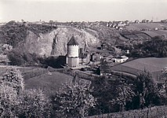Mit Verlagerung der Pulverproduktion wurden die Gebäude zur Mühle mit Bäckerei umgebaut, welche vorrangig den Bedarf der Dresdner Garnison decken sollte und deshalb Garnisons- bzw. Kommißmühle genannt wurde. Als eine der ersten Getreidemühlen im Dresdner Raum erhielt sie 1839 moderne "amerikanische Mahlgänge" und 1845 eine Dampfmaschine. Ein Castrationsprotokoll der Amtshauptmannschaft Dresden von 1860 listet für die "Commißariats-Mühle" als Inventar drei oberschlächtige Wasserräder mit je 6 1/2 Ellen Durchmesser, die zugehörigen Stirn- und Diagonalräder aus Gußeisen, drei Mahlstühle, Elevatoren und weitere Mühlentechnik auf. Im zweiten Obergeschoss befand sich die eigentliche Mühle, bestehend aus acht Paar Liebethaler Mühlsteinen, Läufersteinen, Wellen und einer Krananlage zum Wechseln der Mühlsteine.

Bald genügte jedoch auch diese Mühle nicht mehr den Anforderungen. Nach Abbruch der vorhandenen Baulichkeiten errichtete man 1885 eine moderne Großmühle mit fünf Walzenstühlen, zwei Mahlgängen und zwei Mehlmischmaschinen. Betreiber war bis zur Fertigstellung der neuen [Heeresbäckerei](../../../neustadt/aussere_neustadt/antonstadt/konigsbrucker_strasse/) in der Albertstadt die sächsische Armee.

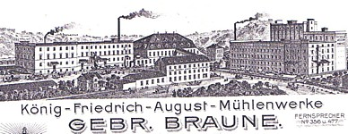

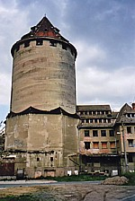Nach dem Umzug erwarben 1903 die Gebrüder Braune, Besitzer der König-Friedrich-
August-Mühlenwerke AG, für 140.000 Taler das Gelände und bezogen es in die benachbarte Großbäckerei ein. 1917 entstand für diese der bis heute erhaltene Siloturm _(Foto),_ im Volksmund auch “Hungerturm” genannt. Leider verschwand die originelle Wetterfahne mit dem Müllerburschen nach dem Zweiten Weltkrieg von der Spitze des Turmes. Seit 1910 besaß die Mühle zudem ein eigenes Anschlussgleis, welches von der Albertbahn abzweigte und über eine Weißeritzbrücke unmittelbar auf das Betriebsgelände führte.

Während des Zweiten Weltkrieges dienten Teile des Gebäudekomplexes als Schmiermittelfabrik für den Rüstungsbedarf. Danach nutzte bis 1990 der Konsum- Backwarenbetrieb das Areal, zuletzt noch die Dresdner Handelsgesellschaft für Nahrungsmittel und Getränke "Goldene Ähre" als Lager für Körnerfrüchte. Seit 1993 stehen die Gebäude der früheren Weizenmühle leer und wurden durch das Weißeritzhochwasser 2002 sowie einen Großbrand im September 2005 schwer beschädigt. 2015 begann der Umbau zu einer Wohnanlage.

Zwei-Pfennig-Brücke: Das 1837 als einfache Holzbrücke errichtete Bauwerk wurde im Volksmund früher als “Zwei- Pfennig-Brücke” bezeichnet, da man hier in den ersten Jahren eine Benutzungsgebühr bezahlen musste. Die Brücke verbindet die durch den Plauenschen Grund führende Fahrstraße (Tharandter Straße) mit den jenseits der Weißeritz gelegenen Häusern des Stadtteils Gittersee. 1897 wurde die Brücke beim Weißeritzhochwasser zerstört und durch eine Fachwerk-Bogenbrücke aus Stahl ersetzt. Diese Brücke war noch bis Anfang der 1990er Jahre erhalten, wurde dann jedoch durch einen modernen Neubau ersetzt. Bis heute steht sie jedoch nur Fußgängern und Radfahrern zur Verfügung.

Tischersche Schmiede: Das zweigeschossige Wohnhaus entstand Mitte des 19. Jahrhunderts unmittelbar am Weißeritzufer in der Nähe der Gitterseebrücke und befand sich im Besitz des Schmiedemeisters Tischer. Neben der Werkstatt gab es im Haus auch ein Produktengeschäft und mehrere Wohnungen. Am 30. Juli 1897 war es Schauplatz einer Tragödie beim Weißeritzhochwasser. Nach stundenlangen Regenfällen hatte der Fluß das Haus umspült und die Bewohner eingeschlossen. Beim Versuch, diese mittels eines Seils zu retten, kamen der Schmied und ein Helfer ums Leben. Wenig später brach das Gebäude ein. Lediglich eine Frau und ein Kleinkind konnten in Sicherheit gebracht werden, 11 Menschen starben.

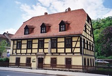Chausseehaus Neucoschütz: Das zweigeschossige Fachwerkhaus wurde 1828 an
der damaligen Talstraße als Einnehmerhaus für die Erhebung des Chausseegeldes errichtet. Bis zur Aufhebung des Chausseegeldes 1885 diente es seinem Zweck
und wurde dann in ein Wohnhaus umgewandelt. 1896 erfolgte die Eingemeindung des Coschützer Ortsteils Neucoschütz zu Potschappel. 1992 wurde das Gebäude
denkmalgerecht saniert und in diesem Zusammenhang das verputzte Fachwerk wieder freigelegt. Heute nutzt es der Kunstverein Freital für Ausstellungen und Veranstaltungen.

* * *

 \[ [Nord](../../../nord/)\] \[ [Nordwest](../../../nordwest/)\] \[ [Neustadt](../../../neustadt/)\] \[ [Nordost](../../../nordost/)\]
 \[ [West](../../../west/)\] \[ [Zentrum](../../../zentrum/)\] \[ [Südwest](../../../sudwest/)\] \[ [Süd](../../../sud/)\] \[ [Südost](../../../sudost/)\] \[ [Ost](../../../ost/)\] \[ [Register](../../../Register/register.html)\] \[ [Kontakt](../../../Kontakt/kontakt.html)\] \[ [Impressum](../../../impressum/)\]
