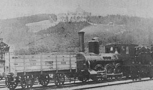
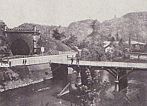
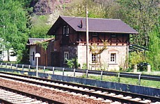

* * *

Die Albertbahn entstand nach 1850 auf Betreiben der Grubenbesitzer des Steinkohlenreviers um Hänichen und Gittersee, die sich durch die Strecke bessere Absatzmöglichkeiten für ihre Kohle erhofften. 1852 reichten einige interessierte Unternehmer ein Gesuch an die sächsische Regierung ein, um die Genehmigung zum Bahnbau durch den Plauenschen Grund erhalten. Da die Trasse zugleich erster Abschnitt einer geplanten Bahnstrecke zwischen Dresden und Chemnitz war, erteilte der Staat die Genehmigung. Am 4. Mai 1853 entstand in Dresden eine Aktiengesellschaft, die den Bau und Betrieb dieser Privatbahn bewerkstelligen sollte. Der erste Spatenstich erfolgte am 12. September 1853 in feierlichem Rahmen im [Plauenschen Grund](../../../../sud/plauen/plauenscher_grund/) oberhalb der späteren Felsenkellerbrauerei, gefolgt von einem Galadinner in Tharandt. Unter Leitung des Ingenieurs Guido Brescius wurde die 13,5 km lange Strecke zwischen dem Albertbahnhof an der [Freiberger Straße](../../../../zentrum/wilsdruffer_vorstadt/freiberger_strasse/) und dem vorläufigen Endpunkt in Tharandt angelegt. Zweigstrecken schlossen die Schächte an diese Bahnlinie an, die nach dem sächsischen Kronprinzen den Namen Albertbahn erhielt. Am 28. Juni 1855 konnte die Eisenbahnstrecke eröffnet werden. Vier Jahre später erfolgte die Inbetriebnahme der [Elbezweigbahn](../../../../Zentrum/Friedrichstadt/Dresden_-_Berlin/Anschlussbahn_Kohlebahnhof/Anschlussbahn_Kohlebahnhof.html) bis zum Altstädter Elbkai

Für den Bahnbau entstanden einige Kunstbauten, vor allem im engen Weißeritztal des Plauenschen Grundes. Neben mehreren Brücken wurde hier auch ein 57 Meter langer Tunnel an der [Felsenkellerbrauerei](../../../../sud/plauen/plauenscher_grund/felsenkellerbrauerei/) angelegt _(Foto)_. Mit diesem sollte die enge Krümmung am sogenannten “Schweizerbett” umgangen und die Bahntrasse zugleich vor Steinschlag geschützt werden. Nachteilig war jedoch, dass die Schienen gleich zweimal von der durch den Grund führenden Straße gekreuzt werden mussten. 1893 entschloss man sich deshalb zu einer Veränderung der Verkehrsführung. In diesem Zusammenhang fiel der Tunnel dem weiteren Streckenausbau zum Opfer. In der Nähe lag bis 1923 auch der alte Plauener Bahnhof, dessen Empfangsgebäude noch erhalten ist und heute von einer Kunstglaserei genutzt wird. Wenige Kilometer weiter zweigt kurz vor der Stadtgrenze von Freital die frühere Hänichener Kohlenzweigbahn ab, die unter dem Namen [Windbergbahn](../../../../sud/gittersee/windbergbahn/) als erste mitteleuropäische Gebirgsbahn bekannt wurde.

Die zunächst vorrangig dem Kohlentransport dienende Albertbahn wurde am 1. Juli 1868 vom sächsischen Staat übernommen und bis Freiberg und Chemnitz verlängert. 1923/25 erfolgte im stadtnahen Bereich eine Verlegung auf einen Hochdamm, womit fast alle bislang noch bestehenden niveaugleichen Straßenübergänge verschwanden. In diesem Zusammenhang erhielt Plauen auch
seine bis heute bestehenden Haltepunkt im Ortskern. Heute ist die Strecke Teil der wichtigen Fernverbindung von Dresden nach Plauen / Hof und wurde 1963/66 elektrifiziert. Trotz des dafür erforderlichen Streckenausbaus sind im Plauenschen Grund noch zahlreiche Sachzeugen aus der Frühzeit der Bahn erhalten geblieben, u.a. einige historische Bahnwärterhäuser _(Foto)_. Beim Weißeritzhochwasser 2002 wurden die Bahnanlagen in diesem Abschnitt schwer beschädigt und mussten über weite Abschnitte komplett neu gebaut werden. Die Wiederfreigabe der sogenannten “Sachsenmagistrale” als moderne ICE-Strecke erfolgte am 14. Dezember 2003.

* * *

 \[ [Home](../../../../index.html)\] \[ [Nord](../../../../nord/)\] \[ [Nordwest](../../../../nordwest/)\] \[ [Neustadt](../../../../neustadt/)\] \[ [Nordost](../../../../nordost/)\] \[ [West](../../../../west/)\] \[ [Zentrum](../../../../zentrum/)\] \[ [Südwest](../../../../sudwest/)\] \[ [Süd](../../../../sud/)\] \[ [Südost](../../../../sudost/)\] \[ [Ost](../../../../ost/)\] \[ [Register](../../../../Register/register.html)\] \[ [Kontakt](../../../../Kontakt/kontakt.html)\] \[ [Impressum](../../../../impressum/)\]
