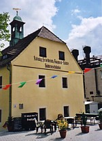
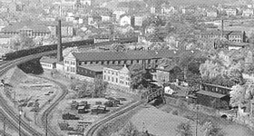
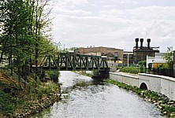

* * *

* * *

Die Geschichte des späteren Eisenhammerwerkes begann 1794, als der aus Stolpen
stammende Hammerschmied Johann Gottfried Ulbricht im Weißeritztal auf Dölzschener Flur einen Eisenhammer einrichtete. Zuvor gab es an dieser Stelle bereits ab 1789 einen
Kupferhammer, der sich im Besitz des Roßthaler Rittergutsbesitzers von Nimptsch befand. 1822 wurde der Betrieb durch die beiden Dresdner Handwerksmeister Karl August Richter
und Christian Friedrich Pleißner erweitert. Um das beim Produktionsprozess anfallende eisenhaltige Wasser wirtschaftlich nutzen zu können, richteten die Besitzer ein Kurbad ein. Im
“Schlacken-, Stahl- und Eisenbad” wurden Patienten mit Rheuma-Erkrankungen nach einem Verfahren des Freiberger Bergrates Johann Friedrich Henckell behandelt. Dieses Kurbad
existierte bis 1873 und musste dann der Erweiterung des Betriebes weichen. Erhalten blieb das einstige Wohnhaus der Hüttenbesitzer mit der seit 2011 leider geschlossenen Gaststätte “Hüttenschänke” _(Foto)_.

1827 erwarb Carl Friedrich August Krebs das Eisenhammerwerk. Krebs war auch Eigentümer der Burgker Steinkohlengruben und wurde später als Freiherr Dathe von Burgk in den Adelsstand erhoben. 1828 errichtete er im
Plauenschen Grund eine Eisengießerei, der 1835 noch eine Maschinenfabrik  folgte. Das ab 1846 nach einem Besuch des
Wettiners als König-Friedrich-August-Hütte bezeichnete Unternehmen gehörte zu den modernsten Betrieben der Branche. Zwischen 1842 und 1849 war hier der erste koksbefeuerte Hochofen Sachsens in Betrieb. Außerdem gab es
eine Modellwerkstatt, eine Zeug- und Emaillierhütte sowie eine Großschmiede mit 32 Feuern.

**_Foto:_** _Blick über die König-Friedrich-August-Hütte (1928)_

Nach dem Tod Dathes übernahm die in Chemnitz ansässige Sächsische Maschinenfabrik vorm. Richard Hartmann das
Eisenhammerwerk und wandelte es 1873 in eine Aktiengesellschaft um. Bis zum Ende des Zweiten Weltkriegs produzierte die Firma hier verschiedene Gussteile und Maschinen, darunter nach 1933 auch Rüstungsgüter für den
Wehrmachtsbedarf. 1945 wurde ein Großteil der technischen Anlagen von der sowjetischen Besatzungsmacht demontiert.
Nach Enteignung und Überführung in Volkseigentum konzentrierte sich das Eisenhammerwerk auf die Herstellung von Gusserzeugnissen für die Kfz-Produktion.

1993 wurde das Unternehmen von ehemaligen Werksangehörigen von der
Treuhand erworben und war bis zur Insolvenz 2013 Hersteller von Gussteilen für den Kanalbau. Zu den Innovationen des Betriebes gehörten u.a. besonders
geräuscharme “Flüstergullys” zur Kanalabdeckung im Straßenbau. Durch die starke Konkurrenz geriet der Betrieb jedoch in wirtschaftliche Schwierigkeiten. 1996
schloss die Gießerei, 2004/05 wurde das Werk 1 auf der rechten Straßenseite der Tharandter Straße abgerissen. Künftig ist auf dem Gelände ein Gewerbepark
geplant. Die historische Hüttenschänke konnte bereits Anfang der 1990er Jahre durch ABM-Kräfte restauriert werden und beherbergt im Obergeschoss ein kleines
Werksmuseum. Das Foto zeigt im Vordergrund die 1904 errichtete Brücke der mittlerweile stillgelegten Anschlussbahn des Betriebes über die Weißeritz.

* * *

 \[ [Home](../../../../index.html)\] \[ [Nord](../../../../nord/)\] \[ [Nordwest](../../../../nordwest/)\] \[ [Neustadt](../../../../neustadt/)\] \[ [Nordost](../../../../nordost/)\] \[ [West](../../../../west/)\] \[ [Zentrum](../../../../zentrum/)\] \[ [Südwest](../../../../sudwest/)\] \[ [Süd](../../../../sud/)\] \[ [Südost](../../../../sudost/)\] \[ [Ost](../../../../ost/)\] \[ [Register](../../../../Register/register.html)\] \[ [Kontakt](../../../../Kontakt/kontakt.html)\] \[ [Impressum](../../../../impressum/)\]
