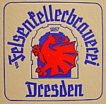
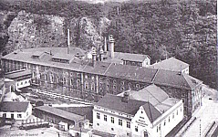
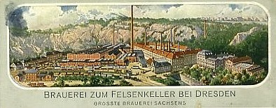
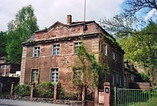
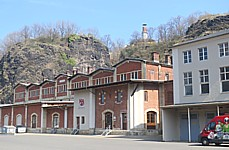
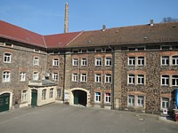
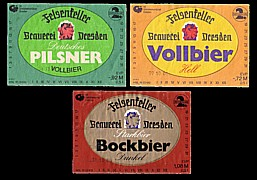

* * *

* * *

**Bieruntersetzer der Felsenkellerbrauerei mit dem Firmenlogo**

**des “Eiswurms”**

**Bieruntersetzer "100 Jahre Felsenkeller"**

**Blechwerbetafel aus den 1920er Jahren**

**Flaschenetikett für Weizenbier**

An Stelle der späteren Felsenkellerbrauerei lag einst der Lagerplatz einer altsteinzeitlichen Jägerhorde, ältester nachgewiesener Siedlungsplatz im Dresdner Stadtgebiet. Ab 1559 befand sich hier die 1871 abgetragene Buschmühle, eine von mehreren Wassermühlen im [Plauenschen Grund](../../../../sud/plauen/plauenscher_grund/). Nach dem Bau der [Albertbahn](../../../../sud/plauen/plauenscher_grund/albertbahn/) im Jahr 1855 wurde der Plauensche Grund auch als Industriestandort attraktiv. Zu den neuen Betrieben auf Plauener und Coschützer Flur gehörte die 1856 mit einem Stammkapital von 300.000 Talern gegründete Brauerei des “Aktienvereins der Brauerei zum Felsenkeller”. Gegen deren Bau hatte sich bis zuletzt die Dresdner Brauerinnung gestellt, welche Umsatzeinbußen durch den modernen Großbetrieb befürchtete. Erst ein Gutachten der Kreisdirektion vom 26. September 1856 lehnte den Einspruch der Innungsältesten ab und ermöglichte den Beginn der Bauarbeiten. Der Aktienverein erwarb daraufhin das Grundstück von Grassis Villa und ließ diese abbrechen. Am 15. April 1857 erfolgte im Beisein König Johanns die offizielle Grundsteinlegung für die Produktionsgebäude. Die Leitung des Baus oblag dem Baudirektor Schmidt, die Ausführung übernahm der Bauunternehmer August Kochert aus Neucoschütz. Bis zur endgültigen Fertigstellung im Februar 1859 wurden im Plauenschen Grund 59.000 Taler, mehr als das Doppelte der ursprünglich veranlagten Summe verbaut. Bereits Anfang 1858 war jedoch der Braubetrieb aufgenommen worden. Erster Direktor der Brauerei wurde der aus Bayern stammende Philipp Heiß. 1862 übernahm Karl Krimpe die Leitung des Unternehmens und führte dieses erfolgreich über 32 Jahre lang. Für seine Verdienste wurde er 1891 zum Kommerzienrat ernannt.

Das Unternehmen wuchs schnell und entwickelte sich bis 1900 zur bedeutendsten sächsischen Großbrauerei. Für die Lagerung des Bieres wurden bis 1869 von Freiberger Bergleuten neun je 66 Meter lange Stollen in den Fels getrieben, die durch einen 140 Meter langen Gang miteinander verbunden sind. Zu den Kuriositäten aus der Frühzeit des Unternehmens gehört die von einigen Aktionären 1862 verbreitete Legende vom “Eiswurm”, der in den Kühlkellern der Brauerei hausen sollte und so das hier gelagerte Bier verderben würde. In Panik verkauften mehrere Kleinaktionäre ihre Anteile, so dass sich das Kapital nun in wenigen Händen konzentrierte. Der Wurm wurde in Form eines roten Drachens später Markenzeichen der Brauerei und ist auch Namenspatron der Straße Am Eiswurmlager hinter der Brauerei.

Die Felsenkellerbrauerei stellte zunächst bayrisches Lagerbier, ab 1880 vorrangig Bier nach Pilsner Brauart her und war wirtschaftlich äußerst erfolgreich. Moderne Anlagen ermöglichten in der zwischen 1871 und 1895 mehrmals erweiterten Brauerei eine effektive Produktion. Erstmals in Deutschland wurde in der Felsenkellerbrauerei die Kohlefeuerung der Braukessel in einem Großbetrieb angewandt. 1866 wurden ein neues Kontorhaus und eine Malztenne gebaut, 1868/69 der große Lagerkeller am Restaurant geschaffen. Zwischen 1872 und 1874 entstanden zehn weitere Lagerkeller und drei Gär- und Eiskeller, 1887 die dritte Malztenne. Zur Wasserversorgung richtete man 1885 ein eigenes Wasserwerk ein. Das Wasser dafür kam über eine Leitung aus dem [Kaitzgrund](../../../../sud/kaitz/kaitzbachtal/) sowie sechs eigenen Tiefbrunnen. 1891/92 folgten ein Kühlhaus sowie ein Maschinen- und Kesselhaus. Gegenüber den eigentlichen Braugebäuden entstand um 1890 ein Gebäudekomplex für den umfangreichen Fuhrpark _(Foto)_. Außerdem richtete man bereits 1858 eine Brauereigaststätte mit großem Saal ein, die sich zum beliebten Ausflugsziel der Dresdner entwickelte. Dieses Gebäude wurde 1945 durch Bomben schwer beschädigt und 1957 als Kulturhaus der Eisenbahner wieder eröffnet.

1905 erwarb die Brauerei die Malzfabrik in Pirna. 1909 wurde ein neues Verwaltungsgebäude erbaut. Eine Übersicht der vorhandenen Bauten und Anlagen nennt für die Zeit vor dem Ersten Weltkrieg die Malzbereitung mit Mälzerei, Tennen und Darren, Lagerräumen und Schrotanlagen, drei Sudhäuser, ein modernes Kühlhaus mit Flächenberieselungskühlapparaten _(Bild links)_, den Gärkeller mit 382 Gärbottichen, ein betriebseigenes Kraftwerk, Kesselhaus, Dampfmaschinen, Werkstätten für die Faßherstellung _(Bild rechts)_, Schmiede, Zimmerei, Wagenbauanstalt, Schlosserei, ein der Qualitätskontrolle dienendes Laboratorium sowie einen großen Fuhrpark mit Verladehalle, Anschlussgleise und eine Bahnverladungshalle. Ein besonderes Kuriosum war, dass sich das Gelände der Felsenkellerbrauerei bis zur Eingemeindung auf den Fluren der drei Gemeinden Plauen, Coschütz und Dölzschen befand und deshalb auch die Steuern anteilig an diese Orte zu entrichten waren.

Im Gegensatz zu vielen kleineren Brauereien überstand der Großbetrieb Felsenkellerbrauerei sowohl die schwierige Zeit nach dem Ersten Weltkrieg als auch die Weltwirtschaftskrise. Dazu trugen aufwendige Marketingaktionen bei, so die Herstellung von Blechwerbeschildern, Biergläsern und individuell gestalteten Etiketten. 1930 ließ sich die seinerzeit größte Brauerei Sachsens im Zusammenhang mit der Internationalen Hygieneausstellung von der renommierten Firma Boehner einen Reklame-Kurzfilm anfertigen. Erst während des Zweiten Weltkriegs kam es zu drastischen Einschränkungen des Betriebes. Auf Weisung des Reichsministers für Bewaffnung und Munition mussten Teile der Felsenkeller 1944 für ein Drahtwerk der Firma Osram zur Verfügung gestellt werden. Die Bombenangriffe auf Dresden trafen 1945 den Saal der Brauereigaststätte, während die übrigen Gebäude weitgehend unbeschädigt blieben.

1948 wurde die Felsenkeller AG aufgelöst und der Betrieb als VVB Brau- und Malzindustrie in Volkseigentum überführt. Trotz schwieriger Bedingungen gelang
es, den Braubetrieb fortzusetzen und den jährlichen Ausstoß bis 1973 auf ca. 500.000 Hektoliter pro Jahr zu erhöhen. Im Zusammenhang mit dem Konzentrationsprozess der Dresdner Brauereien wurde in den 1960er Jahren der Betriebsteil Freital-Döhlen an die Felsenkellerbrauerei angeschlossen und
diese selbst 1978 in das VEB Getränkekombinat Dresden eingegliedert. Nach Fertigstellung der modernen [Großbrauerei in Coschütz](../../../../Sud/Coschutz/Strassen_Coschutz/Brauerei Coschütz/brauerei.html) 1981 stellte die Felsenkellerbrauerei die Flaschenbierproduktion ein und produzierte nun nur noch Fass- und Tankbier. 1990 wurde die Brauerei ganz geschlossen. Die Markenrechte gingen 1992 an den Braukonzern Holsten über.

Die noch erhaltenen und zum Teil denkmalgeschützten Gebäude wurden 1999 an einen privaten Investor verkauft und zu einem Kultur- und Gewerbestandort entwickelt. Heute befinden sich hier u. a. verschiedene Handwerksbetriebe, eine Diskothek und eine Cocktailbar (früher “Bierbörse”). Die ehemaligen Lagerkeller waren ab 2001 Veranstaltungsort des regelmäßig durchgeführten Grottenflohmarktes. Außerdem existiert ein Strahlenmesslabor zur Spektralanalyse, welches vom Rossendorfer [Verein für Kernverfahrenstechnik und Analytik](../../../../nordost/schonfeld-weissig/rossendorf/kernforschungszentrum/) betrieben wird. Ein privater Braukunstverein stellt seit 2012 auch wieder verschiedene Biersorten in kleinen Mengen her, welche allerdings nicht im Handel erhältlich sind.

_Flaschenetiketten der Felsenkellerbrauerei aus den 1970er Jahren_

* * *

 \[ [Home](../../../../index.html)\] \[ [Nord](../../../../nord/)\] \[ [Nordwest](../../../../nordwest/)\] \[ [Neustadt](../../../../neustadt/)\] \[ [Nordost](../../../../nordost/)\] \[ [West](../../../../west/)\] \[ [Zentrum](../../../../zentrum/)\] \[ [Südwest](../../../../sudwest/)\] \[ [Süd](../../../../sud/)\] \[ [Südost](../../../../sudost/)\] \[ [Ost](../../../../ost/)\] \[ [Register](../../../../Register/register.html)\] \[ [Kontakt](../../../../Kontakt/kontakt.html)\] \[ [Impressum](../../../../impressum/)\]
