* * *

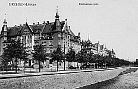Die Agnes-Smedley-Straße
hieß ursprünglich wegen ihres Verlaufs am Weißeritzufer Uferstraße. Nach der Eingemeindung Plauens erhielt sie 1904 den Namen Kielmannseggstraße, der an die Gräfin Auguste Charlotte von Kielmannsegge
(1777-1863) erinnerte. Die als Verehrerin Napoleons bekannte Adlige wohnte bis zu ihrem Tod im Wasserpalais des [Reisewitz´schen Gartens](../../../sudwest/lobtau/strassen_lobtau/tharandter_strasse/reisewitz_scher_garten/). Der Park wurde Ende des
19\. Jahrhunderts mit Industrieanlagen überbaut. Auch die Wohnhäuser der Kielmannseggstraße entstanden auf einem Teil des ehemaligen Gartengeländes. Im Haus Nr. 11 hatte ab 1906 die von Ida Bienert gestiftete erste [Volksbibliothek](../../../sud/plauen/) Sachsens ihr Domizil.

Nach 1945 wurde die Straße in Agnes-Smedley-Straße umbenannt. Die amerikanische Schriftstellerin und Journalistin Agnes
Smedley (1894-1950) schloss sich in den Zwanziger Jahren der anarchistischen Bewegung an und nahm am Freiheitskampf in
Indien und China teil. Zeitweise lebte sie in Berlin. Enge Kontakte unterhielt sie während des Zweiten Weltkrieges zum Agenten Dr. Richard Sorge, der in Japan für den sowjetischen Geheimdienst tätig war.

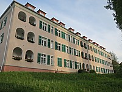Die Straße im südlichen Teil Plauens an der Ortsgrenze zu Coschütz wurde nach dem Ersten
Weltkrieg im Zusammenhang mit dem Bau neuer Wohnhäuser angelegt und zunächst nach dem deutschen Philosophen Friedrich Wilhelm Nietzsche (1844-1900) Nietzschestraße
genannt. Ursprünglich war sie Teil der geplanten, aber nie realisierten halbkreisförmigen äußeren Ringstraße des Villenviertels. Nach 1920 wurden zwischen Nietzsche-, Bernhard-
und Leibnizstraße Mietshäuser des Bauvereins Gartenheim errichtet _(Foto)_.

Da Nietzsche vor allem in der Nachkriegszeit als einer der geistigen Wegbereiter der
Ideologie des Nationalsozialismus betrachtet wurde, entschied man sich Ende der 1960er Jahre zur Umbenennung in Albert-Schweitzer-Straße. Der Arzt und Theologe Albert Schweitzer (1875-1965) setzte sich Zeit
seines Lebens für humanistische Ideale ein und erhielt für seine Verdienste um Frieden und Völkerverständigung 1952 den Friedensnobelpreis.

Die im Stadtviertel Hohenplauen gelegene Arltstraße erinnert seit 1936 an den Architekten Max Arlt (1876-1933), welcher
viele Jahre als Stadtbaudirektor im städtischen Hochbauamt tätig war. Zu seinen wichtigsten Tätigkeiten gehörte die Planung der [Großsiedlung Dresden-Trachau](../../../nordwest/trachau/trachauer_siedlung/) 1928-1930. Die Gebäude der Straße, meist zweigeschossige Wohnhäuser, entstanden  Mitte
der 1930er Jahre.

Die Bamberger Straße bildet die nördliche Flurgrenze Plauens und wurde deshalb von 1878 bis 1904 Grenzstraße genannt. An
den einstigen Verlauf dieser Grenze erinnert noch ein alter, heute eingemauerter Weichbildstein an der Kreuzung Kaitzer /
Bamberger Straße mit der Nr. 72 und der Jahreszahl 1729. Nach der Eingemeindung Plauens erfolgte die Umbenennung nach der Stadt Bamberg in Oberfranken.

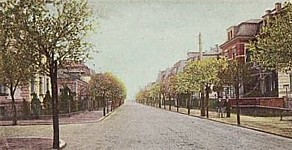

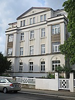Die ersten Gebäude wurden 1879 errichtet. 1890 verlegte die renommierte [Blechwarenfabrik Anton Reiche](../../../sud/plauen/strassen_plauen/blechwarenfabrik_reiche/) ihre Produktion auf ein Grundstück an der Bamberger Straße 1 bis 9. Auch die Firma
Weinhold & Albrecht, eine von mehreren Schokoladenfabriken in Plauen, hatte hier bis 1933 ihren Sitz (Bamberger Straße 20). Danach nutzte bis 1945 eine Beleuchtungskörperfabrik die Gebäude.
Dieser Teil Plauens gehörte zu den am stärksten vom Luftangriff 1945 betroffenen Gebieten, weshalb heute nur noch wenige Reste der ursprünglichen Bebauung vorhanden sind.

Zu den 1945 zerstörten Gebäuden gehörte auch das Wohnhaus Hohe Straße 22 / Ecke Bamberger Straße, in dem zwischen 1884 und 1890 der Sozialistenführer August Bebel lebte. Als erstes Haus
der Südvorstadt konnte 1952 das Gebäude Bamberger Straße 43 in Privatinitiative wieder aufgebaut werden _(Foto)_.

Die 1876 im Plauener Industrieviertel an der Grenze zur Südvorstadt gelegene Straße trug bis zur Eingemeindung den Namen
Florastraße. Grund für diese Namensgebung waren mehrere Gärtnereien in diesem Gebiet. Um Verwechslungen mit einer gleichnamigen Straße in Dresden zu vermeiden, erfolgte 1904 die Umbenennung in Biedermannstraße. Woldemar von
Biedermann (1817-1903) war im Staatsdienst tätig und wurde vor allem als Goethe- Forscher bekannt.

An der Biedermannstraße siedelten sich Ende des 19. Jahrhunderts einige gewerbliche Unternehmungen an. Hier befand sich bis
1913 das Plauener Elektrizitätswerk, dessen Gebäude danach einer Erweiterung der Dresdner Milchversorgungsanstalt weichen
mussten. Auf dem Grundstück Biedermannstraße 8 hatte von 1877 bis 1927 die Maschinenfabrik Vogel & Schlegel ihren Sitz.

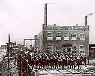Maschinenfabrik
Vogel & Schlegel: Das Unternehmen wurde 1877 von Oskar Vogel und Friedrich Ernst Schlegel auf der Oberseergasse in der Nähe der Prager Straße als
Reparaturwerkstatt für Maschinenbau.gegründet. Da die beengten Platzverhältnisse in der Innenstadt eine Erweiterung unmöglich machten, erwarben die beiden Unternehmer 1889 ein
Grundstück in Plauen, um hier ein neues Fabrikgebäude zu errichten. Zu dieser Zeit waren bereits 50 Arbeiter im Betrieb beschäftigt. Hergestellt wurden verschiedene Maschinenteile,
Wellen, Turbinen und Kupplungen. Für ihre Produkte erhielt die Firma Vogel und Schlegel 1894 den Ehrenpreis der Stadt Dresden für hervorragende Leistungen. Weitere Gold- und
Silbermedaillen folgten später auf verschiedenen Ausstellungen.

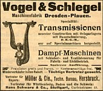1912 erwarb das Unternehmen ein weiteres Areal in der Gemeinde Döhlen (seit 1921 Stadtteil
von Freital). Nach dem Tod Oskar Vogels wurde die Firma 1920 in eine GmbH umgewandelt und beschäftigte nun über 200 Angestellte. Im Zuge der Verstaatlichung der meisten Betriebe in
der DDR kam das Unternehmen 1952 als Betriebsteil zum VEB Kupplungswerk- und Triebwerksbau und gehörte ab 1982 zum VEB Kupplungswerk Dresden, dessen
Nachfolgebetrieb noch heute als KWD Kupplungswerk Dresden GmbH existiert. Das frühere Plauener Betriebsgrundstück an der Biedermannstraße wird jetzt von verschiedenen Kleinunternehmen genutzt.

Die 1871 angelegte Bienertstraße erhielt ihren Namen nach dem Plauener Mühlenbesitzer Gottlieb Traugott Bienert (1813-1894), der 1852 die frühere [Hofmühle](../../../sud/plauen/bienertmuhle/)
übernommen hatte. Bienert war wichtigster Förderer der Gemeinde Plauen und trat als Stifter öffentlicher Einrichtungen wie Schule, Kindergarten und Rathaus in Erscheinung. Auch seine Söhne Erwin und
Theodor und die Schwiegertochter Ida Bienert engagierten sich auf kulturellem und sozialem Gebiet. Die Familiengrabstätte befindet sich auf dem [Inneren Plauenschen Friedhof](../../../sud/plauen/auferstehungskirche/) an der Kirche.

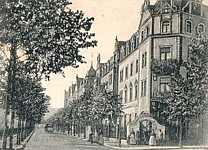Im letzten Drittel des 19. Jahrhunderts wurden die Flächen östlich des Dorfkerns parzelliert
und für eine Bebauung freigegeben. Die Bienertstraße gehörte dabei zu den ersten in diesem Zusamenhang neu angelegten Straßen. Ab 1872 entstanden hier Wohnhäuser und Villen,
meist in offener Bauweise. Bauherren waren meist einheimische Fabrikanten wie der Ziegeleibesitzer Bossecker, der sich um 1880 ein Wohnhaus an der Ecke Hohe Straße
(Bienertstraße 35) errichten ließ. Hinzu kamen einige gewerbliche Unternehmen. Zu den wichtigen Industriebetrieben Plauens gehörte bis zur Zerstörung 1945 die [Schokoladenfabrik Petzold & Aulhorn](../../../sud/plauen/strassen_plauen/petzold___aulhorn/) (Bienertstraße 1),  die 1897 auf dem Gelände des [Reisewitz´schen Gartens](../../../sudwest/lobtau/strassen_lobtau/tharandter_strasse/reisewitz_scher_garten/) entstanden war. An diesen erinnerte auch der Name des früher im
Eckhaus zur Tharandter Straße befindlichen Restaurants “Zum alten Reisewitzer Park”. Eine weitere Gaststätte “Knäsels Restaurant” befand sich auf der Bienertstraße 6 an der Einmündung der Kielmannseggstraße (Agnes-Smedley-Straße -
_Foto_). Auch das Haus Bienertstraße 55 (Ecke Münchner Straße) diente bereits seit ca. 1900 als Restaurant “Münchner Krug”. 1945 fielen mehrere Gebäude den Bomben zum Opfer.

In der Nachkriegszeit wurde die Bienertstraße in Kronacher Straße umbenannt, erhielt jedoch 1991 ihren früheren Namen
wieder zurück. Die beim Hochwasser 2002 schwer beschädigte denkmalgeschützte Weißeritzbrücke aus dem Jahr 1898 wurde 2008 saniert und wird seitdem nur noch als Fußgängerbrücke genutzt.

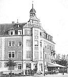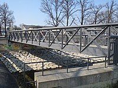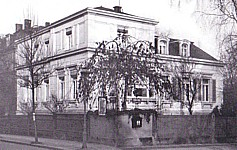

**_Fotos:_** _Eckhaus mit ehemaliger Gaststätte “Zum alten Reisewitzer Park” (links) -_

_historische Weißeritzbrücke (Mitte) - Villa Bossecker um 1930 (Nr. 35 - rechts)_

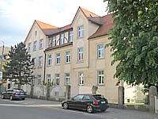Die heutige Coschützer Straße wurde 1844 als Chaussee ausgebaut und ersetzte einen alten und wegen der starken Steigung schwer zu bewältigenden Fahrweg über die heutige Gitterseestraße. 1865 erhielt sie als eine der ersten Straßen Plauens ihren Namen nach dem benachbarten Dorf Coschütz. Noch bis Ende des 19. Jahrhunderts wurden die Flächen fast ausschließlich landwirtschaftlich genutzt. Zu den ersten Gebäuden gehörte die 1862 gegründete Schankwirtschaft am [Hohen Stein](../../../sud/plauen/hoher_stein/) mit ihrem Aussichtsturm. Wenig später begann die Bebauung der Straße mit Mietshäusern. Unter Denkmalschutz steht u.a. das vom Dresdner Spar- und Bauverein errichtete Wohnhaus Coschützer Straße 54-56 (“Plaut-Haus” - _Foto_). Das für die Bebauung weniger geeignete Areal an der Felskante des Plauenschen Grundes wurde ab 1906 vom Mühlenbesitzer Erwin Bienert erworben und als Parkanlage gestaltet.

Mädchenheim (Nr. 58): Das Gebäude entstand 1897 an der Flurgrenze zu Coschütz zur Unterbringung von elternlosen Mädchen und alleinstehenden Fabrikarbeiterinnen der Plauener Firma Anton Reiche. Anfangs lebten hier bis zu 100 Bewohnerinnen. Bereits 1901 erfolgte jedoch die Umwandlung in ein Altersheim, welches bis heute existiert. Im Ersten Weltkrieg befand sich hier ein Lazarett. 1995 wurde das Seniorenheim um einen modernen Anbau an der Hofseite erweitert.

Nr. 65: Das markante Gebäude mit seinen beiden Giebeln zur Straßenseite wurde 1889 als “Versorghaus” der Gemeinde Plauen erbaut und diente als Unterkunft für die Armen des Ortes. Im Inneren befanden sich Krankenstuben für alte bzw. pflegebedürftige Bewohner. Später wurde es als Wohnhaus genutzt.

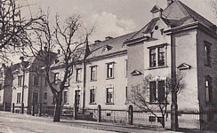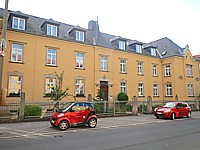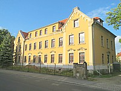

**_Fotos:_** _Das heute als Seniorenheim genutzte Mädchenheim (links und Mitte) und das Plauener “Versorghaus” (rechts)_

An Stelle des heutigen F.-C.-Weiskopf-Platzes befand sich ursprünglich der Dorfplatz des Plauener Oberdorfes. Um den hier
gelegenen Dorfteich standen die meisten Gehöfte des Ortes, darunter das 1608 entstandene Freigut zwischen Chemnitzer und
Klingenberger Straße und die alte Schmiede an der Ecke zur Reckestraße. Im Zuge der Entwicklung Plauens zum städtischen
Wohnvorort wurde der Teich 1875 verfüllt und die Gebäude bis zur Jahrhundertwende 1900 abgetragen. An ihrer Stelle
errichteten verschiedene Bauherren mehrgeschossige Wohn- und Geschäftshäuser im Stil der Gründerzeit, zum Teil mit reich verzierten Jugendstilfassaden.

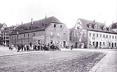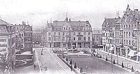

_**Fotos:** Das ehemalige Kobisch-Gut an der Südseite des Platzes kurz vor seinem Abriss 1902 (links);_

_Gebäude an der West- und Südseite um 1910, in der Bildmitte das 1945 zerstörte Haus_

_mit der Gaststätte “Zum Müllerbrunnen” (rechts)_

Nach dem Bau des [Plauener Rathauses](../../../sud/plauen/) erhielt der Dorfplatz 1897 zunächst den Namen Rathausplatz und wurde 1911 in
Chemnitzer Platz umbenannt. Der 1902 hier aufgestellte [Müllerbrunnen](../../../sud/plauen/strassen_plauen/mullerbrunnen/) ist bis heute ein Wahrzeichen des Stadtteils geblieben.
Ab 1909 verkehrte die Straßenbahn bis zum Rathausplatz. 1927 folgte eine weitere Verbindung über [Altplauen](../../../sud/plauen/strassen_plauen/altplauen/) bis zur
Tharandter Straße. Die Häuser an der Westseite des Platzes mit dem Restaurant “Zum Müllerbrunnen” sowie ein Wohnhaus an der Nordseite wurden 1945 beim Bombenangriff zerstört und um 1960 sowie 1998 durch Neubauten ersetzt.

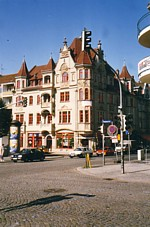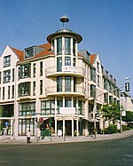1953 erhielten der Chemnitzer Platz sowie die benachbarte Chemnitzer Straße den Namen des Schriftstellers Franz Carl Weiskopf (1900-1955). Weiskopf wurde vor allem durch seine politischen Romane (“Abschied vom Frieden”) und Reportagen bekannt und musste 1933 vor den Nazis emigrieren. Nach 1945 war er zunächst im diplomatischen Dienst der Tschechoslowakei tätig und lebte ab 1953 in der DDR. Hier war er bis zu seinem Tod als Vorstand des Schriftstellerverbandes aktiv. Während die Namensgebung der Straße nach 1990 wieder rückgängig gemacht wurde, trägt der F.-C.-Weiskopf- Platz bis heute diesen Namen.

Mitte der 1990er Jahre wurde mit der Schließung der Sanierung der Bausubstanz _(Foto links)_ und der vorhandenen Baulücken begonnen _(Foto rechts)_, so dass sich der Platz wieder zu einem Geschäftszentrum Plauens entwickelt hat. An der Südseite wurde 2006 der Neubau eines Altenpflegeheimes eingeweiht. Außerdem ist der F.-C.-Weiskopf- Platz als Verkehrsknoten und Haltepunkt mehrerer Buslinien von Bedeutung.

Die im Jahr 1888 angelegte Friedrich-Hegel-Straße wurde ursprünglich als Daheim-Straße bezeichnet, da eine 1872 gegründete
gleichnamige Baugenossenschaft hier die ersten Wohnhäuser errichtet hatte. 1946 erhielt sie ihren jetzigen Namen nach dem
deutschen Philosophen Friedrich Hegel. Hegel (1770-1831) begründete das philosophische System des dialektischen “Dreischritts” und stellte die Bedeutung des Staates als Verwirklichung einer sittlichen Idee heraus.

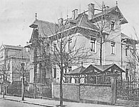Bis heute prägen zahlreiche villenartige Mehrfamilienhäuser aus der Gründungszeit des
Stadtteils Hohenplauen um 1884 das Straßenbild. Ursprünglich war zwischen Plauenschem Ring und Kaitzer Straße der Bau einer weiteren Kirche für den stark gewachsenen Ort
geplant. Bedingt durch den Ersten Weltkrieg wurden diese jedoch nicht umgesetzt. Stattdessen errichtete man Ende der Zwanziger Jahre auf dem Grundstück weitere
Mehrfamilienhäuser. Zu den Bewohnern der Friedrich-Hegel- Straße gehörten einige Professoren der Technischen Hochschule, u.a. Heinrich Barkhausen (Nr. 10), Ewald
Sachsenberg (Nr. 21), Hugo Eckardt (Nr. 27) und Helmut Heinrich (Nr. 31).

Die heutige Gitterseestraße geht auf einen alten Reit- und Fahrweg zurück, der die Dörfer Plauen und Coschütz miteinander
verband. Vor der Eingemeindung trug sie ab 1873 den Namen Gartenstraße, da sich hier der gemeindeeigene Obstgarten
befand. Dieser wurde 1711 vom Dorfrichter Ehrlich angelegt und mit Obstbäumen bepflanzt. Nach dem Tod Ehrlichs erfolgte
eine Aufteilung des Areals an die Bauern des Dorfes, die in diesem Teil des Ortes bis Ende des 19. Jahrhunderts Obst- und
Gartenbau betrieben. 1904 wurde die Straße nach dem benachbarten Ort Gittersee benannt und mit Wohnhäusern bebaut..

Ältestes noch erhaltenes Gebäude ist das Haus Gitterseestraße 18, erbaut um 1865. Später befand sich hier viele Jahre das Volksbad Plauen. 1914 wurde das Wohn- und Geschäftshaus Nr. 7 errichtet. Die Erdgeschossräume nutzte nach der
Fertigstellung die 23. Polizei-Bezirkswache der Dresdner Polizei. Heute befinden sich hier Gewerberäume.

Die Großmannstraße wurde im Zusammenhang mit der Schaffung des [Fichteparkes](../../../sud/plauen/fichtepark/) angelegt und 1901 benannt. Ihren Namen verdankt sie dem früheren Plauener Gemeindevorstand Karl Gustav Großmann (1843-1900), der sein Amt ab 1876 ausübte. Unter seiner Führung entwickelte sich Plauen zum wichtigen Industrie- und Wohnvorort Dresdens. Auf Großmann geht auch der angrenzende Park zurück. Sein Grab befindet sich auf dem Äußeren Plauenschen Friedhof. An der Großmannstraße blieben bis zur Gegenwart einige Villen aus der Zeit um 1900 erhalten. An der Ecke zur Bernhardstraße befand sich ab 1895 die Gaststätte “Parkschänke”. 1918 zum Wohnhaus umgebaut, fiel das Gebäude 1945 dem Luftangriff zum Opfer. Architektonisch interessant ist die Villa Nr. 5 an der Ecke zur Westendstraße (erbaut 1905).

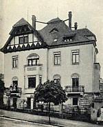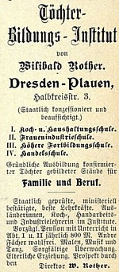Die nach ihrer Straßenführung benannte Halbkreisstraße in Hohenplauen erinnert an die frühen Bebauungspläne der Dresdner Westend AG. Ursprünglich war die Anlage eines parallel-halbkreisförmigen Straßennetzes in diesem Bereich geplant, in dessen Zentrum der [Westendpark](../../../sud/plauen/fichtepark/) (heute Fichtepark) lag. Die Halbkreisstraße bildete in diesem Projekt den inneren, der Plauensche Ring sowie die Albert-Schweitzer-Straße den äußeren Kreis des Baugebietes. Bedingt durch den Ersten Weltkrieg konnte dieses Vorhaben jedoch nicht vollendet werden. Erst in den Zwanziger Jahren entstanden weitere Wohnhäuser, die sich jedoch nur teilweise an den ursprünglichen Absichten orientierten.

Architektonisch interessant sind die um 1900 entstandenen Wohnhäuser Halbkreisstraße Nr. 7, 12 und 14, welche an den Fassaden verschiedene Jugendstilelemente aufweisen. Im Haus Nr. 3 (heute Nr. 4) befand sich vor dem Ersten Weltkrieg das private Töchter-Bildungsinstitut von Willibald Rother _(Foto links)_. Die Einrichtung bestand aus einer Koch- und Haushaltungsschule, einer Frauenindustrie- und Handelsschule sowie einer Höheren Fortbildungsschule für Mädchen. Fakultativ konnten zudem Kurse in Malen, Musik und Tanz beleght werden. Untergebracht waren die Schülerinnen in einer angeschlossenen Pension. Der Unterricht kostet jährlich 800 Mark. 1945 fiel das Haus den Bomben zum Opfer und wurde nach 1960 durch Ausbau des Erdgeschosses als Wohnhaus teilweise wiederaufgebaut.

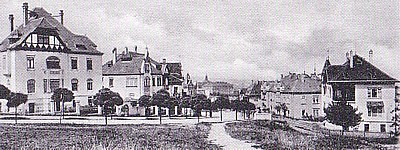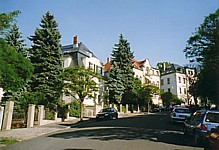

**_Fotos:_** _Blick in die Halbkreisstraße um 1900 und 2003_

Die Hantzschstraße wurde 1934 nach der Familie Hantzsch benannt. Bernhard Adolf Hantzsch (1875-1911) war Ornithologe und Polarforscher und zwischen 1898 und 1909 Lehrer an der XV. Bürgerschule in Plauen. Im Juni 1911 kam er bei einer Expedition in der Nähe der Baffin-Insel in Nordkanada ums Leben. Sein Vater Karl Adolf Hantzsch (1841-1920) gehörte zu den Mitbegründern des Vereins für Geschichte Dresdens. Er verfasste u.a. 1905 das "Namenbuch der Straßen und Plätze Dresdens" und war auch Autor einer Schrift "Hervorragende Persönlichkeiten in Dresden und ihre Wohnungen".

Bis zum Beginn des Zweiten Weltkriegs wurden an der Hantzschstraße mehrere zweigeschossige Wohnhäuser erbaut. 1945 kam es auch in diesem Viertel zu einigen Schäden, so dass ein Teil der Gebäude in der Nachkriegszeit durch Neubauten ersetzt werden musste.

Die Hegerstraße wurde 1888 nach der Plauener Gutsbesitzerwitwe Amalie Wilhelmine Heger (1800-1877) benannt. Bei ihrem Tod hinterließ sie der Gemeinde 56.000 Mark als Stiftung für eine Kinderbewahranstalt, Vorläufer der späteren Kindergärten. 1883 konnte die Kinderbewahr- und Beschäftigungsanstalt der Heger-Bienert-Stiftung an der Nöthnitzer Straße 4 eingeweiht werden.

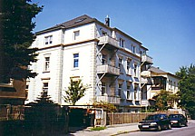

**_Foto:_** _Blick in die Hegerstraße_

Die Straße Hohenplauen wurde Anfang der 1930er Jahre parallel zum Westendring im Zusammenhang mit einem kleinen Wohngebiet angelegt. Erstmals wird der Name 1936 im Adressbuch genannt. Die Benennung erfolgte nach einer Flurbezeichnung für den gesamten südlichen Teil Plauens, bedingt durch dessen geografische Lage am Rand des Elbtalkessels.

Die heutige Kantstraße hieß bis 1904 Seminarstraße, da sich hier das 1896 eröffnete Königliche Lehrerseminar befand. Der
Name erinnert an den bedeutenden deutschen Philosophen Immanuel Kant (1724-1804). Kant gilt als bedeutendster Vertreter
der klassischen deutschen Philosophie und wurde vor allem durch seine “Kritik der reinen Vernunft” bekannt. Im ehemaligen Seminargebäude hat heute das Gymnasium Dresden-Plauen seinen Sitz.

Die Klingenberger Straße, benannt nach dem kleinen Ort Klingenberg im Weißeritzkreis, trug vor 1904 den Namen Poststraße,
da sich hier das Postamt des Ortes befand. Zwischen Klingenberger und Chemnitzer Straße stand bis zum Abbruch 1895 das
Freigut, welches sich zuletzt im Besitz der Familie Moses befand und größtes bäuerliches Anwesen Plauens war. Später wurden
an seiner Stelle repräsentative Mietshäuser errichtet. Die Westseite der Straße erhielt ihr heutiges Bild nach dem Ersten Weltkrieg, als hier weitere Mehrfamilienhäuser entstanden.

Der Kotteweg im Wohngebiet Hohenplauen entstand in den Zwanziger Jahren und erhielt seinen Namen nach dem Dresdner
Stadtverordneten Gustav Kotte (1844-1925). Kotte war zugleich Vorsitzender des Bürgervereins Dresden-Plauen.

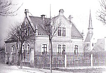Die Krausestraße oberhalb des Inneren Plauenschen Friedhofes wurde 1876 als
Schulstraße angelegt, da sich hier das alte Plauener Schulhaus befand. Das historische Gebäude wurde 1903 wegen Baufälligkeit abgerissen. Ihren heutigen, nach der
Eingemeindung des Ortes nach Dresden eingeführten, Namen verdankt sie dem Philosophen Karl Christian Friedrich Krause (1781-1832). Krause verbrachte viele Jahre
seines Lebens in Dresden und war als Privatdozent tätig. Sein wichtigstes Werk “Das Urbild der Menschheit” wurde im 19. Jahrhundert vor allem in Spanien und Lateinamerika populär.

An der Südseite der Krausestraße steht das 1878 errichtete Pfarrhaus der Auferstehungskirche (Nr. 3). Das eingeschossige
Gebäude besitzt zwei Wohnungen. Auf dem Nachbargrundstück wurde 1997 ein kirchlicher Kindergarten gebaut. Gegenüber befindet sich die einstige Feuerwache Plauens _(Foto)_
. Das Haus, zu welchem ursprünglich ein heute nicht mehr vorhandener Wach- und Schlauchturm gehörte, wurde in den 1930er Jahren umgebaut und aufgestockt. In den früheren Fahrzeughallen befindet sich heute eine Kfz-Werkstatt.

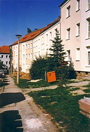Die Landsberger Straße, eine kleine Verbindungsstraße zwischen Münchner und Nöthnitzer Straße entstand Ende der 1930er Jahre und ist 1940 erstmals im Adressbuch verzeichnet. In Anlehnung an die benachbarten Straßen im "bayrischen Viertel" erhielt sie ihren Namen nach der Stadt Landsberg am Lech.

Die Bebauung erfolgte zunächst nur auf der südlichen Straßenseite mit Mehrfamilienhäusern. Besitzer dieser Baugruppe war 1944 die "Allianz und Stuttgarter Lebensversicherung Bank AG". In den 1950er Jahren wurden auch auf der gegenüberliegenden Straßenseite Wohnhäuser erbaut _(Foto)_. Eine Modernisierung der Gebäude erfolgte nach 1990.

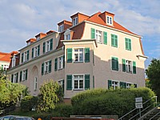Die Leibnizstraße wurde im Zusammenhang mit der Erschließung des Villenviertels
Hohenplauen angelegt, jedoch erst in den 1920er und 30er Jahren mit Mehrfamilienhäusern bebaut. Initiator der Siedlung zwischen Leibniz- und Nietzschestraße (heute
Albert-Schweitzer-Straße) war der genossenschaftlich organisierte Bauverein Gartenheim. Ihren Namen erhielt die Straße  nach dem deutschen Gelehrten Gottfried Wilhelm Leibniz
(1646-1716), der zu den wichtigsten Vertretern der Frühaufklärung gehörte. Leibniz befasste sich mit philosophischen Fragen, aber auch mit mathematischen und physikalischen
Fragen und begründete die Differential- und Integralrechnung.

Die Lotzestraße entstand in den Zwanziger Jahren in der Nähe des Plauenschen Rings und wurde nach dem Philosophen Rudolf
Hermann Lotze (1817-1881) benannt. Der aus Bautzen stammende Gelehrte gilt als Vertreter der vor dem Ersten Weltkrieg populären Lehre der “induktiven Metapysik”, welche moderne wissenschaftliche Erkenntnisse mit religiösen
Glaubensvorstellungen in Einklang zu bringen versuchte. 2011 entstand auf dem Areal eines früheren Garagenkomplexes
zwischen Lotzestraße und Passauer Straße ein kleines Wohngebiet mit Einfamilienhäusern und einer Kita. Architektonisch
interessant ist das von Steffen Pape entworfene Haus Nr. 7, welches 2013 mit dem “Baupreis Plauen” prämiert wurde.

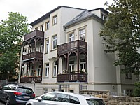Die Pestitzer Straße im Ortsteil Hohenplauen erhielt ihren Namen nach dem Bauernweiler
(Klein-) Pestitz zwischen Räcknitz und Mockritz. Seit Mitte des 19. Jahrhunderts waren die Flächen Standort der Ziegelei Bossecker. Die Firma gehörte zu den einst drei
Ziegeleibetrieben auf Plauener Flur. Nach Erschöpfung der Lehmvorkommen verlegte man deren Betrieb zur Nöthnitzer Straße. Teile der früheren Ziegeleigebäude wurden später von
einem Fuhrunternehmen genutzt und 2005 zugunsten eines Wohnhauses abgebrochen. Erhalten blieb die Villa des einstigen Besitzers an der Bienertstraße 35. Nach Aufgabe des
Ziegeleibetriebes entstanden an der Pestitzer Straße mehrgeschossige Mietshäuser.

Der bis 1904 Ringstraße genannte Plauensche Ring wurde 1873 als Auftakt für das geplante Villenviertel Hohenplauen durch
die Baugesellschaft Dresdner Westend angelegt. Unter Ausnutzung des Geländes war ein teilweise bogenförmiges Straßennetz
vorgesehen, welches jedoch nur in Ansätzen realisiert wurde. Ab 1897 endete hier die Straßenbahn, die 1927 bis Coschütz
verlängert wurde. In diesem Zusammenhang entstand auch die Haarnadelkurve am Übergang des Plauenschen Rings in den
Westendring. Hier ereignete sich am 9. Dezember 1959 das schwerste Unglück in der Geschichte der Dresdner Straßenbahn,
bei dem neun Menschen ums Leben kamen. Ein Wagen der Linie 11 war auf der abschüssigen Trasse aus der Kurve getragen
worden und gegen einen Betonmast geprallt. Der Streckenabschnitt auf dem Plauenschen Ring wurde 1999 nach Fertigstellung der neuen Gleistrasse zur Münchner Straße stillgelegt.

Bis zur Jahrhundertwende entstanden an der nördlichen Seite der Ringstraße zahlreiche Mehrfamilienhäuser, teilweise mit kleinen Läden im Erdgeschoss.
Hier finden sich auch einige Gaststätten wie das Lokal “Keller” (Nr. 9) und die 1995 eröffnete bekannte Szenekneipe “Paul Rackwitz” (Nr. 33). Das in einem früheren Kolonialwarenladen befindliche und nach dessen
einstigem Besitzer benannte Lokal schloss im Juli 2015 seine Pforten. Auch im Eckhaus Nr. 10 gab es mit der “Räuberschänke”
zeitweise eine Gastwirtschaft. Nach dem Ersten Weltkrieg setzte sich die Bebauung der Ringstraße in Richtung Coschütz fort.
Noch heute lassen die unterschiedlichen Stilformen der Wohnhäuser den Wandel der Architekturauffassung gut erkennen.

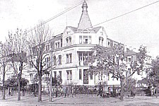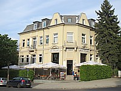

**_Fotos:_** _Das 1945 zerstörte Eckhaus zur Kaitzer Straße aus der Zeit vor 1900._

_Nach 1945 befand sich auf dem Grundstück der Schulgarten der 55. Polytechnischen Oberschule (links) -_

_Das Eckhaus zur Bernhardstraße mit der Kneipe “Paul Rackwitz” (rechts)._

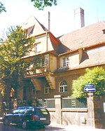Die Reckestraße, vor 1904 Elisenstraße genannt, wurde 1873 durch die Baugesellschaft Dresdner Westend angelegt und mit Wohnhäusern bebaut. Ihren Namen erhielt sie nach der Lyrikerin Elisa von der Recke (1756-1833), die im 19. Jahrhundert Mittelpunkt eines Künstlerkreises war, dem auch ihr Lebensgefährte Christoph August Tiedge und Carl Maria von Weber angehörten. Markantestes Gebäude an der Reckestraße ist neben der [Kirche](../../../sud/plauen/auferstehungskirche/) das 1912 von Hans Erlwein und Max Wrba entworfene Gemeindehaus der Auferstehungskirche _(Foto)_.

Im Wohnhaus Reckestraße 5 entstand 1998 die Restauration Kielmannsegge, deren Name an die [Gräfin Auguste Charlotte von Kielmannsegge](../../../sudwest/lobtau/strassen_lobtau/tharandter_strasse/reisewitz_scher_garten/) (1777-1863), eine Geliebte Napoleons, erinnerte. Später existierte zeitweise die Gaststätte “Hola\` Paraguay” mit südamerikanischer Küche, bevor in die Räume das italienische Restaurant “Il Grottino” einzog.

Der heute nicht mehr im Stadtplan verzeichnete Röhrweg verband einst die Wasserstraße (Hofmühlenstraße) mit der heutigen Zwickauer Straße. Der Name erinnerte an die 1542 abgelegte [Hochplauensche Röhrfahrt](../../../sud/plauen/), die noch bis zum Ersten Weltkrieg in Betrieb war und der Wasserversorgung Dresdens diente. Im Zuge der Industrialisierung in dieser Gegend lag der Weg inmitten des Industriegebietes im Norden des Ortes und wurde zudem von der Bahnverbindung nach Chemnitz überquert. Noch 1964 war der Röhrweg, der mitterweile zum Teil auf dem Gelände des [Bahnbetriebswerkes](../../../zentrum/sudvorstadt/strassen_sudvorstadt/zwickauer_strasse/) lag, in den Stadtplänen verzeichnet. Heute wird der verbliebene Teil zur Biedermannstraße gezählt.

Die Schleiermacherstraße beginnt an der Plauener Kirche und endet in der Nähe des Naturdenkmals [Hoher Stein](../../../sud/plauen/hoher_stein/) im oberen
Teil von Plauen. Bis 1904 wurde sie Lutherstraße genannt. Der heutige Name erinnert an den deutschen Theologen und Religionsphilosophen Friedrich Schleiermacher (1768-1834), der auch mit reformpädagogischen Gedanken für Aufsehen
sorgte. Bemerkenswertestes Gebäude ist das 1875/76 erbaute [Schulhaus](../../../sud/plauen/), welches heute von der 39. Grundschule genutzt wird.
Ein Erweiterungsbau entstand 1898. Oberhalb dieser Schule liegt der vom Sohn des Mühlenbesitzers gestiftete Bienertpark. Im
Sommer 1913 wurde an der Schleiermacherstraße bei Kanalarbeiten eine Wohngrube der sogenannten “Billendorfer Kultur” (um 800 v. Chr.) entdeckt.

Die um 1900 angelegte Gostritzer Straße im oberen Teil von Plauen erhielt nach der Eingemeindung des Ortes den Namen des
deutschen Philosophen Arthur Schopenhauer (1788-1860). Schopenhauer vertrat eine die Welt als Vorstellung und ihre Kräfte
als Äußerung eines allgemeinen Urwillens auffassende Theorie und gehörte seit Mitte des 19. Jahrhunderts zu den wichtigsten
Vertretern der deutschen Philosophie. Um 1905 entstanden an der Schopenhauerstraße die ersten villenartigen Wohnhäuser.
Außerdem gab es unterhalb der Straße vor dem Ersten Weltkrieg eine Ziegelei. Die durch den Lehmabbau entstandene Senke zwischen Hoher Straße und Kaitzer Straße wurde erst um 1970 und nach 1990 mit Wohnhäusern bebaut.

Nr. 1 / 3: Die beiden Wohnhäuser dienten in der unmittelbaren Nachkriegszeit zwischen Juli 1945 und Februar 1947 als
sowjetische Ortskommandantur im 6. Rayon. Dazu waren die deutschen Bewohner zum Auszug gezwungen worden und durften erst nach Räumung der Gebäude in ihre Wohnungen zurück.

Nr. 5:
Zwischen 1909 und 1914 wohnte im 1. Obergeschoss dieses Hauses der aus Dänemark stammende Schriftsteller Karl Gjellerup mit seiner Frau Nina. Gjellerup war nach seiner Hochzeit mit der aus Dresden stammenden und bereits zuvor
verheirateten Eugenia Bendix 1892 in die sächsische Residenz übergesiedelt. Für sein in Dresden entstandenes Werk “Der Pilger Kamanita” (1906) erhielt er 1917 den Literaturnobelpreis. Vom Preisgeld erwarb er die Villa [Goethestraße 11](../../../nord/klotzsche/strassen_klotzsche/) in Klotzsche, wo er bis zu seinem Tod 1919 lebte.

Die Steinadlerstraße in der Nähe des Fichteparks wurde in Abweichung vom ursprünglichen Bebauungsplan für Hohenplauen
um 1930 angelegt. Wenig später wurden hier Ein- und Mehrfamilienhäuser erbaut, welche bis zur Gegenwart weitgehend im Ursprungszustand erhalten blieben.

Der Westendring entstand 1874 in Verlängerung der Ringstraße (ab 1904 Plauenscher Ring) und bildete zugleich die östliche Begrenzung des Villenviertels der Baugesellschaft “Dresdner Westend”. Nach dem Ersten Weltkrieg wurden auch in diesem Bereich Hohenplauens, Wohnhäuser erbaut. Rund um den Fichtepark prägen bis heute vor allem Einfamilienhäuser das Stadtbild. Auf der gegenüberliegenden Seite entstand ab 1980 das Wohngebiet Cämmerswalder Straße.

Ab 1927 verkehrte hier die bis nach Coschütz verlängerte Straßenbahn, welche 1999 über die neu angelegte Passauer Straße eine direkte Verbindung zur Münchner Straße erhielt. Zuvor mussten die Bahnen vom Westendring über eine scharfe Haarnadelkurve in den Plauenschen Ring einbiegen. Diese Stelle gehörte zu den gefährlichsten Stellen im Streckennetz und war 1927 und 1959 Ort tragischer Unfälle. 1959 war ein Hechtwagen bergabwärts von Coschütz kommend an dieser Stelle entgleist, wobei 11 Menschen ums Leben kamen.

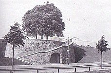Liepschs Ruhe: In der Nähe der Straßenbahnhaltestelle Cämmerswalder Straße befindet sich ein kleiner Aussichtspunkt mit einer Stützmauer am Hang, Treppenanlage und integrierter Straßenbahnwartehalle. Die Anlage geht auf einen 1880 vom Plauener Baumeister Hermann Blauert angelegten Ruheplatz zurück, der nach dessen Freund Max Liepsch, Besitzer der Zeitung “Dresdner Nachrichten”, den Namen Liepschs Ruhe erhielt. Blauert ließ dort vier Linden anpflanzen und eine steinerne Ruhebank aufstellen. Ganz in der Nähe weist ein Grenzstein auf die hier verlaufende Flurgrenze zu Kleinpestitz hin. An Liepschs Ruhe begann zudem ein als “Langer Rain” bezeichneter Fußweg nach Kaitz.

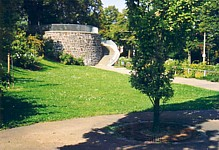Im Zusammenhang mit dem Ausbau der Straßenbahntrasse nach Coschütz und der Bebauung der Fluren von Hohenplauen wurde die Anlage Anfang der 1930er Jahre umgestaltet und erhielt dabei ihr heutiges Aussehen. Mit finanzieller Hilfe der
Bienert-Stiftung entstand zugleich ein Promenadenweg parallel zum Westendring, der Auftakt für eine größere Parkanlage sein sollte. Der Bezirksverein Dresden-Plauen ließ dazu mehrere Spazierwege anlegen, steinerne Wegweiser aufstellen und eine Bepflanzung des Areals vorbereiten. Kriegsbedingt konnten diese Planungen jedoch nicht weiter realisiert werden. Nach 1980 entstand stattdessen das Neubaugebiet Cämmerswalder Straße mit mehrgeschossigen Plattenbauten.

Ebenso wie der benachbarte Westendring erhielt auch die Westendstraße ihren Namen nach dem 1872 gegründeten Bauverein Westend, der bis zum Ende des 19. Jahrhunderts die Freiflächen in diesem Bereich parzellierte und als Baugrundstücke zur Verfügung stellte. Hauptsächlich entstanden hier Villen und Landhäuser, zunächst an der Ost-, nach 1900 auch an der Westseite der Straße. Architektonisch interessant sind u.a. die Häuser Nr. 18 und 21. Beim Bau weiterer Wohnhäuser wurden 1921 hier einige Mammutknochen gefunden.

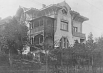Villa Nr. 21:
Zu den markantesten Wohnbauten in Plauen gehört die 1905 erbaute Villa an der Ecke Plauenscher Ring / Westendstraße, die vom Plauener Büro William & Fischer
entworfen wurde und zu den bedeutendsten Zeugnissen des Jugendstils in Dresden zählt _(Fotos)_. Bauherr und erster Eigentümer des Hauses war der Rechtsanwalt Dr. jur. R.
Baum, der ab 1900 am Landgericht Dresden tätig war und 1915 eine Professur erhielt. Aus dieser Familie entstammt auch der FDP- Politiker Gerhart Baum, später deutscher Bundesinnenminister.

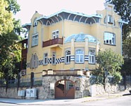1920 erwarb der Spediteur und Automobilhändler
Alexander Graumüller die Villa. Seine Tochter Lilo war eine der ersten weiblichen Rennfahrerinnen in Deutschland und startete bei mehreren Autorennen. Aus dieser Zeit stammt
auch der Anbau mit Garage. 1945 wurde die Villa von der Roten Armee zeitweise konfisziert und diente bis 1947 als Wohnung für sowjetische Offiziere. Die Erdgeschossräume wurden
später gewerblich genutzt, u.a. von einer Zahlstelle der SVK und ab 1951 vom Leihhaus Baldauf & Co. In den Obergeschossen entstanden Mietwohnungen und Büros. 1951 verkauften
die Erben Graumüllers das Gebäude an die Familie Kahlert, die die Villa bis 1995 denkmalgerecht sanieren ließ. Heute befindet sich hier die Kunstgalerie “Galerie K Westend”.

Diese Straße im unteren Teil von Plauen wurde 1873/74 als Reisewitzer Straße (nach dem nahen Reisewitzschen Garten) angelegt und 1904 in Würzburger Straße umbenannt. In diesem Gebiet dominierten vor allem gewerbliche Unternehmen, östlich der Chemnitzer Straße lagen Villen und Mehrfamilienhäuser. In der Nähe der Weißeritz enstand ein Elektrizitätswerk, daneben die Großmolkerei DREMA. Das Eckgrundstück zur Chemnitzer Straße wurde von der Brauerei “Plauenscher Lagerkeller” (später [Falkenbrauerei](../../../sud/plauen/strassen_plauen/chemnitzer_strasse/falkenbrauerei/)) eingenommen.

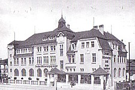Dresdner Milchversorgungsanstalt: Das Gebäude entstand 1907 nach Plänen des Architekturbüros Schümichen Michel auf einem Grundstück an der Würzburger Straße 9 als Altstädter Dampfmolkerei zur Verarbeitung von Milch. Zum Zeitpunkt ihrer Entstehung gehörte sie zu den modernsten Unternehmen der Branche weltweit. Die Milch wurde von Bauern aus Orten der Dresdner Umgebung bezogen, vor Ort verarbeitet und anschließend in Filialen im gesamten Stadtgebiet verkauft. 1911 war das Unternehmen mit einem eigenen Milchausschank auf der [Internationalen Hygiene-Ausstellung](../../../Zentrum/Pirnaische_Vorstadt/Strassen_Pirnaische_Vorstadt/Hygienemuseum/hygienemuseum.html) in Dresden vertreten. Die Entwürfe für diesen Pavillon stammten vom bekannten Architekten Georg Heinsius von Mayenburg. Bis nach dem Ersten Weltkrieg erfolgte die Betriebsführung durch eine Genossenschaft, welche in dieser Zeit größte Molkereigenossenschaft Deutschlands war. 1923 wurde der Betrieb an die neu gegründete Drema AG übertragen (ab 1936 Drema Grossmolkerei AG).

Trotz einiger Kriegsschäden konnte die Produktion bereits kurz nach Kriegsende wieder aufgenommen werden. Später wurde die Drema Betriebsteil der volkseigenen Dresdner Milchwerke. 1990 ging aus diesem Unternehmen die Sachsenmilch AG hervor. Nachdem in Leppersdorf bei Radeberg eine moderne Großmolkerei in Betrieb genommen wurde, stellte der Plauener Betrieb seine Produktion ein.

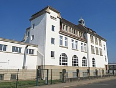Die Gebäude bezog im Juni 1992 der Feinkosthersteller Dr. Doerr. Das Unternehmen wurde 1933 von Alice und Dr. Herbert Doerr als Feinkostfabrik auf der Stephanienstraße gegründet und 1938 nach Klotzsche verlegt. Bis 1972 befand sich die Firma in Familienbesitz, wurde dann zwangsweise verstaatlicht und 1990 reprivatisiert. Ein Jahr später erwarb Doerr die Gelände der früheren DREMA. Hergestellt werden vor allem Salatcremes, Brotaufstrich und verschiedene Feinkostsalate, welche den Betrieb zum Marktführer seiner Branche in Sachsen machten. In den letzten Jahren erfolgten einige Modernisierungen sowie 2004 der Neubau eines Produktionsgebäudes am Weißeritzufer. Bis 2002 stand an seiner Stelle ein mehrstöckiges Mietshaus, welches beim Augusthochwasser teilweise einstürzte, wobei ein Bewohner ums Leben kam.

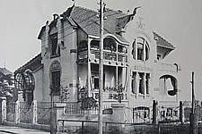Nr. 43: Die Villa entstand 1902 nach Plänen des Plauener Architekten- und Baubüros Fichtner im Jugendstil _(Foto)_. 1945 fiel das Haus den Bomben zum Opfer und wurde
mit Ausnahme der früheren Einfriedung abgerissen. Nach 1990 wurde auf dem Grundstück ein Mehrfamilienhaus errichtet.

Nr. 58:
Die im süddeutschen Stil gestaltete Villa wurde 1908 nach Plänen des Architekten Otto Heinrich Riemerschmidt errichtet. Bauherr und erster Bewohner war der TH-Professor Richard Mollier (1863-1935). Mollier kam 1897 als Nachfolger Gustav Zeuners nach Dresden und wurde hier ordentlicher Professor für Maschinenlehre. Er gilt als einer der Pioniere der Thermodynamik.

Nr. 69:
Auch dieses Haus gehört zu den architektonisch interessanten Villen und Mietshäusern der Würzburger Straße. Die malerische Villa mit zahlreichen Schmuckdetails entstand 1906.

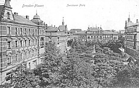Der ursprünglich Wettiner Platz genannte Platz erhielt seinen Namen Zwickauer Platz
erst nach der Eingemeindung Plauens 1904. Gleichzeitig wurde die benachbarte Falkenstraße in [Zwickauer Straße](../../../zentrum/sudvorstadt/strassen_sudvorstadt/zwickauer_strasse/) umbenannt. Angelegt wurde er 1895 im Zuge der
Bebauung der Flächen zwischen Zwickauer und Klingenberger Straße. Der von mehrgeschossigen Wohnhäusern umgebene Platz erhielt dabei eine parkartige Gestaltung. Im Mittelpunkt stand ein heute nicht mehr vorhandenes Wettindenkmal,
welches seinen Standort zuvor am alten Dorfplatz hatte. Heute befindet sich an seiner Stelle ein um 1995 angelegter Kinderspielplatz. Einige Gebäude der Ostseite fielen 1945 den Bomben zum Opfer.

[Plauen auf OpenStreetMap](https://www.openstreetmap.org/search?query=Dresden+Plauen)

* * *

 \[ [Home](../../../index.html)\] \[ [Nord](../../../nord/)\] \[ [Nordwest](../../../nordwest/)\] \[ [Neustadt](../../../neustadt/)\] \[ [Nordost](../../../nordost/)\] \[ [West](../../../west/)\] \[ [Zentrum](../../../zentrum/)\] \[ [Südwest](../../../sudwest/)\] \[ [Süd](../../../sud/)\] \[ [Südost](../../../sudost/)\] \[ [Ost](../../../ost/)\] \[ [Register](../../../Register/register.html)\] \[ [Kontakt](../../../Kontakt/kontakt.html)\] \[ [Impressum](../../../impressum/)\]
