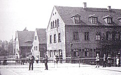
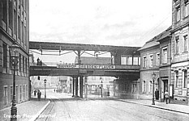

* * *

* * *

**Empfangsgebäude des Plauener Bahnhofs**

Obwohl die 1904 eingeführte Straßenbezeichnung Altplauen auf das frühere
Dorf Plauen hinweist, wurde hier nicht der alte Dorfanger, sondern die Verbindungsstraße zwischen Oberdorf ( [F.-C.-Weiskopf-Platz](../../../../sud/plauen/strassen_plauen/)) und Unterdorf ( [Hofmühlenstraße](../../../../sud/plauen/strassen_plauen/hofmuhlenstrasse/)) so benannt. Vor der Eingemeindung hieß diese Straße ab 1865 Kirchstraße. An der Einmündung der [Chemnitzer Straße](../../../../sud/plauen/strassen_plauen/chemnitzer_strasse/) befand sich bis um 1900 das beliebte Ausflugsrestaurant Glafey. Dieses
musste ebenso dem Bau mehrgeschossiger Mietshäuser weichen wie einige hier befindliche Gebäude des früheren Dorfkerns. Die letzten verschwanden in den 1970er Jahren im Zusammenhang mit einer Straßenverbreiterung. Die
gegenüber liegende Straßenseite nehmen die Bauten der [Bienertmühle](../../../../sud/plauen/bienertmuhle/) ein, welche heute von verschiedenen gewerblichen Unternehmen genutzt werden.

Mit Eröffnung der Straßenbahnlinie durch den [Plauenschen Grund](../../../../sud/plauen/plauenscher_grund/) hatte Plauen 1902 eine weitere Verbindung an das Dresdner Straßenbahnnetz erhalten Ursprünglich bogen die Wagen von der [Tharandter Straße](../../../../sudwest/lobtau/strassen_lobtau/tharandter_strasse/) links ab, überquerten in Altplauen die Weißeritz und fuhren dann entlang des rechten
Flußufers zur Hegereiterbrücke. 1921 erfolgte die Verlegung der Talstraße auf die andere Uferseite. Zwei Jahre später entstand in Altplauen der neue Eisenbahnhaltepunkt Dresden-Plauen mit Straßenunterführung ( _Foto rechts_). Zuvor gab es an dieser Stelle einen mit Schranken versehenen Bahnübergang _(Foto oben)_. Das frühere Bahnhofsgebäude (im Bild rechts) nutzt seit einigen
Jahren ein Jugendklub. Zugleich dient die Station jedoch auch weiterhin als S-Bahn-Haltepunkt.

Im Zusammenhang mit der Hochlegung der Eisenbahngleise und der
Einrichtung des neuen Haltepunktes entstand zugleich eine neue Straßenbahntrasse von der Tharandter Straße über Altplauen zum Chemnitzer Platz. Zusätzlich gab es ab 1926 ein bis 1964 genutztes Gütergleis in den Hof
der Bienertmühle. Gleisreste sind noch heute im Hof des Betriebsgeländes zu sehen. Die nach 1945 über die Reckestraße geführte Straßenbahnstrecke wurde 1999 aus verkehrstechnischen Gründen stillgelegt und durch eine
Neutrassierung vom Münchner Platz zum Westendring ersetzt. Das Foto zeigt die Eisenbahnunterführung kurz vor Einstellung des Straßenbahnverkehrs im Jahr 1998.

Weißeritzbrücke:
Die am Ausgang der Straße gelegene Brücke über die Weißeritz entstand 1833/34 als steinerne Bogenbrücke und wurde 1902 im Zusammenhang mit dem Bau der Straßenbahn durch den Plauenschen Grund nach
Hainsberg verbreitert. Sie wurde bei der Hochwasserkatastrophe vom 12./13. August 2002 zerstört und 2006 durch einen Neubau wenige Meter stromaufwärts ersetzt.

* * *

 \[ [Home](../../../../index.html)\] \[ [Nord](../../../../nord/)\] \[ [Nordwest](../../../../nordwest/)\] \[ [Neustadt](../../../../neustadt/)\] \[ [Nordost](../../../../nordost/)\] \[ [West](../../../../west/)\] \[ [Zentrum](../../../../zentrum/)\] \[ [Südwest](../../../../sudwest/)\] \[ [Süd](../../../../sud/)\] \[ [Südost](../../../../sudost/)\] \[ [Ost](../../../../ost/)\] \[ [Register](../../../../Register/register.html)\] \[ [Kontakt](../../../../Kontakt/kontakt.html)\] \[ [Impressum](../../../../impressum/)\]
