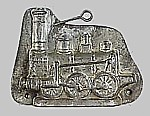
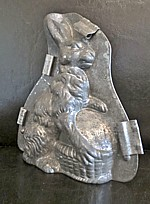
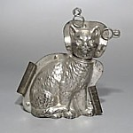
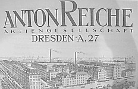
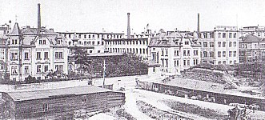

* * *

* * *

Das Unternehmen wurde 1871 von Anton Reiche, einem 1845 in Wilsdruff geborenen Bauernsohn, auf der Münzgasse gegründet und befand sich später im Annenhof in der Wilsdruffer Vorstadt. Reiche hatte während seiner Wanderjahre in Paris das Verfahren der Blechformenherstellung kennengelernt und mit in seine sächsische Heimat gebracht. 1877 verlegte der gelernte Klempner seine Werkstatt zum Freiberger Platz und spezialisierte sich auf die Herstellung von Blechformen und -verpackungen. Reiche galt als cleverer Geschäftsmann und ließ die bei der Herstellung der Formen anfallenden Abfälle zu Spielzeug, Spardosen, Werbeschildern u. ä. verarbeiten, um das wertvolle Material effizient auszunutzen. Als erstem in Deutschland gelang es ihm, Blechdosen farbig zu bedrucken. Entscheidend für seinen Erfolg war jedoch die Produktion von Formen aus Weißblech zur Schokoladenherstellung, die das bis dahin verwendete teurere Kupferblech ersetzten. Außerdem war der Unternehmer Erfinder der Schokoladenautomaten, die zuerst von der Firma Stollwerck eingesetzt wurden. Von Reiches Erfindungen profitierten auch die beiden in Plauen ansässigen Schokoladenhersteller [Petzold & Aulhorn](../../../../sud/plauen/strassen_plauen/petzold___aulhorn/) und [Riedel & Engelmann](../../../../zentrum/sudvorstadt/strassen_sudvorstadt/zwickauer_strasse/) (“Schwerter- Schokolade”).

Auf Anregung des Plauener Mühlenbesitzers Traugott Bienert erwarb Anton Reiche 1886 ein Grundstück an der Bamberger Straße 1-9 _(Foto)_, wohin er seine gesamte Produktion verlegte. Begünstigt durch die verbesserten räumlichen Bedingungen gehörte die Anton Reiche Blechwarenfabrik AG um 1900 zu den bedeutendsten Plauener Unternehmen und beschäftigte zeitweise über 1800 Arbeiter. Nach dem Tod des Firmengründers 1913 wurde das Werk von seinen Söhnen fortgeführt und blieb bis zum Zweiten Weltkrieg bedeutendstes Unternehmen seiner Branche in Deutschland. Der 1945 schwer beschädigte Betrieb wurde in der Nachkriegszeit enteignet und zum VEB Schokoladenformen Dresden umgewandelt, später vom DDR-Kombinat NAGEMA übernommen und 1991 geschlossen. Auf dem früheren Werksgelände entstanden in den letzten Jahren moderne Wohn- und Bürohäuser. Über die Geschichte der Firma Reiche informiert seit 2007 eine Ausstellung in der [Bienertmühle](../../../../sud/plauen/bienertmuhle/), in welcher u.a. eine große Sammlung historischer Schokoladenformen zu sehen ist.

* * *

 \[ [Home](../../../../index.html)\] \[ [Nord](../../../../nord/)\] \[ [Nordwest](../../../../nordwest/)\] \[ [Neustadt](../../../../neustadt/)\] \[ [Nordost](../../../../nordost/)\] \[ [West](../../../../west/)\] \[ [Zentrum](../../../../zentrum/)\] \[ [Südwest](../../../../sudwest/)\] \[ [Süd](../../../../sud/)\] \[ [Südost](../../../../sudost/)\] \[ [Ost](../../../../ost/)\] \[ [Register](../../../../Register/register.html)\] \[ [Kontakt](../../../../Kontakt/kontakt.html)\] \[ [Impressum](../../../../impressum/)\]
