* * *

* * *

* * *

**Historische Werbeanzeigen von Unternehmen an der Chemnitzer Straße**

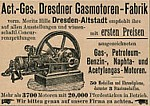

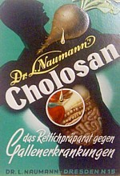

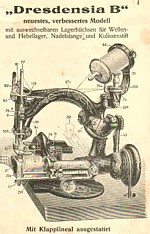

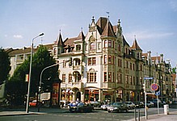Die Chemnitzer Straße geht auf einen alten Verbindungsweg zwischen dem Dorf
Plauen und der Stadt Dresden zurück. An den früheren Grenzverlauf zwischen beiden Fluren erinnert noch ein Weichbildstein an der Südecke des Alten
Annenfriedhofes. Dieser trägt die Nr. 73 und weist die Jahreszahlen 1679 und 1729 auf. 1842/43 wurde dieser Weg zur Chaussee ausgebaut. In diesem Zusammenhang entstand an der Ecke Chemnitzer/ Nöthnitzer Straße 1843 ein
Chausseehaus. In der Folgezeit siedelten sich verschiedene gewerbliche Unternehmen an, darunter die aus der Brauerei “Plauenscher Lagerkeller” hervorgegangene [Falkenbrauerei](../../../../sud/plauen/strassen_plauen/chemnitzer_strasse/falkenbrauerei/) , die [Feldschlösschenbrauerei](../../../../zentrum/sudvorstadt/strassen_sudvorstadt/feldschlosschenbrauerei/) und die
Konservenfabrik Louis Naumann. Hinzu kamen Wohngebäude und Gaststätten sowie der im mittleren Teil der Chemnitzer Straße gelegene [Alte Annenfriedhof](../../../../sud/plauen/strassen_plauen/chemnitzer_strasse/alter_annenfriedhof/). Ursprünglich nach ihrer Richtung Coschützer Straße genannt, erfolgte
1871 die amtliche Benennung Chemnitzer Straße. Ab 1873 verkehrte eine Pferdestraßenbahn von der Innenstadt bis
zum Dorfplatz Plauen, die 1897 bis zum Plauenschen Ring verlängert und drei Jahre später elektrifiziert wurde. Das alte
Chausseehaus fiel 1887 dem Neubau eines Wohn- und Geschäftshauses zum Opfer. Das gegenüberliegende Gebäude Chemnitzer Str. 96 _(Foto)_
war vor 1933 Filiale des bekannten Bankhauses Arnhold, später Geschäftsstelle der Dresdner Bank. Nach 1945 befand sich hier viele Jahre der Klub “Müllerbrunnen” mit öffentlicher Gaststätte.

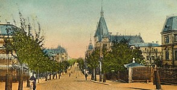Ursprünglich begann die Chemnitzer Straße am Plauenschen Platz in
der Nähe des Hauptbahnhofes, überquerte auf einer Brücke die Bahnanlagen, vereinigte sich dort mit der Falkenstraße und führte von dort über den Hahneberg in Richtung Plauen. Während der
Luftangriffe auf Dresden wurden auch die Südvorstadt und die angrenzenden Teile von Plauen schwer getroffen. Zahlreiche Gebäude an der Chemnitzer Straße wurden dabei völlig zerstört bzw. stark
beschädigt. Der Straßenbahnverkehr kam ebenfalls zum Erliegen und wurde auch nach 1945 nicht wieder aufgenommen.

1953 erhielt die Straße gemeinsam mit dem angrenzenden Chemnitzer Platz den Namen des Schriftstellers F. C. Weiskopf (1900-1955). Weiskopf verfasste zahlreiche Romane und Reportagen zu politischen Themen und floh 1933
vor der NS-Herrschaft ins Ausland.  Im Zuge des Ausbaus der neuen Hochstraße über die Bahngleise wurde der
Abschnitt zwischen Dippoldiswalder Platz und Nürnberger Straße zu einer vierspurigen Schnellstraße ausgebaut und 1968 in [Budapester Straße](../../../../zentrum/sudvorstadt/strassen_sudvorstadt/) umbenannt. 1991 erhielt der verbliebene Teil der F.-C.-Weiskopf-Straße in Plauen wieder
den alten Namen Chemnitzer Straße zurück. Heute dominieren hier vor allem gewerbliche Unternehmen. Als wichtigstes
Bauvorhaben wurde 1997 der Bürokomplex “Falkenbrunnen” fertig gestellt. An der Ecke Chemnitzer/ Bamberger
Straße entstand 1997 an Stelle eines 1945 zerstörten Wohnhauses das neue Transmar Leonardo Hotel. Künftig ist hier außerdem ein kleiner Wohnpark mit Ein- und Mehrfamilienhäusern geplant.

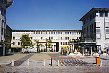

**_Foto:_** _Der Bürokomplex “Falkenbrunnen” am Standort der früheren Falkenbrauerei_

Einzelne Gebäude:

_Südvorstadt_

Taubstummenanstalt (Nr. 2): Die Dresdner Taubstummenanstalt wurde 1828 vom Seminardirektor Zahn gegründet.
Bereits vier Jahre später übergab Zahn wegen seiner Versetzung nach Moers die Leitung an Johann Friedrich Jencke,
der sich bereits seit 1828 mit der Unterrichtung Hörgeschädigter beschäftigte. Mit Unterstützung eines großzügigen
Legats des russischen Majors Alexius Adamowitsch von Olsusieff sowie staatlicher Unterstützung konnte Jenke 1838
einen Neubau an der Chemnitzer Straße einweihen. Das Grundstück in der Nähe des Plauenschen Platzes lag zwischen
Chemnitzer, Polier- und Ammonstraße und wurde nach Süden von den Bahnanlagen begrenzt. Anfangs standen Plätze für ca. 50 bis 60 Gehörlose zur Verfügung, die von fünf speziell geschulten Lehrern unterrichtet wurden.

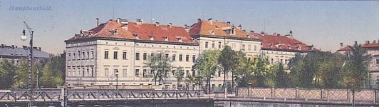

Nach Erweiterung des Gebäudekomplexes 1879 wuchs die Kapazität der Schule deutlich an. Mit Verlegung der
Blindenanstalt nach Chemnitz konnten ab 1905 auch deren Gebäude an der Chemnitzer Straße 4 genutzt werden, was
1910 die Erweiterung der Anstalt um eine Schwerhörigenschule ermöglichte. 1945 wurde der Komplex zerstört und das
Grundstück in den 1960er Jahren mit der Hochstraße überbaut. Heute befindet sich ungefähr an Stelle des Gebäudes die Straßenbahnhaltestelle Budapester Straße. Eine Nachfolgeeinrichtung hat seit 1959 mit der [“Johann-Friedrich-Jencke-Schule”](../../../../nordwest/trachenberge/trachenberge_-_sozialeinrichtu/) ihren Sitz in Trachenberge.

Nr. 3:
Das 1945 zerstörte Gebäude unmittelbar an der Brücke der Chemnitzer Straße über die Bahngleise diente als Verwaltungsgebäude der Deutschen Bahn. Hier hatten u.a. Eisenbahn-Maschinenamt, das Reichsbahn-Verkehrsamt
sowie das Reichsbahn-Betriebsamt Dresden I ihren Sitz.

Blindenanstalt (Nr. 4): Die Blindenanstalt wurde am 2. Januar 1809 vom Privatgelehrten Emanuel Gottfried Flemming als
privates Wohlfahrtsunternehmen gegründet und nutzte zunächst die Räume der ehemaligen Gaststätte “Bei Birkholzens”
am Fischhofplatz in der Wilsdruffer Vorstadt. Nach Flemmings Tod 1820 richtete der Kaufmann Schütz eine weitere
Beschäftigungs- und Unterrichtsanstalt für erwachsene Blinde ein. Beide Institute wurden fünf Jahre später vereinigt.

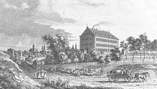1830 übernahm der Staat die Einrichtung und ließ 1835/37 auf einer
Schanze aus den Napoleonischen Kriegen eine moderne Heilstätte für Blinde errichten. Die Königlich-Sächsische Landesblindenanstalt bot Platz für 225 Behinderte, die hier einfache Gegenstände wie Bürsten,
Seilerwaren und Handarbeiten herstellten und in einem institutseigenen Geschäft verkauften. Auch Klavierstimmer bildete man aus. Erster Direktor war Karl August Georgi (1802-1867), der sich große Verdienste um den
Aufbau des Blindenschulwesens in Deutschland erwarb. Als einer der jüngsten Schulleiter überhaupt befasste er sich intensiv mit spezialisierter
Blindenpädagogik und war Initiator des 1843 gegründeten Unterstützungsfonds für entlassene Blinde, um den
Behinderten auch nach Abschluss der Schule eine berufliche Tätigkeit zu ermöglichen. 1905 wurde die Blindenanstalt
nach Chemnitz verlegt. Im Anschluss übernahm die benachbarte Taubstummenanstalt die Gebäude und nutzte diese bis zur Zerstörung 1945 als Gehörlosenschule.

Nr. 4b:
In diesem Haus gab es  bis 1945 die Zigarettenfabrik “Sulima”, die 1871 als “Tabak- und Cigarettenfabrik
Sulima F. L. Wolff  G.m.b.H.” gegründet worden war. Das Unternehmen kam nach dem Ersten Weltkrieg in den Besitz der [Firma Jasmatzi](../../../../ost/striesen/striesener_zigarettenfabriken/) und wurde mit dieser 1925 in den Reemtsma-Konzern eingegliedert. Beim Luftangrifff wurde das
Gebäude nur teilweise zerstört. In den noch nutzbaren Räumen richtete 1948 der Kunstglaser Oskar Fritz Beier
(1908-1972) seine Bau- und Kunstglaserei ein. Beier schuf in den 1950er und 60er Jahren zahlreiche Bleiglasfenster für
Dresdner Kirchen, die Studentenwohnheime auf der Hoyerswerdaer und Teplitzer Straße und die Gaststätte “Nürnberger Ei”. Nach seinem Tod 1972 übernahm der VEB Denkmalpflege den Betrieb, dessen Gebäude im Zuge der
Neubebauung der Budapester Straße abgerissen wurden.

Nr. 12: Das Gebäude zwischen Hahneberg- und Altenzeller Straße beherbergte vor dem Ersten Weltkrieg die Gaststätte
“Zum Hahneberg”, benannt nach einer gleichnamigen Erhebung in diesem Bereich. Später nutzte man die Räume für
gewerbliche Zwecke, u.a. als Dresdner Niederlassung der schwedischen Svenska Sprit- und Punschcentralen sowie als Wohnhaus.

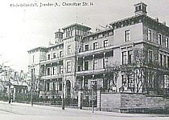Kinderheilanstalt (Nr. 14):
Die Kinderheilanstalt wurde 1834 als private Klinik gegründet und befand sich ursprünglich auf der Rampischen Gasse in der Nähe des Neumarktes. 1870 erwarb sie mit Hilfe privater Spender das Grundstück
Poliergasse 6. Da sich jedoch auch dieses Haus schon bald als zu klein erwies, erhielt sie zwischen 1876 und 1878 einen großzügigen Neubau auf dem Eckgrundstück zur Zelleschen Straße [(Altenzeller Straße](../../../../zentrum/sudvorstadt/strassen_sudvorstadt/altenzeller_strasse/)). Das neue Haus besaß neben Behandlungs- und Aufenthaltsräumen mehrere Krankenzimmer mit
großzügigen offenen Galerien, um den kranken Kindern einen Aufenthalt an frischer Luft zu ermöglichen. Insgesamt standen anfangs 70, später 120 Betten zur
Verfügung, darunter 23 sogenannte “Freibetten” für Kinder aus armen Familien. Außerdem betrieb der Verein eine Poliklinik an der Straße Am See 47.

In der Zeit nach dem Ersten Weltkrieg geriet die von einem Verein geführte Klinik in ernsthafte wirtschaftliche
Schwierigkeiten, die 1922/23 sogar zu einer zeitweisen Schließung führten. Erst der Verkauf des ursprünglich für einen
Neubau vorgesehenen Grundstücks Chemnitzer Straße 44 trug zur Konsolidierung bei und rettete die Einrichtung vor dem Konkurs. 1945 fiel die Kinderheilanstalt den Bomben zum Opfer und wurde wenig später abgerissen.

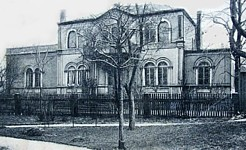
Nr. 17 / 17b (Kindergarten der Fröbel-Stiftung und Privatklinik Grunert): Auf diesem Grundstück an der Einmündung der Schweizer Straße befanden sich
bis 1945 zwei soziale Einrichtungen. Das von der Straße zurückgesetzte, um 1840 erbauten villenartige Haus Nr. 17 befand sich im Besitz des “Allgemeinen Erziehungsvereins zu Dresden”, eines 1871 von Bertha von
Marenholtz-Bülow (1810-1893) gegründeten Vereins zur Förderung von Kindergärten nach der Idee des Pädagogen Friedrich Fröbel. Innerhalb kurzer Zeit gründete der Verein sechs Kindergärten für untere und mittlere
Bevölkerungsschichten und gab mit der Zeitschrift “Neue Folge” zugleich ein Fachblatt für angehende Kindergärtnerinnen heraus. 1872 entstand mit finanzieller Unterstützung der Vereinsgründerin
die “Dresdner Fröbelstiftung”, die in der Villa eine Ausbildungsstätte für Kinderpflegerinnen betrieb. In drei Abteilungen
wurden hier wissenschaftlich gebildete Erzieherinnen, Kindergärtnerinnen für öffentliche Einrichtungen und Kindermädchen unterrichtet. Außerdem gab es im Haus einen “Volkskindergarten”. 1930 kam der Kindergarten in
städtischen Besitz und existierte bis 1945.

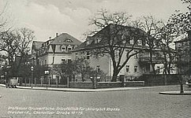Auf dem gleichen Grundstück befand sich die Chirurgische Privatklink von Prof. Dr. med. Emil Grunert (1878-1938). Der anerkannte Chirurg hatte sich vor allem als Urologe
Verdienste erworben und war Verfasser mehrerer medizinischer Fachschriften. Zeitweise arbeitete er auch als Chefarzt des [Maria-Anna-Kinderhospitals](../../../../nordwest/trachenberge/trachenberge_-_sozialeinrichtu/). Bereits um 1905 bestand die “Professor
Grunertsche Privatklinik für chirurgisch Kranke” im Vordergebäude an der  Chemnitzer Straße 17b. Mitte der 1930er Jahre folgten einige Erweiterungsbauten auf dem Nachbargrundstück Nr. 19 _(Foto)_. Grunert
verstarb 1938 und wurde auf dem Alten Annenfriedhof beigesetzt. Nach seinem Tod übernahm Dr. med. Rudolf  Uhlbach die Leitung der Privatklinik bis zu ihrer Zerstörung 1945. Ende der
1990er Jahre wurde auf dem Grundstück ein Bürohaus für die Versicherungsgesellschaft DEVK erbaut.

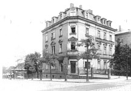Nr. 20:
In den unteren Geschossen dieses Wohnhauses hatte bis 1893 die vom früheren Dresdner Bürgermeister Friedrich August Ermel (1740–1812) initiierte
“Wohlgemeinte Stiftung für unehelich Gebärende” ihren Sitz. Leiterin war ab 1885 die aus Hessen stammende Friederike Hornstein (1843-1915), die drei Jahre
später einen “Frauenverein zur Hebung der Sittlichkeit” gegründete. Ziel von Verein und Stiftung war die Betreuung bedürftiger Frauen in der Schwangerschaft,
bei der Entbindung und in den ersten Monaten der Mutterschaft. Dafür betrieb der Verein mehrere Zufluchtsstätten für Wöchnerinnen, u.a. auf der [Dürerstraße 122](../../../../zentrum/johannstadt/strassen_johannstadt/durerstrasse/).
Die finanziellen Mittel erlaubten 1893 den Erwerb des sogenannten “Ermelhauses” in der Oberlößnitz und den Umzug
der Einrichtung. Später gründete Friederike Hornstein auch ein Arbeiterinnenheim in Plauen (Coschützer Straße 58)
sowie 1901 eine Dienstmädchenschule in Oberlößnitz. Für ihre Verdienste wurde sie 1903 mit dem Carola-Orden geehrt. Zuletzt diente das Gebäude an der Chemnitzer Straße als Wohnhaus und war Sitz der Musikschule
Dresden-Süd.

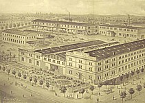
Gasmotoren-Fabrik Moritz Hille: (Nr. 22): Das Unternehmen ging aus einer 1869 von Moritz Hille gegründeten Werkstatt für mathematisch-physikalische Instrumente
und Apparate hervor. 1885 begann er mit der Herstellung von Gasmotoren. Der wirtschaftliche Erfolg ermöglichte 1892 die Umwandlung in eine Aktiengesellschaft,
welche nun als “Dresdner Gasmotoren-Fabrik vorm. Moritz Hille” firmierte. Ab 1898 wurden hier auch dreirädrige Motorkraftwagen mit Einzylindermotor und ca.
2 PS Leistung produziert. Zwischen 1908 und 1910 erwarb das Unternehmen weitere Firmen, u.a. die die Dresdner Bohrmaschinenfabrik-AG, vorm. Fischer und
Winsch. Neben Bohr- und anderen Werkzeugmaschinen widmete man sich ab 1911 auch dem Bau von Nutzfahrzeugen. Zwischen 1924 und 1926 entstanden die Lastwagen der Modellreihe K3, die
mit verschiedenen Aufbauten und Spezialausrüstungen erhältlich waren. Zuvor hatte man bereits 1918 den Betrieb in Hille-Werke AG umbenannt.

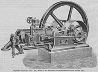Da die zur Verfügung stehenden Räumlichkeiten nicht mehr ausreichten, verlegte die
Firma ihren Sitz 1929 nach Dresden-Reick. Weitere Betriebsübernahmen erfolgten 1932. Da die Hille-Werke während des Zweiten Weltkriegs ein wichtiger
Rüstungsbetrieb waren, fielen sie 1946 unter die Bestimmungen des Volksentscheids und wurden in einen volkseigenen Betrieb umgewandelt. Als VEB Hille-Werke Dresden gehörten dieser zum [VVB Werkzeugmaschinen und Werkzeuge](../../../../sudost/reick/mikromat/) (WMW) und bestand bis 1962. Das frühere Firmengelände an der Chemnitzer /
Eisenstuckstraße (heute Glauchauer Straße) übernahm nach Verlegung der Hille-Werke 1930 die benachbarte Zigarettenfabrik Richard Greiling. Die zum Teil erhalten gebliebenen Gebäude wurden in den 1990er Jahren abgerissen.

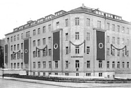Firma Großmann (Nr. 26): Das Unternehmen wurde 1863 von Heinrich
Großmann gegründet und war als Hersteller von Nähmaschinen spezialisiert auf Maschinen zur Herstellung von Strohhüten. Die Maschinen der Marken “Dresdensia” und “Anita” kamen in zahlreichen Fabriken der Umgebung zum
Einsatz, wurden aber auch in viele Länder exportiert. Ladengeschäfte besaß die Fabrik u. a. auf der Waisenhausstraße, in Striesen und Löbtau. Im 1891 erbauten Stammhaus an der Chemnitzer / Ecke Nossener Straße _(Foto)_ produzierten ca. 700 Beschäftige außerdem Werkzeugmaschinen, Lehren und Vorrichtungen. Eine letzte Betriebserweiterung erfolgte 1938.

1945 trafen Bomben das Werk. Der geborgene Maschinenpark wurde 1945 als Reparationsleistung demontiert und in
die Sowjetunion verbracht. Großmann ging in die Niederlande und baute ab 1952 seine Firma in der Nähe von Rottweil
wieder auf, wo sie bis zur Übernahme durch die Hutmaschinenfabrik Max Emmerich 1966 existierte. Auf dem früheren
Firmengrundstück steht heute das “Drei-Brücken-Haus”, ein nach 1990 entstandener Büroneubau an der Auffahrt zur Nossener Brücke.

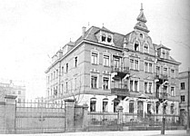Ariston-Elka Maschinenfabrik (Nr. 28):
Das Gelände unmittelbar neben dem Alten Annenfriedhof gelegen wurde bereits Ende des 19. Jahrhunderts gewerblich genutzt. Während das 1945 zerstörte Vordergebäude _(Foto)_ als Wohnhaus diente
(1910 befand sich hier auch das Konsulat von Kolumbien), dienten die Hintergebäude als Fabrik. Zunächst stellte hier der Unternehmer Emil Görldt
Schrauben, Kolben und ähnliche Maschinenteile her. Bereits um 1900 firmierte der Betrieb als Sächsische Metallindustrie A.G. vorm. Emil Görldt, später als Firma
Seifert & Comp. Vor dem Ersten Weltkrieg gab es außerdem eine Fahrradfabrik auf dem Grundstück.

Mehrfach wechselten nach dem Ersten Weltkrieg die Anteilseigner des Betriebes, zu denen u.a. die R. Frister AG als
Hersteller von Gasheizgeräten und -kochern gehörte, nach deren Konkurs 1933 die Bergmann-Elektricitäts-Werke mit
Sitz in Berlin. In den 1930er Jahren firmierte der Betrieb als Ariston-Elka Maschinenfabrik AG. Zeitweise war hier der
SPD-Politiker Walter Breitmann (1902-1983) als Dreher beschäftigt. Bergmann gehörte der illegalen SPD-Leitung
Dresden an, wurde mehrfach inhaftiert und war nach 1945 persönlicher Referent von Otto Buchwitz. 1949/50 war er
Landessekretär der Nationalen Front in Sachsen. Weitere Räume auf dem Areal dienten bis 1945 als Buchdruckerei, Eisengießerei und Isotherm-Apparatebau.

Video: Werbefilm der Ariston-Elka Maschinenfabrik aus den 1930er Jahren

Nr. 39: Inhaber dieser Villa, welche ihren Standort an der in Richtung Plauen linken Straßenseite zwischen Leubnitzer
und Altenzeller Straße hatte, war der Particulier I. F. Balzer, Schwiegervater des Bildhauers Robert Henze. Henze, der
selbst viele Jahre in der Villa lebte, schuf u.a. Figuren an der Kunstakademie, das nach 1945 beseitigte  Germania- Siegesdenkmal am Altmarkt, den [Müllerbrunnen](../../../../sud/plauen/strassen_plauen/mullerbrunnen/) in Plauen sowie die Figuren der vier Propheten an der Fassade der Pieschener [Markuskirche](../../../../nordwest/pieschen/markuskirche/).

Nr. 43:
Das 1885 errichtete Haus an der Einmündung der Altenzeller Straße beherbergte ein zur Taubstummenanstalt gehörendes Heim für hörgeschädigte Mädchen. Die jungen Frauen wurden hier unterrichtet und erlernten im Rahmen
ihrer Berufsausbildung Nähen, Sticken und Plätten.

Nossener Hof (Nr. 57): In diesem 1945 zerstörten Eckhaus an der Chemnitzer / Nürnberger Straße existierte die
Gaststätte “Zum Nossener Hof” _(Fotos)_. Zum Lokal, welches das gesamte Erdgeschoss einnahm, gehörten mehrere
Gasträume, ein Gesellschaftszimmer sowie das Braustübl. Seinen Namen erhielt es nach der Verlängerung der Nürnberger Straße, welche bis in die 1960er Jahre den Namen Nossener Straße trug.

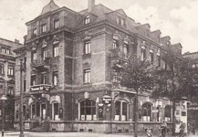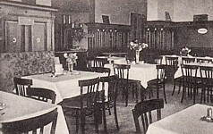

Nr. 59b: Die 1897 erbaute Stadtvilla stand nach 1990 viele Jahre leer und ist seit 2013 Sitz der polnischen Informationstechnikfirma COMARCH. In diesem Zusammenhang wurde auf dem Eckgrundstück zur Nürnberger Straße 2011/12 ein moderner Neubau errichtet, der mit der Villa verbunden ist. Im Erdgeschoss befinden sich verschiedene Läden.

_Plauen:_

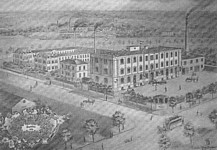Konservenfabrik Naumann (Nr. 42): Die Firma wurde 1872/73 vom Chemiker Dr. Carl Louis Naumann (1843-1900) als Fabrik zur Herstellung von Gewürzextrakten und Konserven gegründet. Naumann entwickelte verschiedene neue Verfahren zur Konservierung von Lebensmitteln und war ein Wegbereiter der Nahrungsmittelindustrie im Dresdner Raum. Zunächst hatte das Unternehmen seinen Sitz an der Wasserstraße (heute Hofmühlenstraße), bevor der Betrieb 1886 an die Chemnitzer Straße 1 (heute Nr. 42 / Ecke Bamberger Straße verlegt wurde. Hier konnten von den ca. 330 Arbeitern bis zu 100.000 Konservendosen am Tag hergestellt werden. Zu den Großabnehmern dieser Produkte gehörte die sächsische Militärverwaltung, die ihn 1886 zum Alleinlieferanten von Konserven für das sächsische Heer machte. Diese Geschäftsbeziehung war auch der Grund für den Umzug des Unternehmens in die Albertstadt. Naumann war nicht nur erfolgreicher Unternehmer, sondern auch Mitglied des Plauener Gemeinderates. Nach seinem Tod führten seine Nachkommen die Firma noch bis in die 1970er Jahre, zuletzt unter dem Namen L. Naumann Dr. Jean Olbricht KG.

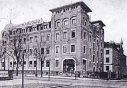Nr. 44:
Das 1945 zerstörte drei- bis viergeschossige Wohn- und Fabrikgebäude mit burgartigem Aussehen war vor 1945 Sitz der Wäsche- und Tapisseriewarenfabrik Hartmann & Saam. Das ursprünglich auf der Ammonstraße
44 ansässige Unternehmen stellte verschiedene Handarbeitsmaterialien wie Stickgarn her. Außerdem befanden sich einige Wohnungen im Haus, welches seinen Standort an der Ecke zur Bamberger Straße hatte. Um 1930 nutzte die
Eckstein Cigarettenfabrik GmbH das Gebäude. Heute befindet sich hier ein zum Bürokomplex “Falkenbrunnen” gehörender Parkplatz.

Nr. 58:
Das 1945 zerstörte Gebäude gehörte zum Komplex der Brauerei “Plauenscher Lagerkeller” (ab 1930 [Falkenbrauerei](../../../../sud/plauen/strassen_plauen/chemnitzer_strasse/falkenbrauerei/)) und diente als Gaststätte des Unternehmens. Wegen seines großen Biergartens gehörte die
Schankwirtschaft an der Ecke zur Würzburger Straße zu den stadtweit bekannten Einkehrstätten. Während der Nazizeit befand sich im Gebäude die Geschäftsstelle der NSDAP-Ortsgruppe Westend. Nach 1990 entstand auf dem
Grundstück der Bürokomplex “Falkenbrunnen”.

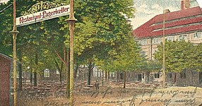

**_Foto:_** _Gästegarten des Restaurants “Plauenscher Lagerkeller”_

Nr. 67: Das heute nicht mehr vorhandene Gebäude gegenüber dem Annenfriedhof wurde bis zur Zerstörung 1945 als Wohn- und Geschäftshaus genutzt. Im Hinterhaus betrieben die Gebrüder Korn eine Fabrik zur Herstellung von Rostschutzmitteln. Neben mehreren Großunternehmen mit ausgedehnten Fabrikanlagen hatten sich um 1900 auch zahlreiche Kleinbetriebe in diesem Teil Plauens angesiedelt. Künftig soll hier und auf dem Nachbargrundstück Nr. 69 ein Neubau mit Studentenwohnungen entstehen.

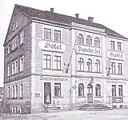Plauenscher Gasthof:
Der Gasthof befand sich auf dem Grundstück Chemnitzer Straße 70 (Nähe Würzburger Straße) und gehörte zu den größeren Gaststätten im alten Plauen. Das
dreistöckige Gebäude mit Restaurationsräumen und Stehbierhalle entstand um 1860 und wurde nach seinem Besitzer noch um 1900 Gasthof Pahlitzsch genannt. Wenig später
wechselte der Name zu “Deutscher Hof” und der Gasthof diente nun auch als Hotel. 1945 wurde das Haus zerstört und in der Nachkriegszeit abgebrochen. Heute befindet sich hier ein Supermarkt.

Nr. 73: In diesem Wohnhaus, gegenüber dem Alten Annenfriedhof gelegen, wohnte nach dem Ersten Weltkrieg der sächsische Politiker Max Heldt (1872-1933). Heldt gehörte der SPD an und wurde bereits im
Oktober 1918 als Minister ohne Geschäftsbereich in die sächsischen Landesregierung berufen. Später hatte er u.a. das
Amt des Ministers für Arbeit und Wohlfahrt und des Finanzministers inne und war von 1924 bis zum 26. Juni 1929 Ministerpräsident des Freistaates Sachsen.

Rumpelmeyer AG: (Nr. 78):
Die Firma Rumpelmeyer gehörte bis zur Zerstörung 1945 zu den zahlreichen Dresdner Schokoladenherstellern, die sich vor allem im Raum Plauen / Südvorstadt konzentrierten. Neben der Rumpelmeyer AG
gehörten dazu auch die unweit gelegenen Firmen Weinhold & Albrecht (Bamberger Straße), [Riedel & Engelmann](../../../../zentrum/sudvorstadt/strassen_sudvorstadt/zwickauer_strasse/)
(Zwickauer Straße) und [Petzold & Aulhorn](../../../../sud/plauen/strassen_plauen/petzold___aulhorn/) (Tharandter Straße).

Nr. 83:
Auf dem Grundstück 1945 zerstörter Wohngebäude wurde 1973 ein Schulneubau vom Typ “Dresden” erichtet und als Berufsschule genutzt. Heute befindet sich hier das Berufsschulzentrum für Dienstleistung und Gestaltung.

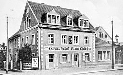Nr. 84:Das kleine Gebäude wurde 1845 als Einnehmerhaus erbaut. Hier mussten Kaufleute und Reisende ihre Waren verzollen, bevor sie weiter nach
Dresden fahren durften.  Nach Aufhebung der Akzise um 1875 beherbergte das Haus ab 1882 viele Jahre ein Restaurant. Dieses trug nach seinem Besitzer zunächst den Namen Gastwirtschaft Bruno Ehrlich und wurde später
“Kaffeehäuschen” bzw. “Tankhäuschen” genannt. Im Erdgeschoss gab es nach Schließung der Gaststätte zeitweise die Blumenhandlung “Flora 27”, deren Räumlichkeiten bis 2012 ein gleichnamiges Café nutzte.

2012 begann die Sanierung des Hauses, welches heute als “Genussmanufaktur” dient. Neben einer Suppenbar sind auch
eine Verkaufsstelle für Wein und mediterrane Produkte sowie die Brasserie Ehrlich untergebracht. Im Obergeschoss wurden Wohnungen eingerichtet.

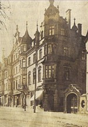Nr. 90:
Das Wohn- und Geschäftshaus entstand 1898 als Teil der markanten Eckbebauung zum Chemnitzer Platz (F.-C.-Weiskopf-Platz). Während sich im Obergeschoss Wohnungen
befinden, wird das Erdgeschoss gewerblich von verschiedenen Läden genutzt. Sehenswert ist die aus der Bauzeit des Hauses stammende Decke des Fleischerladens, welche aus
handbemalten Glas-Keramik-Platten besteht. Die in Meißen gefertigten Platten zeigen u.a. das Wappen der Fleischerinnung und verschiedene Szenen der Fleischverarbeitung und
entstanden im Auftrag des Fleischermeisters Heinrich Müller, dessen Initialien “HM” ebenfalls zu finden sind.

**_Foto:_** _Das Wohnhaus Chemnitzer Straße 90 um 1900_

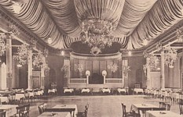
Westendschlösschen (Nr. 117): Das einst beliebte Gartenrestaurant entstand 1872 auf dem Gartengrundstück der Familie Rühle, Chemnitzer Straße 117.
1886 wurde die Gaststätte um ein im hinteren Grundstücksteil gelegenes Saalgebäude erweitert und entwickelte sich so zu einem beliebten Vergnügungs- und Versammlungslokal der Gemeinde Plauen. Besitzer war zunächst der
Gastronom Pfütze, ab 1912 Otto Haase. Wegen seiner günstigen Lage und der direkten Straßenbahnverbindung wurde das Westendschlösschen auch gern von den Dresdnern besucht. Mehrfach erfolgten Erweiterungen des
Gebäudekomplexes, der später zugleich verschiedene Geschäfte, u.a. eine Schokoladen-, eine Seifenwaren- und eine Zoohandlung beherbergte. Am 17. April 1945 beschädigten die Bomben des
letzten Luftangriffes auf Dresden das Westendschlösschen und beendeten die gastronomische Tradition. Zeitzeugen
berichten, dass das Gebäude danach noch als Unterkunft des “Volkssturmes” und später für sowjetische Soldaten
genutzt wurde und in der Nachkriegszeit einem Brand zum Opfer fiel. An gleicher Stelle entstand 1995 ein modernes Wohn- und Geschäftshaus.

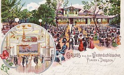

**_Foto:_** _Das Plauener Westendschlösschen auf einer historischen Postkarte_

* * *

 \[ [Home](../../../../index.html)\] \[ [Nord](../../../../nord/)\] \[ [Nordwest](../../../../nordwest/)\] \[ [Neustadt](../../../../neustadt/)\] \[ [Nordost](../../../../nordost/)\] \[ [West](../../../../west/)\] \[ [Zentrum](../../../../zentrum/)\] \[ [Südwest](../../../../sudwest/)\] \[ [Süd](../../../../sud/)\] \[ [Südost](../../../../sudost/)\] \[ [Ost](../../../../ost/)\] \[ [Register](../../../../Register/register.html)\] \[ [Kontakt](../../../../Kontakt/kontakt.html)\] \[ [Impressum](../../../../impressum/)\]
