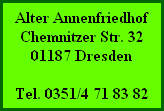
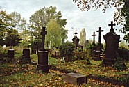
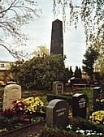
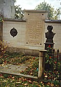
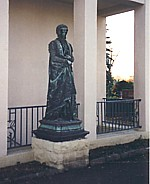

* * *

* * *

Der Alte Annenfriedhof entstand Mitte des 19. Jahrhunderts als Ersatz für den zu klein
gewordenen Annenfriedhof in der dichtbebauten Wilsdruffer Vorstadt. Die Wahl des neuen Standortes war heftig umstritten, da das Areal an der Chemnitzer Straße
ursprünglich als Bauland vorgesehen war und man außerdem negative Auswirkungen auf den Betrieb der nahegelegenen Gaststätte “Feldschlößchen” befürchtete. Nachdem
Forderungen, den bisherigen Friedhof am Sternplatz zu erweitern, ebenso abgelehnt wurden wie die Idee, auf einen neuen Begräbnisplatz ganz zu verzichten und die Toten
stattdessen auf dem Trinitatisfriedhof beizusetzen, beschloss die Annenkirchgemeinde den Erwerb eines Grundstücks an der Chemnitzer Straße. Mit Zustimmung der Königlichen Kreisdirektion begannen 1847 die
Vorarbeiten, so dass bereits am 2. Juni 1848 die erste Beisetzung erfolgen konnte.

Die gesamte Anlage wurde nach Plänen des Ratsbaumeisters Christian Gottlieb Spieß mit vier Begräbnisfeldern gestaltet, welche mit Hecken und Bäumen umrahmt sind. Bereits ein Jahr später
wurde auf dem Friedhof eine Gedenkstätte für 53 Opfer des Dresdner Maiaufstandes geschaffen _(Foto rechts)_. Den gefallenen Revolutionären folgten schon bald Persönlichkeiten des Dresdner
Kunst- und Kulturlebens, aber auch prominente Politiker sowie Professoren der Technischen Hochschule. Zu den hier beigesetzten Personen gehört u.a. Robert Henze, der zahlreiche
Grabdenkmale entwarf und für sein eigenes Grab die Figur der entschwebenden Psyche schuf. Auch die erste Frau Richard Wagners, die Historienmaler Julius Schnorr von Carolsfeld und
Hermann Freihold Plüddemann, der Dresdner Oberbürgermeister Alfred Stübel und die Förderin der Fröbel-Pädagogik Bertha von Marenholtz-Bülow fanden hier ihre letzte Ruhestätte.

Bereits 1863 musste der Alte Annenfriedhof erstmals erweitert werden. In diesem Zusammenhang entstanden auch eine Parentationshalle, ein Leichenhaus und das Wohnhaus des Totengräbers. Entworfen wurden
die Gebäude von Stadtbaudirektor Johann Friedrich Eichberg. Weitere geplante Erweiterungen scheiterten am Einspruch der Anwohner und
an der beengten Lage des Friedhofs zwischen Eisenbahnstrecke und Chemnitzer Straße. Nachdem sich auch die damals
noch selbständige Gemeinde Plauen weigerte, Land für weitere Gräberfelder zur Verfügung zu stellen, entschloss sich die Annengemeinde zum Bau eines neuen Friedhofs in Löbtau, welcher 1875 als [Neuer Annenfriedhof](../../../../../sudwest/Lobtau/Friedenskirche/Neuer_Annenfriedhof/neuer_annenfriedhof.html) eingeweiht werden konnte.

Die Bombenangriffe vom 13./14. Februar und vom 17. April 1945 richteten auf dem Alten Annenfriedhof erhebliche Schäden an. Einige historische Grabstätten gingen dabei verloren. Auch die Friedhofskapelle und das Leichenhaus wurden zerstört bzw. schwer beschädigt. Dank des Engagements von Friedhofsinspektor Geiser gelang es, einige beschädigte Gräber zu reparieren und den Friedhof wieder nutzbar zu machen. 1966 entstand auf dem Platz der zerstörten Kapelle ein
Neubau. 1983 legte die Technische Universität an der Gruft des Literaturwissenschaftlers Hermann Hettner eine Gedenkstätte für neun Professoren an, deren Gräber nicht mehr zu rekonstruieren waren _(Foto)_. Weitere historische Grabstellen konnten in den letzten Jahren restauriert werden. Ein 2006 neu gestaltetes Gräberfeld beherbergt die sterblichen Überreste von 149 bekannten und 592 unbekannten Opfern des Luftangriffs 1945. Die Finanzierung übernahm der Schweizer Rolf Hartmann (+ 2007), die Umsetzung die Dresdner Landschaftsarchitektin Dr. Haufe. Auf dem schlichten Obelisk sind Worte aus den Klageliedern des Jeremias zu lesen, die Kreuzkantor Richard Mauersberger für sein Requiem zur Zerstörung Dresdens: “Wie liegt die Stadt so wüst...” verwendete.

Annendenkmal:
Das Standbild wurde 1869 von Robert Henze als Brunnenfigur für den Vorplatz der Annenkirche geschaffen. Die Aufstellung erfolgte aus Anlass des 100. Jahrestages des
Wiederaufbaus der Kirche und wurde von der Güntz-Stiftung finanziert. Im Mittelpunkt des Brunnens stand ein Bronzestandbild der sächsischen Kurfürstin Anna von Dänemark. Am Sockel
gab es zwei Inschriftentafeln sowie Darstellungen des sächsischen und dänischen Wappens.

Bereits 1892 wurde die Brunnenanlage bei einer Umgestaltung des Vorplatzes wieder beseitigt
und die Figur fortan als Denkmal in unmittelbarer Nähe wieder aufgestellt. Hier überstand sie den Luftangriff ohne größere Schäden. In der Nachkriegszeit verbrachte man die Plastik zum Alten
Annenfriedhof und stellte sie als Denkmal vor der Feierhalle auf. Erst 2010 kehrte sie wieder an ihren ursprünglichen Standort an der Annenkirche zurück. Den ehemaligen Sockel auf dem Alten
Annenfreidhof schmückt seit 2012 ein 1888 vom Bildhauer Geissler geschaffener Bronzeengel, welcher ursprünglich vom Grab der Familie Harlan stammt und dort 1995 geborgen wurde.

In der Nähe des ehemaligen Standortes sind noch einige historische Grabdenkmale zu sehen, die vom altem Friedhof der
Annenkirche aus der Wilsdruffer Vorstadt stammen und nach dessen Auflösung nach hier verbracht wurden.

Außerhalb der Friedhofsmauer befindet sich an der Südecke des Alten Annenfriedhofs an der Chemnitzer Straße ein
historischer Weichbildstein. Der Stein mit der Nr. 73 zeigt neben dem Stadtwappen die Jahreszahlen 1679 und 1729 und
befand sich ab 1911 im Hof des Dresdner Rathauses. 1993 wurde er in der Nähe seines ursprünglichen Standortes wieder aufgestellt.

Bedeutende Grabstellen (Auswahl):

**_Grabstätte_**

**_Todesjahr_**

**_Standort\*_**

J. E. R. Käuffer, Hofprediger

1865

Minna Wagner, geb. Planer, erste Frau Richard Wagners

1866

L. 6.4

Friedrich Wilhelm Enzmann, Mechanicus, Begründer der Dresdner Fotoindustrie

1866

Hermann Freihold Plüddemann, Historienmaler

1868

W 219

Johann Carl Ulrich Baehr, Maler, Urenkel George Bährs

1869

W 44

Julius Schnorr von Carolsfeld, Maler und Galeriedirektor (Familiengrabstätte)

1872

L. 3. 1-3

Emil Devrient, Hofschauspieler

1872

1945 zerstört

Bogumil Dawisons, Hofschauspieler und Widersacher Emil Devrients

1872

W 175

Hermann Hettner, Kunst- und Literaturwissenschaftler (Büste von E. J. Hähnel)

_Die Grabstelle wurde 1983 als gemeinsame Gedenkstätte für mehrere TU-Professoren umgestaltet, deren Gräber_
_vernichtet und nicht mehr rekonstruiert werden konnten: August Seebeck, Physiker (1849) - Julius Ambrosius Hülße, Mathematiker (1876) - Wilhelm Fränkel, Statiker (1895) - Oskar Schlömilch, Mathematiker_
_(1903) - Carl Weißbach, Architekt (1905) - Gustav Anton Zeuner, Professor für Maschinenbau (1907) - Georg Helm, Mathematiker (1923) - Martin Dülfer, Architekt (1942)_

1882 (1983)

W 153

Georg von Bothmann, kaiserlich-russischer Hofmaler

1891

M.18.15-16

August Paschky, Fischhändler und SPD-Funktionär

1891

Johann Friedrich Jencke, Begründer der Dresdner Taubstummenanstalt

1893

M.10.1-2

Bertha von Marenholtz-Bülow, Reformpädagogin (Grab 1945 zerstört, restauriert)

1893

Thekla Charlotte von Gumpert, Publizistin, Kinderbuchschriftstellerin

(Familiengruft Seydlitz und Kurzbach)

1897

Alfred Stübel, Oberbürgermeister

1895

F. 1.20-21

Familiengrabstelle Pusinelli, Engelsfigur von Gustav Adolf Kietz (1993 entwendet)

D/11/29-31

Hans Bruno Geinitz, Geologe

1901

Clemens Müller, Nähmaschinenfabrikant (“Veritas”), 2004 saniert

1902

W

Christian August Nagel, Geodät

1903

Gustav Woldemar von Biedermann,

Goetheforscher, stellv. Generaldirektor der sächs. Staatsbahn

1903

1945 zerstört

Friedrich August Leßke, Heimatforscher

1904

1981 beseitigt

Moritz Adolph Stübel, Geologe und Naturforscher

(die Urne befand sich bis 1976 im Länderkundlichen Museum in Leipzig)

1904

Grab seit 1976

Robert Henze, Bildhauer, Bronzeplastik “Entschwebende Psyche” von ihm selbst

1906

Heinrich Wilhelm Gudehus, Wagner-Tenor

1909

Pauline Ulrich, Hofschauspielerin

1916

W 82

Franz Dibelius, Oberhofprediger

1924

M. 20.28-29

Karl Friedrich Ernst Noack,

Hofzimmermeister und Obermeister der Baumeisterinnung

1924

Martin Dülfer, Architekt, Rektor der Technischen Hochschule

1942

Gedenkstätte für die Opfer des Luftangriffs vom 13. Februar 1945 (2006 erneuert)

1945 (2006)

Hans Prescher, Geologe, Direktor des Museums für Mineralogie und Geologie

1996

\\* Die Grabstellen wurden - soweit mir bekannt - mit Buchstaben und Zahlen bezeichnet. Dabei stehen die Buchstaben für das jeweilige Gräberfeld, die Zahlen für Reihe und Platz. Die mit W bezeichneten Gräber sind Wandgräber an der Friedhofsmauer. Eine Übersicht über die genaue Lage bietet ein Orientierungsplan am Eingang des Friedhofes.

* * *

 \[ [Nord](../../../../../nord/)\] \[ [Nordwest](../../../../../nordwest/)\] \[ [Neustadt](../../../../../neustadt/)\] \[ [Nordost](../../../../../nordost/)\] \[ [West](../../../../../west/)\] \[ [Zentrum](../../../../../zentrum/)\] \[ [Südwest](../../../../../sudwest/)\]
 \[ [Süd](../../../../../sud/)\] \[ [Südost](../../../../../sudost/)\] \[ [Ost](../../../../../ost/)\] \[ [Register](../../../../../Register/register.html)\]
 \[ [Kontakt](../../../../../Kontakt/kontakt.html)\] \[ [Impressum](../../../../../impressum/)\]
