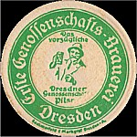
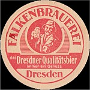
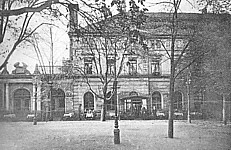
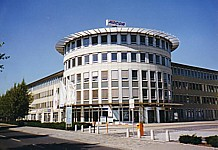
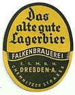
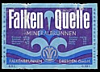
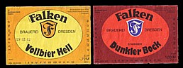

* * *

* * *

Die Falkenbrauerei entstand 1872 außerhalb des Dorfes Plauen auf einem freien Grundstück an der Chemnitzer Straße 52. Chemnitzer, Würzburger, Zwickauer und Bamberger Straße begrenzten das ausgedehnte Betriebsgelände. Ursprünglich trug dieses Unternehmen den Namen “Actien-Bierbrauerei zum Plauenschen Lagerkeller”. Zum Brauereikomplex gehörte auch eine gleichnamige Gaststätte (Chemnitzer Straße 58), die wegen ihres großen Biergartens beliebte Einkehrstätte der Plauener und Dresdner Bevölkerung war. Der zu den größeren Dresdner Brauereien gehörende "Plauensche Lagerkeller" besaß schon früh modernste Einrichtungen, u.a. eine um 1870 patentierte selbsttätige "Schultz´sche Rosteinrichtung" zur Feuerung und eine vom Braumeister Pohl entwickelte Reinigungsmaschine für Bierfässer. 1907 wurde auf dem Gelände ein Brunnen gebohrt, der zur Wassergewinnung für die Bierherstellung
genutzt wurde. Das Quellgebiet des wegen seiner Qualität hochgelobten Wassers befindet sich in der Nähe von Altfranken.

Nach Schließung der 1911 in Niederpoyritz gegründeten [Genossenschaftsbrauerei](../../../../../nordost/niederpoyritz/strassen_niederpoyritz/schlossbrauerei/) e.G.m.H. siedelte sich diese 1920 auf dem Grundstück an. Ab 1930 firmierte das Unternehmen als Falkenbrauerei und stellte verschiedene Biersorten der Marken "Falken" und "Bärenbräu" her.

Die vor 1945 zu den wichtigsten Plauener Unternehmen gehörende Brauerei wurde beim letzten Luftangriff auf Dresden am 17. April 1945 schwer beschädigt. Dabei
kamen auf dem Betriebsgelände ca. 70 Personen ums Leben, welche versucht hatten, in den Lagerkellern der Firma Schutz zu finden. Nach Beseitigung der
Schäden konnte die Brauerei bereits im gleichen Jahr die Produktion wieder aufnehmen. Erst nach Fertigstellung der Coschützer Großbrauerei wurde die
Bierherstellung 1981 eingestellt. Die mineralhaltige Quelle diente nun als Mineralbrunnen des Dresdner Betriebsteils der Firma MARGON, wobei das Wasser unter dem Namen Falken-Quelle in Dresden und Umgebung verkauft
wurde. Nach 1990 wurde das Unternehmen geschlossen und vollständig abgetragen. An seiner Stelle entstand in den 1990er Jahren der Bürokomplex “Falkenbrunnen” mit verschiedenen Geschäften und Gaststätten.

_Verschiedene Flaschenetiketten_

_der Falkenbrauerei Dresden-Plauen_

* * *

 \[ [Home](../../../../../index.html)\] \[ [Nord](../../../../../nord/)\] \[ [Nordwest](../../../../../nordwest/)\] \[ [Neustadt](../../../../../neustadt/)\]
 \[ [Nordost](../../../../../nordost/)\] \[ [West](../../../../../west/)\] \[ [Zentrum](../../../../../zentrum/)\] \[ [Südwest](../../../../../sudwest/)\]
 \[ [Süd](../../../../../sud/)\] \[ [Südost](../../../../../sudost/)\] \[ [Ost](../../../../../ost/)\] \[ [Register](../../../../../Register/register.html)\] \[ [Kontakt](../../../../../Kontakt/kontakt.html)\] \[ [Impressum](../../../../../impressum/)\]
