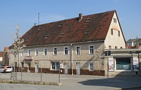
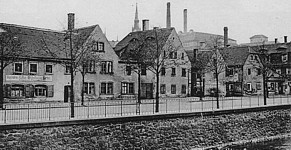
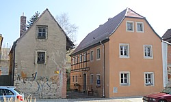
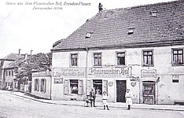

* * *

**Werbung ehemaliger Plauener Unternehmen**

_Pianofabrik_

_Hoffmann & Kühne_

_Plastine-Fabrik_

_Otto Manjock_

_Fabrik für Innenausbau_

_Arthur Jähnichen_

Die Hofmühlenstraße wurde 1597 erstmals erwähnt und hieß ursprünglich Wassergasse, ab 1865 Wasserstraße. Der Name erinnerte an die 1541 angelegte [Hochplauensche Röhrfahrt](../../../../sud/plauen/) zur Wasserversorgung des Dresdner Schlosses. Die parallel zum Weißeritzufer führende Straße war Standort der Gebäude des Plauener Unterdorfes, welches im Gegensatz zum Dorfkern um die Kirche jedoch stark hochwassergefährdet war. Nach einer erneuten Zerstörung zahlreicher Häuser beim schweren Weißeritzhochwasser am 31. Juli 1897 wurde die Flußseite nicht wieder aufgebaut. Heute erinnern die weitgehend erhaltenen Gebäude der gegenüberliegenden Straßenseite an die dörfliche Vergangenheit Plauens. Bemerkenswert sind u.a die aus dem 17. und 18. Jahrhundert stammenden Fachwerkhäuser Nr. 59 und 61 (2012 saniert). Im Haus Nr. 71 befand sich früher die bekannte Schankstätte “Plauenscher Hof” _(Foto)_
. 1904 erhielt die Straße ihren heutigen Namen nach der ehemaligen [Hofmühle](../../../../sud/plauen/bienertmuhle/) (Bienertmühle).

Neben den verbliebenen Gebäuden Alt-Plauens enstanden im 19. Jahrhundert im nördlichen Teil der Straße verschiedene Gewerbebetriebe. Zu den bedeutendsten gehörte die 1889 erbaute Malzfabrik Plauen. Hier wurde Rohgerste zu Malz verarbeitet und an die in Plauen ansässigen Brauereien Reisewitz und Plauenscher Lagerkeller geliefert. 1945 wurde die Fabrik zerstört. Hinzu kamen zahlreiche kleinere Firmen unterschiedlicher Branchen, Handwerksbetriebe und Läden für die örtliche Versorgung.

Große Schäden richtete das Weißeritzhochwasser vom August 2002 an, welches die Straße unterspülte und einige Gebäude schwer beschädigte. Beim Einsturz eines Wohnhauses an der Ecke zur Würzburger Straße kam ein Mann ums Leben. Außerdem wurden fast alle Weißeritzbrücken in diesem Bereich zerstört bzw. schwer beschädigt.

**_Foto:_** _Die Hofmühlenstraße um 1900 (links) und die im historischen Bild_

_ganz rechts stehenden Häuser Nr. 59 und 61 im Jahr 2014 (rechts)_

Einzelne Gebäude:

Walkmühle: Diese Mühle befand sich bis 1897 am rechten Weißeritzufer in der Nähe des Grundstücks Hofmühlenstraße
18\. Das Wasserrad wurde dabei vom Mühlgraben der Bienertmühle angetrieben. Besitzer war Mitte des 18. Jahrhunderts Graf Heinrich von Brühl, der sie ab 1746 bis zur Zerstörung im Siebenjährigen Krieg als Wasserhebewerk nutzte, um die Brunnen seines [Friedrichstädter Palais](../../../../zentrum/friedrichstadt/strassen_friedrichstadt/friedrichstrasse/marcolinipalais/) zu betreiben. als. 1795 wurde sie von der Dresdner Tuchmacherinnung umgebaut, um sie zum Walken von Stoffen und Leder zu nutzen. 1867 pachtete der frühere Pulvermüller Carl Gottlieb Meinert die Mühle und wandelte sie in eine Furnierschneidemühle um. Nach dessen Tod 1874 übernahm sie Traugott Gottlieb Bienert. Das Gebäude fiel am 31. Juli 1897 dem Weißeritzhochwasser zum Opfer und wurde nicht wieder aufgebaut.

Unweit davon lag am [Weißeritzmühlgraben](../../../../sudwest/lobtau/weisseritzmuhlgraben/) eine weitere Walkmühle, die sich im Besitz der Dresdner Tuchmacherinnung befand. Die um ca. 1570 entstandene Mühle brannte 1868 ab und wurde daraufhin als Furnierschneidemühle des Unternehmers Kittler wiederaufgebaut _(Foto)_. 1897 übernahm die Stadt Dresden die Mühle und überließ sie 1914 dem Plauener Fabrikbesitzer [Anton Reiche](../../../../sud/plauen/strassen_plauen/blechwarenfabrik_reiche/). 1934 wurden die Gebäude abgetragen.

Firma Vadossi (Nr. 15): Das heute nicht mehr vorhandene Gebäude an der Hofmühlenstraße 15 wurde bereits vor dem Ersten Weltkrieg gewerblich genutzt und beherbergte bis 1920 die Sächsische Metalltuchfabrik Oswald Seele Nachf. KG. Am 1. Oktober 1920 gründete der aus Matzkirch in Oberschlesien (heute Maciowakrze) stammende Karl Friedrich Lischka (1890-1949) in angemieteten Räumen dieses Hauses sein Backhaus Vadossi. Zu den Spezialitäten des Betriebes gehörten verschiedene Gebäckarten wie "Dresdner Hohlhippen", "Feine Bissen", Aprikosentörtchen und Mandelhörnchen, die unter dem Markennamen "Vadossi" verkauft wurden. Wenig später kamen Schokoladentafeln dazu, die zunächst noch aus gekaufter Kakaomasse gepresst wurden, bevor Lischka im Frühjahr 1922 eigene Maschinen zur kompletten Verarbeitung der rohen Kakaobohnen erwarb.

Da die Räume an der Hofmühlenstraße bald zu klein waren, kaufte Lischka Anfang 1924 die leerstehende Knopffabrik "W. Käfer & Co." an der Kötitzer Straße 29 in Kötzschenbroda. Das Fabrikgebäude wurde umgebaut und mit modernen Maschinen ausgestattet und war ab Herbst 1924 offizieller neuer Firmensitz der "Vadossi Kakao-, Schokoladen- und Marzipanfabrik", die nun ca. 40 Angestellte beschäftigte. Auch nach 1945 blieb der Betrieb in Privatbesitz, wurde 1972 als VEB Vadossi Radebeul verstaatlicht und zehn Jahre später als Werk 2 dem VEB Dresdner Süßwarenfabriken Elbflorenz angegliedert. Die 1992 reprivatisierte Firma musste 1994 Insolvenz anmelden und wurde daraufhin vom Konditormeister Karl-Heinz Hartmann erworben. Heute wird sie als "Sächsische und Dresdner Back- und Süßwaren GmbH & Co. KG" geführt und ist vor allem durch die Schokoladencreme "Nudossi" deutschlandweit bekannt.

Nr 17: Das Eckhaus zwischen dem heute nicht mehr vorhandenen Röhrweg und der Biedermannstraße beherbergte vor dem Ersten Weltkrieg das Restaurant "Zur Hofmühle". Besitzer war 1910 Albin Kegel, später Karl Kuschel. 1920 übernahm Martha Hennig das Lokal, welches wenig später für immer seine Pforten schloss. Das Haus wurde 1945 zerstört. Heute wird das Areal gewerblich genutzt.

Nr. 20: Das Eckgrundstück zur Würzburger Straße unmittelbar an der Weißeritz war ab 1899 Sitz der Klavierbaumanufaktur Hoffmann & Kühne. Später hatten hier auch die Sächsische Metall-Schrauben-Fabrik E. Görldt, die Strickwarenfabrik Josef Herrmann und die Schuhfabrik Horst Gräfe & Co. ihre Geschäftsräume. Nach 1990 wurden die Gebäude abgerissen und das Grundstück danach von einem Pflanzen- und Saatgutverkauf genutzt.

Nr. 21: Auch auf diesem Grundstück befand sich einst eine von zahlreichen Plauener Fabriken in diesem Viertel. Das Unternehmen wurde Ende des 19. Jahrhunderts von Max Kühne gegründet und firmierte um 1900 unter dem Namen Plauensche Korkfabrik Kreutziger & Oeser (ab 1910 Dresdner Kork-Industrie - _Bild rechts_).

Nach dem Ersten Weltkrieg nutzte die Sächsische Plastine-Fabrik von Otto Manjock die Fabrikräume. Hergestellt wurde Modelliermasse sowie verschiedene Gesellschafts- und Beschäftigungsspiele. In den 1920er Jahren warb das Unternehmen als "älteste Spezialfabrik für Modelliermasse (Plastelina)" mit "Fröbel Modellierspielen" mit vielen Vorlagen und Modellierhölzern" sowie "Beschäftigungsspielen nach Fröbel". Außerdem waren Kartenspiele im Angebot, u.a. mit dem Olympiasiegern von 1936 _(Bild links)_. Um 1920 gab es im Haus zudem eine Außenstelle des Sächsischen Serumwerkes (Institut für Bakteriotherapie). Zuletzt dienten die 1945 zerstörten Gebäude als Lagerhaus.

Nr. 25: Im Erdgeschoss des Wohnhauses an der Ecke Hofmühlen-/Würzburger Straße befand sich bis Mitte der 1920er Jahre eine Gastwirtschaft. Vor dem Ersten Weltkrieg wurde diese Restaurant "Zur Wartburg" genannt, um 1920 "Zum Würzburger Hof". Später dienten die Gasträume gewerblichen Zwecken. Das Haus überstand im Gegensatz zu vielen Nachbargebäuden den Zweiten Weltkrieg und wurde bis 2002 als Wohnhaus genutzt. Beim Weißeritzhochwasser im August 2002 stürzte das Gebäude teilweise ein, wobei ein Mann ums Leben kam. Nach Abriss der Ruine errichtete die Feinkostfirma Dr. Doerr 2004 auf dem Grundstück ein neues Produktionsgebäude.

Sächsische Malzfabrik: Das Unternehmen wurde am 29. Januar 1889 gegründet und nahm das gesamte Grundstück Hofmühlenstraße 33 bis zur Bahnlinie ein. Hergestellt und verkauft wurde vorrangig Braumalz für verschiedene Dresdner Brauereien. Zum Areal gehörten 1943 die Tennen- und Trommel-Mälzerei, vier Darren zur Trocknung der Gerste, vier werkseigene Brunnen, Verwaltungs- und Lagergebäude. Die Kapazität ermöglichte die Vermälzung von ca. 240.000 Zentnern Gerste pro Kampagne. Für den Transport besaß der Betrieb ein eigenes Anschlussgleis an die Bahnlinie Dresden - Chemnitz. 1945 fielen die Gebäude der Plauener Malzfabrik weitgehend dem Bombenangriff zum Opfer. Die formale Auflösung der Aktiengesellschaft erfolgte jedoch erst 1961.

_Rechnungskopf der Sächsischen Malzfabrik Dresden-Plauen_

Nr. 39/41: Das Grundstück war bis Mitte der 1930er Jahre Sitz der Firma Arthur Jähnichen - Fabrik für Innenausbau. Jähnichen, gelernter Tischler und später auch Glasermeister hatte seine Werkstatt 1869 gegründet und später zu einer Fabrik für Möbel, Ladenbau und Inneneinrichtungen ausgebaut. Im Hintergebäude hatte zeitweise auch die Gelbgießerei Josef Kaul (1905), eine Kartonnagenfabrik (1925) und zuletzt die Tischlerei Wilhelm Specht ihren Sitz. Im Vordergebäude (Nr. 41) wohnte bis 1945 der Bildhauer Rudolf Kreische (1904-1969), der von 1924 bis 1936 Mitarbeiter der Zwingerbauhütte war.

Gasthaus Altplauen (Nr. 51): Das noch auf den alten Plauener Dorfkern zurückgehende Haus Hofmühlenstraße 51 war vor dem Ersten Weltkrieg unter dem Namen Gasthaus Altplauen eine von mehreren Einkehrstätten des Unterdorfes. 1910 ist das Lokal als "Gesellschaftshaus Plauen" im Adressbuch verzeichnet und gehörte Friedrich Wilhelm Müller. 1918 richtete man im Saal ein Kino mit ca. 300 Plätzen ein (Metropol-Lichtspiele). Allerdings scheint das Projekt von keinem großen Erfolg begleitet worden zu sein, denn bereits 1920 ist nur noch vom Gasthaus Altplauen die Rede. Wenige Jahre später schloss die Gaststätte für immer ihre Pforten, die Räume wurden bis zum Abriss gewerblich genutzt.

Nr. 55: Das langgestrecke Gebäude bildet den Auftakt zur noch erhaltenen Restbebauung des früheren Plauener Unterdorfes _(im Foto ganz links)_. Einst gab es hier eine Bäckerei sowie Pässlers Café und Kuchengarten. Nach 1990 wurde das Haus saniert.

Plauenscher Hof (Nr. 71): Die Gaststätte ging aus dem alten Gasthof des Unterdorfes hervor und befand sich im noch heute erhaltenen Gebäude Hofmühlenstraße 71 an der Ecke Altplauen / Weißeritzbrücke. Das Haus entstand um 1800 und erhielt später in einem Seitenflügel noch einen Gesellschaftssaal. Vor dem Ersten Weltkrieg wurde es als "Tharandter Hof", nach 1918 als "Plauenscher Hof" bezeichnet. Noch bis in die 1950er Jahre wurde es gastronomisch genutzt. Bis 1954 gab es zudem in einem Anbau an der rechten Seite einen Fleischerladen. Später dienten die Räume noch bis in die 1990er Jahre als Fahrradwerkstatt und -handlung. Zudem gab es zeitweise einen Friseursalon und ein Tabakgeschäft. Heute steht das beim Hochwasser 2002 schwer in Mitleidenschaft gezogene Gebäude leer.

* * *

 \[ [Home](../../../../index.html)\] \[ [Nord](../../../../nord/)\] \[ [Nordwest](../../../../nordwest/)\] \[ [Neustadt](../../../../neustadt/)\] \[ [Nordost](../../../../nordost/)\] \[ [West](../../../../west/)\] \[ [Zentrum](../../../../zentrum/)\] \[ [Südwest](../../../../sudwest/)\] \[ [Süd](../../../../sud/)\] \[ [Südost](../../../../sudost/)\] \[ [Ost](../../../../ost/)\] \[ [Register](../../../../Register/register.html)\] \[ [Kontakt](../../../../Kontakt/kontakt.html)\] \[ [Impressum](../../../../impressum/)\]
