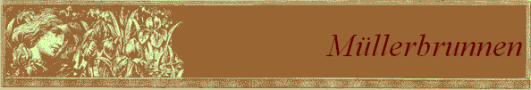
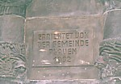
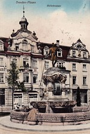
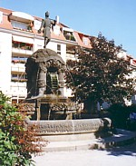

* * *

* * *

* * *

* * *

* * *

* * *

**Inschrift am Sockel des Müllerbrunnens**

Der Müllerbrunnen entstand 1902 auf Initiative der Mühlenbesitzerfamilie Bienert aus Anlass
der 50-Jahr-Feier der Inbesitznahme der Hofmühle und wurde an der Westseite des früheren Dorfplatzes (heute [F.-C.-Weiskopf-Platz](../../../../sud/plauen/strassen_plauen/)) aufgestellt. Schöpfer des Brunnens war das
Dresdner Architekturbüro Lossow & Viehweger. Die Figur des Müllerburschen stammt von Robert Henze und wurde in der Kunstgießerei Bierling gegossen. Mit dem Brunnen sollte an
Plauens Tradition als Mühlenstandort erinnert und zugleich dem zeitweise hier lebenden Dichter Wilhelm Müller ein Denkmal gesetzt werden. Müller hielt sich häufig im nahen Plauenschen
Grund auf und ist Autor des Volksliedes “Das Wandern ist des Müllers Lust...”, dessen erste Zeilen am Sockel des Brunnens eingemeißelt sind. Die Kosten in Höhe von 25.000
Reichsmark übernahmen verschiedene Plauener Vereine. Die feierliche Einweihung erfolgte am 2. Dezember 1902 _(Foto vor 1945)_.

Der Brunnen selbst besteht aus einem steinernen Unterbau mit einem
integrierten beweglichen Mühlrad und insgesamt 32 verschiedenen Wasserspeiern. Verziert ist dieser mit floralen Schmuckelementen sowie Menschen- und Tiergesichtern. Die Bronzeplastik
des Müllerburschen wurde 1942 für Rüstungszwecke demontiert und eingeschmolzen.

Erst 1986 konnte der Brunnen restauriert und mit einer Kopie des Bildhauers Wilhelm
Landgraf vervollständigt werden. Eine weitere Sanierung erfolgte 1993 _(Foto 2002)_. Der Müllerbrunnen ist bis heute Wahrzeichen des Stadtteils Plauen geblieben. Er war auch
Namensgeber einer 1945 zerstörten Gaststätte und der angrenzenden Müllerbrunnenstraße.

* * *

 \[ [Home](../../../../index.html)\] \[ [Nord](../../../../nord/)\] \[ [Nordwest](../../../../nordwest/)\] \[ [Neustadt](../../../../neustadt/)\] \[ [Nordost](../../../../nordost/)\] \[ [West](../../../../west/)\] \[ [Zentrum](../../../../zentrum/)\] \[ [Südwest](../../../../sudwest/)\] \[ [Süd](../../../../sud/)\] \[ [Südost](../../../../sudost/)\] \[ [Ost](../../../../ost/)\] \[ [Register](../../../../Register/register.html)\] \[ [Kontakt](../../../../Kontakt/kontakt.html)\] \[ [Impressum](../../../../impressum/)\]
