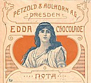
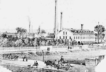

* * *

* * *

* * *

* * *

* * *

* * *

Die Schokoladenfabrik Petzold & Aulhorn wurde 1843 vom Konditor Carl
Christian Petzold gemeinsam mit dem Kaufmann  Ernst Louis Aulhorn als Schokoladen und Zuckerwarenfabrik “C.C. Petzold & Aulhorn” gegründet.
Gemeinsam stellten beide, zunächst in der Wilsdruffer Vorstadt, verschiedene Süßwaren her. Da die Geschäftsräume im Haus Am See 22 bald zu klein wurden, erwarb man 1855 das Grundstück Falkenstraße 49 (später Zwickauer
Straße 22. Ursprünglich hatte auf diesem Areal eine Mühle am [Weißeritzmühlgraben](../../../../sudwest/lobtau/weisseritzmuhlgraben/) gestanden, die man von den Erben des letzten
Mühlenbesitzers Sippel übernahm. Fünf Jahre später kauften die beiden Unternehmer noch das Haus Wilsdruffer Straße 7 in der Innenstadt als Ladengeschäft. Zweigniederlassungen besaß
die Firma u.a. in Berlin, Chemnitz, Leipzig, Breslau, Nürnberg und Frankfurt/M.. Ende des 19. Jahrhunderts gehörte Petzold & Aulhorn zu den bekanntesten Schokoladenfabriken Deutschlands.

Da sich auch das neue Betriebsgelände als zu klein erwies, kauften die Inhaber 1897 große
Teile des verwilderten [Reisewitzschen Gartens](../../../../sudwest/lobtau/strassen_lobtau/tharandter_strasse/reisewitz_scher_garten/) in Plauen auf und errichteten hier einen
modernen Betrieb (Bienertstraße 1). Bis 1945 wurden unter den Markennamen “Pea” und “Deutschmeister” Schokoladentafeln, Pralinen und ähnliche Erzeugnisse produziert und
überregional verkauft.  Im Zweiten Weltkrieg wurden die Gebäude durch Bomben schwer beschädigt, so dass Petzold & Aulhorn die Produktion in Dresden nicht wieder aufnehmen konnten.

Die Firma siedelte, auch bedingt durch die politischen Verhältnisse, nach Hamburg über. Heute liegen die Markenrechte bei der Pea Süßwaren GmbH mit Sitz in Veitshöchheim.
Die zerstörten Gebäude an der Tharandter / Bienertstraße dienten nach ihrem teilweisen Wiederaufbau bis 1990 dem VEB Galvano Dresden. Heute befindet sich auf dem Grundstück ein Supermarkt.

* * *

 \[ [Home](../../../../index.html)\] \[ [Nord](../../../../nord/)\] \[ [Nordwest](../../../../nordwest/)\] \[ [Neustadt](../../../../neustadt/)\] \[ [Nordost](../../../../nordost/)\] \[ [West](../../../../west/)\] \[ [Zentrum](../../../../zentrum/)\] \[ [Südwest](../../../../sudwest/)\] \[ [Süd](../../../../sud/)\] \[ [Südost](../../../../sudost/)\] \[ [Ost](../../../../ost/)\] \[ [Register](../../../../Register/register.html)\] \[ [Kontakt](../../../../Kontakt/kontakt.html)\] \[ [Impressum](../../../../impressum/)\]
