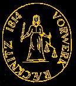
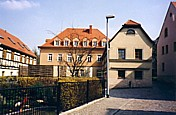
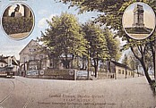
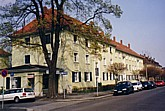

* * *

**Gemeindesiegel von Räcknitz**

* * *

Räcknitz entstand im Mittelalter als markgräfliches Herrengut und wurde 1305 erstmals
als Rekenicz erwähnt. Der Ortsname stammt aus dem sorbischen und bedeutet “Leute eines Rakon”, vermutlich der Gründer der Siedlung. Besitzer dieses Gutes waren 1384
zu gleichen Teilen die Dresdner Bürger Ziegler und Münzmeister. Das Erbgut Räcknitz wurde gemeinsam mit dem früheren Vorwerk Auswik am heutigen Fritz-Förster-Platz
1467 vom Rat der Stadt Dresden erworben und an 38 Dresdner Bürger aufgeteilt, die fortan die Fluren bewirtschafteten. Das Herrengut selbst kam 1468 als Stadtzinsgut in
bäuerlichen Besitz, wurde jedoch 1892 wieder von der Stadt zurück erworben. An dieses Gut, seit 1951 als Versuchsgut der Technischen Universität genutzt, erinnert noch die Stadtgutstraße.

Weitere Zeugnisse der engen Bindung des Ortes an die Stadt Dresden sind die noch erhaltenen Weichbildsteine, die
ursprünglich das gesamte Stadtgebiet umgaben und neben dem Stadtwappen auch die Jahreszahl ihrer Aufstellung tragen. Weichbildsteine befinden sich in Räcknitz u. a. am Stadtgut, am Räcknitzer Marktweg, und an der Ecke
Räcknitzhöhe/ Bergstraße. 1764 erhielt der Ort das Privileg der Zollfreiheit auf der Dresdner Brücke. Zu diesem
Zeitpunkt lebten fünf Familien in Räcknitz. Kirchlich unterstand Räcknitz bis 1889 der Kreuzkirche, danach der Lukaskirche.

Zu den bedeutendsten Ereignissen der Ortsgeschichte gehört die [Schlacht bei Dresden](../../sud/racknitz/schlacht_bei_dresden/) am 26./27. August 1813, die
sich zum Großteil auf der Räcknitzhöhe abspielte. An dieses letzte große Gefecht der Napoleonischen Kriege vor der Völkerschlacht erinnert neben dem [Moreaudenkmal](../../sud/racknitz/schlacht_bei_dresden/) ein [Gedenkstein](../../sud/racknitz/gedenkstein_1813/) in Alträcknitz. Der Ort wurde durch die
Kampfhandlungen fast völlig zerstört und im Anschluss wieder aufgebaut. Seit dem 1. Juli 1902 gehört Räcknitz als
Stadtteil zu Dresden. Drei Jahre später wurde die Straßenbahnlinie auf der Bergstraße bis zum Räcknitzer Gasthof
“Elysium” verlängert. Diese Linie wurde jedoch bereits vor Ende des Zweiten Weltkriegs wieder eingestellt. Die
Gaststätte fiel 1945 mit weiteren Gebäuden im Dorfkern dem Luftangriff zum Opfer. An ihrer Stelle befindet sich heute ein Automarkt.

**_Foto:_** _Der Räcknitzer Gasthof “Elysium” an der Bergstraße auf einer historischen Postkarte_

Die bereits im Mittelalter wichtige Verbindungsstraße ins Erzgebirge, heute Bergstraße genannt, wurde nach 1840 zur
Chaussee ausgebaut und berührte den früheren Dorfkern. 1847 entstand an der Kreuzung Bergstraße/ Südhöhe ein Einnehmerhaus zur Erhebung des Chausseegeldes. Später diente dieses Gebäude als Gaststätte, nach 1945 als
Schulungsstätte und zuletzt als Verwaltungsgebäude der Technischen Universität. 1978 musste das historische Bauwerk dem Ausbau der Fernverkehrsstraße 170 weichen.

Im Zusammenhang mit dem Ausbau der Dresdner Wasserversorgung und dem Bau des
Wasserwerkes in Tolkewitz wurde 1898 zwischen Räcknitz und Zschertnitz in 166 Metern ü. NN ein Hochbehälter angelegt. Zum Schutz dieser Anlage entstand in den Folgejahren ein Park, der heute als [Volkspark Räcknitz](../../sud/racknitz/volkspark_racknitz/) bezeichnet wird. Nach 1900 wurde der alte Dorfkern um einige Mietshäuser an der [Räcknitzhöhe](../../sud/zschertnitz/strassen_zschertnitz/), der Zeunerstraße (Foto) und der Bergstraße erweitert. Letztere waren Auftakt zu einem kleinen Villenviertel, welches
bevorzugt von Professoren der nahegelegenen Technischen Hochschule bewohnt wurde. Weitere Siedlungshäuser folgten in den Zwanziger Jahren zwischen Haeckel- und Stadtgutstraße. Zum Ortsbild von
Räcknitz gehören heute neben Einrichtungen der TU auch das nach 1980 angelegte Neubauviertel Räcknitzhöhe rund um die 1906 entstandene [Bismarcksäule](../../sud/racknitz/bismarcksaule/) auf der früheren Franzenshöhe.

[_Weiterführende Literatur und Quellen_](../../impressum/quellenverzeichnis/)

 \[ [Home](../../index.html)\] \[ [Nord](../../nord/)\] \[ [Nordwest](../../nordwest/)\] \[ [Neustadt](../../neustadt/)\] \[ [Nordost](../../nordost/)\] \[ [West](../../west/)\] \[ [Zentrum](../../zentrum/)\] \[ [Südwest](../../sudwest/)\] \[ [Süd](../../sud/)\]
\[ [Südost](../../sudost/)\] \[ [Ost](../../ost/)\] \[ [Register](../../Register/register.html)\] \[ [Kontakt](../../Kontakt/kontakt.html)\] \[ [Impressum](../../impressum/)\]
