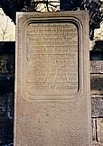

* * *

An die fast völlige Zerstörung des Dorfes Räcknitz während der Schlacht bei Dresden am 26./27. August 1813 erinnert eine Gedenksäule an der Einmündung Alträcknitz/ Bergstraße. Die Sandsteinsäule wurde von
den Bewohnern des Ortes nach dem Wiederaufbau aufgestellt und 1994 restauriert. Die Tafel trägt folgende Inschrift:

**_Foto:_** _Der Räcknitzer Gedenkstein an der_

_Ecke Bergstraße/Alträcknitz_

* * *

 \[ [Home](../../../index.html)\] \[ [Nord](../../../nord/)\] \[ [Nordwest](../../../nordwest/)\] \[ [Neustadt](../../../neustadt/)\] \[ [Nordost](../../../nordost/)\] \[ [West](../../../west/)\] \[ [Zentrum](../../../zentrum/)\] \[ [Südwest](../../../sudwest/)\] \[ [Süd](../../../sud/)\] \[ [Südost](../../../sudost/)\] \[ [Ost](../../../ost/)\] \[ [Register](../../../Register/register.html)\] \[ [Kontakt](../../../Kontakt/kontakt.html)\] \[ [Impressum](../../../impressum/)\]
