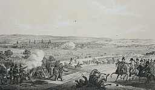
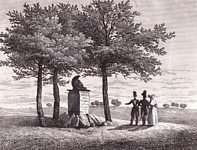
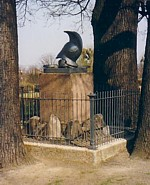

* * *

* * *

* * *

* * *

* * *

* * *

Auf den Feldern südlich von Dresden fand am 25. - 27. August 1813 die
letzte bedeutende Schlacht der Napoleonischen Kriege vor der Völkerschlacht statt. Zugleich war sie letzter Sieg Napoleons auf deutschem Boden. Im Vorfeld der Ereignisse war Dresden zum wichtigen Stützpunkt der
französischen Armee geworden, die hier eine Besatzung von ca. 22.000 Mann stationiert hatte. Am 22. August überschritten 175.000 Soldaten der Hauptarmee der Verbündeten unter Führung des Fürsten Schwarzenberg die
böhmische Grenze und erreichten am 23./24. August die südlichen Dresdner Vororte. Der kommandierende französische Marschall St. Cyr ordnete daraufhin den Bau von Verteidigungsanlagen um die Stadt an.

Am 24. August hatten die Truppen der Verbündeten weite Teile der Stadt eingeschlossen. Es gelang jedoch erst am
Folgetag, sämtliche zur Verfügung stehenden Einheiten heranzuziehen, um den Angriff auf Dresden beginnen zu können.
Schwerpunkt der Kämpfe waren die südlichen Vororte Dresdens sowie das Dorf Striesen, welches am 25. August von den Franzosen in Brand geschossen wurde. Die Befehlshaber der Verbündeten nahmen
im Süden der Stadt Quartier: Fürst Schwarzenberg mit seinem Stab in Bannewitz, Zar Alexander I. in Nöthnitz und Friedrich Wilhelm III. in Leubnitz.

Der Angriff der Verbündeten begann in den frühen Morgenstunden des 26. August. In
schweren verlustreichen Kämpfen eroberten sie den Großen Garten und besetzten Strehlen, Gruna, Cotta und Löbtau. Gegen 9 Uhr traf Napoleon, der aus Schlesien seinem Marschall St. Cyr zu Hilfe geeilt war, in der
Altstadt ein. Die Beschießung der Stadt begann am Nachmittag, so dass die Franzosen erst in den Abendstunden zum Gegenangriff übergehen konnten. Unter persönlichem Befehl des französischen Kaisers
und seiner Generäle Ney, Mortier und Murat gelang die Rückeroberung Striesens und weiterer Orte. Der auf russischer Seite kämpfende General Moreau wurde am 27.
August auf der Räcknitzhöhe schwer verwundet und verstarb wenige Tage später. Nach schweren Verlusten beschlossen die Verbündeten am 28. August ihren Rückzug. Den Kampfhandlungen fielen auf
französischer Seite ca. 10.000 Mann, auf Seiten der Verbündeten ca. 15.000 Soldaten zum Opfer. Zahlreiche Dresdner
Vororte, darunter Räcknitz, Zschertnitz, Strehlen und Plauen wurden schwer beschädigt und teilweise niedergebrannt. In Räcknitz erinnert eine [Gedenksäule](../../../sud/racknitz/gedenkstein_1813/) an der Bergstraße an die Ereignisse.

Moreaudenkmal:

Das Moreaudenkmal wurde 1814 in Erinnerung an den französischen General Jean Victor Moreau (1761-1813) aufgestellt. Der von Napoleon 1804 wegen einer angeblichen
Verschwörung verstoßene General nahm auf Seiten Rußlands an der Schlacht bei Dresden teil und verlor an dieser Stelle am 27. August 1813 durch eine Kanonenkugel beide Beine. Trotz
sofortiger medizinischer Versorgung im Palitzsch-Gut in Kleinpestitz verstarb Moreau wenige Tage später im böhmischen Laun (Louny) an den Folgen seiner Verwundung. Sein Grab befindet sich in St. Petersburg.

Bereits ein Jahr später schuf der Architekt Gottlob Friedrich Thormeyer eine Erinnerungsstätte an Moreau am Ort der Schlacht. Initiator dieses Monuments war der russische
Generalgouverneur in Dresden, Fürst Repnin-Wolkonski. Das Denkmal besteht aus einem Syenitwürfel und einem aufgesetzten Helm mit Lorbeerkranz und Schwert aus Eisenguss und trägt die Inschrift:

_“Moreau / der Held / fiel hier an der Seite / Alexanders / den XXVII. August / MDCCCXIII.”_

Um das Denkmal gruppieren sich drei Eichen, die die drei gegen Napoleon verbündeten Staaten Rußland, Preußen und
Österreich symbolisieren sollen. Die bildhauerische Ausführung des Moreaudenkmals übernahm Christian Gottlieb Kühn.
Am 4. November 1814 wurden im Rahmen einer kleinen Gedenkfeier die amputierten Beine Moreaus in einer Urne unter
dem Denkmal beigesetzt. Das Monument stellt eines der wenigen künstlerischen Zeugnisse des Klassizismus in Dresden dar und wurde mehrfach restauriert, zuletzt 2002.

**Buchtipp: Christine Fischer "Elisa und der Schatten Napoleons", Taschenbuch (348 Seiten) (ISBN 978-3741208010)**

Frühjahr 1813. Seit acht Jahren leidet Dresden unter der französischen Besatzung. Einquartierung, Hunger und Krankheit drängen die Bürger an den Rand des Erträglichen. Auch die junge Elisa Tilla, die Pirnaer Apothekertochter, die 1806 hoffnungsvoll in die Residenzstadt kommt. Von einem traumatischen Kindheitserlebnis verfolgt, von ihrer Jugendliebe verlassen, sucht sie mutig ihren Platz im Leben und trotzt allen Schicksalsschlägen. Doch im August 1813 geschieht das Unfassbare: Die Armeen der Verbündeten stehen vor Dresden, bereit, dem Eroberer die Entscheidungsschlacht aufzuzwingen. Napoleon gewinnt die Schlacht. Danach beginnt für die Menschen in der eingeschlossenen Stadt eine Leidenszeit von apokalyptischem Ausmaß.

Elisa hilft, wo sie kann. Bis zur Selbstzerstörung setzt sie sich für Kranke und Verletzte ein. Lindert so den Schmerz über den vermeintlichen Tod ihres Ehemanns Alois. Als Napoleon in der Schlacht bei Leipzig geschlagen wird, atmen die Völker auf. In Wien ringen die Siegermächte um eine Neuordnung Europas. Für seine Treue zu Napoleon wird das Königreich Sachsen empfindlich bestraft.
Elisa beginnt am Tod ihres Mannes zu zweifeln, als ihr der Zufall plötzlich einen Hinweis in die Hände spielt. Noch einmal nimmt sie all ihre Kraft zusammen und beschließt Alois zu suchen.

Interessierte können das Buch u.a. für 13,99 € bei Amazon erwerben.

* * *

 \[ [Home](../../../index.html)\] \[ [Nord](../../../nord/)\] \[ [Nordwest](../../../nordwest/)\] \[ [Neustadt](../../../neustadt/)\] \[ [Nordost](../../../nordost/)\] \[ [West](../../../west/)\] \[ [Zentrum](../../../zentrum/)\] \[ [Südwest](../../../sudwest/)\] \[ [Süd](../../../sud/)\] \[ [Südost](../../../sudost/)\] \[ [Ost](../../../ost/)\] \[ [Register](../../../Register/register.html)\] \[ [Kontakt](../../../Kontakt/kontakt.html)\] \[ [Impressum](../../../impressum/)\]
