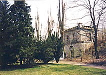
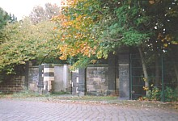

* * *

* * *

* * *

Der zwischen Räcknitz und Zschertnitz gelegene Volkspark an der Räcknitzhöhe wurde 1898 aus Mitteln der König-Albert-Jubiläumsstiftung angelegt. Diese Stiftung war aus Anlass des 70. Geburtstags des Königs von der Stadt Dresden mit einem Kapital von zwei Millionen Mark zur Unterhaltung städtischer Grünanlagen gegründet worden. Die Parkanlage dient dem Schutz des 1897 hier erbauten Wasserhochbehälters des Wasserwerkes Tolkewitz. Ein zweiter Hochbehälter folgte 1905. Neben einem Wohnhaus für Angestellte der DREWAG an der Räcknitzhöhe entstanden zwei kleinere Gebäude (Schieberhäuser), in denen sich die Einstiege zu den Hochbehältern befinden. Auf deren Dach befindet sich eine Aussichtsplattform, von der sich ein weiter Rundblick über die Umgebung bietet. Leider sind diese einst durch eine Pergola verbundenen Türmchen derzeit nicht mehr öffentlich zugänglich _(Foto)_. Außerdem wurden Teile des Parks nach dem Ersten Weltkrieg durch einen Zaun abgetrennt, um das Betriebsgelände der DREWAG zu schützen.

Das Gelände des Volksparkes Räcknitz wurde 1936 aus Anlaß der Reichsgartenschau in Dresden umgestaltet und erweitert. Gleichzeitig wurde ein neues Wegenetz mit Ruheplätzen geschaffen. Im Park sind einige seltene Gehölze zu finden, weshalb die gesamte Anlage unter Schutz steht. Bemerkenswert ist vor allem eine schlitzblättrige Roßkastanie als botanische Rarität (Naturdenkmal). Das früher vorhandene überdachte Tor am Haupteingang Stadtgutstraße wurde Ende der 1970er Jahre wegen Baufälligkeit abgetragen, Reste der Mauern sind noch erhalten. Der Park ist bis heute Erholungsgebiet der Bewohner der umliegenden Neubaugebiete Räcknitzhöhe und Zschertnitz. 2016 begann seine Sanierung nach historischem Vorbild, die künftig auch eine Einbeziehung großer Teile des Wasserwerksgeländes vorsieht.

**_Foto:_** _Der Eingang Stadtgutstraße zum Volkspark Räcknitz_

* * *

 \[ [Nord](../../../nord/)\] \[ [Nordwest](../../../nordwest/)\] \[ [Neustadt](../../../neustadt/)\] \[ [Nordost](../../../nordost/)\]
 \[ [West](../../../west/)\] \[ [Zentrum](../../../zentrum/)\] \[ [Südwest](../../../sudwest/)\] \[ [Süd](../../../sud/)\] \[ [Südost](../../../sudost/)\] \[ [Ost](../../../ost/)\] \[ [Register](../../../Register/register.html)\] \[ [Kontakt](../../../Kontakt/kontakt.html)\] \[ [Impressum](../../../impressum/)\]
