* * *

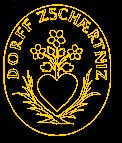

**Gemeindesiegel von Zschertnitz**

* * *

* * *

**Vereine in Zschertnitz:**

[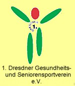](http://1dregespo.homepage.t-online.de)

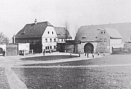Zschertnitz entstand als slawische Siedlung am Südhang des Elbtales und wurde in einer Urkunde vom 16. Oktober 1308 als Scherschiecz erstmals urkundlich erwähnt. Der Ortsname ist aus dem Sorbischen abgeleitet und bedeutet vermutlich “Leute des Srsa”. Andere Deutungen weisen auf die Begriffe “cirtica” (= Rodungsort) oder “cert” (= Teufel) hin, wobei damit auch eine so benannte Person gemeint sein könnte. 1348 gehörte das Vorwerk Zschertnitz den Söhnen des Dresdner Bürgers Nycolai de Jochgrimme , denen 1408 die bekannte Familie Münzmeister als Eigentümer folgte. Als Pächter der Freiberger Münze verfügte diese über großen Reichtum und besaß zahlreiche Güter im Dresdner Umland. Hans Münzmeister war außerdem zeitweise Bürgermeister von Dresden. Abgaben mussten an das Meißner Domstift geleistet werden, welches für diesen Zweck in Mockritz eine Garbensammelstelle unterhielt. Als besonderes Privileg waren die Bewohner von Zschertnitz vom Marktpfennig befreit, wenn sie ihre Waren auf dem Dresdner Wochenmarkt anboten.

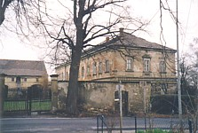1568 erwarb Kurfürst August das Zschertnitzer Vorwerk und siedelte hier vier Bauern und vier Gärtner an. Grund war die Anlage des [Kammergutes Ostra](../../zentrum/friedrichstadt/ostra/), für welches die dort lebenden Familien ihre angestammten Felder verlassen mussten und als Entschädigung neue Äcker in Zschertnitz und Neuostra erhielten. Durch diese Umsiedlung entwickelte sich Zschertnitz zum Bauerndorf mit mehreren Gütern und insgesamt 84 Hektar Fläche. Kirchlich gehörte der Ort zur Parochie der Kreuzkirche, ab 1889 zur Lukaskirche. 1813 wurde Zschertnitz durch die [Schlacht](../../sud/racknitz/schlacht_bei_dresden/) auf der nahegelegenen Räcknitzhöhe schwer in Mitleidenschaft gezogen. Im Anschluss wurden die sechs abgebrannten Gehöfte wieder aufgebaut und bis zum Ende des 19. Jahrhunderts landwirtschaftlich genutzt. Das Foto rechts zeigt das letzte noch erhaltene Zschertnitzer Gehöft an der Caspar-David-Friedrich-Straße 52.

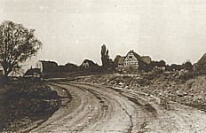Die umfangreichen Lehmvorkommen auf Zschertnitzer Flur führten um 1880 zur Entstehung dreier Ziegeleien, deren Lehmgruben schon bald einen Großteil der Gemeindeflächen einnahmen und letztlich zur Einstellung der Landwirtschaft führten. Stattdessen wurde Zschertnitz zum Wohnvorort. Weit über die Ortsgrenzen hinaus wurde das aus dem früheren Dorfgasthof hervorgegangene Tanz- und Ballhaus [“Paradiesgarten”](../../sud/zschertnitz/paradiesgarten/) bekannt, welches bis 1945 zu den beliebtesten Dresdner Vergnügungslokalen gehörte. Am 1. Juli 1902 wurde Zschertnitz nach langwierigen Verhandlungen nach Dresden eingemeindet. Festgelegt war im Eingemeindungsvertrag u.a. die Verlängerung der Straßenbahn sowie der Ausbau der Beschleusung und eine Anbindung an das städtische Gas- und Wasserleitungsnetz. Ein großzügiger Bebauungsplan für die verbliebenen Freiflächen rund um den Ortskern blieb jedoch unrealisiert.

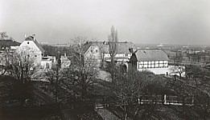

**_Fotos: Der Dorfkern von Zschertnitz vor dem Abriss 1973_**

_(Deutsche Fotothek / Geschichtswerkstatt Zschertnitz)_

Trotz der verbesserten Verkehrsanbindung durch die 1904 eröffnete Straßenbahn entstanden bis zum Ersten Weltkrieg nur wenige neue Gebäude außerhalb des Dorfkerns. Am [Zelleschen Weg](../../sud/zschertnitz/strassen_zschertnitz/zellescher_weg/) befanden sich einige Handelsgärtnereien; einige wenige Villen säumten die Paradiesstraße. Erst nach dem Ersten Weltkrieg entstanden weitere Ein- und Mehrfamilienhäuser. Mitte der 1930er Jahre wurde mit dem Bau der [Knauerschen Siedlung](../../sud/zschertnitz/strassen_zschertnitz/) auf dem Gelände eines früheren Sportplatzes begonnen. Dieser Wohnanlage folgten bis zum Ausbruch des Zweiten Weltkrieges weitere Wohnhäuser an der Runge- und Schinkelstraße. Auch das Gelände der ehemaligen Stadtziegelei wurde 1939/40 teilweise mit Siedlungshäusern bebaut.

Obwohl Zschertnitz 1945 nicht zum Hauptzielgebiet der Luftangriffe gehörte, wurden auch hier zahlreiche Gebäude getroffen. So fielen Teile des Dorfkerns sowie einige Wohnhäuser an der Paradiesstraße und der Swakopmunder Straße (heute Ewald-Schönberg-Straße) den Bomben zum Opfer. Der Gasthof “Paradiesgarten” wurde schwer beschädigt und fortan bis zum Abriss nur noch als Lagerhaus genutzt. Die stillgelegten Lehmgruben an der Südhöhe dienten bis in die 1950er Jahre als Trümmerkippe für die zerstörte Innenstadt und wurden 1989 als Kleingartengelände freigegeben.

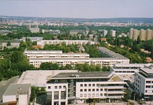Mit dem Beschluss zum Bau eines großen Neubauviertels veränderte sich das Ortsbild völlig. Der Dorfkern [Altzschertnitz](../../sud/zschertnitz/strassen_zschertnitz/) wurde 1973/74 vollständig abgebrochen. An seiner Stelle entstanden sechs Wohnhochhäuser, die eine neue Dominante auf der Südhöhe bildeten. Weitere Wohnblocks wurden zwischen 1971 und 1976 auf Freiflächen rund um den Ort errichtet _(Foto)_. Neben ca. 3.300 Wohnungen entstanden auch einige gesellschaftliche Bauten zur Versorgung der Bevölkerung. Bereits 1967 war an der [Münzmeisterstraße](../../sud/zschertnitz/strassen_zschertnitz/) das erste MOTEL der DDR eingeweiht worden.

Nach 1990 wurde an der Räcknitzhöhe ein neuer Einkaufskomplex gebaut, der den Namen des 1977 abgerissenen Gasthofs “Paradiesgarten” übernahm. Auch das Gelände des MOTELS wurde nach dessen Abriss mit modernen Wohnhäusern bebaut. Außerdem befindet sich in der Gleisschleife der Straßenbahn seit Oktober 1995 der moderne Sportkomplex “TSF” mit öffentlicher Gaststätte.

Schulen in Zschertnitz:

Da der Ort nie eine eigene Schule besaß, mussten die Zschertnitzer Kinder ab 1828 die Strehlener Schule besuchen. Später gingen die wenigen Kinder nach Kaitz zum Unterricht, ab 1868 jedoch wieder nach Strehlen. Um die langen beschwerlichen Schulwege abzukürzen und zugleich die bis dahin fälligen Schulgebühren su sparen, trat Zschertnitz 1890 dem Schulverband Mockritz - Räcknitz - Kleinpestitz bei, der an der Gemarkungsgrenze 1893 ein gemeinsames Schulhaus errichtete. Dieses Gebäude ist bis heute an der Südhöhe erhalten und wird von der 70. Grundschule genutzt.

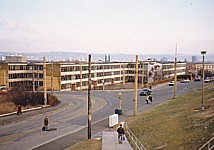Im Zusammenhang mit dem Bau des Neubaugebietes Zschertnitz entstand an Stelle eines abgerissenen Gehöfts an der Paradiesstraße 1973/74 ein moderner Schulkomplex mit zwei Gebäuden, Sporthallen, Sportplatz und Schulgarten _(Foto)_. Diese Schulen (110. und 111. POS)erhielten später die Namen Theodor Körners und Gottfried Sempers. Am Giebelfeld erinnerte ein 1973 von Bruno Dolinski geschaffenes Wandbild an die Schlacht von Dresden 1813. Dieses befindet sich heute im Militärhistorischen Museum und soll dort künftig im Rahmen einer Ausstellung über die Befreiungskriege zu sehen sein.

Nach 1990 wurden beide Schulen aufgelöst. Die Schulhäuser nutzte noch bis 2007 das Vitzthum-Gymnasium, welches seit 1994 die Geschichte dieser traditionsreichen Schule fortsetzt. 2008 begann der Abriss der vorhandenen Gebäude, welche bis 2010 durch einen modernen Neubau ersetzt wurden. Das moderne Gymnasium entstand nach Plänen der Architektenbüros Heinle, Wischer und Partner sowie Bassin Architekten und besteht aus zwei miteinander verbundenen Schulhäusern sowie einer Dreifeld-Sporthalle. Die an der Fassade angebrachte Uhr _(Foto links)_ stammt vom Dresdner Künstler Sebastian Hempel.

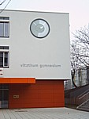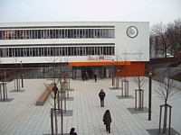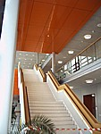

**_Fotos:_** _Das neue Vitzthum-Gymnasium an der Räcknitzhöhe_

__

Kleingartenanlage “Heimaterde”:

Die Kleingartenanlage an der Caspar-David-Friedrich-Straße entstand 1936 auf dem Gelände der früheren Lehmgrube
der Zschertnitzer Ziegelei. Während die eigentlichen Ziegeleigebäude noch bis zum Abriss 1994 gewerblich genutzt
wurden, waren die Lehmgruben bereits um 1930 verfüllt und planiert worden. In unmittelbarer Nähe der Anlage befindet sich seit 1975 das Seniorenheim “Olga Körner”.

Kleingartenanlage “Obere Südhöhe”:

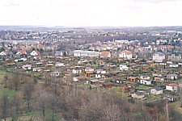Auch diese Kleingartenanlage liegt auf ehemaligem Ziegeleigelände. Nach Schließung der größten Zschertnitzer Ziegelei um 1930 wurde die Lehmgrube zunächst als Müllkippe genutzt. 1944 erhielt sie sogar ein Anschlussgleis der Straßenbahn, welches zum Abfalltransport der Schienenreinigungswagen diente. Nach Zerstörung der Dresdner Innenstadt wurde die frühere Lehmgrube viele Jahre als Abraumhalde für Trümmerschutt genutzt, der per Straßenbahn zur Südhöhe transportiert wurde. Die Ende der 1950er Jahre entstandenen Pläne für einen Schieß- und Sportkomplex der GST kamen nicht zustande. Stattdessen wurde das Gelände Ende der 1980er Jahre für eine neue Kleingartensparte freigegeben, letzte vor der Wiedervereinigung in Dresden entstandene Anlage.

[_Weiterführende Literatur und Quellen_](../../impressum/quellenverzeichnis/)

 \[ [Home](../../index.html)\] \[ [Nord](../../nord/)\] \[ [Nordwest](../../nordwest/)\] \[ [Neustadt](../../neustadt/)\] \[ [Nordost](../../nordost/)\] \[ [West](../../west/)\] \[ [Zentrum](../../zentrum/)\] \[ [Südwest](../../sudwest/)\] \[ [Süd](../../sud/)\]
 \[ [Südost](../../sudost/)\] \[ [Ost](../../ost/)\] \[ [Register](../../Register/register.html)\] \[ [Kontakt](../../Kontakt/kontakt.html)\] \[ [Impressum](../../impressum/)\]
