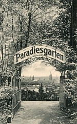
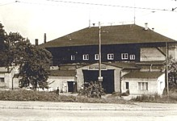
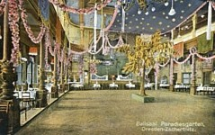
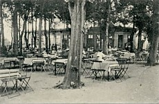
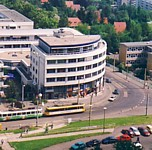

* * *

Der bekannte Zschertnitzer Tanzgasthof “Paradiesgarten” entstand 1854 als
Dorfgasthof des Ortes und ging aus dem früheren Reiheschank hervor. 1886 ließ der Schankwirt Heide das Gebäude komplett umbauen und zum Ballhaus erweitern _(Foto)_
. In diesem Zusammenhang erhielt der Gasthof auch seinen Namen “Paradiesgarten”. Den Besitzern gelang es, ihr Lokal zu einer der beliebtesten Dresdner Vergnügungsstätten zu machen. Unter dem werbewirksamen Namen “Z
bleibt Z” fanden hier regelmäßige Bälle, Konzerte und andere Veranstaltungen statt. Der große Gästegarten war alljährlich Schauplatz der Zschertnitzer Vogelwiese mit Karussells, Spielgeräten und Schießständen.

**_Fotos:_** _Ballsaal und Gästegarten des Paradiesgartens_

Bis zum Ersten Weltkrieg konnte der “Paradiesgarten” seine Position als eines der fünf bedeutendsten Dresdner Ballhäuser bewahren. Doch auch in den Zwanziger Jahren bemühten
sich die Besitzer mit Erfolg, den Niedergang des Hauses aufzuhalten. Noch bis zum Zweiten Weltkrieg besuchten vor allem an den Wochenenden zahlreiche Dresdner den Gasthof. 1945
wurde das Gebäude durch Bomben schwer beschädigt und musste schließen. In der Nachkriegszeit konnte der Bau zu Lagerzwecken wieder hergestellt werden und diente
verschiedenen Gewerbebetrieben als Unterkunft. 1977 fiel der “Paradiesgarten” einem Großbrand zum Opfer und wurde danach abgerissen. An seiner Stelle entstand 1994 ein modernes Einkaufszentrum _(Foto)_
, welches den Traditionsnamen übernahm.

* * *

 \[ [Home](../../../index.html)\] \[ [Nord](../../../nord/)\] \[ [Nordwest](../../../nordwest/)\] \[ [Neustadt](../../../neustadt/)\] \[ [Nordost](../../../nordost/)\] \[ [West](../../../west/)\] \[ [Zentrum](../../../zentrum/)\] \[ [Südwest](../../../sudwest/)\] \[ [Süd](../../../sud/)\] \[ [Südost](../../../sudost/)\] \[ [Ost](../../../ost/)\] \[ [Register](../../../Register/register.html)\] \[ [Kontakt](../../../Kontakt/kontakt.html)\] \[ [Impressum](../../../impressum/)\]
