* * *

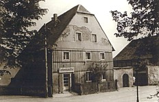Als Altzschertnitz wurde bis Mitte der 1970er Jahre der frühere Dorfkern des Ortes
bezeichnet. Die Gehöfte mit Wohn- und Stallgebäuden entstanden nach dem Dorfbrand 1813 während der Schlacht bei Dresden, wurden jedoch bereits um 1900 nicht mehr landwirtschaftlich genutzt. Stattdessen vermietete die Vereinigte Dresdner Baugesellschaft die Häuser als Wohnung für ihre Ziegeleiarbeiter. Teile des Dorfkerns fielen 1945 dem Luftangriff auf Dresden zum Opfer, darunter das Gut Altzschertnitz 1 und der zuletzt von der Landschaftsgärtnerei Penthin genutzte Vierseithof Nr. 7. Die verbliebenen Gebäude wurden im Zusammenhang mit dem Bau des Neubaugebietes 1973/74 abgerissen. An ihrer Stelle stehen heute die Wohnhochhäuser der Michelangelostraße. Das Foto zeigt das frühere Gehöft Altzschertnitz 2 mit dem kleinen Dorfladen kurz vor dem Abriss 1972 _(Archiv Geschichtswerkstatt)_.

Im Dezember 2002 wurde an der Einmündung Paradiesstraße/Räcknitzhöhe aus Anlass des 100. Jahrestages der Eingemeindung des Ortes nach Dresden ein Gedenkstein an das ehemalige Bauerndorf eingeweiht. Der Stein ist in Gestalt eines sächsischen Viertelmeilensteines gestaltet und zeigt das alte Zschertnitzer Gemeindesiegel.

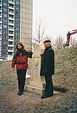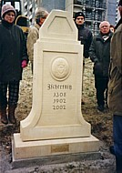

**_Fotos:_** _Einweihung des neuen Gedenksteins am 14. Dezember 2002_

__

Die Auguste-Lazar-Straße wurde in den 1970er Jahren beim Bau des Neubauviertels an der Räcknitzhöhe angelegt. Die Straßen des Plattenbaugebietes erhielten dabei ihre Namen nach Schriftstellern. Auguste Friederike Wieghardt-Lazar
(1887-1970) lebte in den Zwanziger Jahren Dresden, emigrierte 1939 nach England und kehrte nach dem Zweiten Weltkrieg wieder nach Dresden zurück. Ab 1959 wohnte sie in Dölzschen, [Am Tälchen 10](../../../sudwest/dolzschen/strassen_dolzschen/)
. Bekannt wurde sie als Autorin des Kinderbuches “Sally Bleistift in Amerika”.  Ihr Grab befindet sich auf dem Heidefriedhof.

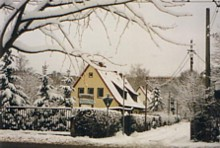Der Name der in den Dreißiger Jahren auf dem Gelände der früheren Stadtziegelei angelegten Bibrachstraße erinnert an die Dresdner Bürger- und Ratsherrenfamilie Bibrach, welche auch Besitzungen im Umland der Stadt besaß und zu den einflussreichsten Geschlechtern in der mittelalterlichen Stadt gehörte. Franz Bibrach (+ 1465) trat zudem als Wohltäter und Stifter in Erscheinung.

Seit 1889 befand sich hier die Ziegelei Dammmüller, welche später als Stadtziegelei von der Stadt Dresden übernommen wurde und noch bis 1990 als Lehrbauhof für angehende Bauhandwerker diente. Bereits 1938/39 hatte die DREWAG auf diesem Areal einige Einfamilienhäuser errichtet. Weitere architektonisch interessante Wohnhäuser entstanden 2005/06 an Stelle der zuvor abgerissenen früheren Ziegeleigebäude.

Die Böllstraße entstand Mitte der 1970 Jahre im Neubaugebiet an der Räcknitzhöhe und wurde zunächst nach dem
Schriftsteller Max Zimmering (1909-1973) Max-Zimmering-Straße genannt. Zimmering war von 1949 bis 1953 Landesvorsitzender des Verbandes der Verfolgten des Naziregimes und einige Jahre Abgeordneter der SED im sächsischen
Landtag bzw. im Bezirkstag Dresden. Ab 1964 lebte er bis zu seinem Tod als freischaffender Schriftsteller in Dresden.
Nach der Wende wurde 1990 die Max-Zimmering-Straße in Böllstraße umbenannt. Heinrich Böll (1917–1985) gehört zu den bedeutendsten deutschen Schriftstellern der Nachkriegszeit und erhielt 1972 den Literaturnobelpreis.

Die Bulgakowstraße entstand in den 1970er Jahren beim Bau des Neubaugebietes Räcknitzhöhe. Zunächst wurde sie nach
dem russischen Schriftsteller und Schauspieler Konstantin Alexandrowitsch Fedin (1892-1977) als Konstantin-Fedin- Straße bezeichnet. Fedin war ab 1959 Vorsitzender des Schriftstellerverbandes der UdSSR und zugleich Vorsitzender der
sowjetischen Freundschaftsgesellschaft mit der DDR. 1991 wurde die Konstantin-Fedin-Straße in Bulgakowstraße umbenannt. Michail Afanasjewitsch Bulgakow (1891–1940) war ein russisch-sowjetischer Schriftsteller, der vor allem
gesellschaftskritisch-satirische Stücke schrieb. Sein bekanntestes Werk ist „Der Meister und Margarita“.

Die Dora-Stock-Straße wurde 1996 auf dem Gelände der früheren Mockritzer Ziegelei angelegt. 1930 existierte hier die
Maschinenfabrik Richard Gäbel KG, welche nach dem Zweiten Weltkrieg Teil des Kombinates NAGEMA wurde (VEB Schokopack). Nach Abriss der Fabrikgebäude entstand auf dem Areal 1994/95 die Wohnanlage “Südpark”. Ihren Namen
erhielt die Straße nach der Malerin Johanna Dora Stock (1759-1832), die zum Freundeskreis der Familie Körner gehörte.

Die Ewald-Schönberg-Straße wurde 1935 als Swakopmunder Straße angelegt. In Erinnerung an die deutsche Kolonialzeit erhielt sie wie auch die benachbarte Windhuker Straße den Namen einer Stadt im früheren Deutsch-Südwestafrika (heute Namibia). 1950 wurde sie nach dem Maler Ewald Schönberg (1882-1949) umbenannt, der viele Darstellungen seiner sächsischen Heimat schuf. Schönberg wirkte nach seiner Ausbildung zum Tischler und Innenarchitekten ab 1900 als freischaffender Künstler in Dresden und war hier auch als Dozent an der Volkshochschule tätig. 1947 gründete er mit einigen Künstlerfreunden die Gruppe “Das Ufer” und beteiligte sich an der Neuorganisation des Kunstlebens in der Stadt.

Knauersche Siedlung: Die aus mehreren Mehrfamilienhäusern bestehende Siedlung entstand Mitte der 1930er Jahre auf dem Gelände eines früheren Sportplatzes. Bauherr war der bei Villeroy & Boch beschäftigte Kaufmann Helmut Knauer. Für die neue Wohnanlage wurden die Ewald-Schönberg-Straße und ihre Seitenstraßen angelegt und der alte Fahrweg nach Dresden zur Karl-Peters-Straße ausgebaut (heute Heinrich-Greif-Straße). Teile der Siedlung an der nördlichen Straßenseite fielen 1945 den Bomben zum Opfer. An ihrer Stelle wurden 1950 bungalowartige Einfamilienhäuser errichtet.

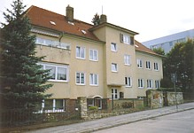

**_Foto:_** _Das Wohnhaus Heinrich-Greif-Str. 15 - Teil der Knauerschen Siedlung_

Die Heinrich-Greif-Straße ist Teil eines alten Verbindungsweges von Mockritz in Richtung Innenstadt und wurde deshalb auch als Mockritzer Fußsteig bezeichnet. Erst mit Entstehung neuer Wohnhäuser Mitte der Dreißiger Jahre wurde dieser Weg zur Fahrstraße ausgebaut und zunächst Karl-Peters-Straße (1856-1918) genannt. Karl Peters erwarb 1884 mit seiner Gesellschaft für Deutsche Kolonisation große Teile Ostafrikas und war wegen seiner rücksichtslosen Kolonialpolitik schon zu Lebzeiten heftig umstritten.

Nach 1945 wurde die Karl-Peters-Straße in Heinrich-Greif-Straße umbenannt. Der politisch engagierte Schauspieler Heinrich Greif (1907-1946) trat 1933 der KPD bei und musste wegen seiner antifaschistischen Haltung nach Moskau emigrieren. Wenige Monate nach seiner Rückkehr aus der Emigration verstarb er 1946.

In den 1950er Jahren wohnte im Haus Nr. 19 die bekannte DDR-Schauspielerin Helga Göring (1922-2010. Nach 1970 wurden die verbliebenen Freiflächen an der Heinrich-Greif-Straße mit Neubaublocks bebaut. Unterhalb des [Volksparks Räcknitz](../../../sud/racknitz/volkspark_racknitz/) richtete die AWG "Glückauf Süd" ihren Handwerkerhof (Nr. 20/20 b) ein. Nach Abbruch der Gebäude entstanden auf diesem Grundstück 2016 drei neue Mehrfamilienhäuser.

Die Louise-Seidler-Straße entstand im Zusammenhang mit dem Bau der Wohnanlage “Südpark” an der Caspar-David-Friedrich-Straße. Der Name erinnert an die Malerin und Schriftstellerin Louise Caroline Seidler
(1786-1865), die ab 1810 als Zeichenlehrerin in Dresden tätig war und Kontakte zu Goethe, Serré und Quandt unterhielt.

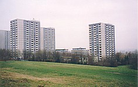
Die ringförmige Michelangelostraße wurde Mitte der 1970er Jahre an Stelle des alten Dorfkerns von Zschertnitz angelegt. So wie andere neue Zschertnitzer Straßen erhielt sie ihren Namen nach einem berühmten
Künstler. Michelangelo Buonarotti (1475-1564) gehört zu den bedeutendsten Malern, Bildhauern und Baumeistern der Renaissancezeit und schuf u.a. die Deckenmalereien der
Sixtinischen Kapelle in Rom. Nach dem Abriss der letzten Gebäude von Altzschertnitz entstanden an der Michelangelostraße 1974-76 sechs siebzehngeschossige Wohnhochhäuser sowie zwei Kindertagesstätten.

Nach Schließung der Kinderkrippe 1990 gab es in dem Gebäude zeitweise Dresdens erstes indisches Restaurant. Bis zum Abriss nutzte später eine Videothek das Haus. Auch eines der Hochhäuser (Nr. 9) wurde mittlerweile abgetragen, die
übrigen teilweise saniert.

Die Münzmeisterstraße geht wie auch die anschließende Heinrich-Greif-Straße auf den alten Fußsteig von Mockritz nach Dresden zurück. Nach der Eingemeindung von Zschertnitz erhielt der frühere Hohlweg seinen Namen nach einem alten Dresdner Ratsherrengeschlecht. Die Münzmeisters erwarben als Pächter der Freiberger Münze ein großes Vermögen und waren zeitweise auch Besitzer des Vorwerks Zschertnitz. Nicolaus und Hans Münzmeister übten zwischen 1438 und 1458 zeitweise das Amt des Dresdner Bürgermeisters aus.

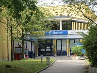Die Flächen zu beiden Seiten der Münzmeisterstraße blieben auf Zschertnitzer Flur bis in die 1960er Jahre weitgehend unbebaut und wurden ursprünglich landwirtschaftlich, später durch die hier ansässigen Ziegeleibetriebe genutzt. 1967 entstand an der Straße das erste MOTEL der DDR. 1974 wurde die 1904 eingerichtete Straßenbahnlinie bis zur Südhöhe verlängert und dort eine Gleisschleife angelegt. Weitere Neubauten folgten Ende der 1970er Jahre auf der früheren “Ponywiese” an der Kreuzung Räcknitzhöhe. Hier erinnert noch eine Wegsäule des 19. Jahrhunderts an die Vergangenheit. 1995 wurde innerhalb der Gleisschleife die moderne Sport- und Freizeitanlage ”TSF Sportpark” Dresden mit Badmintonfeldern, Fitness- und Gymnastikstudio sowie einer öffentlichen Gaststätte errichtet _(Foto)_.

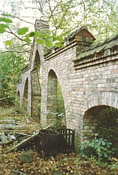Stadtziegelei: Die Ziegelei an der Münzmeisterstraße wurde 1889 von den Gebrüdern Otto und Richard Dammmüller gegründet. Die Familie hatte dafür größere Teile der Zschertnitzer Flur aufgekauft und wohnte in einer 1945 zerstörten Villa auf der Paradiesstraße 20. In den 1920 Jahren kam die Ziegelei in den Besitz der Stadt Dresden und wurde deshalb Stadtziegelei genannt. Als letzte der drei früheren Ziegeleien auf Zschertnitzer Flur stellte sie 1932 den Betrieb ein.

Auf dem Gelände wurde nun ein Lehrbauhof eröffnet, der noch bis 1990 Nachwuchs in verschiedenen Bauberufen ausbildete und 2003 zugunsten einer Wohnsiedlung abgerissen wurde. Das frühere Pförtnerhaus und das Verwaltungsgebäude dienen heute Wohnzwecken. Teile des einstigen Werksgeländes waren bereits vor dem Zweiten Weltkrieg von der DREWAG mit Reihenhäusern bebaut worden. Die dafür angelegte Erschließungsstraße trägt seit 1938 den Namen Bibrachstraße

**_Foto:_** _Zu Ausbildungszwecken errichtete Lehrmauern auf dem Gelände der ehem. Stadtziegelei_

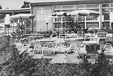MOTEL: Das MOTEL an der Münzmeisterstraße entstand 1967 auf einem Teilgelände der früheren Stadtziegelei und war bei seiner Eröffnung am 30. Juni erste Einrichtung seiner Art in der DDR. Die Pläne für die Anlage stammten vom Architekten Karl Kübler, den Bau führte eine Stuttgarter Firma aus. Dabei kam ein modernes Raumzellensystem zum Einsatz, dass einen schnellen Aufbau aus vorgefertigten Teilen ermöglichte Neben den vier Bettenhäusern mit 140 Betten gehörten auch eine öffentliche Gaststätte mit 120 Plätzen sowie ein Intershop zum Gebäudekomplex. Mit dem Bau sollte dem Mangel an Übernachtungsmöglichkeiten in Dresden begegnet und zudem eine preiswerte Herberge für motorisierte Gäste der Stadt geschaffen werden.

Zu den regelmäßigen Gästen des MOTELS gehörten u.a. die Spieler ausländischer Fußballclubs, die zu Europapokalspielen in Dresden weilten. Am Eingang zum Areal befand sich eine noch heute erhaltene Kopie einer kursächsischen Postmeilensäule, die von Werner Hempel nach einem Vorbild von 1722 geschaffen wurde. Das MOTEL wurde 1990 in "Hotel Am Bismarckturm” umbenannt, wenig später jedoch geschlossen und abgerissen. An seiner Stelle befinden sich heute mehrgeschossige Wohnhäuser der Anlage “Am Bismarckturm”.

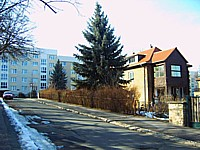Parallel zur heutigen Ewald-Schönberg-Straße wurde 1935 die Windhuker Straße angelegt, benannt nach der Hauptstadt Deutsch-Südwestafrikas (Namibia). Der unbebaute westliche Teil ist heute nur noch als Zufahrt zu den Neubauten an der Heinrich-Greif-Straße erhalten. Der kleine Straßenstumpf jenseits der Paradiesstraße _(Foto)_ erhielt nach 1945 den Namen Otto-Altenkirch-Straße nach dem “Maler des Dresdner Hellers”, der vor allem durch seine Landschaftsdarstellungen bekannt wurde. Otto Altenkirch (1875-1945) war ab 1902 an der Dresdner Kunstakademie angestellt und wurde 1917 zum Professor ernannt.

Die heutige Paul-Wiegler-Straße wurde um 1935 im Zusammenhang mit der Knauerschen Siedlung angelegt und erhielt
zunächst den Namen des deutschen Kolonialoffiziers Theodor Leutwein, der zwischen 1895 und 1905 Gouverneur in Deutsch-Südwestafrika war. Nach 1945 wurde die Straße nach dem Schriftsteller und Literaturhistoriker Paul Wiegler
(1878-1949) benannt, der auch als Redakteur und Theaterkritiker tätig war. Im oberen Teil der Straße entstanden 1974 einige Neubauten des Baugebietes Zschertnitz.

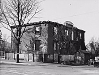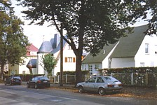Die Paradiesstraße entstand 1886 durch Ausbau des alten Fahrweges vom Zschertnitzer Dorfkern in Richtung Stadtzentrum. Ende 1904 wurde die Straßenbahn bis zum Endpunkt Zschertnitz verlängert. Hier befand sich der bekannte Tanzgasthof [“Paradiesgarten”](../../../sud/zschertnitz/paradiesgarten/), dem die Straße auch ihren Namen verdankt. Bis 1923 existierten nur wenige Gebäude an der Paradiesstraße, von denen zwei Villen 1945, unter ihnen das Wohnhaus der Ziegeleibesitzerfamilie Dammmüller, dem Bombenangriff zum Opfer fielen. Auch einige jüngere Wohnhäuser im unteren Teil der Straße erlitten dieses Schickal.

_( **Foto:** Ecke Zellescher Weg / Paradiesstraße 2/ Deutsche Fotothek)_.

Ende der 1920 Jahre begann die Bebauung der Paradiesstraße mit weiteren Ein- und Mehrfamilienhäusern, welche bis zum Beginn des Zweiten Weltkrieges weitgehend abgeschlossen war. An Stelle der zerstörten ”Turmvilla” (Nr. 18) und der Villa Dammüller (Nr. 20) wurde 1973/74 ein Neubaublock errichtet. Im oberen Teil entstand zum gleichen Zeitpunkt auf dem Areal eines abgetragenen Bauernhofes der neue Zschertnitzer Schulkomplex. Die um 1910 entstandenen Häuser Paradiesstraße 10 und 12 stehen unter Denkmalschutz.

Die Räcknitzhöhe verbindet die ehemaligen Dorfkerne von Räcknitz und Zschertnitz und hieß bis zur Eingemeindung 1902 Bismarckstraße. Danach wurde sie nach dem unweit dieser Straße gefallenen General Jean Victor Moreau Moreaustraße genannt, ein Name der bis nach 1945 erhalten blieb. Um 1900 entstanden auf Räcknitzer Flur die ersten Mietshäuser. Das übrige Gelände wurde ab 1898 vom [Volkspark Räcknitz](../../../sud/racknitz/volkspark_racknitz/) sowie Feldern und Gartenland eingenommen. Als einziges Gebäude in Zschertnitz existierte das um 1890 entstandene Landhaus “Mariens Heim” _(Foto: Archiv Geschichtswerkstatt)_, welches 1974 dem neuen Dienstleistungskomplex weichen musste. Zuletzt hatte in diesem Haus die Aufbauleitung des Neubaugebietes ihren Sitz.

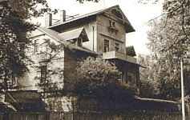

Im Zusammenhang mit dem Bau dieses Neubaugebietes wurde die Räcknitzhöhe durch Ausbau eines Fußweges bis zur Caspar-David-Friedrich-Straße verlängert. Nach 1990 wurde an Stelle des abgerissenen Gasthofes “Berghof Zschertnitz” ein modernes Geschäftshaus errichtet, welches heute gemeinsam mit dem Einkaufszentrum “Paradiesgarten” ein kleines Stadtteilzentrum bildet.

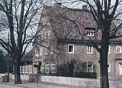Berghof: Der Berghof entstand kurz vor Beginn des Zweiten Weltkrieges in Nachbarschaft des “Paradiesgartens” und wurde nach dessen Schließung infolge von Kriegsschäden beliebtes Tanz- und Speiselokal. Die auch zu DDR-Zeiten privat bewirtschaftete Gaststätte blieb auch nach dem Bau des Neubaugebietes einzige Einkehrstätte in Zschertnitz. Lediglich im Erdgeschoss eines Hochhauses der Michelangelostraße bestand zeitweise noch ein kleines Café. Mit einer Silvesterveranstaltung 1991 wurde der Berghof geschlossen und wenige Monate später zugunsten eines Büro- und Geschäftshauses abgerissen.

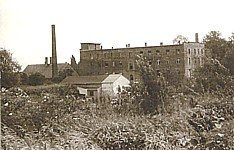Ziegeleien an der Räcknitzhöhe: In der zweiten Hälfte des 19. Jahrhunderts entstanden im östlichen Teil von Zschertnitz die Ziegeleien Christmann (1872) und Ulbricht (1876). Während die erstgenannte vor allem dem örtlichen Bedarf diente und bereits nach dem Ersten Weltkrieg aufgegeben wurde und völlig verschwand, sind von der größeren Ziegelei Ulbricht bis heute einige Bauten erhalten geblieben ( _Foto um 1970/Archiv Geschichtswerkstatt)_. Das nach 1900 im Besitz der Vereinigten Dresdner Baugesellschaft befindliche Unternehmen gehörte zu den bedeutendsten Ziegeleien im Dresdner Süden und hatte einen Großteil der Zschertnitzer Flur aufgekauft. Auf dem ca. 34 Hektar großen Areal befanden sich ein Ringofen, mehrere Trockenschuppen, ein größeres Verwaltungsgebäude und Unterkünfte für die Ziegeleiarbeiter. Ab 1930 nutzten verschiedene gewerbliche Unternehmen die ehemaligen Produktionsstätten. Im früheren Hauptgebäude hat heute die Möbelfirma Röthing ihren Sitz. Auf dem Gelände der nach 1945 mit Trümmerschutt verfüllten Lehmgrube befindet sich eine Kleingartenanlage.

Der Rubensweg wurde im Zuge des Neubaugebietes Zschertnitz angelegt und erhielt 1975 seinen Namen nach dem flämischen Maler Peter Paul Rubens (1577-1640). Rubens gehörte ab 1598 der Malerzunft seiner Heimatstadt Antwerpen
an und gehörte zu den bedeutendsten Künstlern seiner Zeit. Auch in der Dresdner Galerie “Alte Meister” befinden sich einige seiner Bilder.

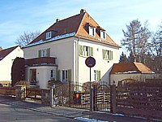Die Rungestraße wurde 1938 im Zusammenhang mit einer geplanten, aber nie vollständig realisierten Kleinhaussiedlung angelegt und nach dem Maler Philipp Otto Runge (1777-1810) benannt. Runge gehört zu den wichtigsten Vertretern der deutschen Romantik und lebte zwischen 1801 und 1804 in Dresden. Der von der übrigen Rungestraße getrennte Straßenteil auf Strehlener Flur erhielt nach 1990 den Namen Schurichtstraße. Zwischen 1972 und 1975 war das dazwischen liegende Terrain mit den Plattenbauten des Neubaugebietes Zschertnitz bebaut wurden und die durchführende Straßenführung unterbrochen worden.

Zu den vor 1945 fertiggestellten Gebäuden gehörte das 1938 von der Firma August Warnatz erbaute Haus des Arztes Dr. Rainer Fetscher _(Nr. 45 - Foto)_, der am 8. Mai 1945 von der SS beim Versuch der kampflosen Übergabe Dresdens erschossen wurde. Noch heute erinnert der Buchstabe "F" am Ziergitter der Haustür an Fetscher.

Die Schinkelstraße wurde Mitte der 30er Jahre angelegt und anschließend mit Ein- und Mehrfamilienhäusern bebaut. Karl
Friedrich Schinkel (1781-1841) gilt als Hauptarchitekt des Klassizismus und schuf in Dresden die Altstädter Wache am Theaterplatz.

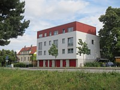Die auf dem südlichen Kamm des Elbtals verlaufende Südhöhe hieß ursprünglich Kohlenstraße, da sie als Transportweg der Schächte im Gittersee-Birkigter Steinkohlenrevier diente. Um 1900 wurde die Straße in Südhöhe umbenannt und bildet teilweise die Flurgrenze zwischen Mockritz und Zschertnitz. Die ersten Wohnhäuser entstanden auf Mockritzer Flur um 1890. Die gegenüberliegende Straßenseite blieb unbebaut, da sich hier die große Lehmgrube der Vereinigten Zschertnitzer Baugesellschaft befand. Nach 1945 wurde diese Grube mit Trümmerschutt aus der zerstörten Innenstadt verfüllt.

Auf den Freiflächen westlich der Münzmeisterstraße entstand in den 1970er Jahren rund um den Bismarckturm das Neubaugebiet Räcknitzhöhe mit mehrgeschossigen Plattenbauten. Hinzu kamen eine inzwischen nicht mehr vorhandene Schule (125. POS “Heinrich Heine”) sowie eine Lebensmittelkaufhalle. Vor der Kaufhalle erinnert ein historischer Weichbildstein von 1729 an den einst komplizierten Flurverlauf zwischen der Stadt Dresden und den Nachbarorten Räcknitz und Zschertnitz. Der Stein trägt die Nr. 47 und das Stadtwappen und war einst ein wichtiger Vermessungspunkt.

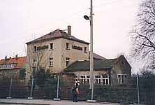Café Südhöhe: Die Gaststätte an der Südhöhe entstand Anfang der 1930er Jahre und war mit ihrem Gästegarten beliebtes Ausflugslokal. Zuvor existierte in unmittelbarer Nachbarschaft bereits eine weiteres Lokal mit Namen “Mockritzer Höhe”, welches jedoch nach 1945 geschlossen wurde. Heute dient dieses Gebäude (Caspar-David-Friedrich-Straße 41) als Wohnhaus. Die “Südhöhe” wurde auch zu DDR-Zeiten in Regie der HO weitergeführt und schloss erst nach 1990 ihre Pforten. Das Gebäude stand danach viele Jahre leer _(Foto links)_ und wurde 2012 zugunsten eines Wohnhauses abgerissen (Foto oben rechts).

Die Tizianstraße wurde 1973 auf dem Gelände eines früheren Sportplatzes angelegt und in der Folgezeit mit Plattenbauten bebaut. Einer Zschertnitzer Tradition folgend erhielt sie
den Namen des italienischen Malers Tizian (eigentlich Tiziano Vecellio). Tizian wurde um 1490 in der Nähe von Venedig geboren und war später als Auftragsmaler für hochrangige
Adlige, Kaiser Karl V. und den Papst tätig. 1576 starb er in Venedig. Einige Bilder Tizians finden sich in der Dresdner Galerie.

Der Zschertnitzer Marktweg führte einst vom alten Dorfkern in nördlicher Richtung über die heutige Heinrich-Greif-Straße
zum Zelleschen Weg und von dort am Bornberg vorbei (heute Beutlerpark) zur Innenstadt. Dieser alte Weg wurde nicht nur
als Weg zum Markt genutzt, sondern war auch Kirchweg der Zschertnitzer, die bis zum Bau der Lukaskirche von der Kreuzkirche betreut wurden. Mit der Bebauung der südlich der Eisenbahnstrecke gelegenen Flächen nach 1870 verlor
dieser Weg an Bedeutung und verschwand schließlich aus dem Stadtbild. Als Reststück des alten Zschertnitzer Marktweges besteht heute noch die Heinrich-Greif-Straße.

[Zschertnitz auf OpenStreetMap](https://www.openstreetmap.org/search?query=Dresden+Zschertnitz)

* * *

 \[ [Home](../../../index.html)\] \[ [Nord](../../../nord/)\] \[ [Nordwest](../../../nordwest/)\] \[ [Neustadt](../../../neustadt/)\] \[ [Nordost](../../../nordost/)\] \[ [West](../../../west/)\] \[ [Zentrum](../../../zentrum/)\] \[ [Südwest](../../../sudwest/)\] \[ [Süd](../../../sud/)\] \[ [Südost](../../../sudost/)\] \[ [Ost](../../../ost/)\] \[ [Register](../../../Register/register.html)\] \[ [Kontakt](../../../Kontakt/kontakt.html)\] \[ [Impressum](../../../impressum/)\]
