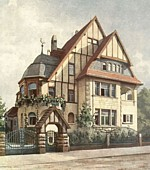
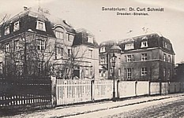
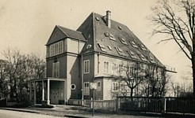
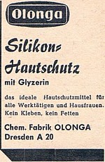
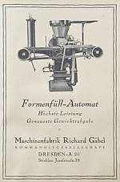
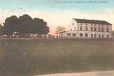
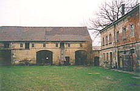

* * *

* * *

Die über Mockritzer, Zschertnitzer und Strehlener Flur verlaufende Caspar-David-Friedrich-Straße geht auf einen alten Höhenweg am südlichen Kamm des Elbtalkessels zurück. Da dieser Weg für den Transport der Steinkohle aus den Schachtanlagen in Bannewitz und Gittersee genutzt wurde, war bis ins 19. Jahrhundert der Name Kohlenstraße üblich. Später setzte sich die Bezeichnung Südhöhe durch, während der östlichste Teil von der Mockritzer Flurgrenze über Zschertnitz nach Strehlen ab 1862 als Josefstraße bezeichnet wurde. Namensgeber war Kaiser Franz Josef von Österreich, der 1860 den damaligen sächsischen Kronprinzen Albert in seiner [Strehlener Villa](../../../../sudost/strehlen/konigliche_villa/) besucht hatte. Erst 1940 erhielt die Straße ihren jetzigen Namen nach dem wohl bekanntesten deutschen Maler der Romantik Caspar David Friedrich. Infolge verkehrstechnischer Veränderungen besteht sie heute aus zwei getrennten Abschnitten zwischen [Wasaplatz](../../../../sudost/strehlen/strassen_strehlen/wasaplatz/) und Teplitzer Straße sowie dem über eine Treppenanlage erreichbaren südlichen Teil bis zur Südhöhe.

Während in der Nähe des Wasaplatzes auf Strehlener Flur vor allem Villen dominieren, erinnert oberhalb der Räcknitzhöhe das letzte erhaltene Bauerngut an die Vergangenheit von Zschertnitz. Das Gehöft Caspar-David-Friedrich-Straße 52 blieb als einziges Zschertnitzer Gut 1973 vom Abriss verschont und steht heute unter Denkmalschutz. Im Wohnhaus Nr. 15b richteten die Nazis 1940 eines der berüchtigten “Judenhäuser” ein, in dem u.a. der bekannte Sprachwissenschaftler Victor Klemperer leben musste.

Einzelne Gebäude:

Nr. 3: Bemerkenswert ist die 1904 errichtete Villa Caspar-David-Friedrich-Straße 3. Das Gebäude wurde von Heino Otto für den Arzt Dr. Curt Schmidt entworfen und weist Jugendstilformen auf. Eine Besonderheit stellt die in das Souterrain integrierte Garage dar, ein Novum für die damalige Zeit. Einige Jahre hatte in diesem Gebäude der Maler Robert Sterl sein Atelier. Zu DDR-Zeiten als Konsum-Textilverkaufsstelle genutzt, dient die Villa nach ihrer Sanierung 2002 heute als Bürohaus. Leider sind von der ursprünglichen Innenausstattung nur noch Reste erhalten geblieben, darunter mehrere farbig verglaste Fenster im Treppenhaus.

Nr. 5: Auch das Nachbarhaus weist eine interessante architektonische Gestaltung auf. Die Villa entstand 1905 mit zahlreichen Erkern, Giebeln und Fensterformen sowie verschiedenen Jugendstilelementen _(Bild)_. Architekt war Georg Heinsius von Mayenburg, Bruder des “Chlorodont”-Fabrikanten. Er schuf zahlreiche Villen in Dresden und Umgebung, einen Großteil der Pavillons der I. Internationalen Hygieneausstellung und war auch am Umbau des Schlosses Eckberg beteiligt.

Nr. 10: Das Eckhaus oberhalb der Einmündung des Zelleschen Weges entstand Ende des 19. Jahrhunderts als villenartiges Wohnhaus. Später befand sich hier das "Institut Gammerl", eine Höhere Töchterschule mit Mädchenpensionat. Heute wird es als Wohnhaus genutzt.

Nr. 12: Das repräsentative Gebäude im Stil der sogenannten Reformbaukunst wurde kurz vor dem Ersten Weltkrieg in der Nähe der Einmündung des Zelleschen Wegs in die Josefstraße als privates Sanatorium erbaut. Inhaber war der Arzt Dr. Curt Schmidt. Ab 1932 übernahm der Psychiater Dr. Heinrich Stoltenhoff die Leitung der Privatklinik. Stoltenhoff (1898-1979) hatte in Königsberg und Wien studiert und wirkte ab 1922 als Assistenzarzt am Kurhaus Alberthöhe in Bad Schandau. Ab 1950 war bis zur Pensionierung 1964 Chefarzt und Ärztlicher Direktor des Krankenhauses Arnsdorf und zeitweise auch sächsischer Landespsychiater. Die Gebäude der früheren Privatklinik nutzte zu DDR-Zeiten die Poliklinik Dresden-Strehlen. Heute dienen sie als Ärztehaus.

Nr. 15: Auch dieses Gebäude auf der gegenüberliegenden Straßenseite wurde schon vor dem Zweiten Weltkrieg für medizinische Zwecke genutzt. Hier befand sich die private Klinik Dr. Behringer. So wie mehrere Häuser in diesem Abschnitt der Caspar-David-Friedrich-Straße kam auch diese nach 1945 zur Poliklinik Strehlen, die hier ihre orthopädische und chirurgische Abteilung einrichtete. Heute dient das Haus als Waldorf-Kindergarten. Außerdem gibt es auch weiterhin Arztpraxen im Haus.

Nr. 15b: Das Wohnhaus entstand 1935 für die Familie Kreidl. Ernst Kreidl arbeitete als Prokurist bei einer Bank und bewohnte es bis 1940 zusammen mit seiner Ehefrau Elsa. Da er jüdischer Herkunft war, wurde er 1940 zwangsweise enteignet und sein Wohnhaus in ein "Judenhaus" umgewandelt. Zu den hier eingewiesenen Bewohnern gehörte der Romanist und Sprachwissenschaftler Victor Klemperer, der von Mai 1940 bis zum September 1942 im Haus wohnte. Ernst Kreidl wurde am 19.November 1941 verhaftet, später nach Buchenwald deportiert und dort am 21. Mai 1942 erschossen. Seine Schwägerin Ida starb im Judenghetto Theresienstadt, die ebenfalls im Haus untergebrachte Gattin des Besitzers der Niedersedlitzer [Malzfabrik](../../../../ost/niedersedlitz/strassen_niedersedlitz/) Julia Pick nahm sich nach Erhalt des Deportationsbefehls das Leben. Vor dem Haus erinnert seit 2012 ein Stolperstein an das Schicksal seiner Bewohner.

Ziegelei Christmann (Nr. 34): Die Mitte des 19. Jahrhunderts gegründete Privatziegelei Christmann gehörte zu den drei Zschertnitzer Ziegeleien und stellte ihren Betrieb bereits nach dem Ersten Weltkrieg ein. Einige Nebengebäude blieben noch bis 1970 erhalten. Das Areal wurde daraufhin mit mehrgeschossigen Wohnhäusern bebaut (Räcknitzer Weg).

Ziegelei der Vereinigten Dresdner Baugesellschaft (Nr. 36-46): Diese Ziegelei war im 19. Jahrhundert vom Mockritzer Gutsbesitzer Ulbricht gegründet worden. 1904 befand sie sich im Besitz der Vereinigten Dresdner Baugesellschaft (später Dresdner Bau- und Industrie AG). Das Unternehmen hatte um 1900 große Teile der Zschertnitzer Dorfflur erworben und für die Ziegelherstellung umgestaltet. Die eigentlichen Ziegeleianlagen befanden sich an der Räcknitzhöhe, die Lehmgrube erstreckte sich an der Südhöhe bis zur Münzmeisterstraße.

Nach Einstellung des Ziegeleibetriebs übernahmen verschiedene gewerbliche Unternehmen die Gebäude. U.a. hatte hier die Firma Feig für die Herstellung chemisch-pharmazeutischer Erzeugnisse (“Olonga”; Nr. 36) sowie das Graphit-Schmelztiegel-Werk Blechschmidt (ab 1930 F.C. Theiss Graphit-Schmelztiegelwerk) ihren Sitz. Nach 1945 nutzte die Möbelfirma Röthing das Areal. Das Hauptgebäude blieb bis heute erhalten, während die meisten Nebengebäude sowie die einstigen Ringöfen dem Bau des Neubaugebietes Zschertnitz weichen mussten. Das areal der früheren Lehmgrube nimmt heute eine Kleingartenanlage ein.

Maschinenfabrik Richard Gäbel (Nr. 39): Das Unternehmen wurde 1888 vom Mechaniker Friedrich Adolf Richard Gäbel (1866-1939) gegründet. Ursprünglich hatte die Firma ihren Sitz auf der Pirnaischen Straße 19 und wurde als einfache Werkstatt betrieben. Um 1900 stellte man hauptsächlich Spezialmaschinen für die Papierwarenindustrie her und übernahm zudem Reparaturarbeiten. Später kamen Maschinen zur Herstellung von Süßwaren und Verpackungen hinzu. Um 1914 beschäftige Gäbel bereits 60 Angestellte. Um sein Unternehmen ausbauen zu können, erwarb der Firmeninhaber nach dem Ersten Weltkrieg das Areal der früheren Mockritzer Ziegelei auf der Josefstraße 39. Hier ließ er die vorhandenen Bauten für seine Zwecke umbauen und durch eine Montagehalle sowie ein Verwaltungsgebäude ergänzen.

Im Juni 1924 nahm die zugleich in eine Kommanditgesellschaft umgewandelte Firma in Mockritz die Produktion auf. Richard Gäbel war der Komplementär, seine Ehefrau sowie seine drei Kinder wirkten als Kommanditisten. Außerdem wurden Gäbels Schwiegersöhne Hermann Weber und Hermann Lohmann als Prokuristen eingesetzt. Die Firma spezialisierte sich nun auf den Bau von Papierschneide- und Verpackungsmaschinen für die Nahrungs- und Genussmittelindustrie. Zum Produktionsprogramm gehörten u.a. Waffel- und Gebäckschneidemaschinen sowie Spezialmaschinen für die Verpackung von Schokoladentafeln und Bonbons sowie Tabletteneinfüll- und -abzählanlagen. In dieser Zeit nahm das Unternehmen regelmäßig an Messen und Ausstellungen teil und erhielt für seine Erzeugnisse Auszeichnungen, u.a. eine “Goldene Medaille” zur Dresdner Hygiene-Ausstellung 1930/31 und den “Grand Prix” der Weltausstellung in Brüssel 1935. Die mit zahlreichen Patenten versehenen Maschinen wurden in 46 Länder Europas und nach Übersee verkauft. Bis 1938 war die Zahl der Beschäftigten auf ca. 100 angesteigen.

1939 übernahm Gäbels Schwiegersohn Hermann Weber die Geschäftsleitung, da der Unternehmensgründer zusammen mit seinem Sohn bei Jüterbog Opfer eines Verkehrsunfalls geworden war. Während des Zweiten Weltkrieges arbeitete der Mockritzer Betrieb hauptsächlich für die Rüstungsindustrie. Zu den Partnern gehörten die Junkers- Werke in Dessau sowie die Torpedoversuchsanstalt in Eckernförde. Den stark zurückgegangenen zivilen Anteil übernahm der Betriebsteil “Olonga” auf der Caspar-David-Friedrich-Straße 46. Zwischen 1941 und 1945 kamen verstärkt Kriegsgefangene als Zwangsarbeiter zum Einsatz, die im Gasthof “Elysium” an der Bergstraße, im Betriebsgelände Caspar-David-Friedrich-Straße 46 und in einer Baracke an der Münzmeisterstraße untergebracht waren.

Kurz nach Kriegsende wurden große Teile des Maschinenparks demontiert und in die UdSSR verbracht, so dass zunächst nur kleine Reparaturarbeiten möglich waren. 1946 erhielt der Betrieb den Auftrag, im Rahmen von Reparationsleistungen 30 Bonbon-Prägeanlagen für die Sowjetunion zu produzieren. Wegen ihrer engen Verbindung zur Rüstungsindustrie fiel die Maschinenfabrik Richard Gäbel unter die Enteignungsbestimmungen des Volksentscheids und wurde zum 1. Juli 1946 verstaatlicht. Als VEB NAGEMA Spezialmaschinen Dresden bzw. VEB Manag-Werk gehörte der Betrieb bis zur Schließung 1990 zum Kombinat NAGEMA. Mitte der 1990er Jahre erfolgte der Abbruch sämtlicher Gebäude. An ihrer Stelle befindet sich heute ein Wohnpark (“Südpark”), für den mit der Dora-Stock- und der Louise-Seidler-Straße zwei neue Erschließungsstraßen auf dem früheren Betriebsgelände angelegt wurden.

Mockritzer Höhe (Nr. 41): Die Gaststätte entstand Ende des 19. Jahrhunderts am Rande der Lehmgrube der Mockritzer Ziegelei (Kohlenstraße 3, später Josefstraße 41). Wegen der schönen Aussicht über das Elbtal entwickelte sie sich zu einem beliebten Ausflugslokal. Neben den Restaurationsräumen im Hauptgebäude gehörten auch eine Veranda und ein großer Gästegarten dazu. Nach 1945 wurde der Betrieb eingestellt. Das noch erhaltene Gebäude dient heute als Wohnhaus.

Nr. 52: Der aus dem 19. Jahrhundert stammende Dreiseithof ist letztes erhaltenes Zeugnis des alten Bauerndorfes Zschertnitz. Die Gebäude entstanden in der zweiten Hälfte des 19. Jahrhunderts und bestehen aus dem Wohnhaus, einem Stallgebäude und einer Scheune. Da große Flächen der Zschertnitzer Ortsflur um 1900 für die Lehmgewinnung der Ziegeleien in Ansprich genommen wurden, erwarb die Dresdner Bau- und Industrie AG (Dresdner Baugesellschaft) das Gut und ließ es durch einen Gutsverwalter bewirtschaften. 1946 kam das Gehöft in Privatbesitz und wurde zuletzt von der LPG Kaitz landwirtschaftlich genutzt. Die Gebäude befinden sich heute in einem schlechten Zustand, stehen jedoch unter Denkmalschutz.

* * *

 \[ [Home](../../../../index.html)\] \[ [Nord](../../../../nord/)\] \[ [Nordwest](../../../../nordwest/)\] \[ [Neustadt](../../../../neustadt/)\] \[ [Nordost](../../../../nordost/)\] \[ [West](../../../../west/)\] \[ [Zentrum](../../../../zentrum/)\] \[ [Südwest](../../../../sudwest/)\] \[ [Süd](../../../../sud/)\] \[ [Südost](../../../../sudost/)\] \[ [Ost](../../../../ost/)\] \[ [Register](../../../../Register/register.html)\] \[ [Kontakt](../../../../Kontakt/kontakt.html)\] \[ [Impressum](../../../../impressum/)\]
