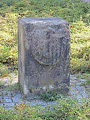Der Zellesche Weg gehört zu den ältesten Verkehrsverbindungen im Süden der Stadt und bestand bereits im 13. Jahrhundert. Ursprünglich verlief er von der [Löbtauer Brücke](../../../../sudwest/lobtau/strassen_lobtau/lobtauer_brucken/) über den Hahneberg und den Frankenberg bis zum [Klosterhof Leubnitz](../../../../sudost/leubnitz-neuostra/klosterhof/). Da dieser Weg vor allem als Transportweg zwischen Leubnitz und dem Klosters Altzella genutzt wurde, dem der Klosterhof unterstand, erhielt er den Namen Zellescher Weg. An dieser Straße lagen auch die zum Ausgang des Mittelalters untergegangenen Dresdner Vorwerke [Auswik](../../../../zentrum/sudvorstadt/auswik/) (Nähe Fritz-Foerster-Platz) und Boskau (am Beutlerpark).

Im 16. Jahrhundert erlangte der Zellesche Weg neue Bedeutung, da hier die südliche Weichbildgrenze Dresdens verlief. An diese Grenze erinnert noch ein historischer Weichbildstein in der Nähe der TU-Mensa _(Foto)_. Der Stein mit der Nr. 63 stand einst an der Kreuzung des Zelleschen Weges mit der alten Dippoldiswalder Chaussee (Bergstraße) und wurde nach seiner Sanierung Mitte der 1990er Jahre an seinen heutigen Platz versetzt. Der Form des Wappens nach gehört er zu den ältesten Weichbildsteinen der Stadt, die sonst übliche Jahreszahl der Aufstellung fehlt.

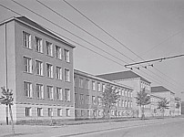Einige Abschnitte des alten Zelleschen Weges wurden nach 1870 mit den Villenvierteln der [Südvorstadt](../../../../zentrum/sudvorstadt/) überbaut. Der westlich der Zwickauer Straße gelegene Teil erhielt 1881 den Namen Nossener Straße, der Teil bis zur Hohen Straße den Namen Zellesche Straße (heute [Altenzeller Straße)](../../../../zentrum/sudvorstadt/strassen_sudvorstadt/altenzeller_strasse/). Die weiter östlich gelegenen Abschnitte blieben hingegen vorerst von der städtischen Bebauung ausgeschlossen und wurden erst nach 1900 aufgehoben. In diesem Zusammenhang ging der ursprüngliche Verlauf des alten Zelleschen Weges völlig verloren.

Das heute als Zellescher Weg bezeichnete Reststück zwischen Fritz-Foerster-Platz und Teplitzer Straße blieb sogar bis 1950 weitgehend unbebaut. Auf dem heutigen TU-Gelände und an der Ortsgrenze von Zschertnitz bestanden einige Handelsgärtnereien. Ein in den 1930er Jahren begonnener Ausbau der Straße als Teil des geplanten Tangentenringes konnte erst im Zusammenhang mit dem Bau des Neubaugebietes 1975 vollendet werden. Ab 1949 verkehrte hier bis zu ihrer Stillegung 1974 Dresdens einzige [O-Bus-Linie](../../../../sudwest/lobtau/strassen_lobtau/ebertplatz/o-bus/).

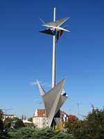Heute dominieren am Zelleschen Weg Bauten der Technischen Universität. Bereits in den 1950er Jahren waren die Lehr- und Verwaltungsgebäude der Mathematischen Fakultät _(Foto oben rechts von 1962 / Fotothek)_, des Botanischen Institutes (beide nach Plänen von Walter Henn) und des Institutes für Holztechnologie entstanden. Außerdem wurden einige Studentenwohnheime errichtet. Die von Heinrich Rettig entworfenen Gebäude sind an den Giebelseiten mit Sgraffitti verziert, welche Szenen aus Forschung und Lehre darstellen.

1978 öffnete an der Ecke Zellescher Weg / Bergstraße die Neue Mensa. Vor dem Gebäude steht der “Stahlmast mit Faltungen” _(Foto links)_ , der vom bekannten Dresdner Metallgestalter Hermann Glöckner geschaffen wurde. Eine weitere Stele als “Wegweiser” zur TU befindet sich seit Oktober 1989 an der Ecke Teplitzer Straße. Die verbliebenen Freiflächen, zuletzt als Sportanlagen genutzt, verschwanden nach 1990 zugunsten des Kongress- und Messezentrums “Dre-punkt” (1993/95) und der neuen [Staats- und Universitätsbibliothek](../../../../sud/zschertnitz/strassen_zschertnitz/zellescher_weg/slub/). Die Eröffnung dieser modernsten Bibliothek Deutschlands erfolgte im Oktober 2002.

Gärtnereien am Zelleschen Weg:

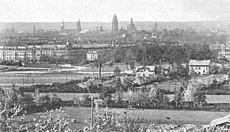Zwischen dem heutigen Fritz-Foerster-Platz und der Paradiesstraße gab es noch bis Anfang der 1970er Jahre mehrere Handelsgärtnereien. So hatten auf den Grundstücken Nr. 10, 12 und 14 die Gärtnereien von Emil Piesche, Oswald Schumann und Paul Angermann ihren Sitz. Nach Kündigung der bestehenden Pachtverträge mussten diese ihre Produktion um 1950 einstellen. Auf dem Gelände entstanden Neubauten der Physikalischen Institute der TU.

Etwas länger existierten die drei Zschertnitzer Gärtnereien zwischen Heinrich-Greif- und Paradiesstraße _(Foto)_. Die Gartenbaubetriebe von Moritz Hirschfeld (Nr. 26), May Tümpler (Nr. 28) und Reinhold Schwarzbach (Nr. 30), welche alle um 1900 gegründet worden waren, mussten 1970 dem Neubau eines Wohnblocks weichen. Erhalten blieb lediglich ein Wohnhaus an der Heinrich-Greif-Straße.

Einzelne Gebäude:

Willers-Bau (Nr. 12-14): Nach dem notdürftigen Wiederaufbau der 1945 zerstörten Hochschulgebäude erarbeitete Richard Konwiarz 1950 einen Raumentwicklungsplan für die künftige Erweiterung der Hochschule. Schwerpunkt dabei waren Flächen südlich des Zelleschen Weges. Die Planungen sahen hier den Neubau mehrerer Lehrgebäude, beginnend an der Bergstraße vor. Die Umsetzung übernahmen Walter Henn, Karl Wilhelm Ochs, Heinrich Rettig und Georg Funk. Für diese Arbeiten mussten die zuvor hier ansässigen Gärtnereien aufgegeben werden.

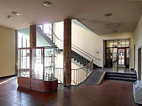Für den im zweiten Bauabschnitt errichteten Willers-Bau begannen die Arbeiten 1954. Die Projektierung stammt von Walter Henn in Zusammenarbeit mit Helmut Fischer und Hans Siegert, die Bauausführung leitete Georg Funk. Bis 1957 wurde das langgestreckte und im Grundriss kammartige Gebäude vollendet. Es besteht aus drei zweistöckigen Gebäudeteilen, die im Norden von Zwischenbauten verbunden sind. Im Inneren sind räumlich getrennt Groß- und Lehrräume sowie die Arbeitsräume der Wissenschaftler untergebracht _(Foto: Jörg Blobelt/Wikipedia)_. Nutzer des Baus waren die mathematischen und physikalischen Institute der Hochschule. 1961 wurde das Gebäude deshalb zu Ehren des Mathematikers Friedrich Adolf Willers Willers-Bau benannt. Heute hat hier die Fachrichtung Mathematik der Technischen Universität ihren Sitz. Ein ursprünglich geplanter Erweiterungsbau bis zur Bergstraße blieb unrealisiert. Heute steht auf diesem Grundstück die Neue Mensa am [Fritz-Foerster-Platz](../../../../Zentrum/Sudvorstadt/Strassen_Sudvorstadt/strassen_sudvorstadt.html.).

Der unter Denkmalschutz stehende Willers-Bau blieb bis zur Gegenwart äußerlich weitgehend im Ursprungszustand erhalten. Im Inneren befindet sich ein von Eva-Schulze-Knabe geschaffenes Sgraffito, das den Wissenschaftler Wilhelm Leibniz bei der Vorführung seiner ersten Rechenmaschine in der Royal Society London zeigt. Mehrere Kunstwerke sind auch in der kleinen parkähnlich gestalteten Anlage hinter dem Haus zu finden. Die Planung für diese Anlage stammt von Werner Bauch. Zu sehen sind hier die Plastik "Besinnung" von Charlotte Sommer-Landgraf (1981), die "Heimkehr des Elefanten Celebes" von Jürgen Schieferdecker (1984) sowie Moritz Töpfers "Tritonus" (1993/1997).

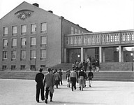Trefftz-Bau (Nr. 16): Der Treffz-Bau entstand zwischen 1950 und 1953 als erster Teil eines geplanten, jedoch nicht vollständig realisierten Bauvorhabens der Technischen Hochschule. Die Grundsteinlegung für diesen Komplex erfolgte am 25. April 1950. Der Entwurf stammt von den Architekten Walter Henn und Heinrich Rettig, die sich dabei an den Formen des bereits kurz zuvor entstandenen Barkhausen-Baus der TH orientierten _(Foto: Erich Höhne / Bundesarchiv)_.

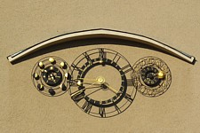Nach seiner Fertigstellung 1953 bezogen die Fachrichtungen Mathematik und Physik das Gebäude. Hier fanden die beiden großen Hörsäle der Fakultäten ihren Platz. Baulich verbunden ist das Gebäude mit dem benachbarten Willers-Bau durch einen säulengestützten Verbindungsgang, dem eine Freitreppe vorgelagert ist. Auf dem Vorplatz steht die Skulptur "Mensch und Woge" von Karl Lüdecke. Am Giebel des Treffz-Baus befand sich ursprünglich eine astronomische Uhr, die ím Zuge eines Um- und Erweiterungsbaus 2006 entfernt und an die Ostseite des Willers-Baus versetzt wurde _(Foto: Wikipedia / SchiDD)_. Die Uhr ermöglicht neben der Zeitangabe auch das das Ablesen von Sonnenauf- und -untergangszeiten und der Mondphasen. Die Berechnungen dafür stammen von Friedrich Adolf Willers, die Zifferblätter entwarf seine Tochter Annemarie.

Mehrfach wurde der Treffz-Bau erweitert, zuletzt 2008/09 um einen Anbau für das Universätsrechenzentrum. Hier ist auch das Zentrum für Informationsdienste und Hochleistungsrechnen untergebracht. Seit 1994 trägt das Gebäude den Namen des früheren TH-Professors für Technische Mechanik und Angewandte Mathematik Erich Trefftz.

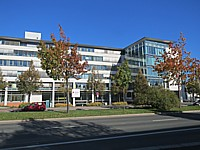Kongresszentrum "DrePunct" (Nr. 17): Der moderne Neubau _(Foto)_ wurde zwischen 1993 und 1995 auf einem zuvor als Sportfläche genutzten Grundstück errichtet. Ursprünglich waren diese für den Akademischen Sportverein der Hochschule angelegt worden. Der Entwurf stammt vom Architektenbüro Brenner & Partner. Im Inneren des langgestreckten Baus sind neben verschiedenen Lehr-, Büro und Veranstaltungsräumen die Zweigbibliotheken mehrerer TU-Fakultäten untergebracht. Außerdem hat hier das Institut für Sächsische Geschichte und Volkskunde seinen Sitz.

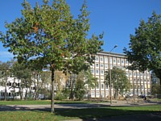Andreas-Schubert-Bau (Nr. 19): Das siebengeschossige Gebäude mit einem dreigeschossigen Nebengebäude entstand 1956-60 nach Entwürfen von Helmut Fischer und Heinz Stoll. Ursprünglich war es Sitz der Fakultät für Kerntechnik der Technischen Universität. Heute sind hier Teile der Fachrichtungen Physik, Biologie und Psychologie untergebracht. Seinen Namen erhielt der Bau nach dem Maschinenbauingenieur Andreas Schubert (1808-1870), der u.a. die erste deutsche Lokomotive und den ersten Elbdampfer "Königin Maria" konstruierte. Im Hauptgebäude befinden sich Büros und Institute, der Flachbau dient als Hörsaal mit 390 Plätzen. Wegen seiner interessanten architektonischen Gestaltung steht das in Stahlbetonskelettbauweise errichtete Gebäude unter Denkmalschutz. In den Grünflächen vor dem Haus erinnert seit 1996 die Werner-Hempel-Eiche an den Gründungsdekan der Fachrichtung Biologie. Der benachbarte Kranichbrunnen stammt von Werner Scheffel.

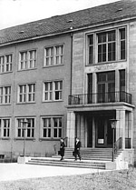Institut für Holztechnologie (Nr. 24): Die Gebäude an der Ecke zur Heinrich-Greif-Straße entstanden 1954/56 für das 1952 gegründete Institut für Holztechnologie und Faserbaustoffe (IHF). Am 9.Juni 1956 wurde das Haus als eine der ersten Forschungs- und Entwicklungseinrichtungen seiner Art in Europa übergeben _(Foto links: Trautvetter 1956 / Bundesarchiv)_. Ab 1973 gehörte es der Vereinigung Volkseigener Betriebe Möbelindustrie an, ab 1980 zum Wissenschaftlich-Technischen Zentrum der holzverarbeitenden Industrie. Heute wird es von einem Trägerverein als gemeinnützige GmbH betrieben.

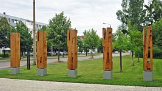Zum Institut gehören verschiedene Labors, Forschungsräume und Werkstätten für die Entwicklung neuartiger Materialien auf der Basis des Rohstoffes Holz. Im hinteren Teil des Grundstücks entstanden dafür Werks- und Versuchshallen. An der Fassade des Hauptgebäudes finden sich einige künstlerisch gestaltete Relieftafeln. Die Holzstelen vor dem Haus _(Foto: Wikipedia / SchiDD)_ wurden 2012 von Kerstin Vicent geschaffen.

Nr. 26-30b:Das zur Gemarkung Zschertnitz gehörende Grundstück zwischen Heinrich-Greif-Straße und Paradiesstraße war ab ca. 1900 Standort dreier Handelsgärtnereien. Die Betriebe gehörten um 1930 Moritz Hirschfeld (Nr. 26), May Tümpler (Nr. 28) und Reinhold Schwarzbach (Nr. 30). 1945 richteten Bomben erhebliche Schäden an und zerstörten auch das Eckhaus an der Paradiesstraße. Trotzdem existierten die Gärtereien weiter und mussten erst 1970 dem Bau des U-förmigen Neubaublocks an dieser Stelle weichen.

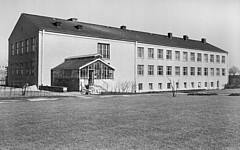Drude-Bau (Nr. 40): Das Gebäude wurde zwischen 1950 und 1952 für die Fakultät Biologie der Technischen Universität errichtet _(Foto: Fotothek)_. Die Planungen stammen von Walter Henn, Fritz Schaarschmidt und Karl Wilhelm Ochs. An der Fassade befindet sich über dem Haupteingang ein Flachrelief vom Reinhold Langner. Der in traditioneller Ziegelbauweise errichtete Bau erhielt 1953 seinen Namen nach dem TH-Professor für Botanik und zeitweisem Rektor Prof. Oscar Drude. Im Inneren des heute vom Institut für Hydrobiologie genutzten Gebäudes sind Labors und Büroräume untergebracht, zudem gibt es einen kleinen Hörsaal.

Studentenwohnheime (Nr. 41 - 41d): Die zweigeschossigen Gebäude zwischen Wundt- und Teplitzer Straße entstanden ab 1952 als erste Wohnheimbauten der Technischen Hochschule nach 1945 und stehen wegen ihrer historischen und architekturgeschichtlichen Bedeutung unter Denkmalschutz. Die Entwürfe für diese Gebäudegruppe stammen von Heinrich Rettig, der die Häuser als einfache Putzbauten errichten ließ. An den zum Zelleschen Weg zeigenden Giebelfeldern befinden sich Sgraffitti mit Darstellungen aus dem Studenten- und Wissenschaftsalltag. Schöpfer dieser Bilder war der Dresdner Künstler Johannes Beutner (1890-1960). 1997 begann die Sanierung der Wohnheime, die heute vom Studentenwerk Dresden vermietet werden. Insgesamt stehen hier ca. 300 Plätze zur Verfügung.

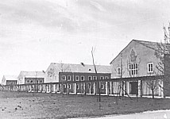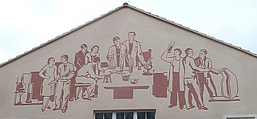

**_Fotos:_** _Studentenwohnheime am Zelleschen Weg mit Sgraffitto von Johannes Beutner (1952)_

_(Bild links: Konrad Klemm / Fotothek - Bild rechts: Xaver X. Dreißig / Wikipedia)_

* * *

 \[ [Home](../../../../index.html)\] \[ [Nord](../../../../nord/)\] \[ [Nordwest](../../../../nordwest/)\] \[ [Neustadt](../../../../neustadt/)\] \[ [Nordost](../../../../nordost/)\] \[ [West](../../../../west/)\] \[ [Zentrum](../../../../zentrum/)\] \[ [Südwest](../../../../sudwest/)\] \[ [Süd](../../../../sud/)\] \[ [Südost](../../../../sudost/)\] \[ [Ost](../../../../ost/)\] \[ [Register](../../../../Register/register.html)\] \[ [Kontakt](../../../../Kontakt/kontakt.html)\] \[ [Impressum](../../../../impressum/)\]
