* * *

* * *

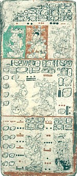

_Zwei Seiten aus_

_dem "Maya-Codex"_

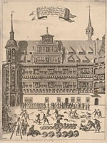Die Geschichte der Sächsischen Landesbibliothek begann im Jahr 1556, als Kurfürst August diese als private Hofbibliothek gründete, um hier wertvolle Bücher und Schriften zu sammeln. Zunächst befand sie sich im Residenzschloss und wurde 1574 nach Schloss Annaburg verlegt. Aus dieser Zeit stammt auch der älteste Katalog, ein Verzeichnis von ca. 2.700 Schriftstücken in 1.674 Bänden. Augusts Nachfolger Christian I. ließ die Bibliothek 1586 wieder nach Dresden zurückführen und durch Ankäufe, u.a. der Sammlung der Grafen von Werthern erweitern. Die Verwaltung oblag den Oberhofpredigern des sächsischen Hofes. Ab 1640 übernahmen literarisch bewanderte Dichter und Poeten die Betreuung, u. a. Christian Brehme und David Schirmer. Bis zum Ende des 17. Jahrhunderts wuchs die Sammlung auf ca. 7.000 Bände an und gehört zu den ältesten und bedeutendsten Bibliotheken in Deutschland.

Nach 1680 übernahmen vor allem hochrangige adlige Hofbeamte die Bibliotheksleitung. Bekannte Leiter waren u.a. Friedrich I. Vitzthum von Eckstädt (1714-1726), Heinrich Friedrich von Friesen (1727-1733) und ab 1738 der sächsische Premierminister Heinrich von Brühl. In dieser Zeit konnte durch weitere Ankäufe der Bestand umfassend erweitert werden. So kamen 1718 der aus fast 1.000 wertvollen Büchern bestehende Nachlass des Herzogs Moritz Wilhelm von Sachsen-Zeitz hinzu, 1727 die ca. 18.000 Bände der privaten Bibliothek Johann von Bessers. Bedeutendster Erwerb war jedoch 1739 der "Codex Dresdensis", eine der wenigen erhaltenen Handschriften der Maya und bis heute ein Prunkstück der Bibliothek.

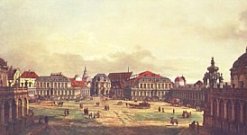

**_Bild:_** _Der Zwingerhof mit Blick zu den von der Bibliothek genutzten Pavillons (Gemälde von Canaletto)_

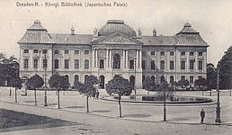Nach einem Brand im Residenzschloss mussten die Bestände vorerst ausgelagert werden und kamen zunächst in den Klepperstall und das nahegelegene Regimentshaus am Jüdenhof. Da die Räumlichkeiten jedoch unzureichend waren, entschied man sich 1728 für einen Umzug in den Zwinger, wo die Bibliothek in den beiden westlichen Eckpavillons und im Glockenspielpavillon (heute Porzellansammlung) untergebracht war. Nach dem Erwerb weiterer größerer Sammlungen, unter anderem der Bibliothek des Grafen von Brühl (1768) und des Grafen von Bünau (1764), genügten auch diese Räume nicht mehr den Anforderungen. 1786 wurde die Bibliothek unter Leitung des Oberbibliothekars Johann Christoph Adelung in das Japanische Palais am Neustädter Elbufer verbracht, wo sie bis 1945 blieb _(Foto rechts)_. Auf Adelung geht auch die systematische Sammlung von "Saxonica", regionaler Literatur zur sächsischen Landeskunde und Geschichte zurück.

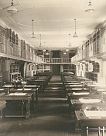Ab 1788 war die bisher ausschließlich den Mitgliedern des Hofes vorbehaltene kurfürstliche Büchersammlung als Bibliotheca Electoralis Publica der Öffentlichkeit zugänglich. Mit der Gründung des Königreiches Sachsen erfolgte 1806 die Umbenennung in Königliche Öffentliche Bibliothek. Leiter war ab 1825 Friedrich August Ebert. Neben regelmäßigen Zukäufen kamen Ende des 19. Jahrhunderts die kartografische und die musikalische Sammlung hinzu. Die Kartensammlung umfasst Kartenblätter aus Sachsen, aber auch anderen Regionen Europas und besteht heute aus ca. 138.000 Einzelblättern. Die aus mehreren 100.000 Objekten bestehende Musikabteilung war 1816 von Ebert gegründet worden und umfasst verschiedene musikalische und musikwissenschaftliche Drucke, Handschriften und Briefe bekannter Musiker. Zu den Sammlungsschwerpunkten gehören u.a. die private Sammlung König Alberts und Bestände der Sächsischen Staatsoper. Das Foto (links) zeigt einen Blick in den Lesesaal um 1920 _(SLUB / Fotothek)_.

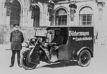Mit dem Ende der Monarchie wurde die bisherige Königliche Bibliothek 1918 in Sächsische Landesbibliothek umbenannt. In den 1930er Jahren erfolgte eine umfassende Modernisierung der Räume im Japanischen Palais. In diesem Zusammenhang entstand 1935 auch das Buchmuseum zur Präsentation besonders wertvoller Exponate. Schwere Schäden an Gebäude und Beständen entstanden beim Luftangriff 1945 durch Brände und Löschwasser. Die Bibliothek blieb danach geschlossen. Nach Kriegsende erfolgte eine Verlagerung der verblieben Bücher in das Gebäude der ehemaligen Infanteriekaserne an der [Marienallee](../../../../../neustadt/albertstadt/strassen_albertstadt/marienallee/). Ein Großteil wurde zudem als Kriegsbeute in die Sowjetunion verbracht. Ab 1949 war die Landesbibliothek wieder öffentlich zugänglich. Außenstellen befanden sich im Ständehaus (Fotothek) und in der [Garnisonkirche](../../../../../neustadt/albertstadt/strassen_albertstadt/stauffenbergallee/garnisonskirche/) (Phonothek).

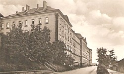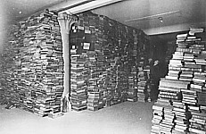Auch zu DDR-Zeiten behielt die Sächsische Landesbibliothek ihre Bedeutung als eine der bedeutendsten wissenschaftlichen Bibliotheken des Landes. Die Fotos zeigen das Gebäude der Landesbibliothek in der ehemaligen Infanteriekaserne und einen Blick in das Depot im Jahr 1947 _( **Foto:** SLUB/Fotothek)_. 1966 wurde das Stenographische Institut angegliedert und die Sammlung um zahlreiche stenographische Schriften erweitert. Ein weiterer Teil der Landesbibliothek ist seit 1983 die Deutsche Fotothek. Diese Sammlung von mehreren Millionen Fotografien entstand 1925 als Landesbildstelle Sachsen in Chemnitz, wurde jedoch schon wenig später in ein Gebäude der früheren [Tierärztlichen Hochschule](../../../../../Zentrum/Pirnaische_Vorstadt/Strassen_Pirnaische_Vorstadt/Zirkusstra%DFe/Tier%E4rztliche_Hochschule/tier%E4rztliche_hochschule.html) an der Zirkusstraße verlegt, wo sie bis 1945 verblieb. Nach 1945 bezog sie das frühere Ständehaus an der Brühlschen Terrasse. 1956 erfolgte die Umbenennung in Deutsche Fotothek. Die ältesten Bilder stammen aus der Zeit um 1850 und wurden vom Dresdner Fotopionier Hermann Krone gefertigt. Ebenfalls 1983 wurde die Sächsische Landesbibliothek zur Zentralbibliothek der DDR für Kunst und Musik.

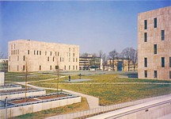Da sowohl Depot- als auch Ausleihbedingungen an der Marienallee nicht mehr den Anforderungen entsprachen, kamen nach 1990 Pläne zu einer Verlagerung der Bibliothek auf. In diesem Zusammenhang wurde auch ein Zusammenschluss mit der Bibliothek der Technischen Universität geprüft. Als neuer Standort war zeitweise der Erlweinspeicher am Elbufer im Gespräch. Nach heftigen Diskussionen entschied man sich schließlich für die Vereinigung von Landes- und Universitätsbibliothek in einem modernen Neubau im Univiertel am Zelleschen Weg. 1996 erfolgte die formelle Fusion unter dem Namen Sächsische Landesbibliothek - Staats- und Universitätsbibliothek Dresden (SLUB). Sechs Jahre später konnte der Neubau bezogen und am 1. August 2002 eröffnet werden _(Foto)_. Mit über 17 Millionen Medien gehört die SLUB zu den vier größten Bibliotheken Deutschlands.

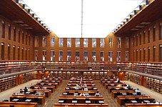Das neue Gebäude entstand zwischen 1997 und 2002 auf dem Gelände des früheren TU-Sportplatzes am Zelleschen Weg, dessen umlaufender Wall mit seiner Bepflanzung noch erhalten ist. Im Vorfeld fand ein Architektenwettbewerb statt, den das Büro Ortner & Ortner (O & O Baukunst) gewann. Die Architekten entschieden sich für einen aus zwei miteinander verbundenen quaderförmigen Bauten bestehenden Komplex, bei dem zwei Etagen unterirdisch liegen. Das ebenerdige erste Geschoss besitzt ein begehbares Dach. Verkleidet ist der weitgehend fensterlose Bau mit Thüringer Travertin. Die Fassadengestaltung soll nach dem Willen der Architekten Strichcodes symbolisieren, wie sie zur Erfassung der Bestandseinheiten verwendet werden. Während die eigentliche Bibliothek in den unteren Etagen untergebracht ist, dienen die beiden Quader der Fotothek und der Verwaltung sowie einer öffentlichen Cafeteria und als Domizil des Buchmuseums. Zentraler Mittelpunkt ist der dreistöckige große Lesesaal mit Glasdach _( **Foto:** Kay Körner / Wikipedia)_. Im nördlichen Bau befindet sich ein Vortragssaal, der 2018 den Namen Klemperer-Saal erhielt. Erinnert wird damit an den Romanisten Viktor Klemperer sowie die beiden nicht mit ihm verwandten Bankiers Viktor Klemperer von Klemenau und Gustav Klemperer, die sich als Ehrensenatoren um die TU verdient gemacht haben. Die Goethe-Büste am Eingang kam 1831 als Geschenk ihres Schöpfers Jean David d´Angers an die damalige Königliche Bibliothek nach Dresden.

Geschichte der Universitätsbibliothek:

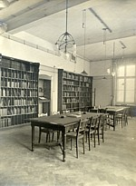Die Universitätsbibliothek entstand 1828 im Zusammenhang mit der Gründung der Technischen Bildungsanstalt. Zunächst nutzte man einige Räume im Finanzhaus am Jüdenhof, bevor man sie 1840 ins Landhaus (heute Stadtmuseum) verlegte. 1846 erfolgte ein Umzug in das neue Polytechnikum am Antonsplatz. Mit zunehmender Erweiterung der Bildungseinrichtung entstanden Ende des 19. Jahrhunderts zahlreiche Neubauten in der Südvorstadt, was 1875 auch zur Verlagerung der Hochschulbibliothek führte _(Foto um 1905 - SLUB / Fotothek)_. 1945 wurde dieses Haus zerstört, große Teile der Bestände gingen dabei verloren.

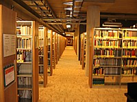Wenig später bezog die Hochschulbibliothek mit ihren ca. 55.000 geretteten Bänden das ehemalige Verbindungshaus der Sängerschaft "Erato". Heute dient dieses Gebäude als Rektorat. 1957 konnten zwei zusätzliche Lesesäle eröffnet werden. Neben der Zentralbibliothek besaßen auch die einzelnen Fachbereiche eigene Bibliotheken, die 1968 von 121 auf 26 Sektionsbibliotheken reduziert wurden. Wichtigste war die 1983 zur Technischen Zentralbibliothek der DDR ernannte Fachbibliothek für Elektronik, Elektrotechnik und Informatik. Mit der Vereinigung der TU-Bibliothek mit der Sächsischen Landesbibliothek ging diese in der neuen SLUB auf. Wesentliche Teile sind seit 1998 im Bürohaus "Dre·Punct" gegenüber der neuen Zentralbibliothek untergebracht. Hier befindet sich auch der Sitz der Verwaltung. Verschiedene Fakultäten besitzen zudem eigene Zweigbibliotheken.

Buchmuseum:

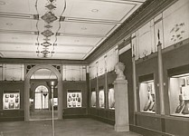Die Geschichte des Buchmuseums reicht bis ins Jahr 1835 zurück. Auf Anregung des Oberbibliothekars Konstantin Karl Falkenstein richtete man im Gebäude des Japanischen Palais einen speziellen Raum für besonders wertvolle Schriften und Dokumente ein. Diese wurden dort unter Glas präsentiert, um sie besser vor Abnutzung zu schützen und gleichzeitig einem größeren Besucherkreis zugänglich zu machen. Nach der aus dem altgriechischen abgeleiteten Bezeichnung "Zimelien" (= Kleinod) für besonders wertvolle Drucke und Manuskripte erhielt dieser Raum den Namen Zimelienzimmer. 1935 erfolgte unter Leitung von Erhart Kästner eine komplette Umgestaltung und Erweiterung, bei der dem Zimelienzimmer weitere Räume hinzugefügt wurden _(Foto: SLUB / Fotothek)_. Damit bestand nun auch die Möglichkeit für regelmäßige Wechselausstellungen. 1945 wurde auch das Buchmuseum beim Brand des Japanischen Palais zerstört.

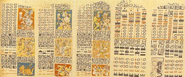

**_Bild:_** _Das Prunkstück des Buchmuseums - der Maya-Codex aus dem 12. Jahrhundert_

Nach dem Zweiten Weltkrieg und dem Umzug der Sächsischen Landesbibliothek in die Albertstadt entstand dort 1952 auch wieder eine neues Buchmuseum. Neben dem Zimelienzimmer standen hier zwei Räume für Sonderausstellungen zur Verfügung. 2002 wurde das Museum im Zusammenhang mit dem geplanten Umzug der Bibliothek vorerst geschlossen und am 14. Januar 2003 im neuen Gebäude der SLUB wieder eröffnet. Die Ausstellung befindet sich im nördlichen der beiden oberirdischen Würfelbauten und besteht aus einer Dauerausstellung (Schatzkammer) zur Buch- und Bibliotheksgeschichte und einem Bereich für wechselnde Ausstellungen. Zu den wertvollsten Stücken des Museums gehört der 1739 von Kurfürst Friedrich August II. erworbene "Codex Dresdensis", eine von nur vier weltweit erhaltenen Maya-Handschriften. Außerdem besitzt das Museum eine Ausgabe des mittelalterlichen Rechtsbuches "Sachsenspiegel", zwei Handschriften aus der berühmten Sammlung des Ungarnkönigs Matthias Corvinius und weitere wertvolle Schriften.

* * *

 \[ [Home](../../../../../index.html)\] \[ [Nord](../../../../../nord/)\] \[ [Nordwest](../../../../../nordwest/)\] \[ [Neustadt](../../../../../neustadt/)\] \[ [Nordost](../../../../../nordost/)\] \[ [West](../../../../../west/)\] \[ [Zentrum](../../../../../zentrum/)\] \[ [Südwest](../../../../../sudwest/)\] \[ [Süd](../../../../../sud/)\] \[ [Südost](../../../../../sudost/)\] \[ [Ost](../../../../../ost/)\] \[ [Register](../../../../../Register/register.html)\] \[ [Kontakt](../../../../../Kontakt/kontakt.html)\] \[ [Impressum](../../../../../impressum/)\]
