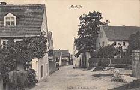
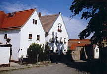
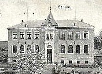

* * *

**Gemeindesiegel von Gostritz**

Das slawische Gassendorf Gostritz entstand am Hang des Nöthnitzbachtals und wurde 1378 erstmals erwähnt. Der altsorbische Ortsname Gosterticz bedeutet “Leute des Gostirad” und weist auf den Sippenältesten der Siedlung hin. Andere Deutungen gehen vom Wort gostryi = spitz aus, da das Dorf auf einer Anhöhe zwischen dem Tal des Schloitzbaches und des Heiligen Borns liegt. Bis 1402 gehörte Gostritz den Burggrafen von Dohna, später verschiedenen Adelsfamilien. Ab 1399 gelang es dem Kloster Altzella, schrittweise fast die gesamte Ortsflur in seinen Besitz zu bringen und Gostritz dem Leubnitzer Klosterhof zu unterstellen. Erst mit Auflösung des Klosterhofes endete diese kirchliche Vorherrschaft. Gostritz wurde nun ab 1550 als Teil des Leubnitzer Amtes vom Rat der Stadt Dresden verwaltet. 1813 wurden einige Gehöfte während der Kämpfe um Dresden beschädigt.

Bis heute konnte der Ort am südlichen Stadtrand sein ländliches Bild weitgehend bewahren. Größere Bauerngüter mit beeindruckenden Hofeinfahrten befinden sich u.a. in Altgostritz _(Fotos)_, an der [Friebelstraße](../../sudost/gostritz/strassen_gostritz/) und der Rosentitzer Straße. Die Einfahrten zeigen zum Teil alte Hausmarken und Inschriften, die auf frühere Besitzer hinweisen. Sehenswert ist auch eine 1836 aufgestellte historische Wegsäule am Ortsausgang.

Ende des 19. Jahrhunderts wurde Gostritz zum Standort mehrerer großer Handelsgärtnereien sowie Baum- und Rosenschulen. Bedeutendste war die Gärtnerei Huck an der Friebelstraße. Ihr Besitzer hatte kurz nach dem Ersten Weltkrieg die schwarze “Gertrud-Huck-Rose” gezüchtet und vom Verkaufserlös seinen Betrieb erheblich vergrößert. Außerdem entstanden einige Mietshäuser an der Straße nach Leubnitz. Als einziges größeres Industrieunternehmen wurde 1894 die Ziegelei Richter gegründet, die als [VEB Ziegelwerke Gostritz](../../sudost/leubnitz-neuostra/page14822/gostritzer_strasse/) noch bis 1978 in Betrieb war. Seit dem 1. April 1921 gehört Gostritz als Stadtteil. zu Dresden. Noch bis in die 1960er Jahre gab es hier die vor allem von Studenten gern besuchte Schankwirtschaft [“Mutter Vogel”](../../sudost/gostritz/mutter_vogel/), deren Gebäude noch erhalten ist. An Stelle eines abgerissenen Vierseithofes von 1736 wurden 2004 am Dorfplatz Altgostritz mehrere Einfamilienhäuser errichtet.

Schulen in Gostritz:

Gostritz unterstand seit 1445 der Leubnitzer Kirche, weshalb die Kinder des Ortes auch die dortige Schule besuchten. Erst 1897 errichtete die Gemeinde ein eigenes Schulhaus, welches jedoch mangels Kinderzahl bereits 1921 wieder geschlossen wurde. Seitdem gehört Gostritz wieder zur Leubnitzer Schule.

**_Foto:_** _Das alte Gostritzer Schulhaus_

## [Gostritzer Straßen](../../sudost/gostritz/strassen_gostritz/)

[_Weiterführende Literatur und Quellen_](../../impressum/quellenverzeichnis/)

 \[ [Home](../../index.html)\] \[ [Nord](../../nord/)\] \[ [Nordwest](../../nordwest/)\] \[ [Neustadt](../../neustadt/)\] \[ [Nordost](../../nordost/)\] \[ [West](../../west/)\] \[ [Zentrum](../../zentrum/)\] \[ [Südwest](../../sudwest/)\] \[ [Süd](../../sud/)\]
 \[ [Südost](../../sudost/)\] \[ [Ost](../../ost/)\] \[ [Register](../../Register/register.html)\] \[ [Kontakt](../../Kontakt/kontakt.html)\] \[ [Impressum](../../impressum/)\]
