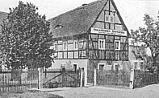

* * *

* * *

* * *

* * *

* * *

* * *

Das früher stadtweit bekannte Lokal an der Rosentitzer Straße 16 entstand 1861 als
Gasthof Gostritz. Ursprünglich befand es sich im Besitz des Schankwirts Max Sändig, der den Reiheschank des Dorfes erworben hatte.

1891 kaufte der Gostritzer Fleischermeister Hermann Vogel das Grundstück. Durch
das Engagement seiner Frau Ida entwickelte sich die kleine Dorfschänke zu einem beliebten Ausflugslokal der Dresdner. Vor allem Studenten besuchten die rustikale
Gaststätte gern. Diese gaben der wegen ihrer volkstümlichen Art beliebten Wirtin auch den Kosenamen “Mutter Vogel”, der schon wenige Jahre später auf das
gesamte Lokal überging. Bis zum Zweiten Weltkrieg blieb die Schänke einer der beliebtesten Treffpunkte für Künstler
und Studentenverbindungen, die die Gaststube mit mitgebrachten Geschenken, Postkarten und Inschriften ausgestalteten.
1914 wurde im Hof eine Linde gepflanzt, die später zum “Gedenkplatz” für die im Ersten Weltkrieg gefallenen Kameraden wurde.

1937 verstarb Ida Vogel und wurde im Beisein vieler Stammgäste auf dem Leubnitzer Friedhof beerdigt. Das Lokal blieb
jedoch auch weiterhin in Familienbesitz und existierte auch noch in der Nachkriegszeit. Erst 1965 schloss die beliebte Schankwirtschaft ihre Pforten. Das Haus selbst ist noch erhalten und dient heute Wohnzwecken.

* * *

 \[ [Home](../../../index.html)\] \[ [Nord](../../../nord/)\] \[ [Nordwest](../../../nordwest/)\] \[ [Neustadt](../../../neustadt/)\] \[ [Nordost](../../../nordost/)\] \[ [West](../../../west/)\] \[ [Zentrum](../../../zentrum/)\] \[ [Südwest](../../../sudwest/)\] \[ [Süd](../../../sud/)\] \[ [Südost](../../../sudost/)\] \[ [Ost](../../../ost/)\] \[ [Register](../../../Register/register.html)\] \[ [Kontakt](../../../Kontakt/kontakt.html)\] \[ [Impressum](../../../impressum/)\]
