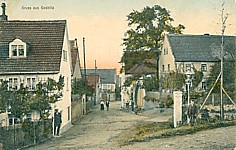
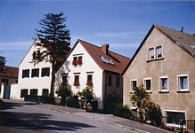
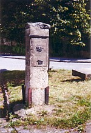
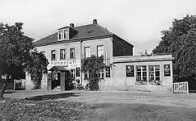
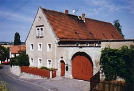
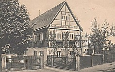

Als Altgostritz wird seit 1926 der alte Dorfkern von Gostritz bezeichnet. Zuvor gab es im Ort keine Straßennamen, sondern alle Häuser waren fortlaufend nummeriert. Bis heute haben sich hier die zum Teil unter Denkmalschutz stehenden früheren Bauerngüter des Dorfes erhalten. Bemerkenswert ist auch eine 1836 aufgestellte Wegsäule am Ortsausgang (Ecke Friebelstraße).

Nr. 8: Zu den noch gut erhaltenen historischen Bauerngütern gehört der Hof Altgostritz 8, ehemals im Besitz der Familie Kegel. Am 24. Juli 1817 wurde er vom aus Brabschütz stammenden Bauernsohn Johann Gottlieb Fehrmann erworben. Zur Wirtschaft gehörten neben dem Gehöft insgesamt ca. acht Hektar landwirtschaftliche Nutzfläche am Fuchsberg und an den Hängen des Heiligen Grundes. Am 22. Juli 1862 wurde das Gut, ebenso wie einige Nachbarhöfe, durch Brandstiftung zerstört. Als Brandstifter ermittelte man einen aus Kleinkarsdorf stammenden Knecht, der für seine Tat zu 25 Jahren Arbeitshaus verurteilt wurde. Kurz darauf erfolgte der Wiederaufbau in heutiger Form. Wie alle bäuerlichen Betriebe wurde auch dieses Gut 1961 Teil der LPG Typ III Kaitz und erst 1990 an seine Besitzer rückübertragen. Zuletzt wurde es noch im Nebenerwerb betrieben. Mit dessen Aufgabe endete 2009 die landwirtschaftliche Tätigkeit in Gostritz.

Die Babisnauer Straße geht auf einen alten Verbindungsweg zwischen
[Mockritz](../../../sud/mockritz/strassen_mockritz/) und Gostritz zurück. Ab 1904 wurde dieser auf Mockritzer Flur Gostritzer Straße genannt, blieb in Gostritz jedoch namenlos. Da es mit der Eingemeindung mehrerer Orte im Süden Dresdens ab 1921 jedoch eine weitere Gostritzer Straße gab, entschied man sich 1926 für die Umbenennung in Babisnauer Straße. Namensgeber ist der heute zu Kreischa gehörende Ort Babisnau. Auch in Gostritz wurden die an diesem Weg liegenden Grundstücke der neuen Adresse zugeordnet. In den 1970er entstand hier eine Leichtbauhalle für Lagerzwecke, die 2015 zu einem originellen Einfamilienhaus umbebaut wurde (Nr. 30).

Die Friebelstraße verbindet die beiden Nachbarorte Leubnitz und Gostritz und wurde deshalb früher Gostritzer Weg genannt. Ab 1897 ist sie in [Leubnitz](../../../sudost/leubnitz-neuostra/page14822/) als Gostritzer Straße im Adressbuch verzeichnet, blieb in Gostritz jedoch zunächst unbenannt. Ihren jetzigen Namen erhielt sie nach der Vereinigung von Leubnitz und Neuostra 1898 nach dem früheren Leubnitzer Ortsrichter und Gemeindevorstand August Friebel (1828–1900). Bis zum Ersten Weltkrieg war dieses Gebiet kaum bebaut und Standort einer von insgesamt vier Leubnitzer Ziegeleien. 1919 erwarb die Gemeinde den technisch überalterten Ziegeleibetrieb und ließ auf dem Gelände einen Sportplatz anlegen. 1926 wurde der Name Friebelstraße auch auf den Gostritzer Abschnitt übertragen.

Im Ortskern von Gostritz sind noch einige historische Bauerngüter erhalten geblieben. Bemerkenswert ist der Hof Friebelstraße 80, der nach 1813 entstand. Unweit davon befindet sich am Abzweig Friebelstraße/ Altgostritz eine historische Wegsäule von 1836 _(Foto rechts)_. Im Wohnhaus Nr. 62 wohnte ab 1917 bis zu seinem Tod 1972 der Dresdner Maler Bernhard Kretzschmar, Träger des Andersen-Nexö-Kunstpreises der Stadt. Sein Grab befindet sich auf dem Leubnitzer Friedhof. Weitere Flächen wurden von Gärtnereien genutzt, so das Grundstück Friebelstraße 69. 1941 warb hier die Blumengroßmarkt-Dresden eGmbH von J. Schreuders für "Chrysanthemen, Hortensien und Begonien in den besten Sorten". 2005 erfolgte der Abbruch der Gewächshäuser. Im gegenüberliegenden Wohnhaus Nr. 72 gab es seit dem 19. Jahrhundert das Restaurant von August Anders, später Café "Höhenluft" genannt _(Foto links)_. Das noch nach dem Zweiten Weltkrieg geöffnete Lokal dient heute als Wohnhaus.

## [Gostritzer Straße](../../../sudost/leubnitz-neuostra/page14822/gostritzer_strasse/)

Die Rosentitzer Straße liegt östlich des alten Dorfkerns von Gostritz. Der Name wurde 1926 eingeführt und erinnert an den kleinen Ort Rosentitz, heute ein Ortsteil von Bannewitz. Im Haus Rosentitzer Straße 16 befand sich bis 1965 die stadtweit bekannte Schankwirtschaft ["Mutter Vogel"](../../../Sudost/Gostritz/Mutter_Vogel/mutter_vogel.html.).

**_Fotos:_** _Bauerngut an der Rosentitzer Straße - Gasthaus "Mutter Vogel" vor 1945_

[Gostritz auf OpenStreetMap](https://www.openstreetmap.org/search?query=Dresden+Gostritz)

* * *

 \[ [Home](../../../index.html)\] \[ [Nord](../../../nord/)\] \[ [Nordwest](../../../nordwest/)\] \[ [Neustadt](../../../neustadt/)\] \[ [Nordost](../../../nordost/)\] \[ [West](../../../west/)\] \[ [Zentrum](../../../zentrum/)\] \[ [Südwest](../../../sudwest/)\] \[ [Süd](../../../sud/)\] \[ [Südost](../../../sudost/)\] \[ [Ost](../../../ost/)\] \[ [Register](../../../Register/register.html)\] \[ [Kontakt](../../../Kontakt/kontakt.html)\] \[ [Impressum](../../../impressum/)\]
