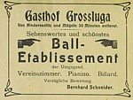
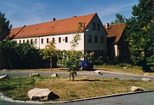
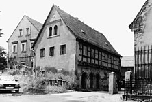
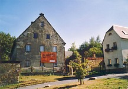
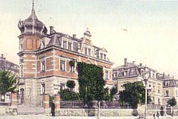
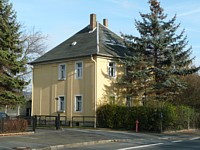
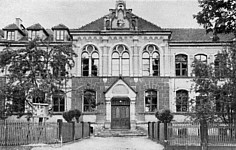

* * *

**Gemeindesiegel von Großluga**

* * *

**Schulen in Luga:**

Großluga entstand als slawischer Rundweiler und wurde 1321 erstmals als Luge erwähnt. Zur besseren Unterscheidung zum benachbarten Kleinluga erhielt der Ort schon bald den Namen Groß-Luga, der sich 1378 zum ersten Mal in den Urkunden findet (luck major). Übersetzt bedeutet Luga “Ort mit einer feuchten Niederung”, was auf die örtlichen Gegebenheiten hindeutet. Einige Überlieferungen gehen davon aus, das die ursprüngliche Siedlung einst etwas nördlich in Richtung Sporbitz lag, später jedoch aus Hochwasserschutzgründen verlegt wurde. Belege für diese These fehlen jedoch.

Ursprünglich gehörte das Dorf den Burggrafen zu Dohna, die jedoch 1321 ihre Zinsrechte an das Kloster Altzella übertrugen. Kirchlich war Großluga der Dohnaer Kirche zugeordnet, wechselte später jedoch nach Lockwitz. 1408 vergab Kurfürst Friedrich der Strenge den Ort an die vier Dresdner Bürger Vincentius, Hans, Alexius und Jorge Busmann als Lehen, denen 1436 die Röhrsdorfer Familie Lange als Lehns- und Gerichtsherren folgte. Ab 1501 gehörte das Dorf der in Zehista ansässigen Adelsfamilie von Staupitz und blieb bis zur Ablösung der grundherrlichen Rechte im 19. Jahrhundert dem Rittergut Zehista unterstellt. Verwaltungsmäßig unterstand Großluga bis 1547 der Pflege Dohna, kam dann zum Amt Dresden und war ab 1856 dem Gerichtsamt Pirna zugeordnet, bevor es 1922 als Ortsteil von Niedersedlitz zur Amtshauptmannschaft Dresden kam.

Das nur aus wenigen Gehöften bestehende Dorf hatte 1501 acht besessene Mann, deren Zahl bis 1790 auf zwölf stieg. 1834 ergab eine Volkszählung für Großluga 70 Einwohner, 1890 bereits 150. Bis ins letzte Drittel des 19. Jahrhundert lebten diese vorrangig von der Landwirtschaft, vom Obstbau und der Strohflechterei.
Eine Besonderheit war ein Privileg von 1572, nachdem sich hier auch Schneider ansiedeln durften, "worn es durch die neu zu errichtende Schneiderinnung zu Dohna nicht gestört werden möchte". Im Zentrum des Ortes lag der heutige Lugaer Platz, ein Rundweiler mit seiner noch erhaltenen Dorflinde. Erst nach dem Bau der Eisenbahnstrecke nach Pirna entstanden ab 1890 neue Mietshäuser an der Dohnaer und Kleinlugaer Straße sowie 1896 der Gasthof Großluga mit Tanzsaal. In der Nähe befindet sich das 1898 fertiggestellte ehemalige Rathaus des Ortes. Auf Großlugaer Flur siedelte sich auch das [Eisenwerk Kelle & Hildebrandt](../../Sudost/Grossluga/Kelle & Hildebrandt/kelle_hildebrandt.html) an, welches später unter dem Namen Sächsischer Brücken- und Stahlhochbau bekannt wurde. Hergestellt werden vor allem Förderanlagen und Bühnentechnik.

1920 wurden Groß- und Kleinluga zu einer Landgemeinde vereinigt, die den Namen Luga erhielt. Dieser Ort konnte seine Selbstständigkeit jedoch nur zwei Jahre bewahren und wurde am 1. März 1922 nach Niedersedlitz eingemeindet. Gemeinsam mit diesem kam auch Großluga 1950 als Stadtteil zu Dresden. 1953 entstand die nach 1990 aufgelöste LPG “1. Mai”, der seit 1958 bzw. 1962 auch Lockwitzer und Nickerner Bauern angehörten. Heute ist Großluga vor allem Wohnort mit einigen bedeutenden gewerblichen Unternehmen, darunter dem Hauptumspannwerk für Dresden-Süd. Sehenswert ist der gut erhaltene Dorfplatz (Lugaer Platz) mit seinen Bauernhäusern aus dem 18. und 19. Jahrhundert _(Fotos)_.

Rathaus Großluga:

Nachdem die Verwaltung des kleinen Ortes zuvor in den Räumen des jeweiligen Gemeindevorstandes untergebracht war, erhielt der Zimmermann Friedrich Otto Thiele am 23. Februar 1898 die Genehmigung für den Bau eines Mehrfamilienhauses auf der Lugaer Straße 8, welches zugleich als Rathaus dienen sollte. Dafür wurde das Gebäude mit einem zwiebelgekrönten Treppenturm und einer aufwändigen Ziegel-Sandstein-Fassade gestaltet und sollte gemeinsam mit dem zeitgleich entstandenen Gasthof auf der gegenüberliegenden Straßenseite Auftakt zu einem repräsentativen Ortszentrum sein. Bedingt durch den Ersten Weltkrieg und die folgende Eingemeindung Großlugas kamen diese Pläne nicht zur Umsetzung. Am Eingang befindet sich eine Schrifttafel mit der Inschrift: "Schaffen und Streben Allein ist mein Leben". Hier und an der Wetterfahne weist die Jahreszahl 1898 auf das Baujahr des Gebäudes hin. Ab 1900 wird das Haus als Gemeindeamt bezeichnet. Mit dem Ende der Selbständigkeit Lugas verlor das Rathaus seine Funktion und wird seitdem nur noch als Wohnhaus genutzt. Eine umfassende Sanierung erfolgte 2010/11.

Schulen in Großluga:

Bis Mitte des 19. Jahrhunderts fand der Schulunterricht der Kinder von Groß- und Kleinluga in verschiedenen Häusern statt, u.a. im Kleinlugaer Bauerngut Teichplatz Nr. 9 sowie im benachbarten Gommern bzw. im Großlugaer Dorfgasthof. 1841 gründeten die Gemeinden Groß- und Kleinluga gemeinsam mit den heutigen Heidenauer Ortsteilen Gommern, Wölkau und Meuscha einen gemeinsamen Schulverband mit dem Ziel, ein eigenes Schulhaus zu errichten. Dieses wurde auf Großlugaer Flur erbaut (Dohnaer Straße 409) und am 26. Oktober 1841 eingeweiht. Über dem Eingang erinnert bis heute eine Schrifttafel an die einstige Nutzung. Nach dem Ausscheiden von Gommern aus dem Verband besuchten ab 1896 nur noch Kinder aus Groß- und Kleinluga diese Schule. Das erhaltene Gebäude dient heute als Wohnhaus _(Foto: Rainer Haufe / Wikipedia)_.

1898 beschlossen die verbliebenen Gemeinden einen Schulneubau, um der gewachsenen Einwohnerzahl Rechnung zu tragen. Mit dem Entwurf wurde der Copitzer Architekt Welz beauftragt. Die Grundsteinlegung erfolgte am 4. April 1899. Bereits am 23. Oktober des gleichen Jahres konnte diese neue Schule an der Kleinlugaer Straße 25 feierlich eröffnet werden. Neben mehreren Klassenräumen beherbergte das Gebäude auch eine Aula und zwei Wohnungen für Lehrer. Zum 1. April 1921 wurde die Lugaer Schule mit der im benachbarten Niedersedlitz vereinigt und hieß nun offiziell Pestalozzischule Niedersedlitz. Aufgrund einer Verfügung der sächsischen Landesregierung wurde diese Vereinigung im Mai 1947 wieder aufgehoben und die Schule in Comeniusschule umbenannt.

Im Oktober 1949 konnte die Großlugaer Schule, die zu diesem Zeitpunkt ungefähr 330 Schüler in acht Klassenstufen unterrichtete, ihr 50-jähriges Jubiläum begehen.
Mit der Eingemeindung von Niedersedlitz und seinen Ortsteilem am 1. Juli 1950 wurde die bisherige Comeniusschule als 90. Grundschule in das Dresdner Schulnetz eingegliedert. Mehrfach erfolgten Modernisierungen und Renovierungsarbeiten, u.a. durch Ausbau der Lehrerwohnungen zu Klassenräumen 1950, den Einbau moderner Heizungen 1964 und 1984 mit der Komplettrenovierung des gesamten Schulgebäudes. Ab 1986 wurden nur noch Kinder im Grundschulalter unterrichtet, dafür bezog ein Kindergarten einige Räume der 1. Etage. Bis 1991 war die Schule nun Zweigschule der 79. Polytechnischen Oberschule Lockwitz. Im Zuge der Neugestaltung des Schulsystems wurde das Gebäude 1992 zur 90. Grundschule. 2012-14 entstand eine neue Schulturnhalle.

[_Weiterführende Literatur und Quellen_](../../impressum/quellenverzeichnis/)

 \[ [Home](../../index.html)\] \[ [Nord](../../nord/)\] \[ [Nordwest](../../nordwest/)\] \[ [Neustadt](../../neustadt/)\] \[ [Nordost](../../nordost/)\] \[ [West](../../west/)\] \[ [Zentrum](../../zentrum/)\] \[ [Südwest](../../sudwest/)\] \[ [Süd](../../sud/)\]
 \[ [Südost](../../sudost/)\] \[ [Ost](../../ost/)\] \[ [Register](../../Register/register.html)\] \[ [Kontakt](../../Kontakt/kontakt.html)\] \[ [Impressum](../../impressum/)\]
