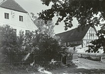
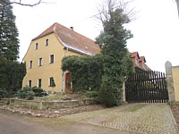
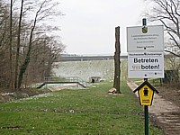

* * *

* * *

Die Region um Kauscha war bereits in der frühen Bronzezeit besiedelt. 1997 wurden bei Ausgrabungen im Vorfeld des Autobahnbaus Gruben mit Keramikscherben und bemerkenswerten Schmuckstücken entdeckt, die der Aunjetitzer Kultur zugeordnet werden und ungefähr 4000 Jahre alt sind. Die genaue Bedeutung dieses Fundes wird noch untersucht. Sicher ist jedoch, das das Gebiet um Kauscha/Nickern zu den ältesten nachgewiesenen Siedelplätzen im Dresdner Raum gehörte. Weitere Funde stammen aus der Zeit um 1200 v. Chr., darunter Keramik, Steinwerkzeuge und das Tongewicht eines Webstuhls. Bereits 1906 hatte man südöstlich des Ortes spätbronzezeitliche Fußringe und eine Sichel geborgen. Nördlich von Kauscha liegt ein Gräberfeld aus der frühen Eisenzeit.

Das 1288 erstmals als Cudeschowe urkundlich erwähnte Dorf Kauscha ist slawischen Ursprungs. Der Name des Rundlings leitet sich wahrscheinlich von einem Lokator ab (Ort des Chudosch). Später wechselte die Bezeichnung über Kudeschowee, Kudischaw und Kaudischow bis zum 1524 erstmals nachweisbaren Kauscha. Zeitweise finden sich auch die Namen Im Caudisch, Kauß, Kauschie und Kudischa in den Urkunden.

Im Mittelalter unterstand der Ort dem Leubnitzer Klosterhof, nach dessen Auflösung den Rittergütern Borthen und Niederlockwitz sowie dem Leubnitzer Amt der Stadt Dresden. Kirchlich gehörte Kauscha zur [Kirche von Leubnitz.](../../sudost/leubnitz-neuostra/leubnitzer_kirche/) Noch 1548 wurde offiziell zwischen dem Dorfkern Großkauscha und dem rechts oberhalb des Geberbachs gelegenen Kleinkauscha unterschieden. Während der Schlacht bei Dresden nahm 1813 der preußische König Friedrich Wilhelm III. sein Hauptquartier in Kauscha, das im Oktober beim Abzug der Franzosen durch Kanonenbeschuss schwer beschädigt wurde. 1875 zählte der Ort zehn Bauerngüter sowie 110 Einwohner. Etwas außerhalb des Ortskerns stand der Gasthof, der zugleich als Dorfschmiede diente. Wegen der geringen Größe gehörtem dem Gemeinderat sämtliche Kauschaer Gutsbesitzer sowie ein Vertreter der "Unangesessenen" an.

Von Bedeutung blieb bis zur Gegenwart die Landwirtschaft sowie der Obstanbau auf den umgebenden Höhenzügen. Außerdem gab es einst einen Kalkofen sowie zwei Granodiorit-Steinbrüche am Hang des Gebergrundes und am Gamig. 1959 wurde der kleine Ort zunächst nach Goppeln eingemeindet und kam mit diesem gemeinsam 1996 zu Bannewitz. Da Kauscha durch den Bau der Autobahn vom übrigen Gemeindegebiet abgetrennt worden wäre, wurde der Ort 1999 ausgegliedert und als Stadtteil nach Dresden eingemeindet. Südlich des Dorfes liegt die Talsperre Kauscha, die Anfang der 1980er Jahre als Hochwasserrückhaltebecken des Geberbaches angelegt wurde. Über den Stausee führt eine Brücke im Zuge der Autobahn A 17 Dresden - Prag, eines der interessantesten Ingenieurbauwerke dieser Strecke. Neben einigen historischen Bauernhäusern ist im Dorfkern eine ca. 100 Jahre alte Stieleiche bemerkenswert, die am 23. April 1898 zu Ehren König Alberts gepflanzt wurde. Der ehemalige Dorfgasthof an der Ecke Kauschauer / Fritz-Meinhardt-Straße dient heute als Wohnhaus und Domizil eines Handwerkerbetriebes.

Talsperre Kauscha:

Die Talsperre Kauscha wurde zwischen 1977 und 1979 angelegt und 1983-1985 nochmals erweitert. Die offizielle Übergabe erfolgte 1985. Hauptsächlich dient die Anlage dem Hochwasserschutz und der Brauchwasserversorgung der Landwirtschaft. Für den Stausee wurde ein Lößlehmdamm errichtet, der den Geberbach anstaut und ca. 0,245 Mio. m³ Stauraum sichert. Außerdem gehören zwei beim Autobahnbau 2005 geschaffene Regenrückhaltebecken zum Stausystem. Über den See verläuft die 228 Meter lange Gebergrundbrücke der Bundesautobahn A 17 Dresden-Prag.

[_Weiterführende Literatur und Quellen_](../../impressum/quellenverzeichnis/)

 \[ [Home](../../index.html)\] \[ [Nord](../../nord/)\] \[ [Nordwest](../../nordwest/)\] \[ [Neustadt](../../neustadt/)\] \[ [Nordost](../../nordost/)\] \[ [West](../../west/)\] \[ [Zentrum](../../zentrum/)\] \[ [Südwest](../../sudwest/)\] \[ [Süd](../../sud/)\]
 \[ [Südost](../../sudost/)\] \[ [Ost](../../ost/)\] \[ [Register](../../Register/register.html)\] \[ [Kontakt](../../Kontakt/kontakt.html)\] \[ [Impressum](../../impressum/)\]
