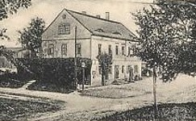

Die Straße Am Hopfenfeld geht im westlichen Teil von Kauscha von der Fritz-Meinhardt-Straße in nördliche Richtung ab. Der Name bezieht sich auf den zu DDR-Zeiten hier betriebenen Hopfenanbau.

Die Straße Am Kirschfeld verbindet die Fritz-Meinhardt-Straße mit einem kleinen Wohngebiet, welches in den 1990er Jahren angelegt und mit Einfamilienhäusern bebaut wurde. 1996 wurde sie noch "Siedlung" genannt, wechselte dann ihren Namen jedoch in Am Kirschfeld, womit an den Obstanbau in der Region erinnert werden soll. Unmittelbar neben der Straße verläuft in einem aus Lärmschutzgründen angelegten Einschnitt der Autobahnzubringer zur A 17.

**_Foto:_** _Blick in die Straße Am Kirschfeld, rechts im Bild der Autobahnzubringer zur A 17_

Die Straße Am Stausee verbinden Kauscha mit dem nahegelegenen Bannewitzer Ortsteil Sobrigau. Bis 1999 wurde sie Kauschaer Straße genannt, bevor im Zusammenhang mit der Eingemeindung Kauschas nach Dresden die Umbenennung in Am Stausee erfolgte. Der Name nimmt Bezug auf die hier gelegene [Talsperre Kauscha](../../../sudost/kauscha/). Unweit des Stausees überquert die Straße die Autobahn A 17 auf einer Brücke.

Kinder- und Jugendbauernhof (Nr. 3): Die Geschichte des Einzelgehöfts oberhalb des Gebergrundes reicht bis ins Mittelalter zurück. Bereits zum Zeitpunkt der Ersterwähnung von Kauscha 1288 war das Gut besiedelt und wurde früher als Kleinkauscha bezeichnet. Vermutlich lag hier eine frühdeutsche Wehranlage aus der Zeit der deutschen Ostkolonisation. Später gab es hier zwei Bauernstellen, von denen eine jedoch unter ungeklärten Umständen wüst fiel. Für den verbliebenen Hof bürgerte sich der volkstümliche Name "Hungerburg" ein. Vermutlich steht dieser im Zusammenhang mit den steinhaltigen und wenig ertragreichen Ackerflächen des Gehöftes.

Im Laufe der Zeit wurde das Anwesen zu einem großen Vierseithof ausgebaut. Herzstück ist das 1895 in heutiger Form gebaute zweistöckige Herrenhaus, welches 1912 nochmals eine Erweiterung erfuhr. Hinzu kamen Ställe und Scheunen. Bis 1959 befand er sich in Privatbesitz und wurde dann Teil der örtlichen LPG. Der schlechte Bauzustand und die mangelnde Ertragsfähigkeit der zugehörigen Felder führten Ende der 1960er Jahre zur Einstellung der Landwirtschaft. Lediglich ein um 1960 erbauter Viehstall wurde noch genutzt. Die Gebäude dienten fortan Wohnzwecken bzw. als Lager- und Werkstätten. 1976 entstand nahe des Gutes eine Kleingartenanlage. Weitere Bauten, u.a. der frühere Pferdestall, das Schlachthaus und ein Wirtschaftsgebäude, verfielen dem Abriss. Im Keller letzteren befand sich bis Mitte der 1980er Jahre eine Champignon-Aufzucht.

Der fortschreitende Verfall und ein Brand Anfang der 1990er Jahre führten zum Leerstand. 1994 übernahm der zwei Jahre zuvor gegründete Verein Kinder- und Jugendbauernhof Nickern e. V. die Ruinen und baute den Hof schrittweise wieder auf. Heute bietet der Verein verschiedene Angebote für die Jugendarbeit, für Kindergeburtstage, Familienfeiern und die Möglichkeit, ländliches Leben kennenzulernen. Dazu werden neben Kleintieren auch Schafe und Pferde gehalten.

Die [Fritz-Meinhardt-Straße](../../../sudost/nickern/strassen_nickern/) verbindet die Dohnaer Straße in Prohlis mit dem Bannewitzer Ortsteil Goppeln und durchquert dabei die Dorfkerne von Nickern und Kauscha. Ihren Namen erhielt sie 1947 nach dem jüdischen Antifaschisten Fritz Meinhardt (1899–1943). Nach 1990 wurde sie zum Autobahnzubringer ausgebaut. Im Zuge der Eingemeindung 1999 wurde diese Bezeichnung auch auf den Kauschaer Straßenabschnitt übertragen. Zuvor hieß dieser Dresdner Straße.

Gasthaus Kauscha: Der Dorfgasthof des kleinen Ortes entstand 1862 etwas außerhalb des Dorfkerns und befand sich an der Straßenkreuzung der heutigen Fritz-Meinhard-Straße (Nr. 134) mit der Kauschaer Straße und der Straße Zur Eiche. Eigentümer war der Besitzer des Winklerschen Gutes (Nr. 2), Gastwirt der Dorfschmied, der in einem Nebengebäude zugleich seine Werkstatt hatte. Das noch erhaltene und nach 1990 sanierte Gebäude _(Foto)_ wird heute als Wohnhaus genutzt und ist Firmensitz einer Schlosserei. Gegenüber des Gasthauses stand noch bis Mitte des 19. Jahrhunderts ein steinernes Sühnekreuz, welches später zerschlagen wurde und als verschollen gilt.

Die Kauschaer Straße verbindet den Dorfkern von [Leubnitz-Neuostra](../../../sudost/leubnitz-neuostra/page14822/) mit dem benachbarten Kauscha und erhielt ihren Namen 1913. Bebaut war diese Straße zunächst jedoch nur in Leubnitz und führte dann weiter als Feldweg bis Kauscha, wo sie in ihrem letzten Teil erneut als Straße ausgebaut ist. Bis 1999 wurde die Bezeichnung auch für die heute den Straßen Zur Eiche und Am Stausee genutzt.

Die kurze Straße Neuer Weg zweigt von der Fritz-Meinhardt-Straße in südliche Richtung ab. Ursprünglich eine Sackgasse führt sie heute bis zur Straße Zur Eiche. Nach 1990 entstanden hier einige Einfamilienhäuser.

Der frühere Dorfplatz des Ortes wird seit der Eingemeindung 1999 Zur Eiche genannt. Um den Platz stehen einige Bauernhöfe aus dem 18. und 19. Jahrhundert. Die Namensgebung nimmt Bezug auf eine mächtige Stieleiche, die am 23. April 1898 von Dorfbewohnern zu Ehren König Alberts gepflanzt wurde. An dieses Ereignis erinnert ein Gedenkstein neben dem Baum mit der Inschrift: " _Zur Erinnerung an den 70. Geburtstag u. 25jähr. Reg. Jubiläum Sr. Majestät des Königs Albert - 23. April 1898"_. Mit ca. 5,10 Meter Stammumfang und einer 35 Meter breiten Krone gehört diese Eiche zu den bedeutendsten Naturdenkmalen im Dresdner Raum. 2000 wurde der seit 1957 unter Naturschutz stehende Baum saniert.

**_Fotos:_** _Der Kauschaer Dorfplatz um 1950 (links - SLUB/Fotothek) und 2018 (rechts)._

_Das mittlerer Bild zeigt den Gutshof Nr. 1_

Größtes der erhaltenen Güter ist der Vierseithof Nr. 2, bestehend aus Wohnhaus, Wohnstallhaus und zwei Seitengebäuden. Der Bauernhof entstand in der ersten Hälfte des 18. Jahrhunderts und wurde in der zweiten Hälfte des 19. Jahrhunderts erneuert. Eigentümer war um 1875 Oskar Winkler, Bruder des Nickerner Rittergutsbesitzers. Neben dem Hauptgut war er im Besitz von zwei weiteren Bauernhöfen im Ort. Zum Winklerschen Gut gehörte auch das etwas abseits des Dorfkerns an der Straße nach Nickern stehendes Gasthaus, welches zugleich Wohnhaus und Werkstatt des Dorfschmiedes war. Nach 1990 wurde das Gehöft als "Gutshof Le Chêne" zur Wohnanlage umgebaut. Zuvor diente es bis Mitte der 1990er Jahre landwirtschaftlichen Zwecken und als Wohnheim.

Bemerkenswert sind ferner die ebenfalls unter Denkmalschutz stehenden Wohnstallhäuser Nr. 6 und 11 mit ihren erhaltenen Toranlagen.

Spieleverlag Rudolf Hengst: Nach 1945 lebte in Kauscha der Verleger Rudolf Hengst, der hier unter dem Markennamen "Henolf" verschiedene Würfel-Brettspiele herausgab. Zu diesen gehörte ein Eisenbahn-Würfelspiel, "Henolfs Verkehrserziehungs-Würfelspiel" und das Würfelspiel "Henolfs Hasenhetzjagd". Die Spielpläne waren auf einfachem Kartonpapier gedruckt, hinzu kamen Würfel und passende Spielfiguren aus Holz. Die Gestaltung der Spiele übernahm der Grafiker Kurt Dietrich aus Dresden, die Herstellung erfolgte in der staatseigenen Landesdruckerei Sachsen.

**_Bilder:_** _Spiele von Rudolf Hengst (1949)_

[Kauscha auf OpenStreetMap](https://www.openstreetmap.org/search?query=Dresden+Kauscha))/spdd.aspx)

* * *

 \[ [Home](../../../index.html)\] \[ [Nord](../../../nord/)\] \[ [Nordwest](../../../nordwest/)\] \[ [Neustadt](../../../neustadt/)\] \[ [Nordost](../../../nordost/)\] \[ [West](../../../west/)\] \[ [Zentrum](../../../zentrum/)\] \[ [Südwest](../../../sudwest/)\] \[ [Süd](../../../sud/)\] \[ [Südost](../../../sudost/)\] \[ [Ost](../../../ost/)\] \[ [Register](../../../Register/register.html)\] \[ [Kontakt](../../../Kontakt/kontakt.html)\] \[ [Impressum](../../../impressum/)\]
