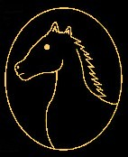
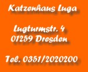
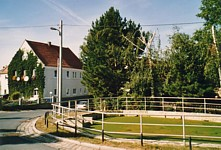
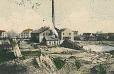
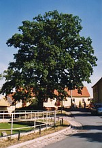
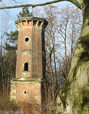
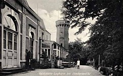
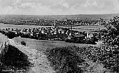
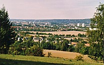

* * *

**Gemeindesiegel von Kleinluga**

* * *

* * *

* * *

Der slawische Rundweiler Kleinluga wurde 1378 erstmals als lug minor urkundlich erwähnt, wobei der Zusatz minor = klein zur Unterscheidung vom benachbarten Großluga diente. Die erste Besiedlung erfolgte jedoch bereits deutlich früher, wie einige nordwestlich des Ortes gemachte Funde aus der mittleren Bronzezeit belegen. Der aus dem altsorbischen abgeleitete Name, 1443 als Lußk, 1481 als Luskaw und 1501 als Lawschke nachweisbar, bedeutet Gras- oder Niederungsort und weist auf die örtlichen Bedingungen hin. Kleinluga gehörte 1378 zum castrum Dresden und war dem Markgrafen von Meißen zinspflichtig.

1445 gehörte das Dorf, welches nur aus einigen wenigen Gütern mit "vier besessenen Mann" bestand, Hans Marschalgk. Auch das Meißner Domstift besaß Zinsrechte in Kleinluga. 1453 übernahm Kurfürst Friedrich der Sanftmütige Teile dieses Dorfes, der es 1471 Hans Munczer zu Lawenstein las Lehen übergab. Im Zusammenhang mit einem erneuten Besitzerwechsel 1501 kam der Ort in den Besitz von Stephan Alnpeck, Rittergutsbesitzer in Lockwitz. Von nun an waren Kleinluga und Lockwitz eng miteinander verbunden. Kirchlich unterstand das Dorf der Parochie Dohna, später der Schlosskirche von Lockwitz. Südlich des Dorfkerns wurde die Flur von der wichtigen Landstraße nach Böhmen berührt, deren früherer Verlauf noch in der [Alten Landstraße](../../sudost/strehlen/strassen_strehlen/dohnaer_strasse/alte_teplitzer_poststrasse/) erhalten blieb. Da diese auch als Heerstraße von Bedeutung war, blieb der Ort von kriegerischen Auseinandersetzungen nicht verschont. 1402 spielte der bei Kleinluga gelegene Straßenübergang über die Malte (Maltengraben) eine strategische Rolle beim Kampf der Markgrafen von Meißen gegen die Burggrafen von Dohna. Im Nordischen Krieg 1706 und zuletzt während der napoleonischen Kriege 1813 war Kleinluga von Kontributionen und Einquartierungen betroffen.

Aufgrund der ungünstigen Lage des Ortes am Hang des Lugberges gab es in der Vergangenheit häufig Probleme mit der Wasserversorgung. Das knappe Nass war mehrfach Streitpunkt zwischen den benachbarten Orten Groß- und Kleinluga, so im Jahr 1572. Um die auf Kleinlugaer Flur liegende Quelle des Hallborns optimal nutzen zu können, errichteten die beiden Dörfer eine hölzerne Röhrfahrt mit zwei Hauptröhren, die am Dorfwassertrog endeten. Kleinere Rohre leiteten das Wasser direkt in die einzelnen Gehöfte. Mit dem Anschluss Kleinlugas an das öffentliche Trinkwassernetz verlor die Quelle an Bedeutung, speist jedoch bis zur Gegenwart den Dorfteich am Teichplatz.

Nachdem der Ort 1839 im Zuge der sächsischen Gemeindeordnung die Rechte einer Landgemeinde erhalten hatte, gehörte Kleinluga ab 1856 zum Gerichtsamt Pirna. In der zweiten Hälfte des 19. Jh. wandelte sich die Bevölkerungsstruktur durch den Zuzug von Arbeitern, die in den drei [Ziegeleien](../../sudost/kleinluga/ziegelei_waschneck/) des Ortes und in der Niedersedlitzer Industrie beschäftigt waren. Von 83 Einwohnern im Jahr 1834 wuchs die Bevölkerung bis 1919 auf über 300 an. Für diese entstanden um 1890 einige neue Mietshäuser an der Steilen Straße.
Trotz einiger baulicher Veränderungen blieb jedoch der Dorfkern um den Teichplatz mit einer am 10. November 1883 von Schülern gepflanzten Luthereiche bis heute erhalten.

Am 1. April 1920 wurden Klein- und Großluga zur Gemeinde Luga vereinigt, die 1922 zu Niedersedlitz kam. Seit 1950 ist auch Kleinluga Stadtteil von Dresden. Einige Siedlungshäuser entstanden ab 1936 zwischen Dohnaer und Lugaer Straße. 1999 wurde der Teichplatz mit seinen historischen Gehöften rekonstruiert. Deutlich ist noch die Form des Rundlings erkennbar, um den sich die Bauerngüter und Häusleranwesen gruppieren. Am Rand des Dorfkerns befindet sich in einem früheren Kleinbauerngehöft seit 1992 das “Katzenhaus” des Tierschutzvereins Dresden e.V. Hier finden herrenlose Katzen ein vorübergehendes oder auch dauerhaftes Domizil und werden an Interessenten abgegeben.

Schule Kleinluga:

Älteste Quellen über das Kleinlugaer Schulwesen stammen aus der Zeit um 1800. Der erste namentlich bekannte Lehrer hieß Näke und unterrichtete die Schüler in Wohnungen im benachbarten Gommern. Sein Nachfolger Stelzer nutzte auch Kleinlugaer Wohnhäuser, so u.a. das Gut Teichplatz 9, wo sich bis heute noch Teile des ältesten Schulhauses erhalten haben. 1813 wurde er von Soldaten aus dem Fenster der Schule gestürzt und fand dabei den Tod. Viele Jahre erinnerte noch eine Gedenktafel an das tragische Ereignis. Später wechselte der Unterricht in das Gasthaus Großluga, bevor 1841 ein neues [Schulhaus](../../sudost/grossluga/) für die Gemeinden Groß- und Kleinluga, Gommern, Wölkau und Meuscha an der Dohnaer Straße errichtet wurde. Heute besuchen die Kinder des Stadtteils die 90. Grundschule in Großluga.

Lugturm und Lugschänke:

Obwohl bereits auf Heidenauer Flur gelegen, wird der 1888 erbaute Lugturm im allgemeinen zu Luga gezählt. Der Aussichtsturm entstand auf Initiative des Niedersedlitzer Sektion des Sächsisch-Böhmischen Gebirgsvereins und war mit seiner benachbarten Gaststätte vor dem Zweiten Weltkrieg ein beliebtes Ausflugsziel. 1938 musste der Turm jedoch wegen Baufälligkeit geschlossen werden. Ein Verkauf des Areals mit dem unter Denkmalschutz stehenden Lugturm ist geplant. Vom 207 Meter hohen Lugberg bietet sich ein schöner Blick bis in die Sächsische Schweiz, zu den Bergen des Erzgebirges und die Dresdner Elbtalhänge.

In unmittelbarer Nähe des Turms gab es früher zwei Gaststätten, das Gasthaus „Lugturm“ und die „Lugschänke“. Der „Lugturm“ _(Foto)_ befand sich im Besitz der Familie Ondorf und wurde noch bis in die Nachkriegszeit als Ausflugs- und Tanzlokal betrieben. Im Volksmund wurde die Gaststätte auch „Die Gage“ genannt. Später übernahm eine Oberlausitzer Textilfirma das Objekt und richtete hier ein Kinderferienlager mit Betriebsferienheim ein. Nach zwei Bränden in den 1970er Jahren musste dieses jedoch geschlossen werden und fiel wenig später dem Abriss zum Opfer.

Die „Lugschänke“, ebenfalls unweit des Lugturms an der Straßenecke Lockwitzer Straße / Grenzstrasse gelegen, gehörte vor 1945 der Familie Streubel. Da die Besitzer dem NS-Regime sehr nahestanden, änderten sie den Namen des Lokals in Anlehnung an Hitlers Privatdomizil in den Alpen in „Berghof Klein München“ um. Nach 1945 schloss das Tanzlokal seine Pforten und wurde fortan als Lehrlingswohnheim des Heidenauer Elbtalwerkes genutzt. Zur Zeit der Militärdiktatur in Griechenland waren dort griechische Emigranten untergebracht, die in dem Betrieb eine Berufsausbildung erhielten. Auch dieses Gasthaus verfiel nach 1990 und musste wegen seines schlechten Bauzustandes abgerissen werden.

**_Foto:_** _Blick vom Lugberg nach Großluga um 1930 und 2003_

[_Weiterführende Literatur und Quellen_](../../impressum/quellenverzeichnis/)

 \[ [Home](../../index.html)\] \[ [Nord](../../nord/)\] \[ [Nordwest](../../nordwest/)\] \[ [Neustadt](../../neustadt/)\] \[ [Nordost](../../nordost/)\] \[ [West](../../west/)\] \[ [Zentrum](../../zentrum/)\] \[ [Südwest](../../sudwest/)\] \[ [Süd](../../sud/)\]
 \[ [Südost](../../sudost/)\] \[ [Ost](../../ost/)\] \[ [Register](../../Register/register.html)\] \[ [Kontakt](../../Kontakt/kontakt.html)\] \[ [Impressum](../../impressum/)\]
