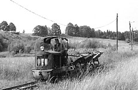
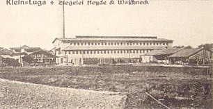

* * *

* * *

Die Ziegelei Waschneck wurde als größte von einst drei Kleinlugaer Ziegeleien 1897 vom Gutsbesitzer Wilhelm August Heyde gegründet. Das Unternehmen bestand aus einem Ringofen, einem Trockenschuppen und mehreren Nebengebäuden. Hinzu kamen die notwendigen technischen Einrichtungen sowie eine zu deren Antrieb benötigte Dampfmaschine. Nach dem Eintritt des Gutsbesitzers Emil Waschneck firmierte das Unternehmen als Heyde & Waschneck Dachsteinfabrik und Dampfziegelei. Produziert wurden sowohl Ton- als auch Dachziegel sowie Hintermauer-und Hartbrandziegel, wobei meist Landarbeiter aus den umliegenden Dörfern Anstellung fanden.

Ab 1916 wurde das Unternehmen nur noch als Dampfziegelei Emil Waschneck bezeichnet. 1918 und 1921 zerstörten Brände einen Großteil des Betriebes, welcher jedoch wenig später seine Produktion wieder aufnehmen konnte. Erstmals kamen nun für den Lehmabbau moderne Bagger zum Einsatz. Der Transport erfolgte über eine bis zur Schließung 1991 in Betrieb befindliche Feldbahn _(Foto)_, die auf ihrem Weg von der Lehmgrube zur Ziegelei die Alte Landstraße unterquerte. Bedingt durch den Beginn des Zweiten Weltkrieges erfolgten auch in Kleinluga Betriebseinschränkungen und ab 1940 eine zeitweise Stilllegung der Ziegelei. Bis zum Ende des Krieges war hier ein Lager der Luftwaffe untergebracht. Am 13. Februar 1945 richtete eine Luftmine erhebliche Schäden an Anlagen und Gebäuden an.

Nachdem mit Unterstützung der sowjetischen Militäradministration die Ziegelei wieder aufgebaut worden war, nahm man 1947 die Herstellung von Nasspresssteinen auf. 1950 erfolgte schließlich der Neubeginn der Ziegelproduktion. Mit Hilfe staatlicher Kredite und der Aufnahme einer staatlichen Beteiligung konnte die Ziegelei Emil Waschneck in den 1950er Jahren nochmals modernisiert werden. 1972 wurde der Betrieb zum VEB umgewandelt und den Sächsischen Ziegelwerken Dresden mit Sitz in Langburkersdorf zugeordnet. Teile der einstigen Lehmgruben dienten zwischen 1973 und 1980 als Hausmülldeponie, später als Deponie für Baustoffe. Als eine der wenigen Dresdner Ziegeleien überstand das Lugaer Werk die Schließungswelle in den 1970er und 80er Jahren und produzierte auch nach 1990 zunächst weiter. 1991 als E. Waschneck GmbH reprivatisiert, übernahm im gleichen Jahr die österreichische Eder GmbH die Leitung. Mangelnde Auslastung führten jedoch drei Jahre später zur endgültigen Produktionseinstellung. Die vorhandenen Gebäude wurden 1999 abgetragen, die markante Esse im Februar 2001 gesprengt. Ab 2018 soll die derzeit stillgelegte Lehmgrube reaktiviert werden. Als Produktionsstandort ist dann das Eder-Ziegelwerk in Freital vorgesehen.

_Foto: die Kleinlugaer Ziegelei Waschneck in den 1930er Jahren_

* * *

 \[ [Home](../../../index.html)\] \[ [Nord](../../../nord/)\] \[ [Nordwest](../../../nordwest/)\] \[ [Neustadt](../../../neustadt/)\] \[ [Nordost](../../../nordost/)\] \[ [West](../../../west/)\] \[ [Zentrum](../../../zentrum/)\] \[ [Südwest](../../../sudwest/)\] \[ [Süd](../../../sud/)\] \[ [Südost](../../../sudost/)\] \[ [Ost](../../../ost/)\] \[ [Register](../../../Register/register.html)\] \[ [Kontakt](../../../Kontakt/kontakt.html)\] \[ [Impressum](../../../impressum/)\]
