* * *

**Gemeindesiegel von Leubnitz**

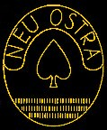

**Gemeindesiegel von Neuostra**

* * *

**Bildungseinrichtungen**

**in Leubnitz-Neuostra**

[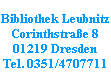](http://www.bibo-dresden.de)

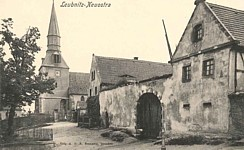Die Fluren von Leubnitz waren spätestens seit dem 11. Jahrhundert dauerhaft
besiedelt, was zur Annahme führt, dass sich hier einst eine frühgeschichtliche Befestigungsanlage befand. Diese hatte ihren Standort vermutlich am Platz des
späteren Klosterhofes (Altleubnitz 12) und war Mittelpunkt eines Burgwardbezirkes, auch wenn urkundliche Belege dazu fehlen. Um diese burgartige Anlage entwickelte sich die slawische Siedlung Leubnitz, welche
1227 erstmals als Lubanitz erwähnt wurde. Der aus dem altsorbischen stammende Ortsname bedeutet “Leute eines Luban” und weist auf den Stammesältesten bzw. Ortsgründer hin. 1233 gehörte der Rundweiler den
Herren von Schönburg, welche ihren Besitz um 1280 Markgraf Heinrich dem Erlauchten verkauften. Dieser überließ
seine Leubnitzer Besitzungen seiner dritten Gemahlin Elisabeth von Maltitz, die als Witwe den Ort 1288 dem Kloster
Altzella bei Nossen schenkte. Unter Regie der Mönche, die in Leubnitz durch einen Hofmeister vertreten waren, wurde
das alte Herrengut in einen landwirtschaftlichen Großbetrieb mit beträchtlichem Landbesitz im Dresdner Raum umgewandelt und fortan als [Klosterhof](../../sudost/leubnitz-neuostra/klosterhof/) bezeichnet. Diesem Gut unterstanden u.a. die Orte Goppeln, Gostritz, Reick,
Strehlen, Torna, Mannewitz und Krebs sowie bestimmte Rechte in zahlreichen weiteren Dörfern. Über den [Zelleschen Weg](../../sud/zschertnitz/strassen_zschertnitz/zellescher_weg/) wurden die Erträge dieser Gutswirtschaft durch Leubnitzer Bauern ins Mutterkloster Altzella abgeführt.

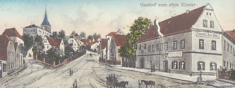

**_Bild:_** _Ansicht vom Leubnitzer Dorfkern in der Mitte des 19. Jahrhunderts._

_Rechts im Bild das “Steinerne Haus” des früheren Klosterhofes._

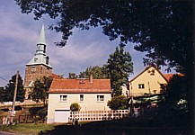Nach Säkularisierung des Klosterhofes 1540 durch Kurfürst Moritz übergab
dieser Leubnitz zehn Jahre später dem Rat der Stadt Dresden, welcher den früheren Besitz als Leubnitzer Amt in die Stadt eingliederte. Zu dieser Schenkung
gehörte das Kirchdorf  “mit allen Äckern, Wiesen, Zinsen, Gerichten, Gebäuden, Gärten und dem Mühlchen”. Damals gab es einer offiziellen Taxierung nach im Ort
21 Bauern, 28 Pferde und 14 Wagen. Bis zur Auflösung des Leubnitzer Amtes am 1. Oktober 1851 blieb der Ort ein der Stadt unterstelltes Bauerndorf, dessen Gehöfte bis heute im Dorfkern [Altleubnitz](../../sudost/leubnitz-neuostra/page14822/altleubnitz/) erhalten blieben. Das einstige Verwaltungsgebäude des Klosterhofes wurde 1572 in eine Schankwirtschaft
umgewandelt. Die Felder und Gärten verpachtete man an Bauern aus Leubnitz und weiteren Orten. Von den Ereignissen
des Dreißigjährigen Krieges und des Siebenjährigen Krieges blieb Leubnitz weitgehend verschont, auch wenn Friedrich
II. von Preußen 1760 für einige Tage im Leubnitzer Pfarrgut Quartier nahm. Schwerer traf es das Dorf 1813, als einige
Gehöfte und das Schulhaus im Zusammenhang mit der Schlacht bei Dresden niederbrannten. Französische Truppen hatten zuvor erfolglos versucht, das von den Preußen besetzte strategisch günstig gelegene Dorf einzunehmen.

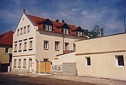1569 entstand auf  Leubnitzer Flur die Siedlung Neuostra. Nach Bildung des
Ostravorwerkes mussten die dort lebenden Bauern der Dörfer [Groß- und Kleinostra](../../zentrum/friedrichstadt/ostra/)
ihren Besitz aufgeben und wurden vom Kurfürsten mit Feldern in Zschertnitz und Leubnitz entschädigt. 11 Bauern mit ihrem Ortsrichter Georg Fehrmann errichteten
mit kurfürstlicher Unterstützung neue Gehöfte an der heutigen Straße [Neuostra](../../sudost/leubnitz-neuostra/page14822/)_(Foto)_
. Nach Abschluss der Umsiedlung am 10. April 1569 wurde dieser Ort zum selbstständigen Dorf erklärt, welches bis zum Ende des 19. Jahrhunderts seine
Eigenständigkeit bewahren konnte. Erst am 1. Juli 1898 vereinigten sich Leubnitz und Neuostra zum Doppelort mit gemeinsamem Gemeinderat. Ein geplanter Anschluss von Torna und Gostritz kam nicht
zustande. Seit dem 1. Juni 1921 gehört Leubnitz-Neuostra als Stadtteil zu Dresden.

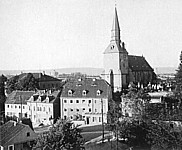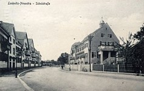

**_Bilder:_** _Blick über den Dorfkern Altleubnitz um 1920 - Schulstraße um 1910 (Heiligenbornstraße)_

Auch nach dem Zusammenschluß konnte der Ort sein dörfliches Bild bewahren. Zu den wenigen gewerblichen
Unternehmen gehörten die Ziegeleien an der Dohnaer Straße und der Friebelstraße sowie die 1900 gegründete [Nahrungsmittelfabrik Dr. Klopfer](../../sudost/strehlen/strassen_strehlen/dohnaer_strasse/). Einige Leubnitzer verdingten sich als Heimarbeiter der Dresdner Zigarettenindustrie,
als Wäscherinnen und Näherinnen. Am 16. November 1902 verkehrte erstmals eine elektrische Straßenbahn zwischen
Dresden und Leubnitz, die jedoch 1974 durch Busse ersetzt wurde. Ein ebenfalls vorgesehener Eisenbahnbau zwischen
Strehlen und Dippoldiswalde über Leubnitz kam nicht zustande. Zu den kommunalen Errungenschaften dieser Zeit gehörten auch ein gemeindeeigenes Wasserwerk, die Einführung der Gasstraßenbeleuchtung, der Ausbau der
Kanalisation und die Befestigung der Straßen des Ortes sowie die Gründung einer Verbandssparkasse mit Kaitz und Gostritz.

Erst nach dem Ersten Weltkrieg erfolgten größere Erweiterungen durch neue Wohnsiedlungen an der Ortsgrenze zu
Torna, am Fuchsberg und der Friebelstraße. 1935 kamen die Siedlungen auf der Leubnitzer Höhe und an der Robert-
Sterl-Straße hinzu. Bereits um 1910 hatte es Planungen für eine Krankenanstalt für geistig Behinderte bzw. einen Start-
und Landeplatz für Luftschiffe auf der Leubnitzer Höhe gegeben. Realisiert wurde jedoch lediglich der Bau der heutigen Wilhelm-Franke-Straße zur Umgehung des alten Ortskerns.

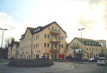Trotz einiger Kriegszerstörungen blieb Leubnitz bis zur Gegenwart in erster Linie
Wohnvorort ohne größere gewerbliche Ansiedlungen. Einige Freiflächen wurden 1976-80 mit Wohnblocks bebaut. Zu den bekannten Wahrzeichen des Ortes gehören die um 1250 entstandene [Dorfkirche](../../sudost/leubnitz-neuostra/leubnitzer_kirche/), die zu den schönsten in Dresden gehört, sowie der sagenumwobene [Heilige Born](../../sudost/leubnitz-neuostra/heiliger_born/), der einst der Wasserversorgung des Klosterhofes und später des Dresdner Schlosses diente. Zahlreiche Gebäude
im Ortskern stehen unter Denkmalschutz. 1992 entstand auf der Leubnitzer Höhe ein moderner Wohnkomplex mit einem Hotel. Im Ortskern folgte kurz darauf das Einkaufszentrum Leubnitz-Passage _(Foto)_
gegenüber dem früheren [Gasthof “Edelweiߔ](../../sudost/leubnitz-neuostra/page14822/edelweiss/).

Schulen in Leubnitz:

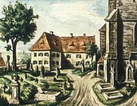Alte Dorfschule: Die Ursprünge des Schulwesens in Leubnitz gehen vermutlich auf den Klosterhof zurück, wo in einem Raum ausgewählte Knaben in Religion, Latein, Lesen und Gesang unterrichtet wurden. Zu diesen gehörten u.a. der spätere Domherr von Meißen Niklas von Prohlis sowie der "Reformationsprediger” Andreas von Prohlis. Eine Dorfschule wurde erstmals im Jahr 1569 erwähnt. Diese befand sich in unmittelbarer Nähe der Kirche auf dem Gelände des heutigen Friedhofs. Da sie die einzige im gesamten Kirchspiel war, besuchten auch die Kinder der Nachbarorte diese Schule. 1813 wurde das Schulhaus bei Kampfhandlungen schwer beschädigt und musste daraufhin fast völlig neu aufgebaut werden. Obwohl 1838 die zuvor zum Leubnitzer Schulbezirk gehörenden Orte Nöthnitz, Rosentitz, Sobrigau, Gaustritz und Golberode ausgegliedert worden waren, machte sich im gleichen Jahr ein Anbau für die gewachsene Kinderzahl erforderlich. Im Erdgeschoss des erweiterten Gebäudes befanden sich die Klassenräume, im Obergeschoss die Wohnung des Lehrers. Nach Fertigstellung des neuen Schulhauses wurde es 1868 abgerissen.

Neue Dorfschule: 1868 erfolgte die Einweihung einer neuen Schule auf der Menzelgasse 2. Neben drei Klassenräumen gab es hier auch drei Wohnungen für die Lehrer. Zusätzlich zur Ausbildung der Kinder übernahm diese Schule ab 1873 auch die vorgeschriebene Fortbildung von Lehrlingen der landwirtschaftlichen und gewerblichen Berufe. In Folge der wachsenden Bevölkerungszahl schieden die Orte Goppeln, Kauscha, Prohlis und Reick 1890 aus dem Leubnitzer Schulverband aus und gründeten eigene Bildungseinrichtungen. 1897 folgte der Nachbarort Gostritz. Bereits 1889 hatte der Prohliser Schloßbesitzer Johann Christian von Kap-herr in einem Tornaer Gut eine Außenstelle der Leubnitzer
Schule eingerichtet. Nach Eröffnung der Schule am Heiligen Grund 1907 wurde die alte Dorfschule geschlossen und dient heute als Kirchgemeindesaal.

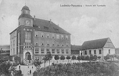68\. Grundschule: Das Gebäude entstand im Ergebnis eines Architektenwettbewerbs, welcher vom ortsansässigen Baumeister Moritz Adolf Rietschel gewonnen wurde. Nachdem die Gemeinde 1904 ein Grundstück am Eingang zum Heiligen Grund erworben hatte, konnte am 21. Mai 1906 die Grundsteinlegung erfolgen. Bereits ein knappes Jahr später, am 15. April 1907 wurde die neue Leubnitzer Schule eingeweiht. Das Schulhaus erhielt neben neun Klassenräumen eine Aula, Wohnungen für Direktor und Hausmeister sowie eine Turnhalle. Die unsymmetrische Lage des Uhrturmes zum Hauptgebäude weist auf nicht realisierte Pläne hin, das Gebäude bei Bedarf erweitern zu können.

Über dem Haupteingang erinnern die Worte “Lerne Weisheit, übe Tugend” an die Weiherede des Königlichen Bezirksschuldirektors Schmidt am Eröffnungstag. Auch am Giebel der Turnhalle hat sich ein historisches Zeugnis der Entstehungszeit erhalten. Das sogenannte “Turnerkreuz” mit den vier Initialien “F” (“Frisch, Fromm, Fröhlich, Frei”) geht auf den deutschen Turnvater Jahn zurück, wurde wegen Missbrauchs durch die Nationalsozialisten aber an vielen anderen Orten nach 1945 entfernt.

Zwischen 1935 und 1954 hatte in der Schule auch die Leubnitzer Heimatstube ihren Sitz. Heute wird das Haus von der 68. Grundschule “Am Heiligen Born” genutzt. Auf dem Gelände erinnert ein Gedenkstein an den früheren Leubnitzer Lehrer und antifaschistischen Widerstandskämpfer Wilhelm Franke.

116\. Oberschule:  Diese Schule wurde 1979 im Zuge eines Neubaugebietes an der Feuerbachstraße eröffnet und trug bis 1990 den Namen 116. POS “Rudolf Bergander”. Heute dient sie als 116. Oberschule für Leubnitz und Umgebung.

130\. Oberschule: Ein weiteres Schulhaus folgte 1986 mit der 130. POS auf der Karl-Laux-Straße. 2001 wurde diese wegen sinkender Schülerzahlen wieder geschlossen. Das Gebäude wird heute als Schule für Erziehungshilfe zur Betreung von Kindern mit sozialen und emotionalen Problemen genutzt und trägt seit 2010 den Namen “Am Leubnitzbach”.

Strick- und Nähschule: Seit 1874 besaß Leubnitz auch eine Strick- und Nähschule, die unter Schirmherrschaft von
Königin Carola stand und junge Mädchen in Handarbeiten unterrichtete. Während die meisten Schülerinnen Schulgeld
bezahlen mussten, existierten auch 24 Freistellen für ärmere Kinder. Nach dem Tod der Königin wurde die Einrichtung
von der Königin-Carola-Gedächtnis-Stiftung finanziert. Seit 1907 gehörte die Nähschule zur Leubnitzer Volksschule und wurde erst 1921 aufgelöst.

## [Leubnitzer Straßen](../../sudost/leubnitz-neuostra/page14822/)

[_Weiterführende Literatur und Quellen_](../../impressum/quellenverzeichnis/)

 \[ [Home](../../index.html)\] \[ [Nord](../../nord/)\] \[ [Nordwest](../../nordwest/)\] \[ [Neustadt](../../neustadt/)\] \[ [Nordost](../../nordost/)\] \[ [West](../../west/)\] \[ [Zentrum](../../zentrum/)\] \[ [Südwest](../../sudwest/)\] \[ [Süd](../../sud/)\]
 \[ [Südost](../../sudost/)\] \[ [Ost](../../ost/)\] \[ [Register](../../Register/register.html)\] \[ [Kontakt](../../Kontakt/kontakt.html)\] \[ [Impressum](../../impressum/)\]
