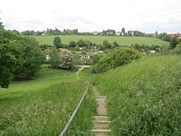
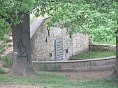
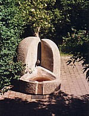

* * *

**_Die Sage vom_**

**_Heiligen Born:_**

_Im 30-jährigen Kriege hauste hier eine Quell- nixe, die jeden, der das_
_Wasser zu  verunreini- gen suchte, der Gewalt böser Geister  über- lieferte. Dagegen ver- wandelte sie frommen Leuten das in der Johannisnacht in der zwölften Stunde ge- schöpfte Wasser in Wein und_
_verlieh dem in der Karfreitagnacht hier geholten Wasser die Kraft, diejenigen, die sich damit wuschen, vor der Pest zu bewahren._

Zwischen dem Altleubnitzer Dorfkern und der Wohnsiedlung am Fuchsberg erstreckt sich das Tal des Heiligenbornbaches, eines von zahlreichen kleineren Gewässern im südlichen Stadtrandgebiet. Hier befindet sich die Quelle des legendenumwobenen “Heiligen Borns”. Dieser soll bereits in vorchristlicher Zeit Teil einer Kultstätte gewesen sein. Später wurde sein Wasser, welches auch in strengen Wintern nicht gefriert, vom Klosterhof genutzt. Im 12. Jahrhundert errichteten die Mönche in unmittelbarer Nachbarschaft der Quelle eine kleine Kapelle, die vermutlich bis zur Reformation bestand und bei der Bekehrung der einst hier ansässigen Slawen zum Christentum eine Rolle gespielt haben dürfte. Der Überlieferung nach war der Brunnen bis zur Reformation Ziel von Wallfahrten, da man seinem klaren Wasser Heilkräfte zusprach.

1551 ließ eine Dresdner Gewerkschaft mit Unterstützung des Kurfürsten eine hölzerne Röhrleitung in die Stadt legen, die noch bis 1939 die Brunnen im Schlosshof speiste. Auch das “Fraumutterhaus”, das Zeughaus und weitere Gebäude im Stadtzentrum wurden über diese Leitung versorgt, bevor sie im Siebenjährigen Krieg 1756-63 zerstört wurde. Auf Wunsch der Hausbesitzer und mit finanzieller Beteiligung der Kurfürstlichen Kammer erfolgte bis 1776 die Reparatur der Röhrfahrt. Nach alten Urkunden lieferte diese pro Minute 310 Kannen qualitativ hochwertigen Trinkwassers. 1875 wurde die Wasserleitung nochmals erneuert und in Gusseisen ausgeführt. Dabei entdeckte man die Fundamente eines mittelalterlichen Badebassins. Als einzige Gemeinde durfte Neuostra Quellwasser aus dem Heiligen Born entnehmen, wofür im Ort ein noch heute erhaltener Steintrog aufgestellt wurde (Neuostra Nr. 20).

Die heutige Quellfassung des Heiligen Borns entstand 1835 und wurde mehrfach umgestaltet _(Foto rechts)_. Zuvor war die Quelle von einer Bruchsteinmauer umgeben, die ein rechteckiges Wasserbecken schützte. Ca. 400 Meter unterhalb davon befindet sich ein zweiter, künstlerisch gestalteter kleiner Brunnen _(Foto links)_. Dieser stammt von 1992 und wurde von der Bildhauerin Petra Graupner geschaffen. Leider wurde die kleine Plastik, die einen wasserspeienden Fisch zeigt, schon kurze Zeit später gestohlen. Später tauchte sie überraschend wieder auf und ist heute wieder am ursprünglichen Ort zu sehen. Obwohl das Wasser keine Heilwirkung besitzt, nutzen noch heute einige Leubnitzer den Brunnen zum Wasserholen. Pro Minute strömen ungefähr 20 Liter ans Tageslicht.

Unweit des Brunnenbeckens stand noch bis 1874 das heute verschollene Sühnekreuz “Untere Marter”. Der durch den Grund führende Fahrweg in Richtung Bannewitz sollte 1908 zur Straße ausgebaut werden, was jedoch unterblieb. Auch eine in diesem Zusammenhang geplante Bogenbrücke zur Verbindung von Friebelstraße und Leubnitzer Höhe wurde nicht realisiert. Die Flächen zu beiden Seiten des Talweges nutzte noch bis zum Ersten Weltkrieg eine Ziegelei als Lehmgrube. Ab 1919 entstanden hier Kleingärten. In der Nähe eines aufgelassenen Steinbruchs führt seit 1937 eine Treppenanlage hinauf zur Leubnitzer Höhe. Um die Hochwassergefahr zu vermindern, wurde 1955 im Grund des Heiligenbornbachs ein Rückhaltebecken angelegt.

* * *

 \[ [Nord](../../../nord/)\] \[ [Nordwest](../../../nordwest/)\] \[ [Neustadt](../../../neustadt/)\] \[ [Nordost](../../../nordost/)\]
 \[ [West](../../../west/)\] \[ [Zentrum](../../../zentrum/)\] \[ [Südwest](../../../sudwest/)\] \[ [Süd](../../../sud/)\] \[ [Südost](../../../sudost/)\] \[ [Ost](../../../ost/)\] \[ [Register](../../../Register/register.html)\] \[ [Kontakt](../../../Kontakt/kontakt.html)\] \[ [Impressum](../../../impressum/)\]
