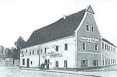
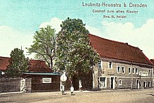
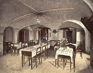
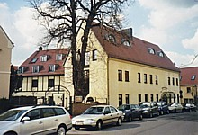

* * *

* * *

* * *

* * *

* * *

* * *

Der Klosterhof Leubnitz geht auf ein altes Herrengut zurück, welches
ursprünglich der Familie von Schönburg gehörte. Um 1280 kam dieses Allodialgut gemeinsam mit dem benachbarten Dorf Goppeln  in den Besitz des Markgrafen Heinrich den Erlauchten. Seine Witwe Elisabeth von Maltitz
überließ 1288 das Vorwerk Leubnitz mit Kirche und Gerichtsbarkeit dem Zisterzienserkloster Altzella bei Nossen. Unter klösterlicher Herrschaft wurde der Leubnitzer Hof zum Klostergut umgewandelt und zu einer
landwirtschaftlichen Großwirtschaft ausgebaut. Obwohl die eigentliche Klosterhofflur nur ca. 130 Hektar in Leubnitz, Torna und Strehlen umfasste,
entwickelte sich dieses Gut zum bedeutendsten landwirtschaftlichen Unternehmen im Dresdner Raum. U.a. gehörten die
Orte Goppeln, Gostritz, Praschütz, Reick, Strehlen, Torna, Mannewitz und Krebs bei Pirna vollständig dem Klostergut; hinzu kamen Besitzungen in Gompitz, Kauscha, Prohlis und Kleinzschachwitz.

Der Klosterhof selbst, der von einem Hofmeister geleitet wurde, beschäftigte bis zu seiner Auflösung nur wenige Arbeitskräfte. Ein Großteil der Arbeiten, zu denen neben der Bestellung der Felder auch
der Obstanbau und die Fischzucht gehörten, musste von den Bauern der umliegenden Dörfer in Fronarbeit erledigt werden. Die Erträge wurden
über den Zelleschen Weg abtransportiert, wobei man eine Berührung des Dresdner Weichbildes vermied, um keine Abgaben leisten zu müssen. Teile dieses Weges sind heute noch im [Zelleschen Weg](../../../sud/zschertnitz/strassen_zschertnitz/zellescher_weg/) in Zschertnitz und der [Altenzeller Straße](../../../zentrum/sudvorstadt/strassen_sudvorstadt/altenzeller_strasse/) in der Südvorstadt erhalten geblieben.

Mittelpunkt des Leubnitzer Klosterhofes war das “Steinerne Haus” Altleubnitz Nr. 12 _(Abbildung)_, welches bereits im Mittelalter mit Dachziegeln gedeckt war und Arbeits- und Verwaltungsräume des Hofmeisters beherbergte. Im Obergeschoss befand sich die Gerichtsstube für Verhandlungen von Streitfällen.
Die Keller waren einbruchsicher ausgebaut und wurden als Depot für Akten und Wertsachen genutzt. Unweit davon lagen zwei Teiche zur Fischzucht, an die heute
noch die Namen Klosterteichplatz und Schilfteichstraße erinnern. Außerdem gehörten Ställe und Scheunen, Mühle und sogar eine Badestube zum Klosterhof.
Den klösterlichen Regeln entsprechend fanden hier auch Reisende Aufnahme und Logis.

1540 wurde der Klosterhof säkularisiert und zehn Jahre später von Kurfürst Moritz an die Stadt Dresden übergeben. Anlass war eine vereinbarte Entschädigung der Stadt für
ihre Aufwendungen beim Ausbau der Festungsanlagen. Als Leubnitzer Amt unterstanden die früheren Klosterfluren nun dem Rat der Stadt, der zugleich die Lehn-
und Gerichtsbarkeit besaß. Im Gegensatz zu vielen anderen Dörfern gehörten auch die Blut- oder Halsgerichte dazu, die die Verhängung von Todesurteilen ermöglichten.
Noch bis um 1820 befand sich am Ortsausgang nach Goppeln der Leubnitzer Galgen. Nach Übernahme des Klosterhofes wurde das Gut aufgelöst und seine Fluren an
ortsansässige und zugezogene Bauern abgegeben. Weitere Bauernhöfe kamen 1569 hinzu, als die Bauern des [Ostravorwerkes](../../../zentrum/friedrichstadt/ostra/) hier die Siedlung Neuostra gründeten. Eigens für diesen Zweck hatte der
Kurfürst einen Teil der Klosterhofflur zurückgekauft, um ihn als Entschädigung an die Bauern abgeben zu können.

Das frühere Hauptgebäude des Klostergutes wurde 1572 in eine Schankwirtschaft
umgewandelt, die noch bis nach dem Zweiten Weltkrieg bestand. Anfangs durfte hier nur zu bestimmten festgelegten Zeiten gezecht und ausschließlich Dresdner Bier
ausgeschenkt werden. Die Schankstube befand sich ursprünglich im Obergeschoss des Gebäudes und war nur über eine hölzerne Außentreppe erreichbar. Erst 1829
erfolgte nach einigen Umbauten der Ausbau des Erdgeschosses zur Gastwirtschaft. 1895 erhielt das Gebäude in einem früher als Viehstall genutzten Seitenflügel einen
von den Einheimischen gern besuchten Tanzsaal. Um 1900 entstand schließlich noch ein Ladenlokal in der ehemaligen Durchfahrt, welchem das frühere
Eingangstor zum Opfer fiel. Trotz Protesten der Denkmalpflege und vieler heimatverbundener Bürger wurde das
“Steinerne Haus” 1972 wegen Baufälligkeit abgerissen. 1997 konnte an gleicher Stelle ein weitgehend originalgetreuer Wiederaufbau als Hotel und Restaurant “Klosterhof” eröffnet werden _(Foto)_.

* * *

 \[ [Home](../../../index.html)\] \[ [Nord](../../../nord/)\] \[ [Nordwest](../../../nordwest/)\] \[ [Neustadt](../../../neustadt/)\] \[ [Nordost](../../../nordost/)\] \[ [West](../../../west/)\] \[ [Zentrum](../../../zentrum/)\] \[ [Südwest](../../../sudwest/)\] \[ [Süd](../../../sud/)\] \[ [Südost](../../../sudost/)\] \[ [Ost](../../../ost/)\] \[ [Register](../../../Register/register.html)\] \[ [Kontakt](../../../Kontakt/kontakt.html)\] \[ [Impressum](../../../impressum/)\]
