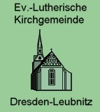
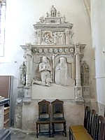
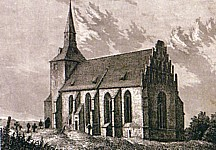
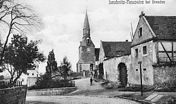
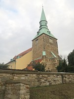
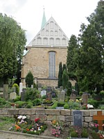
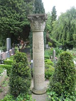
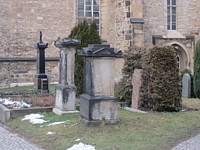
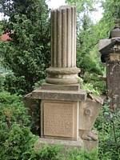
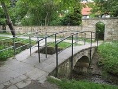

* * *

* * *

* * *

* * *

* * *

* * *

* * *

Epitaph von Hans Alnpeck dem Jüngeren aus dem Jahr 1580

(Foto: Wikipedia / Paulae)

Leubnitzer Kirche:

Die Leubnitzer Kirche, deren genaues Ursprungsjahr nicht bekannt ist, entstand vermutlich um 1150 und gehört zu den schönsten Dorfkirchen in Dresden. Zunächst als Dorfkirche genutzt, kam sie am 28. März 1318 durch Übereignung des Bischofs von Meißen an das Kloster Altzella und bildete das religiöse Zentrum des umfangreichen [Klosterhofbesitzes](../../../sudost/leubnitz-neuostra/klosterhof/). Der Turm entstand in seinen Grundzügen bereits im 12. Jahrhundert, Kirchenschiff und Sakristei in der ersten Hälfte des 15. Jahrhunderts. Der Chor stammt von 1511. 1437 konnte ein neuer Altar zu Ehren der Jungfrau Maria und des Heiligen Andreas eingeweiht werden. Der Kirchturm geht vermutlich auf einen Wehrturm zurück und besitzt über 1,40 Meter dicke Mauern. Der einstige Zugang befand sich in über fünf Metern Höhe und konnte so gut verteidigt werden. Ein sagenhafter unterirdischer Gang zwischen Kirche und Klosterhof gehört jedoch ins Reich der Legende.

Im Zuge der Reformation 1539/40 wurde der Klosterhof aufgehoben und die Kirche in ein evangelisches Gotteshaus ungewandelt. Erster Pfarrer war der frühere Hofmeister Mathias Steinmetz. Da Leubnitz nun dem Rat der Stadt Dresden unterstand, bekam die Kirche eine nur selten genutzte Patronatsloge der Ratsherren, die man später wieder entfernte. Mehrfach wurde die Leubnitzer Kirche umgebaut und erweitert und erhielt 1671/72 die sehenswerte Kassettendecke mit Malereien von Gottfried Lucas. Die Felder zeigen biblische Szenen und bilden mit der ebenfalls bemalten Empore ein interessantes Zeugnis der Innenarchitektur ihrer Zeit. Die Finanzierung der kostspieligen Umbauten übernahm zum Großteil der Dresdner Rat, nicht zuletzt um einige weitere Dörfer von der baufälligen Frauenkirche zur Leubnitzer Kirche auspfarren zu können. Bei der jüngsten Restaurierung zwischen 1999 und 2003 entdeckte man drei weitere, später übermalte Bilder von Lucas. 1681 wurden im Turm zwei Bronzeglocken des Dresdner Stück- und Glockengießers Andreas Herold aufgehängt. Die ältere Glocke aus dem Jahr 1510 zersprang 1839 beim Läuten und musste daraufhin neu gegossen werden.

Ein weiterer Umbau des Gotteshauses folgte zwischen 1705 und 1721, wobei die Kirche deutlich vergrößert wurde und neue Emporen und Herrschaftslogen sowie die dem Turm vorgelagerte Brauthalle erhielt. Diese Arbeiten erfolgten unter Mithilfe des Oberlandbaumeisters Johann Friedrich Karcher, dessen Grab sich auch in der Kirche befindet. 1731 wurde ein von Johannes Bernhard Reinboth und Johann Christian Ebhardt geschaffener barocker Altar aufgestellt. 1755/63 erhielt die Kirche eine Orgel des Silbermann-Schülers David Schubert. Zum Leubnitzer Kirchspiel gehörten ursprünglich die umliegenden Orte Eutschütz, Gaustritz, Golberode, Goppeln, Gostritz, Kaitz, Kauscha, Räcknitz, Prohlis, Reick, Sobrigau und Torna, ab 1855 auch Mockritz.

1874 fiel der markante Staffelgiebel am Chor, der auf vielen alten Darstellungen noch zu sehen ist, einer Erneuerung des Bauwerks zum Opfer. Auch ein hier befindliches Sandsteinrelief mit Darstellung der Gethsemane-Szene, welches vermutlich aus dem Kloster Altzella stammte, wurde dabei beseitigt. Zugleich modernisierte man die zuvor noch gotischen Fenster und verlegte den Haupteingang. Bis zu diesem Umbau gab es zudem im Dach eine von außen mit einer Leiter erreichbare Tür, um im Brandfall schnell auf den Dachboden gelangen zu können. Eine weitere Öffnung in der Nähe soll der Sage nach vom Teufel immer wieder geöffnet worden sein, um auf diesem Wege Bräute, die keine Jungfrau mehr waren, holen zu können. Sehenswert sind im Inneren der Kirche einige Grabsteine der Familie von Alnpeck, Besitzer des Rittergutes Lockwitz, die Nöthnitzer Betstube, einstige Patronatsloge der Schlossherren von Nöthnitz, sowie der barocke Sandsteinepitaph Karchers hinter der Kanzel. Diese stammt noch aus vorreformatorischer Zeit und trägt die Jahreszahl 1511.

Zu den häufigen Besuchern der Leubnitzer Kirche gehörte der Archäologe und Altertumsforscher Johann Joachim Winckelmann, der als Bibliothekar in Nöthnitz angestellt war und mit der Leubnitzer Pfarrersfamilie befreundet war. Zwischen 22. und 29. Juli 1760 übernachtete Preußenkönig Friedrich II. im Pfarrgut, bevor er mit seinen Soldaten weiter nach Schlesien zog. Der Legende nach sollen sächsische Ulanen in diesen Tagen erfolglos versucht haben, Friedrich II. hier gefangen zu nehmen.

Friedhof:

Der alte Kirchhof von Leubnitz wurde zeitgleich mit dem Bau der ersten Kirche angelegt und war Begräbnisplatz der Bewohner des gesamten Kirchspiels. 1760 erfolgte nach Ankauf eines privaten Grundstücks die erste Erweiterung dieses Friedhofs. Vor allem in unmittelbarer Nähe der Kirche sind noch zahlreiche historische Grabsteine erhalten geblieben. Bekannteste Persönlichkeit ist der aus Prohlis stammende Bauernastronom Johann Georg Palitzsch, der hier 1788 seine letzte Ruhe fand. Sein Grab wird von einer abgebrochenen Säule markiert und wurde mehrfach erneuert. In einer abgeschiedenen Ecke an der Friedhofsmauer befand sich früher die “Selbstmörderecke”, da diesen ein christliches Begräbnis verweigert wurde.

Mit wachsender Einwohnerzahl wurde der Friedhof mehrfach in Richtung Heiligenbornbach erweitert, zuletzt kurz nach 1945 durch Aufschüttung der sogenannten "Froschwiese" am Leubnitzbach. Pläne aus den 1920er Jahren, auf der Leubnitzer Höhe in der Nähe des Gamighübels einen gemeinsamen neuen Begräbnisplatz für Leubnitz, Nöthnitz, Rosentitz, Mockritz und Gostritz anzulegen, kamen aus finanziellen Gründen nicht zu Stande. Im Erweiterungsteil ruhen u. a. der frühere Rektor der TU Max Pommer (+ 1993), der Mathematikprofessor Friedrich Adolph Willers (+ 1959), der Bildhauer Edmund Moeller (+ 1958), der Maler Bernhard Kretzschmar (+ 1972) und der Rennfahrer Uli Melkus (+ 1990). Am 14. Mai 1945 wurde auch der bekannte Dresdner Arzt Dr. Rainer Fetscher auf dem Leubnitzer Friedhof beigesetzt, der beim Versuch der kampflosen Übergabe der Stadt am 8. Mai 1945 auf der Prager Straße erschossen wurde. Fetschers Grab, seit 1949 als Ehrengrab unter die Obhut der Stadt Dresden gestellt, wurde 1970 in die Ehrengrabanlage des Heidefriedhofs umgesetzt. Weitere Grabstätten erinnern an Opfer des Zweiten Weltkrieges und des Nationalsozialismus, u.a. an den 1942 im KZ Dachau umgekommenen Pfarrer Paul Richter sowie mehrere Wehrmachtsangehörige. Ein Sammelgrab mit einem 2004 aufgestellten Steinkreuz mahnt an die hier beigesetzten Luftkriegstoten der Bombenangriffe von 1945.

**_Bilder:_** _Grab von Max Rose (links) - alter Kirchhof (Mitte) - Grab von Johann Georg Palitzsch (rechts)_

Engels- und Teufelsbrücke: Nach Verlassen des Friedhofes durch den Nordausgang erreicht man schon nach wenigen Schritten den Heiligenbornbach am Heydenreichweg. Originell sind zwei kurze Brücken über den Bach, welche Engels- und Teufelsbrücke genannt werden. Diese Brücken nutzten viele Leubnitzer früher als Weg zur Kirche. Die aus einem einzigen Sandsteinblock bestehende Teufelsbrücke gilt als “kürzeste Brücke Dresdens”. Früher wurden sie als Pastoren- und Plattenbrücke bezeichnet.

* * *

 \[ [Home](../../../index.html)\] \[ [Nord](../../../nord/)\] \[ [Nordwest](../../../nordwest/)\] \[ [Neustadt](../../../neustadt/)\] \[ [Nordost](../../../nordost/)\] \[ [West](../../../west/)\] \[ [Zentrum](../../../zentrum/)\] \[ [Südwest](../../../sudwest/)\] \[ [Süd](../../../sud/)\] \[ [Südost](../../../sudost/)\] \[ [Ost](../../../ost/)\] \[ [Register](../../../Register/register.html)\] \[ [Kontakt](../../../Kontakt/kontakt.html)\] \[ [Impressum](../../../impressum/)\]
