* * *

Der A-Weg entstand in den 1920er Jahren zur Erschließung eines Wohnviertels auf der Leubnitzer Höhe und ist 1921 erstmals
als Weg A im Adressbuch verzeichnet. Ursprünglich handelte es sich nur um die Bezeichnung einer Planstraße, welche jedoch später beibehalten und amtlich in A-Weg geändert wurde.

Die Alfred-Reucker-Straße, eine kurze Nebenstraße im Neubaugebiet südlich der Dohnaer Straße, wurde am 3. Juni 1994
nach dem früheren Generalintendanten der Sächsischen Staatsoper Prof. Dr. Alfred Reucker (1868-1958) benannt. Reucker hatte das Amt 1921 übernommen und wurde 1933 im Zusammenhang mit dem Skandal um Fritz Busch von den Nazis aus dem
Amt vertrieben. Bis zu seinem Tod wohnte er in Leubnitz-Neuostra auf der Spitzwegstraße 60. Da sowohl der Ausbau der
Planstraße als auch deren Bebauung nicht realisiert wurden, erfolgte am 9. Dezember 2002 der Einzug der Straße sowie die Aufhebung des Straßennamens.

Die Straße Am Dachsberg entstand  Ende der 1920er Jahre im Zusammenhang mit dem Bau einer Kleinhaussiedlung. Ihren Namen erhielt sie 1929 nach einer Flurbezeichnung.

Die Straße Am Eigenheimweg ist 1914 erstmals in den Adressbüchern verzeichnet. Sie entstand um 1910 zur Erschließung der
sogenannten Süd-Ost-Kolonie, einem Leubnitzer Wohngebiet an der heutigen Wilhelm-Franke-Straße. Auch die benachbarte Straße Am Elbtalweg  wurde in diesem Zusammenhang angelegt.

Das Gebiet am Leubnitzer Fuchsberg war bereits im 11. Jahrhundert besiedelt und ist der vermutete Standort einer slawischen
Wallanlage, von der bislang jedoch keine Spuren gefunden wurden. Diese Burg war Ausgangspunkt der Besiedlung der
Leubnitzer Flur. Um 1930 entstand an der Straße Am Fuchsberg eine einheitlich gestaltete Kleinhaussiedlung zwischen Heiligem
Grund und Friebelstraße. Bauherr war die Siedlungsgemeinschaft Festbesoldeter, der vorrangig Beamte und Lehrer angehörten.

Die Straße Am Hofefeld ist erstmals im Jahr 1900 im Adressbuch von Leubnitz-Neuostra verzeichnet und hieß damals nach
ihrer Lage Südstraße. 1926 erfolgte die Umbenennung in Am Hofefeld.

Die schmale Gasse verbindet Altleubnitz mit dem benachbarten Neuostra und wurde früher Klostergasse genannt. Hier befand sich bis zur Reformation das ”Steinerne Haus” des Leubnitzer [Klosterhofes](../../../sudost/leubnitz-neuostra/klosterhof/), aus dem 1572 der Gasthof “Klosterschänke”
hervorging. Nach Abriss des historischen Gebäudes 1972 wurde in Anlehnung an das frühere Aussehen 1994 ein modernes Hotel gleichen Namens eröffnet.

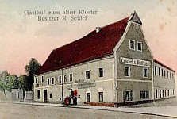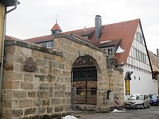

**_Bilder:_** _Historischer Klosterhof - Hofeinfahrt zum Gehöft Am Klosterhof 7_

Die Straße Am Pfaffenberg, benannt nach einem Leubnitzer Flurnamen, wurde im Zusammenhang mit dem Bau einer neuen
Wohnsiedlung auf der Leubnitzer Höhe angelegt. Zwischen 1999 und 2007 entstanden hier insgesamt 55 Reihen- und Doppelhäuser sowie 15 Einfamilienhäuser.

Die Straße Am Querweg entstand als Querverbindung zwischen der Thomas-Mann-Straße und der Straße An der
Kirschwiese. Erstmals ist sie im Adressbuch von 1914 verzeichnet. Die Gebäude gehören zum ab 1910 entstandenen Wohngebiet Süd-Ost-Kolonie.

Die Straße An der Kirschwiese verdankt ihren Namen einer alten Flurbezeichnung. Sie entstand 1910 beim Bau der
sogenannten „Süd-Ost-Kolonie“ und ist 1913 erstmals im Adressbuch verzeichnet. Architektonisch interessant ist das 1931
errichtete Wohnhaus Nr. 8. Das schlichte kubusformige Gebäude mit einem ortsuntypischen Flachdach entstand im Stil des Dessauer Bauhauses und wurde vom Architekten Franz Wirth entworfen.

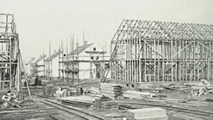Die Bärenklauser Straße wurde 1930 erstmals im Adressbuch erwähnt und erhielt
ihren Namen nach der kleinen Siedlung Bärenklause, der seit 1994 als Ortsteil zu Kreischa gehört. Das Rittergut Bärenklause befand sich ab 1929 im Besitz des Wirtes der Dresdner Bärenschänke auf der Webergasse, der es zur Erzeugung
von Frischwaren für sein Restaurant nutzte. Die Holzhäuser der Bärenklauser Straße entstanden Ende der 1920er/Anfang der 1930 Jahre für den Deutschen Siedlerbund _(Foto)_. Architekt der Gebäude war Eugen Schwemmle, die
Bauausführung übernahm die die Firma Christoph & Unmack aus Niesky.

Die Brunnenstraße entstand kurz vor dem Ersten Weltkrieg und ist 1914 erstmals im Adressbuch verzeichnet. Ihren Namen erhielt sie nach der nahegelegenen Quelle des [Heiligen Borns](../../../sudost/leubnitz-neuostra/heiliger_born/).

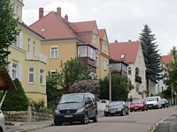

**_Foto:_** _Blick in die Brunnenstraße_

Die Burgstädteler Straße wurde Ende der 1990er Jahre als Seitenstraße der Goppelner Straße angelegt und nach dem kleinen
Ort Burgstädtel bei Dohna benannt. Wahrzeichen des Dorfes ist die als Naturdenkmal unter Schutz stehende Burgstädteler Linde.

Die in den Zwanziger Jahren angelegte Clausen-Dahl-Straße erinnert an den norwegischen Maler Johann Christian Clausen Dahl
(1788-1857), der ab 1818 in Dresden lebte und zum Freundeskreis um Caspar David Friedrich gehörte. Dahl, ab 1824
Professor an der Kunstakademie, schuf neben zahlreichen Naturdarstellungen auch einige Stadtansichten von Dresden. 1976/80
wurde das zuvor gärtnerisch genutzte Gelände an der Clausen-Dahl-Straße mit Neubaublocks bebaut und die ursprünglich ringförmige Straße dadurch unterbrochen.

Die in den Zwanziger Jahren angelegte Straße erhielt ihren Namen nach dem impressionistischen deutschen Maler und Graphiker Lovis Corinth (1858-1925). Die ersten Wohnhäuser entstanden 1928/29 im Bereich Teplitzer Straße für die Heimstättengesellschaft Sachsen (Nr. 1-5). 1976-1980 wurden die verbliebenen Freiflächen mit Neubaublocks bebaut.

Die Feuerbachstraße wurde Anfang der Dreißiger Jahre im Zuge des Wohngebietes Teplitzer Straße angelegt. 1935 wurde sie
nach dem Maler Anselm Feuerbach (1829-1880) Feuerbachstraße genannt. Feuerbach schuf vor allem antike Szenen und Porträts im neoklassizistischen Stil.

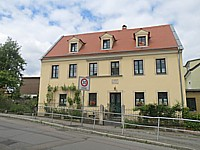Die Friebelstraße verbindet Leubnitz mit dem Nachbarort [Gostritz](../../../sudost/gostritz/strassen_gostritz/) und wurde deshalb früher Gostritzer Weg genannt. 1897 ist sie im Leubnitzer Adressbuch als Gostritzer Straße verzeichnet. Ihren jetzigen Namen erhielt sie nach der Vereinigung von Leubnitz und Neuostra nach dem früheren Leubnitzer Ortsrichter und Gemeindevorstand August Friebel (1828–1900).

Noch bis zum Ersten Weltkrieg war dieses Gebiet kaum bebaut und Standort einer von insgesamt vier Leubnitzer Ziegeleien. 1817 war hier der erste artesische Brunnen Sachsens abgeteuft worden, dessen Wasser für die Ziegelherstellung verwendet wurde. Die Bohrung führte 77 Ellen tief ins Gestein und förderte von dort das Wasser zur Erdoberfläche. 1919 erwarb die Gemeinde den technisch überalterten Ziegeleibetrieb und ließ auf dem Gelände einen Sportplatz anlegen. Teile der ehemaligen Ziegelei sind noch erhalten und werden heute zu Wohn- und Gewerbezwecken genutzt. Die angrenzenden Flächen am Heiligen Grund dienen als Kleingärten. Zu den älteren Gebäuden der Friebelstraße gehört das unter Denkmalschutz stehende Haus Nr. 2, 1861 für F. L. Wirthgen erbaut _(Foto)_.

Die Fritz-Busch-Straße wurde Mitte der 1980er Jahre beim Bau des Neubaugebietes Dohnaer Straße angelegt. Der Name
erinnert an den Dirigenten Fritz Busch (1890–1951), welcher bis 1933 Generalmusikdirektor der Dresdner Oper war. Wegen
seines Einsatzes für jüdische Orchestermitglieder wurde Busch nach einem inszenierten Theaterskandal 1933 aus seinem Amt vertrieben.

Die Gillestraße wurde Anfang der Dreißiger Jahre angelegt und mit mehrstöckigen Siedlungshäusern bebaut. Ihren 1935
erstmals im Adressbuch verzeichneten Namen verdankt sie dem Maler und Kupferstecher Christian Friedrich Gille (1805-1899), der nach seinem Studium an der Dresdner Kunstakademie zunächst im Atelier Clausen Dahls, später als
freischaffender Künstler arbeitete. Gille gilt als einer der Wegbereiter der realistischen Landschaftsmalerei und schuf zahlreiche
Darstellungen der Dresdner Umgebung. 1945 mussten einige Gebäude der Gillestraße geräumt werden und wurden zeitweise von sowjetischen Truppen belegt.

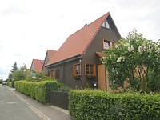Ebenso wie die benachbarten Straßen wurde die Golberoder Straße Ende der 1920er Jahre beim Bau der Wohnsiedlung auf der Leubnitzer Höhe angelegt. Der 1929 erstmals nachweisbare Name erinnert an den kleinen Ort Golberode, heute ein Ortsteil von Bannewitz.

Die Holzhäuser wurden zwischen 1927-1929 im Auftrag der Baugenossenschaft der Alkohol-und Tabakgegner eGmbH erbaut. Architekt der Gebäude war Oswin Hempel, die Ausführung oblag den [Deutschen Werkstätten Hellerau](../../../nord/hellerau/deutsche_werkstatten/).

Die ganz im Süden der Ortsflur verlaufende Gombsener Straße gehört zu den jüngsten Straßen des Stadtteils. Sie wurde erst
Ende der 1990er Jahre zur Erschließung eines kleinen Gewerbegebietes angelegt. Ihren Namen erhielt sie nach dem Dorf Gombsen, einem Ortsteil von Kreischa.

Die Goppelner Straße verbindet den Dorfkern von Altleubnitz mit dem zu Bannewitz gehörenden Ortsteil Goppeln. 1897 wird sie erstmals im Leubnitzer Adressbuch unter diesem Namen genannt, blieb jedoch zunächst unbebaut. Als erstes Wohnhaus entstand 1909 die Villa Goppelner Straße 2, die dem Baumeister Merzdorf gehörte. Merzdorf plante um 1910 sogar die Anlage eines Flugplatzes auf der Leubnitzer Höhe, was jedoch auf Ablehnung der Behörden stieß. Stattdessen schuf er eine ausgedehnte Gartenanlage mit Obstbäumen und Rosenstöcken, die weit über die Ortsgrenzen hinaus bekannt wurde.

Siedlung Leubnitzer Höhe: 1927/28 wurde auf dem Gelände eine Holzhaussiedlung errichtet, für die der Allgemeine Sächsische Siedlerverband und der “Bund der Tabakgegner” verantwortlich zeichneten. Die Siedler mussten sich verpflichten, auf Tabak- und Alkoholkonsum zu verzichten und eine gesunde Lebensweise zu praktizieren. Die Entwürfe für die 41 Gebäude stammten vom Dresdner Architekten Oswin Hempel, die Bauausführung oblag den Deutschen Werkstätten Hellerau. Erst 1958 endeten die vertraglich vereinbarten Genussmitteleinschränkungen für die Bewohner. Seit 1991 gehört die Siedlung zum Siedlerverein Dresden-Süd.

Pflastersteinfabrik Bruno Müller (Nr. 44): Das Unternehmen wurde 1873 vom Blasewitzer Baumeister Bruno Müller als Ziegelei gegründet und erhielt neben einem Wohn- und Geschäftshaus einen Ringbrennofen und mehrere Nebengebäude. Da die lokalen Rohstoffvorräte für die Produktion von Mauerziegeln ungeeignet waren, entschied sich Müller für die Herstellung künstlicher Pflastersteine. Ab 18. Juli 1901 firmierte der Betrieb offiziell als Pflastersteinfabrik Bruno Müller und stellte nach eigenem Patent "Granulitpflastersteine” her, die auf Straßen und Plätzen in Dresden und Umgebung verwendet wurden. 1904 übernahm Sohn Hermann Müller die Geschäftsleitung und wandelte den Betrieb 1908 in eine GmbH, zwei Jahre später in eine Aktiengesellschaft um (Deutsche Pflastersteinwerke AG). Trotz einiger Modernisierungen und dem Kauf einer weiteren Lehmgrube im benachbarten Gostritz stellte des Unternehmen zum Ende des Ersten Weltkrieges seine Produktion ein. Gründe waren vor allem die wirtschaftliche Entwicklung sowie ein Brand 1916, der einen Großteil der technischen Anlagen vernichtet hatte.

Der Hans-Otto-Weg wurde Mitte der 1980er Jahre im Neubaugebiet südlich der Dohnaer Straße angelegt und nach dem Schauspieler Hans Otto (1900-1933) benannt. Otto, ein Mitschüler Erich Kästners, gehörte ab 1924 der KPD an und war Vorsitzender der Berliner Sektion des Arbeiter-Theater-Bundes. 1933 wurde er von der SA verhaftet und aus dem Fenster einer Berliner SA-Kaserne gestürzt. Wenige Tage später verstarb er an seinen schweren Verletzungen.

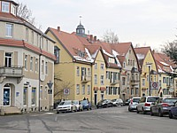Die Heiligenbornstraße verdankt ihren Namen, ebenso wie die benachbarte Brunnenstraße, dem sagenumwobenen [Heiligen Born](../../../sudost/leubnitz-neuostra/heiliger_born/), der bereits im Mittelalter als Wasserquelle genutzt wurde. Da an dieser Straße 1907 das neue Leubnitzer [Schulhaus](../../../sudost/leubnitz-neuostra/) errichtet worden war, wurde die Straße bis zur Eingemeindung Schulstraße genannt. Seit 1902 befand sich hier das Leubnitzer Wasserwerk, welches neben Leubnitz-Neuostra auch Torna und Reick versorgte (Nr. 17). 1910 entstand die Wohnhausgruppe Heiligenbornstraße 1-11 _(Foto)_ mit Kleinwohnungen. Bauherr war der Unternehmer Moritz Hegewald, die Planungen stammen vom Leubnitzer Architekten Adolf Rietschel.

Von 1911 bis zu seinem Tod am 5. März 1945 bewohnte der Kunstmaler und Graphiker Felix Elßner das Gebäude Nr. 11. Elßner schuf neben zahlreichen Postkartenmotiven verschiedene Illustrationen für den Dresdner Verlag Meinhold & Söhne. Außerdem stammen von ihm einige Bilder in der Leubnitzer Kirche. Zum Freundeskreis der Familie gehörte der Maler Otto Griebel, der 1918 als Kriegsheimkehrer für einige Wochen im Hause Elßners wohnte.

Ebenso wie die Heiligenbornstraße erhielt auch der Heiligenbornweg seinen Namen nach der nahegelegenen Quelle. Früher waren auch die Bezeichnungen Heiliger Brunnenweg bzw. Heiliger-Born-Weg gebräuchlich. Der Weg führt von Leubnitz aus durch das Tal des Leubnitzbaches und von dort steil ansteigendend bis hinauf zur Koloniestraße. Von Bedeutung ist er zudem als Zugang zu einer hier gelegenen Kleingartensparte.

Der Heimstattweg wurde Mitte der 1930er Jahre im Zusammenhang mit dem Bau eines kleinen Wohngebiet im Südosten von Leubnitz-Neuostra an der Flurgrenze zu Torna angelegt. Er erschließt das Viertel innerhalb des Tornaer Rings und ist 1937 erstmals im Adressbuch aufgeführt.

Die heutige Heinrich-Heine-Straße entstand Anfang der 1930er Jahre im Zusammenhang mt dem Bau einer neuen Wohnsiedlung oberhalb des Dorfkerns. Zunächst wurde sie ab 1934 Gorch-Fock-Straße genannt, wobei der durch seine Seefahrergeschichten bekannt gewordene norddeutsche Schriftsteller Gorch Fock (eigentlich Johann Wilhelm Kinau; 1880-1916) für die Benennung Pate stand. Wegen seiner Nähe zur nationalsozialistischen und kriegsverherrlichenden Ideologie entschloss man sich 1946 zur Umbenennung der Straße. Heinrich Heine (1797-1856) gehört zu den bekanntesten deutschen Dichtern der Romantik, war aber auch als kritischer Satiriker und Journalist tätig.

Der Heydenreichweg befindet sich im Leubnitzer Ortskern und verbindet Neuostra mit der Dohnaer Straße. Einst wurde der am Leubnitzbach entlang führende Fußweg als Dammweg bezeichnet. Die wenigen Gebäude waren der Leubnitzer Dorfstraße (Altleubnitz) zugeordnet und erhielten erst nach der Vereinigung von Leubnitz und Neuostra 1898 amtlich die Adresse Dammweg. Da es in der Neustadt bereits einen Dammweg gab, machte sich nach der Eingemeindung eine Umbenennung erforderlich. Seinen heutigen, 1926 eingeführten Namen verdankt der Weg dem Leubnitzer Ortchronisten Eduard Heydenreich (1852-1915).

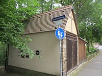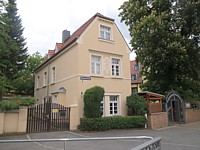

_**Fotos:** Der Heydenreichweg mit dem unter Denkmalschutz stehenden Wohnhaus Nr. 1_

Der Ende der 1930er Jahre angelegte Hochmannweg, eine Seitenstraße der Spitzwegstraße, wurde nach dem Dresdner Maler Franz Gustav Hochmann (1861-1935) benannt. Hochmann schuf vor allem Landschafts- und Tierdarstellungen und wohnte in Kleinzschachwitz.

Die Siedlung am Hohen Rand an der Kante des Elbtalhangs wurde nach dem Ersten Weltkrieg angelegt. Seit 1926 trägt die Sackgasse ihren Namen. Ab 1927 befand sich hier das “Höhen-Café”, welches zuletzt den Namen “Kästners Restaurant” trug. Als Besonderheit in der Dresdner Gastronomie wurden hier bis zur Schließung Gerichte der sogenannten Crossover-Küche” angeboten, z.B. Fleisch in Kombination mit Krustentieren.

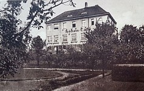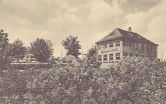

_**Fotos:** Historische Ansichten des Höhen-Cafés aus den 1930er Jahren_

Die Ingeborg-Bachmann-Straße entstand Ende der 1990er Jahre im Zusammenhang mit dem Wohngebiet Am Pfaffenberg südlich der Theodor-Storm-Straße. Benannt ist sie nach der österreichischen Schriftstellerin Ingeborg Bachmann (1926–1973), die als eine der bedeutendsten deutschsprachigen Autorinnen des 20. Jahrhunderts gilt.

Die Johannes-Paul-Thilman-Straße entstand in den 1980er Jahren im Zusammenhang mit der Bebauung der Freiflächen südlich der Dohnaer Straße. Benannt wurde die Straße nach dem Komponisten und Musikwissenschaftler Johannes Paul Thilman (1906-1973). Thilmann wirkte ab 1946 als Dozent an der Palucca-Schule und war ab 1956 Professor an der Dresdner Musikhochschule. Für seine Verdienst beim Wiederaufbau des Musiklebens der Stadt erhielt er 1960 den Martin-Andersen- Nexö-Kunstpreis.

Die Karl-Laux-Straße wurde Mitte der 80er Jahre im Zuge des Neubaugebietes Leubnitz südlich der Dohnaer Straße angelegt
und nach dem Musikkritiker Karl Laux (1896-1978) benannt. Ab 1934 arbeitete Laux als Kritiker für die “Dresdner Neuesten Nachrichten”, nach 1945 für die “Tägliche Rundschau”. Zwischen 1951 und 1962 war er Rektor der Musikhochschule.

An der nach dem Leubnitzer Nachbarort [Kauscha](../../../sudost/kauscha/) führenden Kauschaer Straße befand sich noch bis ins 19. Jahrhundert der Standort des Leubnitzer Galgens. Die ursprünglich zum Klostergut gehörige Richtstätte wurde nach dessen Auflösung vom Leubnitzer Ratsamt übernommen und 1619 erneuert. Noch 1821 wurde der Platz am Abzweig Kauschaer/ Goppelner Straße als Gerichtsplatz bzw. Galgenberg bezeichnet. 1839 wurde an dieser Stelle eine noch erhaltene und 2006 sanierte Wegsäule aufgestellt.

Unweit davon erinnert das Steinkreuz “Obere Marter” an eine Bluttat aus dem Jahre 1525. Damals erschlug der Goppelner Bauer Wenzel Hantsch seinen Nachbarn und musste zur Sühne neben einer Geldstrafe von 23 Schock 8 Groschen dieses Steinkreuz setzen lassen. Kreuz und Richtstätte gaben Anlass zur Sage vom gespenstigen Hund zu Leubnitz, der hier um Mitternacht den Wanderer verfolgt und nur durch Bekreuzigung in die Flucht geschlagen werden kann.

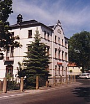
Der Klosterteichplatz erhielt seinen Namen nach dem einst hier gelegenen Teich, der zum Besitz des Klosterhofes gehörte und als Fischteich genutzt wurde. Nach dessen Verfüllung entstand ein kleiner
Platz, der sich zum “Zentrum” des Ortes entwickelte und vor dem Zweiten Weltkrieg Königsplatz genannt wurde.

1904 entstand hier das Leubnitzer Gemeindehaus _(Foto)_, welches neben Versammlungs- und
Verwaltungsräumen auch die Wohnung des Gemeindevorstandes beherbergte. Heute haben in dem Gebäude verschiedene öffentliche Einrichtungen ihren Sitz. Auf dem Platz wurde 1936 von
Leubnitzer Schülern eine Olympia-Gedenkeiche in Erinnerung an die im gleichen Jahr in Berlin veranstalteten Olympischen Spiele gepflanzt.

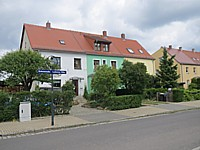Die Koloniestraße entstand 1934 auf der Leubnitzer Höhe. Für den Bau der Reihenhausanlage war der “Bund der Tabakgegner” verantwortlich. Bewohner waren meist junge kinderreiche Familien, die hier ihre Vorstellungen von gesunder Lebensweise ohne Tabak und Alkohol realisieren wollten. Beim Bau der Siedlung wurden mehrere Funde frühgeschichtlicher Keramik entdeckt. Die neu angelegten Straßen erhielten ihre Namen nach Orten der Umgebung bzw. geographischen Flurnamen. Weitere Gebäude wurden bis zum Beginn des Zweiten Weltkrieges durch den Dresdner Spar- und Bauverein und den Bauverein Gartenheim errichtet.

Der Kurt-Exner-Weg bildet den nördlichen Abschluss der Wohnsiedlung am Hohen Rand und verdankt seinen Namen dem
Dresdner Schriftsteller und Journalisten Ernst Kurt Exner (1904-1986). Benannt wurde der nur wenig begangene Weg am 1. Juli 1993.

Die Kurt-Liebmann-Straße wurde nach 1990 im Leubnitzer Wohngebiet am Pfaffenberg angelegt und nach dem Kunsthistoriker
und Schriftsteller Kurt Liebmann (1897-1981) benannt. In Dresden war er ab 1952 Kulturredakteur der “Sächsischen Zeitung“
und Dozent für Ästhetik an der Hochschule für Bildende Künste tätig und verfasste zahlreiche Schriften zu kunst- und kulturhistorischen Themen.

Die kurze Leiblstraße an der Ecke Teplitzer/ Gostritzer Straße entstand 1925 im Zusammenhang mit dem Bau einiger neuer
Wohnhäuser. Ihren Namen verdankt sie dem Maler Wilhelm Leibl (1844-1900), der zu den Hauptvertretern des bürgerlichen Realismus gehört und zahlreiche Darstellungen des Arbeitslebens der Bauern schuf.

Die bereits 1925 angelegte Wohngebietsstraße östlich der Gostritzer Straße wurde zwischen 1926 und 1927 mit einer
genossenschaftlichen Wohnsiedlung bebaut und ab 1929 Max-Klinger-Straße genannt. Max Klinger (1857-1920) gehört zu
den bedeutendsten deutschen Malern, Grafikern und Bildhauern seiner Zeit und schuf zahlreiche Gemälde und Plastiken. Einige seiner Werke befinden sich auch in der Dresdner Gemäldegalerie “Neue Meister”.

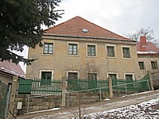
Die Menzelgasse gehört zu den Straßen im alten Dorfkern und führt unmittelbar an der [Leubnitzer Kirche](../../../sudost/leubnitz-neuostra/leubnitzer_kirche/)
vorbei. Ursprünglich befand sich hier die Kantorei, an deren Stelle 1868 das Schulhaus des Dorfes entstand. Dieses Gebäude wurde bis zum Schulneubau 1907 genutzt und beherbergt heute den Versammlungssaal der Kirchgemeinde.

Die Straße erhielt ihren Namen nach dem früheren Kantor und Schullehrer Karl August Menzel. Bis 1926 wurde sie Kirchgasse genannt. Unweit der Menzelgasse steht auch der
nach Beschädigungen 1813 wiederaufgebaute alte Pfarrhof von Leubnitz. _( **Foto:** Menzelgasse 1)_

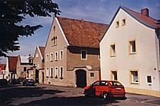Die Straße Neuostra (bis 1921 Ostrastraße) wurde 1569 auf Leubnitzer Flur für die nach hier umgesiedelten Bauern des ehemaligen Dorfes [Ostra](../../../zentrum/friedrichstadt/ostra/) angelegt. Nachdem diese ihre Höfe für die Anlage des Ostravorwerkes verlassen mussten, erhielten 11 Familien neues Land auf den ehemaligen Klosterhoffeldern in Leubnitz. Im Frühjahr 1559 verluden sie ihre gesamte Habe einschließlich der hölzernen Gebäude auf Fuhrwerke und bauten sie am neuen Standort wieder auf. 1569 wurden die “Neuen Vorwerksgüter” zum selbstständigen Dorf erhoben, welches den Namen Neuostra erhielt und erst 1898 mit Leubnitz vereinigt wurde. Bis heute sind die zu beiden Seiten der breiten Dorfstraße angelegten Güter erhalten. An einigen Häusern erinnern Schrifttafeln an frühere Besitzer.

Nr. 16: Das im 18. Jahrhundert in heutiger Form entstandene Wohnhaus befand sich einst im Besitz der Familie Günther, an die noch eine an der Fassade befindliche Inschriftstafel mit “Haussegen” erinnert:

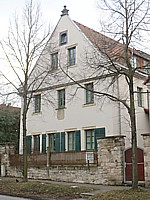

_Gott sey gedanckt für seine Gnade_

_Der diesen Bau ohn allem Schade_

_Anfangen lassen und vollenden_

_Er wolle fernerhin abwenden_

_Krieg, Hunger, Feuer, Waßers Noth_

_Auch Pestilenz und schnellen Todt_

_Samuel Günther Anno 1783_

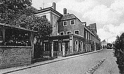Müllers Gasthaus: Der alte Dorfgasthof von Neuostra an der Ecke zur Spitzwegstraße war vor dem Ersten Weltkrieg neben der Klosterschänke beliebteste Einkehrstätte im Ort und wurde vor allem an den Wochenenden auch von den Dresdnern gern besucht. Nach der Inhaberfamilie wurde der Gasthof auch als Hähnels, ab 1898 als Müllers Gasthaus bezeichnet. Das Lokal besaß einen großen Gästegarten sowie einen Tanzsaal im Obergeschoss, der in Anzeigen als "schönster Saal der Umgebung" bezeichnet wurde. Regelmäßig fanden Schul- und Schlachtfeste, Theaterabende, Gartenkonzerte und andere Vergnügungen statt.

1945 waren im Saal sowjetische Soldaten untergebracht, die hier eine Sammelstelle für Kunstgüter einrichteten, die zuvor aus Villen und Schlössern der Umgebung beschlagnahmt worden waren. Nach seiner Schließung wurde das Gebäude noch viele Jahre von der Steppdeckenfabrik Röthing genutzt und am 3. Mai 1984 gesprengt. 1999 entstand auf dem Grundstück ein Neubau mit Läden und Wohnungen.

Der Otto-Reinhold-Weg wurde in den 1980er Jahren beim Bau des Neubaugebietes an der Dohnaer Straße angelegt. Benannt wurde er nach dem Komponisten und Musikpädagogen Otto Reinhold (1899-1965). Reinhold, gelernter Volksschullehrer, schuf in den 1950er Jahren zahlreiche musikdramatische Werke, u.a. das am 2. November 1958 in Dresden uraufgeführte Werk "Die Nachtigall". Für sein Wirken erhielt er 1962 den Martin-Andersen-Nexö-Kunstpreis der Stadt verliehen.

Die Ricarda-Huch-Straße wurde nach 1990 im Zusammenhang mit dem Bau einer kleinen Wohnsiedlung südlich des Leubnitzer
Dorfkerns angelegt. Mit der Namensgebung wird an die deutsche Erzählerin und Kunsthistorikerin Ricarda Huch (1864-1947) erinnert, die zahlreiche historische Romana, Essays und Erzählungen verfasste.

Die Rembrandtstraße entstand 1911 als Verbindung zwischen Uhde- und Wilhelm-Franke-Straße und trug ursprünglich den
Namen Kronprinzenstraße. Vermutlich verdankte sie diesen einem Besuch des sächsischen Kronprinzen im Haus des Porträtmalers Böhringer, welcher an der Uhde-/ Ecke Rembrandtstraße ein Wohn- und Atelierhaus besaß. Nach der
Eingemeindung von Leubnitz wurde die Straße in Rembrandstraße umbenannt. Rembrandt van Rijn (1606-1669) gehört zu den
bedeutendsten Malern der Kunstgeschichte und schuf zahlreiche Gemälde und Radierungen, von denen sich einige auch in der Dresdner Gemäldegalerie befinden.

Die Mehrfamilienhäuser an der Robert-Sterl-Straße entstanden ab 1935 für die Eisenbahner-Wohnungsbaugenossenschaft. Drei
Gebäude fielen 1945 den Bomben zum Opfer, konnten jedoch bis 1955 wieder aufgebaut werden. 1978-1981 wurden die
verbliebenen Freiflächen zwischen Robert-Sterl- und Zschertnitzer Straße mit Plattenbaublocks bebaut. Ihren Namen erhielt die
Straße nach dem Maler Robert Sterl (1867-1932), der zu den bekanntesten deutschen Impressionisten gehört und viele Jahre an der Dresdner Kunstakademie wirkte.

Der Name Schilfteichstraße erinnert an einen heute verschwundenen Teich, der zu den Besitzungen des Klosterhofes diente und
zur Fischzucht genutzt wurde. Bis zur Eingemeindung wurde die Straße nach den hier gelegenen Gärtnereien Gartenstraße genannt. Kurz vor dem Ersten Weltkrieg entstanden die ersten Wohnhäuser.

Die Schmalwiesenstraße, benannt nach einer Flurbezeichnung, wurde 1928 beim Bau einer kleinen Wohnanlage der
Heimstätten-Genossenschaft Dresden-Reick angelegt. In diesem Zusammenhang entstand auch das Wohn- und Geschäftshaus Wilhelm-Franke-Straße 29/29a mit einer Verkaufsstelle des Konsum-Vereins “Vorwärts”.

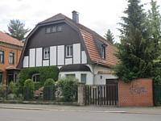Die heutige Spitzwegstraße trug ursprünglich den Namen Mockritzer Straße und wurde nach dem Ersten Weltkrieg nach dem Maler der Romantik Carl Spitzweg (1808-1885) benannt. Die ersten Wohnhäuser entstanden kurz vor dem Ersten Weltkrieg _( **Foto:** Spitzwegstraße 56)_. Bauherr der landhausartigen Villen war die Architektengemeinschaft Rose & Röhle. Max Rose, Mitinhaber des Büros, errichtete hier auch sein eigenes Wohnhaus. 1935-37 folgte eine kleine Wohnanlage des Bauvereins Gartenheim mit 104 Wohnungen, mit welcher die 1917 gegründete Genossenschaft ihre Bautätigkeit in Dresden abschloss. Seit 2016 erinnert vor der Kaufhalle eine vom Bildhauer Hans Kazzer geschaffene Bronzefigur an den Namensgeber der Straße. Die nach einem Motiv von Spitzweg gestaltete Figur "Zeitungsleser" wurde am 4. Februar 2016 eingeweiht.

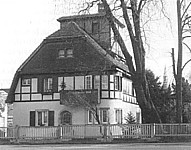Nr. 60: Im Wohnhaus Spitzwegstraße 60 lebte viele Jahre der Generalintendant der Staatsoper Alfred Reucker. Reucker hatte das bereits 1910 errichtete Haus 1928 erworben und als Wohnung und für sein Theaterarchiv ausgebaut. Fortan war das Haus bis zu Reuckers Tod 1958 ein beliebter Treffpunkt Dresdner Theaterleute. 1999 wurden große Teile seines Nachlasses bei einem Brand im Gebäude vernichtet. Im Garten der Villa befindet sich das Grab Alfred Reuckers und seiner Frau sowie seiner Mutter. Die von Edmund Moeller geschaffene Grabstele wird von einer Plastik des “Faust” gekrönt und trägt außerdem die Worte “Schon wieder Krieg, der Kluge hat´s nicht gern”.

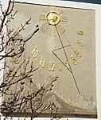
Die Thomas-Mann-Straße geht auf einen alten Fußweg nach Torna zurück. Ende der 1920er Jahre entstanden hier die ersten Siedlungshäuser. Bis 1955 wurde die Straße Dietrich-Eckart-Straße
genannt. Dietrich Eckart (1868-1923) gehörte als Verleger, Schriftsteller und Publizist zu den Mitbegründern der NSDAP und gilt als einer der geistigen Wegbereiter des Nationalsozialismus. Ihren
jetzigen Namen erhielt die Straße nach dem bekannten Schriftsteller Thomas Mann (1875-1955), der zu den wichtigsten Vertretern des kritischen Realismus in der Literatur gehört.

**_Foto:_** _Sonnenuhr am Wohnhaus Thomas-Mann-Straße 43_

Die Uhdestraße wurde als Lindenstraße kurz vor dem Ersten Weltkrieg angelegt und mit Mehrfamilienhäusern bebaut.. Ihren
jetzigen Namen erhielt sie nach dem Maler Fritz von Uhde (1848-1911), der vor allem sozialkritisch-religiöse Gemälde schuf.

Nr. 5:
Die Villa entstand 1910 als Wohnhaus der Familie Böhringer. Konrad Immanuel Böhringer, Königlich-Sächsischer Hofrat, war ein bekannter Porträtmaler seiner Zeit und unterhielt enge Beziehungen zum Königshaus. Sein in der Villa
befindliches Atelier diente auch als Ausstellungsraum. Sohn Konrad sen. und Enkel Konrad jun. erwarben sich später
Verdienste als Fachärzte für Chirurgie und Urologie und besaßen bis 1960 auf der Caspar-David-Friedrich-Straße 15 eine
private Klinik. Das Haus Uhdestraße 5 wurde 1945 schwer beschädigt und danach stark verändert wieder aufgebaut. An der Fassade erinnert ein Wappen an die früheren Besitzer.

Die an der Ortsgrenze zwischen Leubnitz und Mockritz verlaufende Wilhelm-Busch-Straße hieß früher Carolastraße und war ab
1922 Standort der Gärtnerei Dube, die noch bis 1969 in Betrieb war. 1926 wurde die Straße nach dem Zeichner Wilhelm
Busch (1832-1908) benannt, der durch seine satirischen Bildgeschichten (“Max und Moritz”, “Fips, der Affe”) bekannt wurde. 1976 entstanden an der Wilhelm-Busch-Straße einige Neubauten.

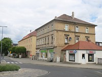Die heutige Wilhelm-Franke-Straße war einst Teil der wichtigen Fernverbindung nach Böhmen, die über Strehlen und Leubnitz verlief und in der Nähe der Spitzwegstraße ostwärts abbog. Da sie zugleich als Weg der Leubnitzer Bauern nach Dresden diente, wurde sie ursprünglich Dresdner Straße, ab 1927 Finckenfangstraße genannt. Namensgeber war eine Anhöhe bei Maxen, auf der während einer Schlacht des Siebenjährigen Krieges 1759 der preußische General von Finck in Gefangenschaft geriet.

Ende des 19. Jahrhunderts erfolgte eine Verlagerung des Fernverkehrs von der Dresdner auf die Dohnaer Straße (heutige B172). Daraufhin ließ der Leubnitzer Gemeindevorstand 1896 Gleise verlegen, um den Ort an das Dresdner Straßenbahnnetz anzuschließen. Am 16. November 1902 verkehrte die erste Bahn von Strehlen kommend bis zum damaligen Carolaplatz vor dem “Edelweiߔ. 1974 wurde die Strecke stillgelegt und durch eine Buslinie ersetzt.

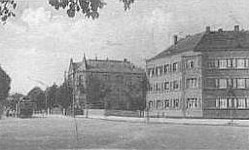Der [Gasthof “Edelweiߔ](../../../sudost/leubnitz-neuostra/page14822/edelweiss/) war bereits 1882 eröffnet worden und entwickelte sich schnell zu einem beliebten Ausflugs- und Vergnügungslokal. Die Gaststätte blieb noch bis 1982 geöffnet, verfiel jedoch danach zur Ruine. Ein Umbau zum Wohnhaus erfolgte ab 2010. Weitere Wohngebäude entstanden bis zum Ersten Weltkrieg. 1912 wurde der obere Teil der Dresdner Straße als Ortsumgehung und Verbindung zur Leubnitzer Höhe ausgebaut. Dieser steil ansteigende und kurvenreiche Abschnitt hieß früher Terrassenstraße. Um 1912 baute man hier die ersten Siedlungshäuser der sogenannten “Südostkolonie” mit dem beliebten Café “Hoher Rand”. Der Abschluss der Bebauung im nördlichen Teil erfolgte um 1935 mit dem Bau der Siedlung Finckenfang-, Dohnaer und Teplitzer Straße _(Foto)_.

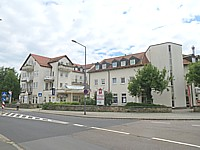Nach 1945 wurde die Finckenfangstraße in Wilhelm-Franke-Straße umbenannt. Wilhelm Franke (1891-1945) arbeitete bis 1933 als Lehrer an der Leubnitzer Schule und gehörte als Stadtverordneter der SPD viele Jahre dem Dresdner Stadtrat an. 1945 kam er beim Bombenangriff in seiner Wohnung ums Leben. Auf dem Gelände einer früheren Gärtnerei gegenüber dem “Edelweiߔ entstand 1995/97 das moderne Einkaufszentrum “Leubnitz-Passagen” _(Foto)_. Unweit davon erinnert die mit historischen Militärrequisiten ausgestattete Gaststätte “Zum General von Finck” an den früheren Namenspatron dieser Straße (Nr. 16).

Die Wittenstraße entstand 1936 im Zusammenhang mit einer Mehrfamilienhaus-Wohnanlage der Eisenbahner-
Wohnungsbaugenossenschaft. Der Name erinnert an den Bildhauer Hans Witten, der u. a. die berühmte Tulpenkanzel im Freiberger Dom schuf.

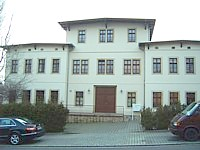
Die Zschertnitzer Straße verbindet die Stadtteile Leubnitz und Zschertnitz und überquert dabei den Kaitzbach auf einer mehrfach erneuerten Brücke. Neben Wohnhäusern aus der
Zeit nach 1900 befanden sich hier noch bis 1974 die beiden Gärtnereien Schleinitz und Schönert. 1975 wurden diese Grundstücke mit Neubaublocks des Gebietes Clausen-Dahl-
Straße bebaut. Gleichzeitig wurde auf früherem Ziegeleigelände an der Zschertnitzer Ortsgrenze das Seniorenheim “Olga Körner” seiner Bestimmung übergeben. Weitere
Neubauten entstanden 1999, wobei auch ein viele Jahre vom VEB PUROTEX genutztes historisches Lagerhaus in die Neugestaltung einbezogen wurde _(Foto)_.

[Leubnitz-Neuostra auf OpenStreetMap](https://www.openstreetmap.org/search?query=Dresden+Leubnitz-Neuostra)

* * *

 \[ [Home](../../../index.html)\] \[ [Nord](../../../nord/)\] \[ [Nordwest](../../../nordwest/)\] \[ [Neustadt](../../../neustadt/)\] \[ [Nordost](../../../nordost/)\] \[ [West](../../../west/)\] \[ [Zentrum](../../../zentrum/)\] \[ [Südwest](../../../sudwest/)\] \[ [Süd](../../../sud/)\] \[ [Südost](../../../sudost/)\] \[ [Ost](../../../ost/)\] \[ [Register](../../../Register/register.html)\] \[ [Kontakt](../../../Kontakt/kontakt.html)\] \[ [Impressum](../../../impressum/)\]
