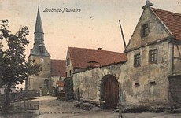
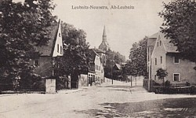
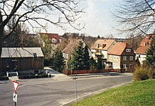
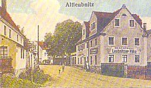
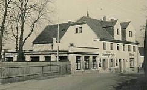
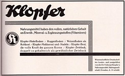

* * *

* * *

Altleubnitz bildet den Dorfkern des früheren Bauerndorfes und besitzt zahlreiche historische Bauerngüter, die heute unter Denkmalschutz stehen. Bemerkenswert sind der frühere Pfarrhof (Nr. 1) aus dem 16. Jahrhundert sowie die Dreiseithöfe Altleubnitz Nr. 9, 11, 31 und 38 mit beeindruckenden Toranlagen. Neben diesen Bauernhöfen sind auch einige Häusleranwesen erhalten, die noch gut die ehemalige soziale Struktur des Dorfes verdeutlichen. Im Haus Nr. 2 befand sich früher die Dorfschmiede (erbaut 1717) und im Gebäude Nr. 14 die einstige Mühle. Wichtigstes historisches Gebäude ist jedoch das 1994 nach historischem Vorbild wiederaufgebaute “Steinerne Haus” des ehemaligen [Klosterhofes](../../../../sudost/leubnitz-neuostra/klosterhof/) (Nr. 12). Heute wird es als Hotel mit öffentlicher Gaststätte genutzt. Eine weitere historische Gaststätte mit über 100-jähriger Geschichte befindet sich mit der “Leubnitzer Höhe” in Altleubnitz Nr. 32.

Ursprünglich wurde die im alten Ortskern verlaufende Straße Dorfstraße genannt. Nach dem Zusammenschluss von Leubnitz und Neuostra erfolgte 1898 die Umbenennung in Leubnitzer Straße. Seit 1926 ist die Straße unter dem heutigen Namen Altleubnitz in den Stadtplänen verzeichnet.

**_Bilder:_** _Altleubnitz um 1930 und 2015_

Einzelne Gebäude:

Leubnitzer Höhe (Nr. 32): Die Gaststätte oberhalb des Leubnitzer Dorfkerns wurde 1898 eröffnet und warb bereits vor dem Ersten Weltkrieg mit ihrem "schattigen Garten und Kegelbahn" um Gäste. Beliebt war und ist sie auch für Familienfeiern. Besitzer war zunächst Heinrich Lichtenberger, später Ewald Zimmermann. Bis heute befindet sich das Lokal in Familienbesitz und besitzt neben den Gasträumen auch einige Hotelzimmer.

**_Bilder:_** _Die Leubnitzer Höhe um 1900 und 1935_

Nr. 36: An der Hauswand dieses historischen Leubnitzer Bauerngutes befindet sich eine Schrifttafel, welche auf die Bauzeit des Gutes um 1630 hinweist: “ _Der Herr bewahre Deinen Eingang unnd Ausgang von nun an bis in Ewigkeit. Jos. Gof. Riger den 26. Mai 1631”._

Chemisches Werk Dr. Klopfer (Nr. 39):
Das ehemalige Bauerngut Altleubnitz 39 wurde 1930 vom früheren Besitzer des [Nahrungsmittelwerkes Dr. Klopfer](../../../../sudost/strehlen/strassen_strehlen/dohnaer_strasse/) erworben und für dessen Chemische Fabrik genutzt. Dr. Volkmar Klopfer hatte um 1900 auf der Dohnaer Straße 103 einen Betrieb zur Herstellung von Weizenmehlprodukten nach einem von ihm entwickelten Trennverfahren gegründet, schied jedoch nach Umwandlung dieses Werkes in eine Aktiengesellschaft 1924 aus. Bereits am 20. Dezember 1924 ließ er seine neue Firma Chemisches Werk Dr. Klopfer GmbH im Handelsregister eintragen. Zunächst nutzte diese einige Nebengebäude des Nahrungsmittelwerkes, verlegte jedoch nach Kündigung des Mietvertrages ihren Sitz 1930 nach Altleubnitz.

Nach Plänen des Gostritzer Baumeisters Hermann Richter entstanden hier einige an die dörfliche Bebauung angepasste Gebäude, in welchen ab 1931 Vitaminpräparate, Tabletten, Tropfen, Jod- und Schwefelpräparate hergestellt wurden. Die dafür notwendigen Rohstoffe stammten zum Teil aus den werkseigenen Anpflanzungen von Ebereschen und Hagebutten direkt am Betriebsgelände. Vermarktet wurden die Produkte unter dem Namen Bryonon-Klopfer bzw. Diasporal. Bis zu seinem Tod am 9. April 1943 wurde der Betrieb von Dr. Klopfer selbst geleitet, danach übernahmen einige Angestellte das Werk. Nach 1945 erfolgte eine Verstaatlichung der Dr. Klopfer GmbH und die Zusammenlegung mit anderen pharmazeutischen Betrieben zum VEB Pharmaka. Ab 1974 gehörte er zum pharmazeutischen Betrieb Apogepha. Erst nach 1990 wurde die Produktion in Leubnitz eingestellt und der Gebäudekomplex zu Wohnungen und Geschäftsräumen umgebaut (heute Thomas-Mann-Straße 10)

Wettin-Denkmal:
Der steinerne Obelisk in Form eines Eichenstammes wurde aus Anlass des 800. Jubiläums des Hauses Wettin 1889 an der Menzelgasse / Altleubnitz aufgestellt. Mit dem Denkmal sollte die enge Verbundenheit der Leubnitzer
Bewohner mit dem regierenden Königshaus dokumentiert werden. Das aus Sandstein geschaffene Monument war
ursprünglich mit einer Bronzetafel und einer Einfassung versehen. Außerdem pflanzte man unmittelbar neben dem Denkmal eine Eiche, Symbol für das hohe Alter des Fürstengeschlechts.

* * *

 \[ [Home](../../../../index.html)\] \[ [Nord](../../../../nord/)\] \[ [Nordwest](../../../../nordwest/)\] \[ [Neustadt](../../../../neustadt/)\] \[ [Nordost](../../../../nordost/)\] \[ [West](../../../../west/)\] \[ [Zentrum](../../../../zentrum/)\] \[ [Südwest](../../../../sudwest/)\] \[ [Süd](../../../../sud/)\] \[ [Südost](../../../../sudost/)\] \[ [Ost](../../../../ost/)\] \[ [Register](../../../../Register/register.html)\] \[ [Kontakt](../../../../Kontakt/kontakt.html)\] \[ [Impressum](../../../../impressum/)\]
