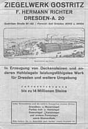
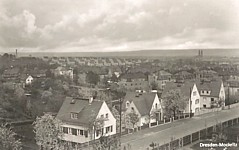
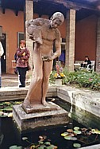
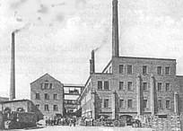
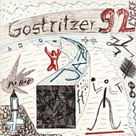

* * *

* * *

* * *

_Historische Firmenwerbung_

Die Gostritzer Straße verbindet Strehlen und Leubnitz mit dem Nachbarort Gostritz und nimmt ihren Ausgangspunkt an der Teplitzer Straße. Historisch geht sie auf einen alten Verbindungsweg von Strehlen über Gostritz nach Mockritz und weiter nach Nöthnitz zurück. Der zum Teil auf Strehlener, zum Teil auf Mockritzer Flur gelegene untere Abschnitt bis zur Boderitzer Straße trug von 1906 bis 1926 den Namen Strehlener Straße. Heute werden diese Häuser meist zu Leubnitz gerechnet. Der südlich gelegene Straßenabschnitt wurde hingegen zur Lessingstraße (heute Eutschützer Straße) gezählt. In Gostritz hatte die Straße keinen Namen. Im Zusammenhang mit der Eingemeindung von Leubnitz-Neuostra, Mockritz und Gostritz erhielt der komplette Straßenzug 1926 den Namen Gostritzer Straße. Gleichzeitig wurden alle Häuser, beginnend an der Teplitzer Straße neu nummeriert.

Im unteren Straßenteil dominieren Villen und Landhäuser, die meist nach der Jahrhundertwende 1900 entstanden. An der Einmündung der Zschertnitzer Straße befand sich noch bis in jüngste Vergangenheit ein von der Leubnitzer Wasserleitung gespeister Trinkbrunnen. Die bei Straßenbauarbeiten beseitigte Anlage soll jedoch rekonstruiert und an einem neuen Standort wieder aufgestellt werden.

Einzelne Gebäude:

Atelier Edmund Moellers: Im Haus Gostritzer Straße 10 hatte bis zu seinem Tod am 19. Januar 1958 der Bildhauer Edmund Moeller sein Atelier. Das Atelierhaus entstand 1927/28 und wurde von Moeller mit seinem Preisgeld für das Nationaldenkmal in Trujillo (Peru) finanziert. Nach seinem Tod übernahm die Künstlergenossenschaft “Kunst am Bau” das Haus. Bis heute nutzen Maler, Bildhauer, Architekten und Restauratoren das Grundstück für Ateliers und Ausstellungsräume.

Im Garten des Hauses sind einige Plastiken Edmund Moellers erhalten geblieben, darunter die Statue “Das Echo”, für welche er 1926 einen Preis der Internationalen Gartenbau- und Kunstausstellung in Dresden erhalten hatte. Bemerkenswert ist auch ein in den Zwanziger Jahren geschaffener Brunnen mit Darstellung eines Silens _(Foto)_, der in der griechischen Mythologie als Waldgott ein Begleiter des Dionysos war. Eine gleichartige Plastik hatte Moeller bereits 1912 für die Große Kunstausstellung in Dresden geschaffen. Ursprünglich sollte sie Teil eines Brunnens am Albertinum werden, was jedoch aus Kostengründen nicht zustande kam. Die später zum Bestand der Skulpturensammlung gehörende Bronzefigur befindet sich heute im Garten des Fachkrankenhauses Coswig.

Nach Verlassen der Leubnitzer Ortsflur führt die Gostritzer Straße weiter zum alten Dorfkern von [Gostritz](../../../../sudost/gostritz/). Die Flächen wurden bis in jüngere Vergangenheit meist landwirtschaftlich genutzt bzw. dienten als Betriebsgelände der Gostritzer Ziegelei. An der Ecke zur Rosentitzer Straße (Nr. 75) befand sich von 1897 bis 1921 das Gostritzer Schulhaus.

Ziegelwerk Gostritz (Nr. 61-63): Die Gostritzer Ziegelei wurde 1894 vom Baumeister Hermann Richter gegründet und gehörte seinerzeit zu den größten und modernsten in Dresden. Nach teilweiser Zerstörung durch einen Brand entstand sie 1900 neu und blieb bis 1953 in Familienbesitz. Hergestellt wurden sowohl Dach- und Mauerziegel, aber auch Blumentöpfe für die zahlreichen Gärtnereien der Umgebung. Das Ziegelwerk besaß zwei Ringöfen, ein Pressenhaus, Verwaltungsgebäude und eine große Lehmgrube, die unmittelbar an das Werksgelände angrenzte.

Als eines der wenigen Ziegelwerke blieb die Gostritzer Ziegelei auch während des Zweiten Weltkrieges in Betrieb, wobei hier Zwangsarbeiter aus verschiedenen Ländern eingesetzt waren. Die Fabrikantenvilla diente 1945 zeitweise als sowjetische Ortskommandantur. Um den Wiederaufbau zu forcieren, wurde bereits 1945 mit der Herstellung von Dachziegeln begonnen. Außerdem war die Ziegelei Richter einige Jahre Endstation einer Trümmerbahn, mit deren Hilfe Schutt aus den zerstörten Stadtvierteln in die Lehmgrube transportiert werden konnte. 1953 übersiedelten die Besitzer in die Bundesrepublik, woraufhin der Betrieb Teil des VEB (K) Ziegelwerke Dresden und zugleich deren Verwaltungssitz wurde.

In den 1960er Jahren wurde die Ziegelei nochmals modernisiert und 1961 auf Ölfeuerung umgestellt. Nach Erschöpfung der Lehmvorkommen und wegen Mangel an Brennöls endete 1978 die Ziegelproduktion. Zuletzt wurden die Gebäude als Baustützpunkt und Lager der Gebäudeverwaltung Dresden genutzt. 1993 entstand auf dem Gelände ein Technologiezentrum. Erhalten blieben die frühere Villa mit einigen Nebengebäuden sowie die hohe Esse, die als technisches Denkmal an die Ziegelherstellung im Dresdner Südraum erinnert. Die nach 1945 zum Großteil verfüllte Lehmgrube wurde 1996 als Naturdenkmal “Alte Ziegelei Gostritz” unter Schutz gestellt.

Nr. 95: Die unter Denkmalschutz stehenden Villa entstand 1895. Im Hintergebäude bezog 1977 der unter dem Namen A. R. Penck bekannt gewordene Maler, Grafiker und Musiker Ralf Winkler (1939-2017) sein Atelier. Zwei Jahre später veröffentlichte er die mit einigen Künstlerkollegen aufgenommen LP "Gostritzer 92", bevor er ein Jahr später in die Bundesrepublik übersiedelte _(Bild: Plattencover von A. R. Penck)_. 2010 wurde das Haus verkauft und bis 2014 saniert. Dabei konnten auch einige Zeichnungen Pencks geborgen werden.

* * *

 \[ [Home](../../../../index.html)\] \[ [Nord](../../../../nord/)\] \[ [Nordwest](../../../../nordwest/)\] \[ [Neustadt](../../../../neustadt/)\] \[ [Nordost](../../../../nordost/)\] \[ [West](../../../../west/)\] \[ [Zentrum](../../../../zentrum/)\] \[ [Südwest](../../../../sudwest/)\] \[ [Süd](../../../../sud/)\] \[ [Südost](../../../../sudost/)\] \[ [Ost](../../../../ost/)\] \[ [Register](../../../../Register/register.html)\] \[ [Kontakt](../../../../Kontakt/kontakt.html)\] \[ [Impressum](../../../../impressum/)\]
